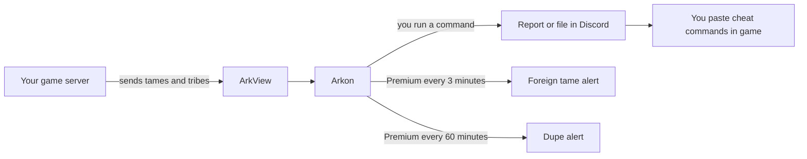

# Anti-Cheat: Dupes, Mass Breeding and Foreign Tames

Arkon can look through your server's tames and tribes and point out cheating or abuse. It finds duplicated dinos, mass breeding pens, dinos brought in from other servers, and tribes that have been gone for weeks.

Most of these checks only **report**. You decide what to do with the result. Arkon never wipes anything on its own. The wipe commands hand you a text file that you paste into the game yourself.

**You need:**

- Arkon in your Discord and at least one server connected ([Getting Started](/guides/getting-started)).
- 🔹 ArkView set up on each server you want to check. ArkView is the small helper program that sends your server's tames and tribes to Arkon. See [ArkView setup](/guides/arkview). Only `finddbtribe` works without it.
- Admin or Mod roles set in Red, the bot framework Arkon is built on ([Getting Started](/guides/getting-started) shows how). In short: **Admin** = people trusted with all settings, **Mod** = helpers with day-to-day tools.
- Arkon able to **Embed Links** and **Attach Files** in the channel you use. Many results come back as `.txt` files.

> Commands in this guide use the default prefix `+`. None of them are slash commands.
{.is-info}

## The big picture

Two checks can also run by themselves on **Premium** servers (see [Premium](/guides/premium)). Everything else you run by hand.

## Which command do I use?

| I want to find... | Use | Needs ArkView |
|---|---|---|
| The same tame copied many times | `+tamedupes` | Yes |
| Mass breeding pens | `+checkmassbreed` | Yes |
| Tames from servers that are not yours | `+scanforeigntames` | Yes |
| Tames with too many stat points | `+tamestatcheck` | Yes |
| Tribes with too many tames outside cryopods | `+uncryocheck` | Yes |
| Tribes that went inactive | `+findexpired` and `+wipetribes` | Yes |
| A tribe or its members in Arkon's own records | `+finddbtribe` | No |

## How the server picker works

Several commands ask you to pick one server first. You will see a menu called **Select a Server**.

Open the dropdown, click your server, and wait for "One moment...". The result replaces the menu. The red button closes it. The menu goes away by itself after 2 minutes.

If you see "There are no servers to select!", you have no enabled servers yet. Go to [Server Settings](/guides/server-settings).

## Part 1: Protect against foreign tames

A foreign tame is a dino that was tamed on a server that is **not on your list**. Players bring them in to cheat. You give Arkon a list of your own server names, and it flags everything else.

### Set it up

1. In any Discord channel Arkon can see, tell Arkon which servers are yours. Type:
   `+setvalidservers Island, Ragnarok, Center`
   Use the names your tames carry as their "tamed on" server. Arkon replies "Valid server names set to:" and lists them.
2. Check the list. Type `+showvalidservers`. You should see your names. If not, you see "There are no valid server names set!".
3. Pick the channel for alerts. Type:
   `+arkset alertchannel #alerts`
   If you skip this, alerts go to your event log channel.
4. **Test it first.** Type `+scanforeigntames`. This only reports, it never bans anyone.
5. Check it worked: Arkon says "Scanning for foreign tames..." and then changes that message to `N foreign tames found!` with a file `foreign_tames.txt`. Or you see "No foreign tames found!".

> Names are matched as **pieces of text**, not whole words, and ignore capital letters. `island` also matches "My Island 2". Use distinctive names. This also lets a short map name match the long name Ascended servers use.
{.is-warning}

> On a Premium server, a wrong list causes real bans on the next 3-minute scan. Always run `+scanforeigntames` first and read the file.
{.is-danger}

### What happens automatically (Premium)

Every 3 minutes, on Premium servers that have a valid list, Arkon scans all enabled ArkView servers by itself. When it finds a foreign tame it:

- Adds the tribe members' game IDs to Arkon's ban list, with the reason "Foreign Tame Scan AutoBan". This is the bot's ban list only. It does not ban them from your Discord. See [Moderation](/guides/moderation) for the ban tools.
- Posts an alert in your alert channel, mentioning your admin roles and the server owner.
- Posts a confirmation message for tames that are out of cryopods (below).

A finding Arkon already reported is not posted again until the bot restarts. If the list is empty, the automatic check does nothing.

Some creatures that are normal to move around (for example bee queens, salmon and trilobites) are skipped on purpose.

**The confirmation buttons.** For foreign tames that are not in a cryopod and not uploaded, Arkon asks an admin before destroying them:

- **Wipe Dinos Now!** destroys the dinos through RCON (the remote-control connection Arkon uses to send commands to your server).
- **Ignore** leaves them alone.
- Only admins can press them. Anyone else sees "Only admins can respond to this."
- After 4 hours with no answer the buttons stop working. Nothing is destroyed, and Arkon asks again on the next scan.

## Part 2: Find duplicated tames

A duped (duplicated) tame shows up as several tames in one tribe with the **same dino ID**. Arkon counts them.

1. In a Discord channel Arkon can see, type:
   `+tamedupes all all 3`
2. Check it worked: Arkon replies "**N Duplicate Tame Entries Found**" with one line per tribe, or "No duplicates found!".

Only tames that have been imprinted at least a little (imprint above zero) are counted. If a server is slow to answer (over 5 seconds) it is silently left out.

**Automatic (Premium):** every 60 minutes Arkon checks all servers and posts "Found N potential duped tame(s)!" when a tribe holds **more than 3** tames with the same dino ID. It only posts an alert. It never bans or deletes.

## Part 3: Find mass breeding

Mass breeding is a big pen of mating dinos crammed in one spot. Arkon groups mating dinos of the same species that stand close together.

1. Type: `+checkmassbreed` (also works as `+massbreed`).
2. Pick your server in the menu.
3. Check it worked: red pages, one per tribe, plus a map picture marking each pen. Use the page buttons to move through them.

You can change how strict it is:

`+checkmassbreed [threshold] [min_dinos]`

- `threshold`: how close dinos must be to count as one pen, in map coordinates. Default `0.5`.
- `min_dinos`: how many mating dinos make a pen. Default `6`.

Example: `+checkmassbreed 0.3 8` finds only tighter, bigger pens.

A pen only counts if it has at least one male and one female. Dinos in cryopods, uploaded dinos and dinos that are not mating are ignored.

## Part 4: Check stat points

Find tames with a lot of points in one stat.

`+tamestatcheck <stat> <points> [stat_type]`

- `stat`: one of `hp`, `stam`, `melee`, `weight`, `speed`, `food`, `oxy`.
- `points`: the number to beat.
- `stat_type`: `wild` or `tamed`. Default is `tamed`.

Example: `+tamestatcheck melee 40` lists tames with more than 40 tamed melee points. Then pick your server.

> The match is **strictly more than** your number. `40` does not list a tame with exactly 40.
{.is-warning}

Check it worked: a message "Found N tames..." with a `tamestatcheck.txt` file, or "No results found!".

## Part 5: Limit uncryo'd tames

"Uncryo'd" means tames that are out in the world, not stored in cryopods. Too many hurt server performance.

### Set a limit (warnings)

1. Type: `+arkset uncryolimit 150 "My Cluster"`
   Use your own cluster name. A limit of `0` turns it off.
2. Check it worked: Arkon replies "Tribe tame limit set to 150 for My Cluster!".

Every 10 minutes Arkon checks your **ASE** servers (not ASA) that have ArkView connected. This check is not Premium only. A tribe at 95% of the limit or more gets:

- A direct message on Discord, if its player is linked and still in your Discord. It says "Your tribe is getting close to the limit of `150` uncryod tames on **The Island My Cluster**." (or "has exceeded the limit"), the current count, and a file `tribe_tames.txt` listing each tame.
- An in-game chat message, if the player is online: "SurvivorSam, your tribe is getting close to the tame limit(145/150)! Cryo some tames soon!" Once the tribe is over the limit the message says it "has exceeded the tame limit" and tells the player they can type `.tames` in game to get a new count (see [In-game commands](/guides/in-game-commands)).
- A **Tame Limit Warning** card in your event log channel.

The card turns red when the Discord message could not be sent. The reason is in the **Failed to DM** field: "User has DMs disabled", "No discord profile linked", "Member not found in guild" or "No player object found matching that game ID". The same tribe at the same count is only reported once, so you are not spammed.

> The in-game message says "or they'll be wiped", but Arkon deletes nothing automatically. Wiping is always something you do yourself with `+uncryocheck`.
{.is-warning}

If Arkon cannot reach ArkView on a server for 10 days in a row, it clears that server's ArkView connection and posts "The ArkView connection for {server} has been reset because it hasn't been able to connect for 10 days straight!" in your alert channel. Set ArkView up again with [ArkView setup](/guides/arkview).

### List the tribes over the limit

1. Type: `+uncryocheck 150` (also works as `+cryocheck`). Pick your server.
2. Check it worked: a message "Found N tribes with more than 150 uncryo'd tames..." with files `Offending Tribes.txt` and `Wipe Commands.txt`, plus one file per tribe.

> The match is **strictly more than** your number. Arkon does not run the wipe. If you want those tames gone, paste the contents of `Wipe Commands.txt` into the in-game console. Long files may need to be cut in parts.
{.is-warning}

## Part 6: Clean up inactive tribes

Two steps: look first, then build the wipe file.

1. Preview: type `+findexpired 60` (also works as `+expired`). Pick your server. You get a file `expired_tribes.txt` and pages with each tribe's tames, structures, last active time and members.
2. Build the wipe file: type `+wipetribes 60`. Pick your server.
3. Download `wipetribecommands.txt` from the reply and paste its contents into the in-game console. Arkon deletes nothing itself.

`60` is the number of days. Use your own number.

`+wipetribes` is careful on purpose. It leaves out:

- Tribes that were active within the days you chose (by ArkView or Arkon's records, including any member seen recently).
- Tribes with no tames and no structures.
- Tribes whose name contains "admin" or "staff".
- Tribes that have a staff member (an admin or bot owner who registered) on the roster. These are listed in `skipped_staff_tribes.txt`.

> `+findexpired` uses only ArkView's last active time, so its list can be longer than the `+wipetribes` list.
{.is-info}

## Look up a tribe in Arkon's records

`+finddbtribe <search>` searches Arkon's own database, not live ArkView data. It works without ArkView, but only finds players and tribes Arkon has already seen.

Example: `+finddbtribe Dino Ranchers`

You can search by tribe name, tribe ID (exact), player name, Gamertag or username, or Steam or Xbox ID (exact). Pick a server. You get one blue card per tribe with its dates and members (up to 15 shown).

## Commands

| Command | Who can run it | What it does | Syntax | Example |
|---|---|---|---|---|
| `+tamedupes` | Admin, or anyone with Manage Server or Ban Members | Lists tribes with the same tame copied many times | `+tamedupes <cluster> <server> <threshold>` | `+tamedupes all all 3` |
| `+checkmassbreed` | Admin, or Manage Server or Ban Members | Finds mass breeding pens | `+checkmassbreed [threshold] [min_dinos]` | `+checkmassbreed 0.5 6` |
| `+scanforeigntames` | Admin, or Manage Server or Ban Members | Reports tames from servers not on your list | `+scanforeigntames` | `+scanforeigntames` |
| `+setvalidservers` | Admin, or Manage Server | Saves your list of real server names | `+setvalidservers <names>` | `+setvalidservers Island, Ragnarok` |
| `+showvalidservers` | Admin, or Manage Server | Shows that list | `+showvalidservers` | `+showvalidservers` |
| `+tamestatcheck` | Admin, or Manage Server or Ban Members | Lists tames above a stat point number | `+tamestatcheck <stat> <points> [wild or tamed]` | `+tamestatcheck hp 45 wild` |
| `+uncryocheck` | Admin, or Ban Members | Lists tribes over an uncryo'd tame count | `+uncryocheck <amount>` | `+uncryocheck 150` |
| `+findexpired` | Mod, Admin, or Manage Messages | Lists tribes inactive for days | `+findexpired <days>` | `+findexpired 60` |
| `+finddbtribe` | Admin, or Manage Server | Searches Arkon's tribe records | `+finddbtribe <search>` | `+finddbtribe Dino Ranchers` |
| `+wipetribes` | Admin, or Ban Members | Builds a file of in-game commands to delete inactive tribes | `+wipetribes <days>` | `+wipetribes 60` |

For `+tamedupes`, use a cluster name, a server name, or the word `all` for either. Names must match exactly (capitals do not matter). The threshold must be 2 or more. It lists tribes with **that many or more** copies.

## Settings and fixed values

| Setting | What it does | Default | Command |
|---|---|---|---|
| Valid server names | Your own server names. Anything else is foreign. | Empty | `+setvalidservers` |
| Alert channel | Where automatic alerts go (falls back to the event log channel) | Not set | `+arkset alertchannel` |
| Tame limit | Uncryo'd tames per tribe before warnings (`0` is off) | Off | `+arkset uncryolimit <limit> <cluster>` |

Fixed by Arkon, not changeable: the dupe alert fires above 3 copies, tame warnings start at 95% of the limit, and the tribe with ID 2000000000 is always protected.

## Common problems

| Problem | Why it happens | Fix |
|---|---|---|
| "There are no valid server names set!" | You have not saved a list | Run `+setvalidservers Island, Ragnarok` |
| "There are no servers with an ArkView port set!" | ArkView is not connected | Follow [ArkView setup](/guides/arkview) |
| "There is no data ready for this server yet, come back later." | ArkView is still reading the save | Wait a few minutes and try again |
| An **ArkView Error** card appears | Arkon cannot reach ArkView on that server | Check the message in the card, then see [ArkView setup](/guides/arkview) |
| "Threshold must be greater than 1!" | You gave `+tamedupes` a threshold under 2 | Use 2 or higher |
| "No servers found with that name!" | The cluster or server name does not match exactly | Check spelling, or use `all` |
| "No duplicates found!" | No tribe reached the threshold, or a slow server timed out | Lower the threshold, or retry |
| "Failed to fetch response for {name}!" | That server did not answer in 30 seconds | Run `+scanforeigntames` again |
| "No results found!" | Nothing matched your number | Try a smaller number |
| "No tribes found matching '...' on ..." | Arkon has not seen that tribe or player | Check spelling or ID, or try another server |
| Tame warnings never come | The check only covers ASE, and needs a limit above 0 | Set `+arkset uncryolimit` and make sure ArkView is connected |
| Automatic alerts never come | Both automatic checks need Premium, and foreign tames needs a valid list | See [Premium](/guides/premium) |
| Pasted commands do nothing | Long files need cutting into parts | Paste in smaller sections |

## Related pages

- [ArkView setup](/guides/arkview)
- [Map Tools](/guides/map-tools)
- [Moderation](/guides/moderation)
- [Security](/guides/security)
- [Server Settings](/guides/server-settings)
- [Premium](/guides/premium)
- [Admin commands](/commands/admin-commands)
- [FAQ](/guides/faq)
