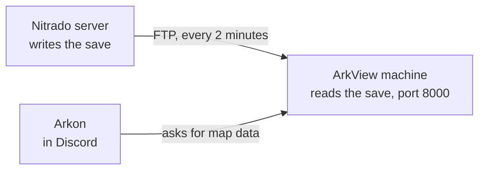
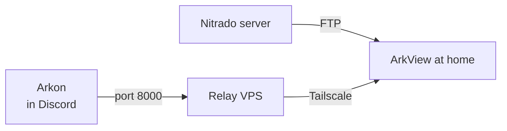

# ArkView on Nitrado (ASA)

Nitrado doesn't let you run your own programs on its game servers, so ArkView can't run there. This guide works around that. A Linux machine you control downloads your save from Nitrado every 2 minutes and runs ArkView on the copy. Arkon then talks to that machine instead of Nitrado.

> **This is an advanced guide.** You'll need to be comfortable typing commands on a Linux server over SSH. If you host your own Ark server, use the regular [ArkView Setup Guide](/guides/arkview) instead, it's much simpler.
{.is-warning}

> **ASA only.** ASE on Nitrado has no RCON, so Arkon can't connect to it at all.
{.is-info}

---

## How It Works



1. Nitrado saves your world.
2. Your machine downloads the new save over FTP.
3. ArkView reads it.
4. When someone runs a map command, Arkon asks your machine for the data.

Arkon has to be able to reach your machine on one port. If your machine is at home behind CGNAT (where your internet provider shares one public IP between many customers, so port forwarding is impossible), a small VPS relays Arkon's requests to it:



Tailscale is a free tool that links your machines over a private, encrypted connection. Your home network never needs an open port.

---

## Pick Your Setup

| Setup | What you need | Good for |
|-------|---------------|----------|
| **One VPS (simplest)** | A VPS with 2 to 4 GB of RAM. ArkView and the download both run on it. | Anyone without an always-on Linux machine at home |
| **Home machine + relay VPS** | An always-on Linux machine at home with about 4 GB of RAM free, plus the smallest VPS you can find (512 MB to 1 GB of RAM) | People who already run a home server, especially behind CGNAT |
| **Home machine, no relay** | An always-on Linux machine at home, and a router where you can forward a port | Home internet with a real public IP (no CGNAT) |

**How to check for CGNAT:** compare the WAN IP shown in your router with your public IP at [whatismyip.com](https://whatismyip.com). If they differ, or the router shows something between `100.64.x.x` and `100.127.x.x`, you're behind CGNAT.

### Picking a VPS

Any VPS with a public IPv4 address and Ubuntu 24.04 (or Debian 12) works. Some common choices:

- **[Oracle Cloud Free Tier](https://www.oracle.com/cloud/free/):** free. The ARM servers are big enough to run ArkView itself, but they're often out of stock. Oracle may reclaim free servers that sit idle, and it has two firewalls to open (covered below).
- **[Hetzner Cloud](https://www.hetzner.com/cloud/), [DigitalOcean](https://www.digitalocean.com/pricing/droplets), [Vultr](https://www.vultr.com/pricing/):** a few dollars a month for the smallest plan. Some of the cheapest plans are IPv6 only, so make sure yours includes IPv4.

Prices and plans change often, so check the provider's pricing page before you buy.

---

## What You Need

- [ ] A Nitrado ASA server already connected to Arkon (see [Getting Started](/guides/getting-started))
- [ ] Your Nitrado **FTP host, username, and password** (in the Nitrado web panel)
- [ ] Your map's save folder name, such as `TheIsland_WP` or `Ragnarok_WP`
- [ ] The machine (or VPS) from [Pick Your Setup](#pick-your-setup), running Ubuntu or Debian with Python 3.10 or newer
- [ ] A free [Tailscale](https://tailscale.com) account, only if you use the relay

In every command below, swap `<MAP>` for your map's folder name, like `TheIsland_WP`.

> **Paste one block at a time.** Pasting several blocks at once can run them together and garble them.
{.is-info}

---

## Step 1. Download the Save From Nitrado

Do this on the machine that will run ArkView (the one VPS, or your home machine). A timer downloads the save every 2 minutes, and only when Nitrado's copy is newer.

1. Install the FTP tool and make a folder for the save:

```bash
sudo apt update && sudo apt install -y lftp
sudo mkdir -p /srv/arkview/map
```

2. Create the login file with `sudo nano /etc/arkview-ftp.env` and paste this in, filling in your details:

```bash
FTP_HOST=<your nitrado ftp host>
FTP_USER=<your nitrado ftp user>
LFTP_PASSWORD='<your nitrado ftp password>'
REMOTE_DIR=/arksa/ShooterGame/Saved/SavedArks/<MAP>
```

Save with `Ctrl + O`, `Enter`, `Ctrl + X`, then lock it down so only root can read your password:

```bash
sudo chmod 600 /etc/arkview-ftp.env
```

3. Create the download script with `sudo nano /usr/local/bin/arkview-sync.sh`:

```bash
#!/bin/bash
set -euo pipefail
set -a; source /etc/arkview-ftp.env; set +a
lftp --env-password -u "$FTP_USER" "$FTP_HOST" <<LFTP
set ftp:ssl-allow yes
set ssl:verify-certificate no
set xfer:use-temp-file yes
set net:max-retries 2
set net:timeout 30
mirror --only-newer --no-perms --include-glob <MAP>.ark --include-glob '*.arkprofile' --include-glob '*.arktribe' "$REMOTE_DIR" /srv/arkview/map
LFTP
```

Then make it runnable:

```bash
sudo chmod +x /usr/local/bin/arkview-sync.sh
```

> **Keep the `.arkprofile` and `.arktribe` parts.** Most servers keep players in `.arkprofile` files and tribes in `.arktribe` files next to the `.ark`. Some Nitrado servers write none of those files and keep the same data inside the `.ark` instead. ArkView 2.25.0 and newer reads it from there automatically, so on those servers the `.ark` alone is enough. The line above handles both cases, so leave it as is.
{.is-warning}

4. Run it every 2 minutes:

```bash
sudo tee /etc/systemd/system/arkview-sync.service > /dev/null <<'EOF'
[Unit]
Description=Sync ARK save from Nitrado for ArkView
[Service]
Type=oneshot
ExecStart=/usr/local/bin/arkview-sync.sh
EOF
sudo tee /etc/systemd/system/arkview-sync.timer > /dev/null <<'EOF'
[Unit]
Description=Run ArkView save sync every 2 minutes
[Timer]
OnBootSec=1min
OnUnitActiveSec=2min
[Install]
WantedBy=timers.target
EOF
sudo systemctl daemon-reload
sudo systemctl enable --now arkview-sync.timer
```

5. Check it after a minute or two. This should list the `.ark` file, plus a pile of `.arkprofile` and `.arktribe` files if your server writes them (some Nitrado servers don't, and that's fine):

```bash
ls -la /srv/arkview/map
```

If you end up at an `lftp :~>` prompt at any point, type `bye` to get back out.

---

## Step 2. Install ArkView

Still on the same machine.

1. Install ArkView under its own user:

```bash
sudo apt install -y git python3-venv
sudo useradd -r -s /usr/sbin/nologin arkviewer
sudo mkdir -p /opt/arkviewer && sudo chown arkviewer:arkviewer /opt/arkviewer
sudo -u arkviewer git clone https://github.com/vertyco/arkview /opt/arkviewer
cd /opt/arkviewer
sudo -u arkviewer python3 -m venv .venv
sudo -u arkviewer .venv/bin/pip install --no-cache-dir -r requirements.txt
```

2. Create the config. First run `+arkset view` in Discord and copy the **ArkView API Key**. Then run this, replacing `<MAP>` and `<YOUR ARKVIEW KEY>`:

```bash
sudo -u arkviewer mkdir -p /opt/arkviewer/maps/nitrado
sudo -u arkviewer tee /opt/arkviewer/maps/nitrado/config.ini > /dev/null <<'EOF'
[Settings]
Port = 8000
MapFilePath = /srv/arkview/map/<MAP>.ark
ClusterFolderPath =
BanListFile =
Priority = LOW
Threads = 2
ReprocessOnArkDataUpdate = False
Debug = False
DSN =
APIKey = <YOUR ARKVIEW KEY>
EOF
```

The API key means only Arkon can read your map data. See [Set the API key](/guides/arkview#set-the-api-key) for details.

3. Install and start the service:

```bash
sudo cp /opt/arkviewer/deploy/arkview@.service /etc/systemd/system/
sudo sed -i 's|main.py$|main.py 0.0.0.0|' /etc/systemd/system/arkview@.service
sudo systemctl daemon-reload
sudo systemctl enable --now arkview@nitrado
```

The `sed` line matters. Without it, ArkView only answers requests from the same machine, and neither Arkon nor the relay can reach it.

4. Set up the firewall. Pick the block for your setup.

**One VPS** (only Arkon may reach port 8000):

```bash
sudo ufw allow OpenSSH
sudo ufw allow from 51.79.109.160 to any port 8000 proto tcp
sudo ufw enable
```

**Home machine + relay** (don't open port 8000 to the internet at all):

```bash
sudo ufw allow OpenSSH
sudo ufw allow from 192.168.0.0/16
sudo ufw allow in on tailscale0
sudo ufw enable
```

Change `192.168.0.0/16` to match your home network if it uses a different range.

**Home machine, no relay:** use the One VPS block above, then forward port 8000 (TCP) on your router to this machine.

> **On Oracle Cloud?** Skip ufw. Oracle's Ubuntu images use iptables instead, see [Oracle Cloud firewall](#oracle-cloud-firewall).
{.is-info}

5. Check that ArkView is running:

```bash
curl -s -o /dev/null -w "%{http_code}\n" http://127.0.0.1:8000/
```

`401` means it's running and the API key is on. `200` means it's running without a key. `000` means it isn't running yet, so check `journalctl -u arkview@nitrado -n 30 --no-pager`.

6. **Relay setup only:** install Tailscale on this machine and note its Tailscale address:

```bash
curl -fsSL https://tailscale.com/install.sh | sh
sudo tailscale up
tailscale ip -4
```

---

## Step 3. Set Up the Relay VPS (Relay Setup Only)

Skip this step if you're using one VPS, or a home machine without CGNAT.

Run everything here **on the VPS**, not on the ArkView machine. Check your prompt before pasting: the relay can't run on the ArkView machine, because ArkView is already using port 8000 there.

1. Create an Ubuntu 24.04 (or Debian 12) VPS with a public IPv4 address, and SSH in.

2. Install the relay tool and only let Arkon in:

```bash
sudo apt update && sudo apt install -y socat ufw
sudo ufw allow OpenSSH
sudo ufw allow from 51.79.109.160 to any port 8000 proto tcp
sudo ufw enable
```

On Oracle Cloud, skip this ufw block and use [Oracle Cloud firewall](#oracle-cloud-firewall) instead (you still need `sudo apt install -y socat`).

3. Join the VPS to your Tailscale account, then check that it can reach ArkView. Replace `<ARKVIEW_TS_IP>` with the address from Step 2:

```bash
curl -fsSL https://tailscale.com/install.sh | sh
sudo tailscale up
curl -s -o /dev/null -w "%{http_code}\n" --max-time 10 http://<ARKVIEW_TS_IP>:8000/
```

Any number except `000` means it works.

4. Create the relay service:

```bash
sudo tee /etc/systemd/system/arkview-relay.service > /dev/null <<'EOF'
[Unit]
Description=ArkView relay
After=network-online.target tailscaled.service
Wants=network-online.target

[Service]
ExecStart=/usr/bin/socat TCP-LISTEN:8000,fork,reuseaddr TCP:<ARKVIEW_TS_IP>:8000
Restart=always
RestartSec=5

[Install]
WantedBy=multi-user.target
EOF
sudo systemctl daemon-reload
sudo systemctl enable --now arkview-relay
systemctl is-active arkview-relay
```

The last line should print `active`. From now on, only the VPS and the ArkView machine need to stay on.

---

## Step 4. Connect ArkView to Arkon

1. Run `+viewservers`, select your cluster, click **Servers**, and pick your Nitrado server.
2. Click **ArkView**.
3. Set **Host IP** to the public IPv4 address of the machine Arkon should connect to:
   - **One VPS** or **relay setup:** the VPS's public IP
   - **Home machine, no relay:** your home public IP
4. Set **Port** to `8000` and click **Submit**.

The Host box only fits 15 characters, so use the IP address, not a hostname.

---

## Step 5. Check That It Works

1. Force a fresh save so you don't have to wait for Nitrado's autosave: `+rcon <cluster> <server> SaveWorld`.
2. Give it a few minutes. Nitrado has to finish saving, the timer has to download it, and ArkView has to read it.
3. Run `+arkviewer` to see the ArkView status, then try `+structures <tribe name>`.

To confirm tribes and players loaded, run this on the ArkView machine:

```bash
sudo cat /opt/arkviewer/maps/nitrado/output/_parse_stats.json
```

`tribes_loaded` and `profiles_loaded` should be above 0. `player_data_source` says where that data came from: `files` (the `.arkprofile` / `.arktribe` files) or `save` (read from inside the `.ark`).

- **Both are 0 and `player_data_source` is `none`:** ArkView found no player or tribe data anywhere. Make sure you're on ArkView 2.25.0 or newer, then check that the files downloaded (see [Step 1](#step-1-download-the-save-from-nitrado)).
- **Tribes and players look out of date:** if your server keeps its data inside the `.ark` but old `.arkprofile` / `.arktribe` files are still in `/srv/arkview/map`, ArkView keeps reading those old files. Delete them and the next read uses the data in the save.

Tribe logs don't need ArkView. They run over RCON, so set a channel with `+tribeset logchannel <cluster> #channel` whether or not ArkView is running.

If Arkon times out, run `sudo tcpdump -ni any tcp port 8000` on the machine Arkon connects to, then run the command again. Lines appearing means Arkon's traffic arrives, so look at the firewall and the relay. No lines means the problem is before that: the provider's firewall, the router, or the Host and Port in `+viewservers`.

---

## Oracle Cloud Firewall

Oracle has two firewalls, and both need to let Arkon in.

1. **In the Oracle console:** open your VCN, then the Default Security List, and add an ingress rule: source `51.79.109.160/32`, TCP, port `8000`.
2. **On the server:** Oracle's Ubuntu images use iptables, so skip ufw and run:

```bash
sudo apt update && sudo apt install -y iptables-persistent
sudo iptables -I INPUT 6 -p tcp -s 51.79.109.160 --dport 8000 -j ACCEPT
sudo netfilter-persistent save
```

> **Never install `iptables-persistent` on a machine that uses ufw.** Installing it removes ufw. Only use this block on Oracle.
{.is-warning}

---

## Troubleshooting

| Check | Where | Command | Good result |
|-------|-------|---------|-------------|
| Download timer runs | ArkView machine | `systemctl list-timers arkview-sync.timer` | Last run under 2 minutes ago |
| Download errors | ArkView machine | `sudo journalctl -u arkview-sync -n 15 --no-pager` | "Finished" with no errors |
| Save files arrived | ArkView machine | `ls /srv/arkview/map` | The `.ark` (plus `.arkprofile` and `.arktribe` files if your server writes them) |
| ArkView running | ArkView machine | `systemctl is-active arkview@nitrado` | `active` |
| ArkView answers | ArkView machine | `curl -s -o /dev/null -w "%{http_code}\n" http://127.0.0.1:8000/` | `401` or `200` |
| Tribes and players loaded | ArkView machine | `sudo cat /opt/arkviewer/maps/nitrado/output/_parse_stats.json` | `tribes_loaded` above 0 |
| Relay reaches ArkView | VPS | `curl -s -o /dev/null -w "%{http_code}\n" --max-time 10 http://<ARKVIEW_TS_IP>:8000/` | Not `000` |
| Relay running | VPS | `systemctl is-active arkview-relay` | `active` |
| Arkon's traffic arrives | Machine Arkon connects to | `sudo tcpdump -ni any tcp port 8000` | Lines appear when you run an Arkon command |

To see when Nitrado last saved (times are UTC), run this on the ArkView machine:

```bash
sudo bash -c 'set -a; source /etc/arkview-ftp.env; set +a; lftp --env-password -u "$FTP_USER" "$FTP_HOST" -e "set ssl:verify-certificate no; cls -lt $REMOTE_DIR | head -5; bye"'
```

**Common mistakes:**

- **ArkView only listening locally:** the service's `ExecStart` line must end in `main.py 0.0.0.0`. Re-run the `sed` line from Step 2, then `sudo systemctl daemon-reload` and `sudo systemctl restart arkview@nitrado`.
- **Relay on the wrong machine:** if `arkview-relay` sticks at `activating`, it's on the ArkView machine, where port 8000 is already taken. Remove it there and set it up on the VPS.
- **Port forwarding behind CGNAT:** it does nothing. Use the relay.
- **Wrong Arkon IP in the firewall:** Arkon connects from `51.79.109.160`.

---

## Known Limits

- **Data can lag behind the game.** Nitrado autosaves every 15 minutes, but a new save can take another 20 to 30 minutes to show up on FTP. Arkon's map data can run that far behind.
- **Free VPS reclaim.** Oracle can reclaim Always Free servers that sit near idle. If Arkon suddenly times out, check that your instance is still running.

---

## Updating ArkView

Check for new versions:

```bash
cd /opt/arkviewer && sudo -u arkviewer git fetch && sudo -u arkviewer git log --oneline HEAD..origin/HEAD
```

Nothing printed means you're up to date. To install an update:

```bash
cd /opt/arkviewer && sudo -u arkviewer git pull && sudo -u arkviewer .venv/bin/pip install --no-cache-dir -U -r requirements.txt && sudo systemctl restart arkview@nitrado
```

---

*Thanks to chance for the original write-up this guide is based on.*

**Need help?** Join the [Discord Support Server](https://discord.gg/RaR3wR4MgY).
