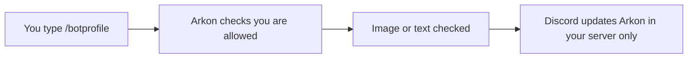

# Bot Profile

Bot Profile lets you change how Arkon looks in your server only. You can set a custom picture (avatar), a banner image and a short bio. Other servers still see the normal Arkon.

It is useful when you want Arkon to match your community's branding.

**You need:**

- Arkon in your server.
- The Manage Server permission in Discord.
- Possibly a special role. The bot owner can limit this feature. See [Who is allowed](#who-is-allowed).

## How it works



> This feature is slash-only. There is no `+` version. Type `/botprofile` and Discord shows the three options.
{.is-info}

## Setup

### Step 1: Prepare your image

Avatar: PNG, JPEG or GIF, up to 8 MB. Banner: PNG, JPEG or GIF, up to 10 MB. Bio: text up to 190 characters.

### Step 2: Set the avatar

Where: any channel where Arkon can see your command.

Type `/botprofile avatar`, then attach your image in the `avatar` box and press Enter.

You will see: "My avatar has been updated for this server!"

### Step 3: Set the banner and bio

```
/botprofile banner
/botprofile bio
```

For the banner, attach an image. For the bio, type your text in the `bio` box.

You will see: "My banner has been updated for this server!" and "My bio has been updated for this server!"


### Step 4: Check it worked

Click Arkon's name in your member list. Its avatar, banner and bio should show your changes.

## Reset to normal

Run the same command and leave the attachment or text empty.

| Command | You will see |
|---|---|
| `/botprofile avatar` | "My avatar for this server has been reset to my global avatar!" |
| `/botprofile banner` | "My banner for this server has been reset to my global banner!" |
| `/botprofile bio` | "My bio for this server has been reset to my global bio!" |

If Arkon has no normal avatar or banner to go back to, the reply says it has been cleared instead.

## Who is allowed

By default, Discord only shows `/botprofile` to people with the Manage Server permission. You can change that in Server Settings, then Integrations.

The bot owner can add a second rule. They can require that the **owner of your server** has a certain role in the bot owner's own Discord server. It is the server owner who needs the role, not the person typing the command.

If the rule is on and your server owner does not have the role, you see this message (only you can see it):

> The owner (@YourName) of this server does not have the `@RoleName` role in the `Main Server` server required to use this feature. You can join the server here: (invite link)

The bot owner can also replace this text with their own message. The invite link is added only if Arkon can make one.


Other messages the rule can give:

- "Could not determine the owner of this server!"
- "I could not find @Owner in the 'main' server!" (the server owner is not in the bot owner's server)

> If your server owner later loses the role or leaves the bot owner's server, Arkon automatically puts your avatar, banner and bio back to normal.
{.is-warning}

If you do not know whether the rule is on, try `/botprofile bio`. If you are denied, ask the bot owner how to get access. You cannot change the rule from your server.

The bot owner can also turn on an automatic content check for images and text. If something is flagged, you see "Submission was flagged by OpenAI moderation for the following reasons:" followed by a list, and nothing changes.

## Commands

| Command | Who | What it does | Example |
|---|---|---|---|
| `/botprofile avatar [avatar]` | Manage Server (and the role rule, if on) | Sets Arkon's picture in this server. Empty resets it | `/botprofile avatar` |
| `/botprofile banner [banner]` | Manage Server (and the role rule, if on) | Sets Arkon's banner in this server. Empty resets it | `/botprofile banner` |
| `/botprofile bio [bio]` | Manage Server (and the role rule, if on) | Sets Arkon's bio in this server. Empty resets it | `/botprofile bio` |

These only work inside a server, not in direct messages.

## Defaults

| Setting | Default |
|---|---|
| Avatar, banner, bio | Same as the normal Arkon |
| Avatar change limit | Once every 10 minutes per server |
| Banner and bio change limit | Once every 30 seconds per server |
| Max bio length | 190 characters |

## Common problems

| Problem | Why it happens | Fix |
|---|---|---|
| "The provided attachment is too large. Max size is 8MB." | Avatar over 8 MB | Shrink the image. Banner limit is 10MB, same message with 10MB |
| "Invalid attachment type `...`, must be one of: PNG, JPEG, JPG, GIF." | Wrong file type | Save as PNG, JPEG or GIF |
| "Bio cannot be longer than 190 characters." | Text too long | Shorten it |
| "Failed to update avatar: ..." | Discord refused the image | Read the reason in the message and try another image |
| "Failed to update banner: ..." | Discord refused the image | Try another image |
| "Failed to update bio: ..." | Discord refused the text | Read the reason and change the text |
| You cannot find `/botprofile` | You lack Manage Server, or the command is hidden by server settings | Ask an admin, or check Integrations |
| Discord says the command is on cooldown | You changed the avatar within 10 minutes (banner and bio: 30 seconds) | Wait and try again |
| "The owner (...) of this server does not have the ... role ..." | The bot owner requires a role | See [Who is allowed](#who-is-allowed) |

## Related pages

- [Getting started](/guides/getting-started)
- [Extras](/guides/extras)
- [FAQ](/guides/faq)
