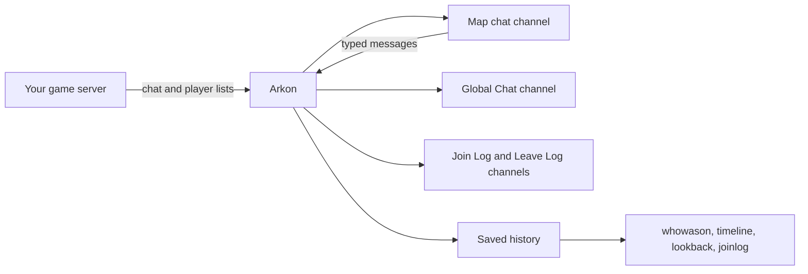

# Game Chat in Discord, Kill Feed and Join Logs

Arkon can show your in-game chat in a Discord channel, and send what people type in that channel back into the game. It can also post a line every time someone joins or leaves, and post a line when a player kills another player. Later you can look up who was online at any moment.

**You need:**

- Arkon in your Discord server with at least one server connected ([Getting started](/guides/getting-started)).
- Working RCON (the remote-control connection Arkon uses to send commands to your game server). See [RCON setup](/guides/rcon-setup).
- A cluster (a group of connected maps) set up in the `+viewservers` menu ([Server settings](/guides/server-settings)).

Some commands here are for Admins or Mods. Admin and Mod are Discord roles you tell Arkon about. See [Getting started](/guides/getting-started) to set them.

## The whole picture



Arkon checks the game over RCON. Chat comes out roughly every 5 to 15 seconds. The list of online players is checked every 30 seconds. Every join and leave is also saved, and that saved history is what the lookup commands read.

> Arkon only has history from the moment tracking started on that server. It cannot show anything from before.
{.is-info}

## Set it up

### Step 1: Open the server menu

1. In any Discord channel the bot can see, type `+viewservers` and press Enter.
2. Pick your cluster ("My Cluster" in our example).

### Step 2: Pick the log channels for the cluster

1. On the cluster page, click the **Logs** button.
2. A popup titled **Edit Cluster Logs** appears. Pick a channel for each log you want. Every picker is optional.


| Picker | What gets posted there |
|---|---|
| Joinlog Channel | Player join events |
| Leavelog Channel | Player leave events |
| Adminlog Channel | In-game admin command events |
| Tribelog Channel | All tribe events (see [Tribe logs](/guides/tribe-logs)) |
| Global Chat Channel | Chat from every map in the cluster, in one place |

3. Save the popup.

Example: Joinlog Channel = `#joins`, Leavelog Channel = `#leaves`, Global Chat Channel = `#all-chat`.

> A channel can only be used for one job. The Global Chat channel can never be shared with anything. The Tribelog channel must differ from your other log channels. If you pick a clash, Arkon refuses with a message like `That chatlog channel is already in use by another log in this cluster!`.
{.is-warning}

### Step 3: Pick the chat channel for each map

1. Go back to the cluster page and click **Servers**.
2. Pick a map (for example "The Island") from the dropdown.
3. Click the 📝 (memo) button. A popup opens. In the popup, use the **Crosschat Channel** picker. Its hint reads `Discord channel where in-game chat will be sent`. Pick a channel such as `#island-chat`.
4. Save. Repeat for each map. Every map needs its own channel.

### Step 4: Check the Crosschat button is green

1. On the cluster page, look at the **Crosschat** button. Green means on, grey means off. It is on by default.
2. If it is grey, click it once. It saves instantly.
3. Optional: the **Interchat** button (off by default). When green, chat from one map is also sent into the game on the cluster's other maps. Players there see it as `ServerChat The Island -> SurvivorSam (Sam): hello`.

> The Crosschat button only controls game-to-Discord chat. Turning it off does NOT stop Discord-to-game messages: anything typed in a map's chat channel or the Global Chat channel still goes into the game. It also does not stop Interchat or the kill feed. While it is off, two things stop showing in Discord: the game's chat lines, and the small replies to in-game chat commands.
{.is-info}

To stop Discord-to-game messages, clear the map's Crosschat Channel in the server popup (Step 3) or turn the server off in `+viewservers`.

### Step 5: Turn on the kill feed (optional)

In any channel Arkon can see, type:

```
+arkset killfeed
```

Arkon answers `Killfeed **Enabled**`. Run it again to turn it off.

### Step 6: Check it worked

1. Join your server and type a message in the in-game chat.
2. Within about 15 seconds it shows up in the map's chat channel. Lines start with 🎮 (Xbox player) or 🖥️ (PC player). A ⭐ means the speaker is linked to a Discord member with an admin role.
3. Type a normal message in that Discord channel. It appears in the game as `ServerChat <your name>: <message>`.
4. Leave and rejoin the game. After up to 30 seconds you see a green join line and a red leave line in your log channels.


> The server must be turned on in Arkon and must have been online in the last 30 minutes. Otherwise Arkon does not check its chat.
{.is-info}

## How chat works

- **Game to Discord:** chat goes to the map's chat channel, and (as small text under a bold map name) to the Global Chat channel. This only happens while the cluster's **Crosschat** button is green.
- **Discord to game:** any normal message (not a command) in a map's chat channel is sent to that map. A message in the Global Chat channel is sent to every map in the cluster. Long messages are split into pieces of 479 characters.
- Links, custom emoji and non-English characters (accents, emoji, non-Latin text) are removed from messages going into the game. Mentions become `@name` or `#channel`.
- Messages from bots and webhooks, and messages in threads, are ignored.
- Chat lines that look like bot commands are left out of the Global Chat channel.
- When a player types an in-game chat command (see [In-game commands](/guides/in-game-commands)), Arkon's reply shows in the map's chat channel as small text. This needs the Crosschat button green, and it is skipped when more than 10 chat lines arrive in one check, so a busy moment does not flood the channel. If a command crashes, the channel shows `Command failed for SurvivorSam: <reason>`.
- Chat lines that contain certain racial slurs are quietly dropped. They are not shown in Discord and Arkon does not act on them.

### What name shows in the game

By default the game shows the person's Discord username. Admins can switch to the nickname they use in your server:

| Setting | What it does | Default | Command |
|---|---|---|---|
| Display names | On: the game shows the server nickname. Off: the Discord username. Characters the game cannot show are removed. | Off | `+arkset usedisplaynames` |

Arkon replies `Use of display names **Enabled**` or `Use of display names **Disabled**`. Admins (or anyone with the Manage Server permission) can run it.

## Join and leave logs

Every 30 seconds Arkon compares who is online now with who was online last time. A new name becomes a green join line. A missing name becomes a red leave line.

- The first check after Arkon restarts posts no lines.
- If Arkon sees a join without a leave (or the other way around), it fills in a matching event so the history stays tidy.

## Kill feed

When a player kills another player, Arkon posts one line in that map's chat channel:

```
**SurvivorSam (`45`) just merked RexRider (`52`)**
```

The first name is the killer, the second is the victim, and the numbers are their levels. Kills by turrets and other structures are not posted.

**What the kill feed needs:**

- `+arkset killfeed` is on.
- The map has a **Crosschat Channel** (Step 3). That is where the line is posted.
- The game sends tribe log lines to Arkon over RCON. The kill feed reads the line "was killed by" from the victim's tribe log.
- That is all. You do NOT need a Tribelog Channel, private tribe threads, or the Crosschat button. Those only decide where the full tribe log is shown ([Tribe logs](/guides/tribe-logs)).

It is one switch for your whole Discord server, not per map. If Arkon has the Manage Webhooks permission in the chat channel, it posts through a webhook named "KillFeed". If not, it needs Send Messages.

## Look up who was online

These four commands are read-only. They only read saved history.

**Who can run them:** Mod (a Mod role, an Admin role, or the Manage Server permission). Arkon needs the Embed Links permission.

### Time zones

When you type a time without a time zone, Arkon reads it in your Discord server's time zone. The default is UTC (the world standard time, with no daylight saving). An Admin can change it:

```
+arkset timezone America/New_York
```

Arkon answers `Timezone set to **America/New_York** (`04:20 PM`)`, where the time in brackets is the current time there. If the name is wrong, it replies `Invalid Timezone, did you mean `America/New_York`?`. You can also add an offset such as `-05:00` to the end of a time to override it once. Times that Arkon prints use Discord's own time format, so each person sees their own local time.

### Pick a server

`+joinlog` and `+whowason` first show a **Select a Server** menu. Pick a map from the dropdown. Click the red ✖️ to close it. If nobody clicks within 2 minutes, the menu is deleted.


### Commands

| Command | What it does | Syntax | Example |
|---|---|---|---|
| `+whowason` | Lists who was online on one map at a moment in time | `+whowason <time>` | `+whowason 4:20pm April 10 2026` |
| `+timeline` | Shows one player's joins and leaves across all maps | `+timeline <player> <start_time> [end_time]` | `+timeline SurvivorSam "April 10 2026 5:00pm" "April 11 2026 5:00pm"` |
| `+lookback` | Draws a chart of where one player was online | `+lookback <player> <start_time> [end_time]` | `+lookback SurvivorSam "April 10 2026 5:00pm"` |
| `+joinlog` | Shows every join and leave on one map | `+joinlog <timespan> [end_time]` | `+joinlog 12h April 10 2026 5:00pm` |

**+whowason**

- `time` is the rest of the line. Use `2026-04-10T16:20:00` or plain words like `4:20pm April 10 2026`.
- Arkon lists players whose latest event before that time was a join.
- Result:


**+joinlog**

- `timespan` is how far back to look: `7d`, `12h`, `3w`, or combined like `3w2d`. The word `all` looks back as far as possible.
- `end_time` is optional and is the end of the window. Default is now. Type it without quotes (it takes the rest of the line).
- Each page holds 40 lines. Buttons: ⬅️ ➡️ page, ✖️ close. With more than 10 pages you also get ⏪ and ⏩ (jump 10 pages) and 🔍 (search). The 🔍 popup is titled **Search**: type a page number, or text to find the first page that contains it.
- Only the person who ran the command can use the buttons. Others see `This isn't your menu!`. The buttons stop working after 5 minutes.


**+timeline**

- `player` can be a Discord mention, a Discord ID, a gamertag or Steam name, a character name, or a game ID. Put names with spaces in quotes. If more than one player matches, use their game ID or a Discord mention instead.
- `start_time` is required. Put it in quotes if it has spaces. `end_time` is optional (default now).
- The result is a paged list titled `Joinlog for <player>`, one line per event with the map name and time. 🟢 is a join, 🔴 is a leave. It covers every map.

**+lookback**

- Same inputs as `+timeline`, but the answer is a picture (a chart), not a list. One row per map.
- Legend: yellow line = Overlap (the same player online twice on the same map at once), blue line = Online, green dot = Join, red dot = Leave, green X = Orphaned Join (a join with no leave), red X = Orphaned Leave (a leave with no join).
- Use it to spot someone on two maps at once, or to see when they were really online.
- Limit: 5 uses per 30 seconds per person.

> If Arkon cannot read your start time, it does not tell you. It quietly uses the last 1 hour instead. If the result looks wrong, retype the time more clearly.
{.is-warning}

### Admin switches

| Command | Who | What it does | Syntax | Default |
|---|---|---|---|---|
| `+arkset killfeed` | Admin | Turns the kill feed on or off for your whole Discord server | `+arkset killfeed` | Off |
| `+arkset usedisplaynames` | Admin | Switches game chat names between Discord username and server nickname | `+arkset usedisplaynames` | Off |
| `+arkset timezone` | Admin | Sets the time zone used when you type a time without one | `+arkset timezone <timezone>` | UTC |

## Common problems

| Problem | Why it happens | Fix |
|---|---|---|
| Game chat never shows in Discord | No Crosschat Channel set for that map, or the Crosschat button is grey | Set the channel (Step 3) and make the Crosschat button green (Step 4) |
| Nothing is polled at all | Server is off in Arkon, or it was not online in the last 30 minutes | Turn the server on in `+viewservers` and start it |
| Discord messages do not appear in the game | Message was a command, from a bot, in a thread, or only had links or emoji | Send a plain text message in the map's chat channel |
| `That chatlog channel is already in use by another log in this cluster!` | The same channel was picked twice for something that cannot share | Pick a different channel |
| `That chat channel is already in use by another server!` | Two maps use the same chat channel | Give each map its own channel |
| `There are no servers to select!` | No enabled servers in this Discord server | Add and enable a server ([Getting started](/guides/getting-started)) |
| `Invalid timestamp format! (YYYY-MM-DDTHH:MM:SS or a human readable time)` | `+whowason` could not read your time | Use `2026-04-10T16:20:00` or `4:20pm April 10 2026` |
| `No players were online at that time.` | Nobody had an open session then, or history starts later | Try a different time |
| `No players found!` | Nothing matched your search | Try a Discord mention, a game ID or the exact gamertag |
| `Multiple players found, please be more specific!` | The name matches more than one player | Use a Discord mention or a game ID |
| `No data found for the specified time range.` | The player has no joins or leaves in that window | Widen the window |
| `No join/leave data found for the specified time range.` | No joins or leaves on that map in the window | Widen the window or pick another map |
| `This isn't your menu!` | Someone else clicked your buttons | Run the command yourself |
| `Initializing database, One moment...` | Arkon is still starting up | Wait a minute and try again |
| Kill feed line never appears | Kill feed is off, the map has no Crosschat Channel, or no tribe log lines are arriving | Run `+arkset killfeed`, set the map's Crosschat Channel, and check [Tribe logs](/guides/tribe-logs) |
| `Invalid Timezone, did you mean ...?` | The time zone name was not recognised | Use a name like `America/New_York` or `Europe/London` |
| No bot message from a lookup command | Arkon lacks Embed Links | Give Arkon the Embed Links permission |

## Related pages

- [Server settings](/guides/server-settings)
- [Tribe logs](/guides/tribe-logs)
- [Status channel](/guides/status-channel)
- [Playtime and roles](/guides/playtime-and-roles)
- [Moderation](/guides/moderation)
- [RCON setup](/guides/rcon-setup)
- [Admin commands](/commands/admin-commands)
- [Mod commands](/commands/mod-commands)
