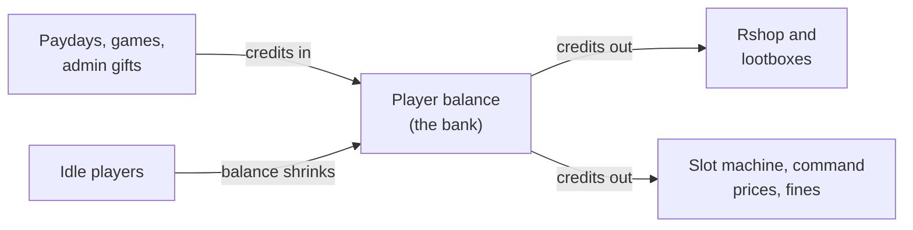

# Server Economy: Your Currency, Paydays and Bank

Your Discord server has its own currency and its own bank. Players earn it from games and paydays, and they spend it in the shop and in lootboxes. This page shows how to name it, hand it out, and keep it in balance.

**You need:**

- Arkon in your Discord server ([Getting started](/guides/getting-started)).
- To be the server owner, or to have the Administrator permission, for the `+bankset` commands. The other admin commands work for anyone with the Arkon Admin role or the Manage Server permission. See [Getting started](/guides/getting-started) for setting that role.

> Nothing on this page needs a game server. The economy works in Discord only.
{.is-info}

## How it works



The bank is a wallet for every member, kept by the bot. Think of it as one number per person. Its default currency name is "credits".

**The bank is per server.** Your server has its own currency name, its own balances and its own payday. Nothing is shared with other servers that use Arkon. Because of that, you can rename the currency without affecting anyone else.

## Where the currency is used

- The [Rshop](/guides/rshop) spends it. Players buy in-game items with it.
- [Lootboxes](/guides/lootboxes) spend it. Each box has a price in this currency.
- The minigames pay into it, and some take bets from it. See [Games](/guides/games).
- The slot machine and `+bank transfer` on this page use it too.

If nobody has a balance, nobody can buy anything. That is why the games and `+payday` matter. They are how your players get money in the first place.

## Part 1: The basics

### Step 1. Check your bank settings

Where: any channel the bot can see.

Type:

```
+bankset showsettings
```

You will see: a box listing the bank name, the bank scope (it says "Server"), the currency name, the default balance and the maximum balance.


The default balance is the amount a new account starts with. Out of the box that is 100.

### Step 2. Name your currency

Type:

```
+bankset creditsname Bones
```

You will see: `Currency name has been set to: Bones`

Every message now says "Bones" instead of "credits". You can also rename the bank itself with `+bankset bankname <name>`.

### Step 3. Set a starting balance

Type:

```
+bankset registeramount 500
```

You will see: `Registering an account will now give 500 Bones.`

This is the balance a brand-new account starts with. It only affects accounts created after you change it.

### Step 4. Set up payday

A payday is free currency a player can claim now and then. They type `+payday`. Arkon gives them the amount, then makes them wait before claiming again.

Type these two commands (use your own numbers):

```
+economyset paydayamount 250
+economyset paydaytime 1d
```

You will see:

- `Every payday will now give 250 Bones.`
- `Value modified. At least 86400 seconds must pass between each payday.`

The time can be written as seconds (`86400`) or with a unit (`1d`, `12h`, `30m`).

> The out-of-the-box payday is 120 credits every 5 minutes. That is a fast tap for most servers. Raise the wait before players find it.
{.is-warning}

**Different pay for different roles.** To give a role a bigger payday:

```
+economyset rolepaydayamount @Supporter 500
```

You will see: `Every payday will now give 500 Bones to people with the role Supporter.`

A member with several paid roles gets the highest single amount, not the total. Set the amount to `0` to remove a role's payday. You will then see the line "The payday value attached to role has been removed...".

### Step 5. Check it worked

1. Ask a member (or use your own account) to type `+payday`.
2. You should see a message like the one below. Claiming a second time right away says `Too soon. Your next payday is` followed by a countdown.
3. Type `+bank balance` to see the new total.


> The payday message always says "global leaderboard", even though your bank is per server. This is a wording quirk. The rank it shows is the rank on your server.
{.is-info}

## Part 2: What players can do

| Command | Who | What it does | Example |
|---|---|---|---|
| `+payday` | Everyone | Claims free currency. Has a waiting time between claims. | `+payday` |
| `+bank balance [user]` | Everyone | Shows a balance. With no name it shows yours. | `+bank balance @RexRider` |
| `+bank transfer <to> <amount>` | Everyone | Sends some of your currency to another member. | `+bank transfer @TekTitan 500` |
| `+leaderboard [top]` | Everyone | Shows the richest members, 10 by default. | `+leaderboard 25` |
| `+slot <bid>` | Everyone | Bets currency on a slot machine. | `+slot 50` |
| `+payouts` | Everyone | Sends the slot machine prize list to the player by direct message. | `+payouts` |
| `+idbalance <user_id>` | Everyone | Shows a balance by Discord user ID. Useful for someone who left the server. | `+idbalance 123456789012345678` |
| `+bankpie [amount]` | Everyone | Draws a pie chart of the top balances (10 by default). | `+bankpie 5` |

Notes:

- The slot machine accepts bets from 5 to 100 by default and has a 5 second wait between spins. You can change those below.
- `+leaderboard` on Arkon shows only your own server. The "all servers" option does not apply.
- If a player's direct messages are closed, `+payouts` replies `I can't send direct messages to you.`

## Part 3: Admin commands

### Bank and economy settings

| Command | Who | What it does | Example |
|---|---|---|---|
| `+bankset showsettings` | Server owner or Administrator | Shows the bank settings. | `+bankset showsettings` |
| `+bankset creditsname <name>` | Server owner or Administrator | Renames the currency. | `+bankset creditsname Bones` |
| `+bankset bankname <name>` | Server owner or Administrator | Renames the bank. | `+bankset bankname Raptor Bank` |
| `+bankset registeramount <amount>` | Server owner or Administrator | Sets the starting balance for new accounts. | `+bankset registeramount 500` |
| `+bankset maxbal <amount>` | Server owner or Administrator | Sets the most any one member can hold. | `+bankset maxbal 1000000` |
| `+bankset reset [yes]` | Server owner or Administrator | Deletes every account on this server. Needs `yes` to run. | `+bankset reset yes` |
| `+bankset prune server [yes]` | Server owner | Deletes accounts of members who left the server. Needs `yes`. | `+bankset prune server yes` |
| `+bankset prune user <user> [yes]` | Admin | Deletes one account. Takes a mention, name or ID. Needs `yes`. | `+bankset prune user @RexRider yes` |
| `+economyset showsettings` | Admin | Shows the payday and slot settings, plus any role paydays. | `+economyset showsettings` |
| `+economyset paydayamount <amount>` | Admin | Sets how much one payday gives. Default 120. | `+economyset paydayamount 250` |
| `+economyset paydaytime <time>` | Admin | Sets the wait between paydays. Default 5 minutes. | `+economyset paydaytime 1d` |
| `+economyset rolepaydayamount <role> <amount>` | Admin | Sets a bigger payday for a role. `0` removes it. | `+economyset rolepaydayamount @Supporter 500` |
| `+economyset slotmin <bid>` | Admin | Sets the smallest slot bet. Default 5. | `+economyset slotmin 10` |
| `+economyset slotmax <bid>` | Admin | Sets the biggest slot bet. Default 100. | `+economyset slotmax 500` |
| `+economyset slottime <time>` | Admin | Sets the wait between slot spins. Default 5 seconds. | `+economyset slottime 30` |
| `+bank set <user> <amount>` | Admin | Sets one balance. Start the number with `+` or `-` to add or take instead. | `+bank set @RexRider +250` |

> `+bankset reset` and the prune commands delete accounts for good. Arkon asks you to repeat the command with `yes` first, so read the warning it shows.
{.is-danger}

Examples for `+bank set`:

- `+bank set @RexRider 26` sets the balance to exactly 26.
- `+bank set @RexRider +2` adds 2.
- `+bank set @RexRider -6` takes 6.

Useful replies you may see:

- `Amount must be greater than zero and less than {max}.` appears when `+economyset paydayamount` gets a bad number.
- `Warning: Minimum bid is greater than the maximum bid` means slots will not work until you fix `slotmin` or `slotmax`.

### Extended Economy: more control over the bank

Extended Economy adds the tools below to the bank. Its main command is `+extendedeconomy`, with the short names `+ecoset` and `+exteco`. Everything in this section is for Admin. The commands start with `+ecoset` below to keep them short.

| Command | What it does | Example |
|---|---|---|
| `+ecoset view` | Shows the extended settings and every command price in a menu. | `+ecoset view` |
| `+ecoset transfertax <percent>` | Takes a cut of every `+bank transfer`. Use a decimal below 1: `0.05` is 5%. `0` turns it off. | `+ecoset transfertax 0.05` |
| `+ecoset taxwhitelist <role>` | Adds or removes a role that does not pay the transfer tax. Run again to remove. | `+ecoset taxwhitelist @Staff` |
| `+ecoset rolebonus <role> <bonus>` | Adds a percent bonus to payday for a role. `0.1` is +10%. `0` removes it. | `+ecoset rolebonus @Supporter 0.1` |
| `+ecoset rolestaticbonus <role> <amount>` | Adds a flat amount to payday for a role. `0` removes it. | `+ecoset rolestaticbonus @Supporter 500` |
| `+ecoset stackpaydays` | Flips whether a member's role paydays add together. Off by default. | `+ecoset stackpaydays` |
| `+ecoset resetcooldown <member>` | Lets one member claim payday again right now. | `+ecoset resetcooldown @RexRider` |
| `+banksetrole <role> <amount>` | Sets (or with `+` / `-` adds or takes) the balance of everyone with a role. | `+banksetrole @Members +100` |
| `+backpay <time> [confirm]` | Works out the paydays members missed in a time span and pays them. Preview only until you add `True`. | `+backpay 7d True` |

How a bonus works: if a member has several roles with bonuses, Arkon uses the single highest one. The percent bonus and the flat bonus can both apply.

Run `+backpay 48h` first to see the preview. Add `True` at the end only when the numbers look right.

#### Charge credits to run a command

You can put a price on any command. The player pays from their bank balance each time they run it. The command is `+addcost`.

Syntax: `+addcost <command> <cost> [duration] [level] [prompt] [modifier] [value]`

Example, charge 10 for the leaderboard:

```
+addcost leaderboard 10
```

You will see: `leaderboard cost added.`

If you wrap a command with more than one word in quotes: `+addcost "bank transfer" 5`.

| Part | What it does | Default |
|---|---|---|
| `cost` | The price in your currency. | none (required) |
| `duration` | Seconds that usage is counted for. Only matters for the rising price types below. | `3600` |
| `level` | Who pays. `all` means everyone. `mod` lets Mods and Admins run it free. `admin` lets only Admins run it free. | `all` |
| `prompt` | How the player is told. `notify` just tells them. `button`, `text` and `reaction` ask them to confirm first. `silent` says nothing. | `notify` |
| `modifier` | `static` is a flat price. `percent` adds a share of their balance. `linear` and `exponential` make the price rise the more they use it. | `static` |
| `value` | The number that goes with the modifier. | `0` |

What players see for a priced command:

- `{name}, you spent {amount} {currency} to run this command` when the charge goes through.
- `You do not have enough {currency} to run that command! (Need {amount})` when they cannot afford it.
- `Do you want to spend {amount} {currency} to run this command?` when the prompt asks first. Saying no replies `Not running` and the command name.

If a regular command breaks after it takes the money, the player is refunded. Slash commands have no refund and are always silent, so be careful pricing those. To change a price, run `+addcost` again. Arkon asks `This will overwrite the existing cost for this command. Continue?`

You cannot price the `addcost` command, commands that are always available, or commands you are not allowed to run yourself.

#### Log what happens to the bank

Type `+ecoset mainlog #bank-log` to send every bank log message to one channel. Run it with no channel to remove the log.

To send just one kind of event to its own channel:

```
+ecoset eventlog transfer_credits #transfers
```

The events you can pick from: `set_balance`, `transfer_credits`, `bank_wipe`, `prune`, `set_global`, `payday_claim`. Leave the channel off to clear that event. A wrong name replies `Invalid event. Must be one of:` with the list.

### Bank Decay: idle balances shrink

Bank Decay slowly takes credits from members who stop showing up. It stops hoards from sitting untouched forever. It is off until you turn it on.

How it works:

1. Arkon notes when each member last did something: sent or edited a message, added or removed a reaction, joined voice, or changed status.
2. Once a member has been quiet for more than the set number of days, they lose a percent of their balance each day.
3. The check runs once a day at midnight (bot time).
4. Any new activity stops the decay. Credits already lost are not given back.

Members are only tracked from their first activity after you turn it on. Run `+bankdecay initialize false` once, so everyone already in the server starts being tracked.

Step by step:

1. Type `+bankdecay toggle`. You will see `Bank decay has been enabled.`
2. Type `+bankdecay initialize false`. You will see `Server initialized!` and how many members were added.
3. Type `+bankdecay getexpired`. This shows who would lose credits and attaches `expired_users.txt`. Nothing is taken.
4. Type `+bankdecay view` to check your settings.


The command is `+bankdecay`, also `+bdecay`. All are Admin.

| Command | What it does | Example |
|---|---|---|
| `+bankdecay view` | Shows the settings and counts of active, expired and left-server accounts. | `+bankdecay view` |
| `+bankdecay toggle` | Turns decay on or off. | `+bankdecay toggle` |
| `+bankdecay setdays <days>` | Days of quiet before decay starts. | `+bankdecay setdays 45` |
| `+bankdecay setpercent <percent>` | How much is taken per day, as a decimal from 0 to 1. `0.05` is 5%. | `+bankdecay setpercent 0.02` |
| `+bankdecay notify` | Turns the warning direct message on or off. | `+bankdecay notify` |
| `+bankdecay setwarndays <days>` | How many days before decay to send the warning. | `+bankdecay setwarndays 5` |
| `+bankdecay ignorerole <role>` | Members with this role never decay. Run again to remove. | `+bankdecay ignorerole @Staff` |
| `+bankdecay logchannel <channel>` | Where Arkon posts a report after each decay run. | `+bankdecay logchannel #bank-log` |
| `+bankdecay decaynow [force]` | Runs a decay cycle right now. Asks you to confirm unless you add `True`. | `+bankdecay decaynow` |
| `+bankdecay getexpired` | Lists who would lose credits, without taking any. | `+bankdecay getexpired` |
| `+bankdecay initialize <as_expired>` | Adds every member to tracking. `True` marks them as already idle. `False` starts their timer now. | `+bankdecay initialize false` |
| `+bankdecay seen <user>` | Shows when a member was last active. | `+bankdecay seen @RexRider` |
| `+bankdecay resettotal` | Sets the "total decayed" counter back to 0. | `+bankdecay resettotal` |
| `+bankdecay bulkaddpercent <percent> <confirm>` | Gives every tracked member back a percent of their balance. Use it to undo a mistake. | `+bankdecay bulkaddpercent 10 True` |
| `+bankdecay bulkrempercent <percent> <confirm>` | Takes a percent from every tracked member. | `+bankdecay bulkrempercent 10 True` |

Good to know:

- `+bankdecay setwarndays` cannot be larger than the inactive days. If it is, Arkon replies `Warn days cannot be greater than the inactive days (30).`
- If you want to be safe, set a small `setpercent`, run `+bankdecay getexpired`, then turn decay on.
- `+bankdecay decaynow` shows how many accounts and how many credits it would take, then asks "Are you sure you want to decay". Press Yes to go ahead.

#### The warning message

With `+bankdecay notify` on, a member gets a direct message before and when decay starts. It tells them to send a message or add a reaction to stop it. If their direct messages are closed, Arkon posts `Decay Warning DM Failed` in your decay log channel.

### Swear Jar: fine bad language

The Swear Jar takes credits from a member each time they use a word on your list. The credits go into the jar, which is just a running total. It is off by default and the word list starts empty, so nothing happens until you add words.

Setup:

1. Add a word: `+swearjarset addword heck`
2. Turn it on: `+swearjarset toggle` (you will see `Swear jar enabled.`)
3. Check: `+swearjarset view`

The setup commands are `+swearjarset` (short name `+sjset`) and are Admin only.

| Command | What it does | Example |
|---|---|---|
| `+swearjarset toggle` | Turns the swear jar on or off. | `+swearjarset toggle` |
| `+swearjarset addword <word> [boundary] [fine]` | Adds a word, or updates it. `boundary` is `true` (whole words only, the default) or `false` (also inside other words). `fine` is that word's price. | `+swearjarset addword heck true 25` |
| `+swearjarset delword <word>` | Removes a word. | `+swearjarset delword heck` |
| `+swearjarset words` | Lists your words with their fines. | `+swearjarset words` |
| `+swearjarset fine <amount>` | Sets the default fine for words without their own. Default 10. | `+swearjarset fine 20` |
| `+swearjarset stack` | Flips whether several swear words in one message add up. On by default. When off, only the highest fine is charged. | `+swearjarset stack` |
| `+swearjarset respond` | Flips whether Arkon posts a message in the channel when someone is fined. Off by default. | `+swearjarset respond` |
| `+swearjarset ignorechannel <channel>` | Skips a channel or category. Run again to remove. | `+swearjarset ignorechannel #adults-only` |
| `+swearjarset whitelistchannel <channel>` | Only watches this channel or category. Also `+swearjarset allowchannel`. | `+swearjarset whitelistchannel #general` |
| `+swearjarset ignorerole <role>` | Members with this role are never fined. | `+swearjarset ignorerole @Staff` |
| `+swearjarset view` | Shows the settings and the jar total. | `+swearjarset view` |
| `+swearjarset reset [True]` | Sets the jar total and everyone's totals back to 0. Needs `True`. | `+swearjarset reset true` |

Anyone can look at the jar:

| Command | Who | What it does | Example |
|---|---|---|---|
| `+swearjar` | Everyone | Shows how much is in the jar. | `+swearjar` |
| `+swearjar leaderboard` | Everyone | Shows who has paid the most. Also `+swearjar lb`. | `+swearjar lb` |

Good to know:

- A phrase with spaces needs quotes: `+swearjarset addword "son of a bitch" true 25`.
- If you whitelist any channel, the swear jar only runs there, and the ignore list is not used at all. Arkon says so when you add one.
- A member can only be fined what they have. With a balance of 0 nothing happens.
- Fined credits leave the member's balance. They are not given to anyone.

## Defaults

| Setting | Default |
|---|---|
| Currency name | credits |
| Starting balance for a new account | 100 |
| Maximum balance | no practical limit |
| Payday amount | 120 |
| Payday wait | 5 minutes |
| Slot bet range | 5 to 100 |
| Slot wait | 5 seconds |
| Transfer tax | 0% (off) |
| Bank Decay | off, 30 days idle, 5% per day, warning 3 days ahead, warning messages on |
| Swear Jar | off, no words, default fine 10, fines add up, no in-channel reply |

## Common problems

| Problem | Why it happens | Fix |
|---|---|---|
| `Too soon. Your next payday is` and a countdown | The payday wait has not passed. | Wait, or use `+ecoset resetcooldown @member`. |
| `You've reached the maximum amount of credits! Please spend some more` | The balance hit the maximum. | Raise it with `+bankset maxbal`. |
| `You do not have enough credits to run that command! (Need 10)` | A command you priced costs more than the member has. | Pay out some currency, or lower the price with `+addcost`. |
| `You ain't got enough money, friend.` | The slot bid is more than the balance. | Bid less. |
| `That's an invalid bid amount, sorry :/` | The slot bid is outside the allowed range. | Bid inside the range, or change it with `+economyset slotmin` and `slotmax`. |
| `You're on cooldown, try again in a bit.` | The slot wait has not passed. | Wait, or lower `+economyset slottime`. |
| `Insufficient funds` with two numbers | A transfer or charge is more than the balance. | Send less. |
| `Invalid transfer amount` | The transfer amount was 0 or less. | Use a number above 0. |
| `Invalid tax percentage. Must be between 0 and 1.` | The tax was typed as `5` instead of `0.05`. | Use a decimal below 1. |
| `Command not found.` | `+addcost` got a name Arkon does not know. | Check the spelling. Put multi-word names in quotes. |
| `There were no users affected by the decay cycle` | Nobody is idle long enough. | Nothing to do, or check `+bankdecay view`. |
| `The decay system is currently disabled!` | Decay is off. | Run `+bankdecay toggle`. |
| `That word is not in the list.` | `+swearjarset delword` got a word that was never added. | Check `+swearjarset words`. |
| `Nobody has paid into the swear jar yet.` | The jar leaderboard is empty. | Normal until someone is fined. |
| Members with a big balance are not shrinking | They are not tracked yet, have an ignored role, or were active recently. | Run `+bankdecay initialize false` and check `+bankdecay seen @member`. |

## Related pages

- [Games](/guides/games)
- [RCON Shop (Rshop)](/guides/rshop)
- [Lootboxes](/guides/lootboxes)
- [Getting Started](/guides/getting-started)
- [Quick Reference](/guides/quick-reference)
- [FAQ](/guides/faq)
