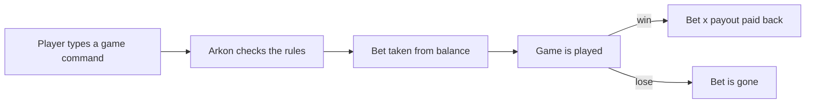

# Casino

The casino is a set of small gambling games that players play with your server's currency. A player types a command like `+coin 10 heads`, risks some currency, and either wins more or loses it. You decide the bet limits, the payouts and how often each game can be played.

The casino works the moment Arkon is in your server. You do not have to set anything up. This page shows how to change the defaults.

**You need:**

- Arkon in your server.
- Players with currency to spend. The casino uses the bank (the bot's built-in currency, which is separate for every Discord server). See [Economy](/guides/economy).

No Ark game server connection is needed. The casino only moves bank currency around inside Discord.

> Admin commands (`+casinoset ...` and the admin `+casino ...` commands) can be run by the server owner, anyone with the Admin role, or anyone with the Administrator permission. See [Getting started](/guides/getting-started) for setting the Admin role.
{.is-info}

## How it works



The rules Arkon checks, in this order: the casino is open, the game is open, the player's access level is high enough, the choice is valid, the bet is between the minimum and maximum, the player can afford it, and the game is not on cooldown.

**How payouts work.** The bet is taken first. If the player wins, Arkon pays back the bet times the game's payout number (the "multiplier"). A payout of 2.0 returns double the bet, so the player gains exactly their bet. A payout of 1.5 on a bet of 10 returns 15, a gain of 5.

## The games

Everyone can play every game by default. Each game has its own bet limits, payout and cooldown (see Defaults below). Type the game command with your bet, then the choice if the game needs one.

| Game | Command | How to play | How to win | Payout |
|---|---|---|---|---|
| Coin | `+coin <bet> <heads or tails>` | Pick a side | The coin lands on your side (1 in 2) | 1.5x |
| Cups | `+cups <bet> <1, 2 or 3>` | Pick a cup | The coin is under your cup (1 in 3) | 1.8x |
| Dice | `+dice <bet>` | Nothing to pick | Two dice add up to 2, 7, 11 or 12 (10 in 36) | 1.8x |
| Hilo | `+hilo <bet> <choice>` | Pick `high` (or `hi`), `low` (or `lo`), or `seven` (or `7`) | Two dice total above 7, below 7, or exactly 7 | 1.7x, and 5 times more for a correct seven |
| Craps | `+craps <bet>` | Nothing to pick | See below | 2.0x |
| Blackjack | `+blackjack <bet>` | Type `hit`, `stay` or `double` | Beat the dealer without going over 21 | 2.0x |
| War | `+war <bet>` | Nothing to pick | Your card is higher than the dealer's | 1.5x |
| Double | `+double <bet>` | Type `double` or `cash out` | Keep doubling, then cash out before a flip fails | Your own |
| Allin | `+allin <multiplier>` | You choose the multiplier | A lucky draw (see below) | Your own |

The payout column is the default. Admins can change it for every game except Double and Allin.

Aliases: `+bj` and `+21` for blackjack, `+don` and `+x2` for double, `+hl` for hilo.

> Type the choice in lowercase and in full: `heads`, `tails`, `high`, `low`, `seven`. Arkon accepts `h` and `t` at the first check, then rejects them with "Incorrect response". Capital letters are rejected too.
{.is-warning}


After each game, Arkon shows a green message when you win and a red one when you lose. It also shows your remaining balance. The number in brackets after your winnings, like `(+0)`, is the extra paid by your membership (see Memberships below).

### Hilo in detail

Low means the dice total is 2 to 6. High means 8 to 12. Seven means exactly 7. Low and high win about 42 times in 100. Seven wins about 17 times in 100, but it pays five times as much. At the default 1.7x, a winning seven returns 8.5 times the bet.

### Craps in detail

Arkon plays a simplified craps, always as a "pass line" bet (a bet that you will win).

1. Arkon rolls two dice, the "come-out" roll.
2. A total of 7 wins and pays triple (3 times, then the payout number, so 6x at the default 2.0).
3. A total of 11 wins at the normal payout.
4. A total of 2, 3 or 12 loses.
5. Any other total becomes your "point". Arkon says: "I'll roll the dice one more time. This time you will need exactly {point} to win." You win only if the next roll equals your point. Any other total loses.

### Blackjack in detail

You and the dealer each get two cards. You see one dealer card. You win by getting closer to 21 than the dealer without going over.

- `hit` takes another card.
- `stay` stops. The dealer then draws until they have 17 or more.
- `double` doubles your bet (it takes a second bet from your balance), gives you one more card, then the dealer plays. If you cannot cover the second bet, Arkon says "You can not cover the bet. Please choose hit or stay."
- Aces count as 1 or 11, whichever is better.
- A tie is a "push": you get your bet back.
- If your first two cards make 21, the hand ends right away.
- Splitting pairs is not supported.
- You have 35 seconds for each choice. If you do not answer, you stay.


### War in detail

You and the dealer each get one card. Aces are high. The higher card wins. If both cards match, it is "war": type `war` to draw again (you win if your new card is equal or higher), or type `surrender` to give up. If you do not answer in 35 seconds, you surrender. A surrender counts as a loss and nothing is paid back.

### Double in detail

Your bet is flipped like a coin. If it fails, you lose everything. If it works, the amount doubles and Arkon asks: type `double` to flip again, or `cash out` to keep the money. There is no payout setting. You are paid whatever you reached. If you do not answer in 35 seconds, you cash out. The first flip happens right away, so there is a 1 in 2 chance of losing before you can choose.

### Allin in detail

`+allin 10` puts your whole balance on a long shot. The number must be 2 or higher. After a short wait, you win with a chance of 1 in (your number plus 2). A win pays your balance times your number. A loss takes your whole balance. The higher your number, the bigger the prize and the worse the odds. Allin ignores bet limits. Its default cooldown is 12 hours.

## Player commands

| Command | Who | What it does | Example |
|---|---|---|---|
| `+coin <bet> <heads or tails>` | Everyone | Coin flip | `+coin 10 heads` |
| `+cups <bet> <1, 2 or 3>` | Everyone | Guess the cup | `+cups 25 2` |
| `+dice <bet>` | Everyone | Roll for 2, 7, 11 or 12 | `+dice 25` |
| `+hilo <bet> <choice>` (alias `+hl`) | Everyone | Guess high, low or seven | `+hilo 25 high` |
| `+craps <bet>` | Everyone | Play craps | `+craps 50` |
| `+blackjack <bet>` (aliases `+bj`, `+21`) | Everyone | Play blackjack | `+blackjack 100` |
| `+war <bet>` | Everyone | Play war | `+war 25` |
| `+double <bet>` (aliases `+don`, `+x2`) | Everyone | Double or nothing | `+double 10` |
| `+allin <multiplier>` | Everyone | Bet everything | `+allin 5` |
| `+casino info` | Everyone | Shows every game with limits, payout, on/off and cooldown | `+casino info` |
| `+casino stats [player]` | Everyone | Shows games played, games won and cooldowns for you or another player | `+casino stats @RexRider` |
| `+casino memberships` | Everyone | Lists memberships and what each one needs and gives | `+casino memberships` |
| `+casino version` | Everyone | Shows the casino version | `+casino version` |

All game commands only work inside a server, not in direct messages.


In the `+casino info` table, `Access` is the membership level a game needs, `On` shows whether the game is open, and `CD` is the cooldown between plays.

## Memberships

Memberships are optional perks. A player who meets a membership's requirements gets it automatically. Memberships can give:

- **Access:** a level number. Games can be locked behind a level, so only members at or above it can play.
- **Cooldown reduction:** a number of seconds taken off every game's cooldown.
- **Bonus multiplier:** a number like 1.5 that multiplies winnings. With a 1.5 bonus, a win that would pay 20 pays 30. The bonus does not apply to Double or Allin.

Everyone starts as `Basic`: access level 0, no reduction, no bonus.

**Requirements** (a membership can use any of these, and a player must meet all of the ones you set):

- **Credits:** the player's current balance must be at least this much.
- **Role:** the player must have this Discord role.
- **Days on server:** the player must have been in your server this many days.

If a player qualifies for several memberships, they get the one with the highest access level. Arkon rechecks everyone every 5 minutes. A player only starts being checked after they have played a casino game at least once.

You can also hand someone a membership by hand. A hand-given membership skips the requirements until you revoke it.

### Step 1: Create a membership

Where: any channel the bot can see.

Type:

```
+casino memdesigner
```

You will see: "Do you wish to `create`, `edit`, or `delete` an existing membership?" Type `create`.

Arkon then asks a series of questions. Answer each one in the channel within 25 seconds. To stop at any time, type the word `cancel` with the Arkon prefix in front of it (a plus sign, no space).

| Question | What to type |
|---|---|
| What name would you like to set? | A name using only letters, numbers, spaces and hyphens, like `VIP` |
| What access level would you like to set? | A whole number, 1 or higher |
| What color would you like to set? | One of blue, red, green, orange, purple, yellow, turquoise, teal, magenta, pink, white |
| What is the cooldown reduction of this membership in seconds? | A whole number, 1 or higher |
| What is the bonus payout multiplier for this membership? | A number above 0, like `1.25` (type `1` for no bonus) |
| Which requirement would you like to add or modify? | `credits`, `role` or `days on server` |

After each requirement Arkon asks "Would you like to continue adding or modifying requirements?" Answer `yes` to add more, or `no` to finish.

You will see: a green "Membership sucessfully created." message listing everything you chose.

> A new membership has no effect on game access until you give games an access level (see the next section). Every game starts at access level 0.
{.is-info}

### Step 2: Edit or delete a membership

Run `+casino memdesigner` again and type `edit` or `delete`, then the membership's name. For `edit` you pick what to change: `requirements`, `access`, `color`, `name`, `reduction` or `bonus`.

### Step 3: Give or take away a membership by hand

```
+casino assignmem @RexRider VIP
+casino revokemem @RexRider
```

A revoked player drops to `Basic` right away, then the 5 minute check puts them back to whatever they qualify for.

### Step 4: Check it worked

Type `+casino memberships`. Arkon lists the membership names. Type one name and Arkon shows its access level, cooldown reduction, bonus, requirements and which games it can play. Players can see their own with `+casino stats`.

## Set up the casino (admin)

Every step here is optional. Each setting can be changed at any time.

### Step 1: Give your casino a name

The name appears at the top of every game result. The default is "Redjumpman's", which will show your players "Redjumpman's Casino". Change it.

Type:

```
+casinoset name Tek Temple
```

You will see: your name and ID, then "set the casino name to Tek Temple." The name can be 30 characters at most.

### Step 2: Set bets, payouts and cooldowns

Use the game name (any capitals) and a number:

```
+casinoset min coin 10
+casinoset max coin 100
+casinoset multiplier coin 1.8
+casinoset cooldown coin 30
```

For `cooldown`, type seconds (`30`), minutes and seconds (`2:30`), or hours, minutes and seconds (`1:00:00`).

The game names are: Allin, Blackjack, Coin, Craps, Cups, Dice, Double, Hilo, War.

Coin is the odd one out: its default minimum and maximum are both 10, so players can only bet exactly 10. Raise the maximum if you want more.

Allin has no min or max. Allin and Double have no multiplier setting because the player controls their result.

### Step 3: Lock games behind a membership (optional)

```
+casinoset access blackjack 1
```

Now only players whose membership has access level 1 or higher can play blackjack. Players below that see: "Blackjack requires an access level of 1. Your current access level is 0. Obtain a higher membership to play this game."

Set it back to 0 to open the game to everyone.

### Step 4: Close or open a game or the whole casino

```
+casinoset gametoggle war
+casinoset toggle
```

`gametoggle` closes a game (or opens it again). `toggle` closes or opens the whole casino. Each time, Arkon says whether it is now opened or closed.

### Step 5: Set a payout limit (optional)

A payout limit stops huge wins from landing automatically. It is a safety net against someone finding a way to cheat.

```
+casinoset payoutlimit 5000
+casinoset payouttoggle
```

`payouttoggle` switches the limit on or off. It is off by default. When it is on, any single win bigger than the limit is held back. The player sees the normal result and a direct message saying the winnings are pending until an admin reviews them. A player can have only one pending payout at a time.

To release the held currency:

```
+casino releasecredits @RexRider
```

Arkon says how many credits are pending and asks if you want to release them. Type `yes` within 25 seconds.

### Step 6: Check it worked

Type `+casino info`. You should see your new limits, payouts, cooldowns and casino name. Then play a game yourself.

### Message style (optional)

By default Arkon edits one message as a game goes on. Type `+casinoset oldstyle` to make it send a new message each time instead. Type it again to switch back.

## Admin commands

| Command | Who | What it does | Example |
|---|---|---|---|
| `+casino admin` | Admin | Shows a list of admin commands | `+casino admin` |
| `+casinoset name <name>` | Admin | Sets the casino name (30 characters max) | `+casinoset name Tek Temple` |
| `+casinoset toggle` | Admin | Opens or closes the whole casino | `+casinoset toggle` |
| `+casinoset gametoggle <game>` | Admin | Opens or closes one game | `+casinoset gametoggle war` |
| `+casinoset min <game> <amount>` | Admin | Sets the smallest bet | `+casinoset min dice 10` |
| `+casinoset max <game> <amount>` | Admin | Sets the largest bet | `+casinoset max dice 200` |
| `+casinoset multiplier <game> <number>` | Admin | Sets the payout number (not Allin or Double) | `+casinoset multiplier dice 2` |
| `+casinoset cooldown <game> <time>` | Admin | Sets the wait between plays | `+casinoset cooldown war 1:00` |
| `+casinoset access <game> <level>` | Admin | Sets the membership level a game needs | `+casinoset access craps 2` |
| `+casinoset payoutlimit <amount>` | Admin | Sets the biggest win paid out automatically | `+casinoset payoutlimit 5000` |
| `+casinoset payouttoggle` | Admin | Switches the payout limit on or off | `+casinoset payouttoggle` |
| `+casinoset oldstyle` | Admin | Switches between editing and sending new messages | `+casinoset oldstyle` |
| `+casino memdesigner` | Admin | Creates, edits or deletes memberships | `+casino memdesigner` |
| `+casino assignmem <player> <membership>` | Admin | Gives a membership by hand | `+casino assignmem @RexRider VIP` |
| `+casino revokemem <player>` | Admin | Removes a hand-given membership | `+casino revokemem @RexRider` |
| `+casino releasecredits <player>` | Admin | Releases held winnings | `+casino releasecredits @RexRider` |
| `+casino resetuser <player>` | Admin | Resets one player's `cooldowns`, `stats` or `all` (Arkon asks which) | `+casino resetuser @RexRider` |
| `+casino resetinstance` | Admin | Resets `settings`, `games`, `cooldowns`, `memberships` or `all` (Arkon asks which) | `+casino resetinstance` |

`resetinstance` with `all` resets every setting, game, membership and cooldown for your server. Player stats are kept. Think before you type `all`.

The bot owner controls one more setting: whether the casino runs per server (the default) or shared across every server the bot is in. Your admin commands work the normal way as long as it stays on the default.

### Defaults

| Game | Min bet | Max bet | Payout | Cooldown | Access |
|---|---|---|---|---|---|
| Allin | None | None | Player's choice | 12 hours | 0 |
| Blackjack | 50 | 500 | 2.0 | 5 seconds | 0 |
| Coin | 10 | 10 | 1.5 | 5 seconds | 0 |
| Craps | 50 | 500 | 2.0 | 5 seconds | 0 |
| Cups | 25 | 100 | 1.8 | 5 seconds | 0 |
| Dice | 25 | 100 | 1.8 | 5 seconds | 0 |
| Double | 10 | 250 | Player's result | 5 seconds | 0 |
| Hilo | 25 | 75 | 1.7 | 5 seconds | 0 |
| War | 25 | 75 | 1.5 | 5 seconds | 0 |

| Setting | Default | Command |
|---|---|---|
| Casino name | Redjumpman's | `+casinoset name` |
| Casino open | Yes | `+casinoset toggle` |
| Payout limit | Off, limit 10000 | `+casinoset payouttoggle`, `+casinoset payoutlimit` |
| Message style | Edit one message | `+casinoset oldstyle` |
| Memberships | None | `+casino memdesigner` |

Notes:

- Every game is open and at access level 0 until you change it.
- A game's cooldown is per player and per game. Winning or losing does not change it.
- A membership's cooldown reduction is taken off the wait for every game.
- Game names are not case sensitive.
- Do not type negative numbers. Arkon refuses most of them with "Go home. You're drunk."

## Common problems

| Problem | Why it happens | Fix |
|---|---|---|
| "The Casino is closed." | An admin ran `+casinoset toggle` | Admin runs `+casinoset toggle` again |
| "Coin is closed." | That game was closed with `gametoggle` | Admin runs `+casinoset gametoggle coin` |
| "Blackjack requires an access level of 1. Your current access level is 0. Obtain a higher membership to play this game." | The game is locked behind a membership | Earn the membership, or admin lowers it with `+casinoset access blackjack 0` |
| "Incorrect response. Accepted responses are:" followed by a list | The choice was misspelled, in capitals, or shortened | Type it in lowercase in full, like `heads` or `high` |
| "You must bet heads or tails." | The coin choice was not heads, tails, h or t | `+coin 10 heads` |
| "Your bet must be between 10 and 10." | The bet is outside the game's limits | Bet inside the range, or admin changes `min` and `max` |
| "You do not have enough credits to cover the bet." | Balance is too low | Earn more currency ([Economy](/guides/economy)) |
| "Coin is still on a cooldown. You still have: 4 seconds remaining." | The game was played too recently | Wait, or admin shortens it with `+casinoset cooldown` |
| "Your multiplier must be 2 or higher." | Allin needs a multiplier of 2 or more | `+allin 2` or higher |
| "This games's multiplier is determined by the user." | Admin tried to set a multiplier for Allin or Double | Not possible, skip it |
| "Invalid game name. Must be on of the following:" followed by a list | The game name is wrong (the typo is in the real message) | Use one of the listed names |
| "Invalid cooldown format. Must be an integer or in HH:MM:SS style." | The time was not numbers and colons | Use `30` or `1:30` |
| "You can't set a minimum higher than the game's maximum bid." | Min would be above max | Raise the max first |
| "You can't set a maximum lower than the game's minimum bid." | Max would be below min | Lower the min first |
| "Your Casino name must be 30 characters or less." | The name is too long | Shorten it |
| "There are no memberships to display." | No memberships exist yet | Create one with `+casino memdesigner` |
| "{name} is not a registered membership." | The membership name does not match | Type it exactly as created, capitals included |
| "{name} has no assigned membership." | `revokemem` on a player without a hand-given one | Nothing to do |
| "This user doesn't have any credits pending." | No held winnings | Nothing to release |
| "No Response." or "Process timed out. Exiting membership process." | You took longer than 25 seconds to answer | Run the command again |
| "While the casino is in global mode, only the bot owner may use this command." | The bot owner turned on shared mode | Ask the bot owner |

## Related pages

- [Games hub](/guides/games)
- [Economy](/guides/economy)
- [Getting started](/guides/getting-started)
- [Player getting started](/guides/player-getting-started)
- [FAQ](/guides/faq)
