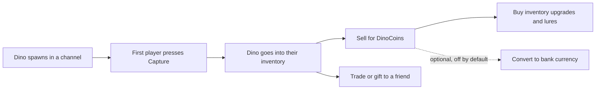

# Dino Collector

Dino Collector is a small collecting game for your Discord chat. A random dino pops up in a channel. The first player to press **Capture** keeps it. Players sell dinos for coins, fill a book of every species and trade with each other. It gives your members a reason to keep chatting.

**You need:**

- Arkon in your server ([Getting started](/guides/getting-started)).
- A text channel where the bot can send messages and embeds (boxes with a title and fields).
- Nothing else. No game server, RCON or registration is needed.

Dino Collector has its own currency called **DinoCoins**. It does not touch the bank (the bot's built-in server currency, see [Economy](/guides/economy)) unless you turn on the optional conversion described below. Conversion is off by default.

## How it works



Each Discord server has its own game. Players, coins and settings are never shared between servers.

> Admin commands (`+dcset ...`, `+dcspawn ...`, `+dcsetup`) can be run by the server owner, anyone with the Admin role, or anyone with the Manage Server permission. See [Getting started](/guides/getting-started) for setting the Admin and Mod roles.
{.is-info}

## Setup

### Step 1: Run the setup wizard

Where: any channel the bot can see.

Type:

```
+dcsetup
```

You will see: Arkon asks "Would you like to perform a **full** setup, or a **quick** setup? (Type `full` or `quick`)". Type:

```
quick
```

The full setup only says it is under construction, so always pick quick. You have 60 seconds to answer each question, otherwise Arkon says "Setup Cancelled, please run the command again if you wish to continue."

### Step 2: Answer the wizard questions

The wizard asks these questions in order. Use the buttons, or type in the same channel where it says so.

1. **Admin role?** Yes or No. If Yes, mention a role or paste its ID. (This role only lets people skip the blacklist. It does not give them admin commands. See Notes below.)
2. **Which channel should the game start in?** Mention a channel like `#dino-zone` or paste its ID. You can add more channels later.
3. **Time or Message spawn method?** Time means a dino can appear every few minutes. Message means a dino can appear when people chat in the channel. See "How spawns work" below.
4. **Allow bank currency conversion?** Yes or No. Pick No if you are unsure. You can change it later.
5. If Yes: **Set or Default conversion rate?** The default is 100 DinoCoins for 1 unit of your bank currency.
6. **Ready to start the game?** Yes starts spawning right away. No leaves it off until you type `+dcset startgame`.

### Step 3: Check it worked

Type:

```
+dcset display
```

You should see "Game Status: Enabled" and your channel under "Allowed Channels".


### Step 4: Spawn a test dino

Type `+dcspawn random` in the game channel. A dino message with a **Capture** button appears. Press it to make sure it works.


## How spawns work

Pick one of two modes with `+dcset mode time` or `+dcset mode message`.

- **Time mode** (the default). Arkon checks once a minute. After the interval has passed since the last spawn (default 300 seconds), it rolls the spawn chance (default 5%). A miss means it rolls again a minute later. So with the defaults, a dino shows up roughly every 25 minutes on average.
- **Message mode.** Every message a member sends in an allowed channel can trigger a roll. The chance is the same spawn chance (default 5%). After a spawn, nobody can trigger another for the cooldown (default 30 seconds).

Other things to know:

- Time mode with no allowed channels picks a random text channel where the bot can send messages. That can include staff or private channels. Add your game channels with `+dcset channel add` so spawns stay where you want them.
- When several channels are allowed, time mode avoids repeating the last channel.
- A spawn can be captured for about 90 seconds. After that the button stops working. About 30 seconds later the message says "Too slow!" (or is deleted if cleanup is on).
- The first player to press **Capture** wins. There is a 15% chance a dino escapes instead. You cannot change that number. When it escapes, the dino is gone for everyone and the message says "It fled from" the player who pressed.
- A player with a full inventory cannot capture. They see "Your inventory is full".

## How players play

Players need no setup. They just watch for spawns and press **Capture**.

| What | How it works |
|---|---|
| Capture | Press the button on a spawn. The dino goes into your inventory (starts at 20 slots). |
| Explorer Log | A book of every species you ever caught. `+dclog` shows it. Unknown species show as "Unknown Dino!". |
| Sell | `+dcsell <number>`, `+dcsell all` or `+dcsell <rarity>`. You always get a confirmation first. |
| Buddy | Keep one favourite dino as a buddy. It boosts every sale (see below). |
| Lure | A shop item that spawns a dino right now in the channel where you use it. |
| Trade | Gift a dino, sell it for coins, or swap dinos with another player. |
| Achievements | 52 one-time goals that pay out coins. Open `+dcstats` and press **Achievements**. |

### What a dino is worth

There are 238 species. Each has a rarity, and the rarity sets a coin range. Rarer dinos spawn less often.

| Rarity | Species | Coin range | Spawn weight |
|---|---|---|---|
| Common | 75 | 10 to 35 | 80 |
| Uncommon | 61 | 25 to 65 | 70 |
| Semi-Rare | 43 | 40 to 95 | 50 |
| Rare | 17 | 50 to 115 | 20 |
| Very Rare | 5 | 65 to 130 | 15 |
| Super Rare | 8 | 80 to 150 | 10 |
| Legendary | 16 | 90 to 165 | 5 |
| Event | 13 | 150 to 215 | 30 (only while that event is on) |

Spawn weight is relative: a Common is 16 times more likely than a Legendary. Arkon picks the rarity first, then a random species of that rarity.

Every spawn also gets a **modifier** that changes the value. The coin value is shown on the spawn message.

| Group | Chance | Modifiers (coin change) |
|---|---|---|
| Normal | 70% | normal (0), muscular (+5), young (-1) |
| Rare | 20% | sickly (-5), withered (-3), irradiated (-2) |
| Special | 10% | shiny (+25), corrupted (+5), aberrant (+3) |

Each group picks one of its three modifiers evenly. A value never drops below 1.

### Selling

- `+dcsell all` sells everything except shiny and event dinos. Those are protected, so you must sell them one by one by number.
- `+dcsell <rarity>` sells every dino of that rarity, except shinies. Rarity words: `common`, `uncommon`, `semi` or `semi_rare`, `rare`, `very` or `very_rare`, `super` or `super_rare`, `legendary`, `event`.
- Your numbers come from `+dcinv`.


### Buddy bonus

`+dcbuddy set <number>` moves one dino from your inventory to be your buddy. While it is set, every sale pays a bonus on top, based on the buddy's rarity. A buddy does not use an inventory slot.

| Buddy rarity | Bonus |
|---|---|
| Common | 0% |
| Uncommon | 1% |
| Semi-Rare | 2% |
| Rare | 3% |
| Very Rare | 4% |
| Super Rare | 5% |
| Legendary | 6% |
| Event | 7% |

You can rename your buddy with `+dcbuddy name <name>`. Names are checked against a blocked-words list that admins control. Return it to your inventory with `+dcbuddy clear` (needs one free slot).

### Explorer Log reward

Catch every non-event species (225 of them) and `+dclog sell` pays a big reward (default 7,500 DinoCoins). The log is then wiped so you can start again. Event species are bonus entries and are not required.

### Shop, lures and trading

- `+dcshop` shows your coins and what you can buy.
- `+dcshop buy upgrade` adds 10 inventory slots for 500 coins. You can do this 23 times, up to 250 slots.
- `+dcshop buy lure` costs 200 coins. You can hold one lure at a time. `+dclure` uses it in the current channel and starts a one hour cooldown. A lure only works in an allowed channel.
- `+dctrade @user <your number> free` gifts a dino.
- `+dctrade @user <your number> coin <amount>` sells it for coins.
- `+dctrade @user <your number> dino <their number>` swaps dinos.
- The other player has 2 minutes to press **Accept Trade**. The sender can only cancel.

### Turning coins into bank currency

If you enabled conversion, players can move value both ways:

- `+dcconvert <amount>` or `+dcconvert all` turns DinoCoins into bank currency at your rate. Only whole units are paid.
- `+dcinvest <amount>` turns bank currency into DinoCoins at the same rate.

With the default rate, 100 DinoCoins equal 1 unit of bank currency in both directions. Think about your server's economy before turning this on. Dino Collector coins are earned just by playing, so a low rate lets players print bank currency.

## Commands

Player commands work for everyone, except users on the blacklist.

| Command | Who | What it does | Example |
|---|---|---|---|
| `+dchelp` | Everyone | Opens an in-chat help menu with buttons | `+dchelp` |
| `+dcleaderboard` (alias `+dclb`) | Everyone | Players ranked by dinos captured, 5 per page | `+dclb` |
| `+dclog` (alias `+dcel`) | Everyone | Shows your Explorer Log | `+dclog` |
| `+dclog sell` | Everyone | Sells a completed Explorer Log | `+dclog sell` |
| `+dcinv [user]` | Everyone | Shows an inventory, 25 dinos per page | `+dcinv @TekTitan` |
| `+dcsell <number, all or rarity>` | Everyone | Sells dinos after a confirm button | `+dcsell rare` |
| `+dcbuddy set <number>` | Everyone | Makes an inventory dino your buddy | `+dcbuddy set 3` |
| `+dcbuddy clear` | Everyone | Returns your buddy to your inventory | `+dcbuddy clear` |
| `+dcbuddy name <name>` | Everyone | Renames your buddy | `+dcbuddy name Rexy` |
| `+dcbuddy info` | Everyone | Shows your buddy and bonus earned | `+dcbuddy info` |
| `+dclure` | Everyone | Uses your lure to spawn a dino here | `+dclure` |
| `+dctrade <user> <your number> <free, coin or dino> [value]` | Everyone | Offers a trade | `+dctrade @RexRider 2 coin 150` |
| `+dcstats [user]` (alias `+dcstat`) | Everyone | Stats card with an Achievements button | `+dcstats` |
| `+dcshop` | Everyone | Shows your coins and the shop | `+dcshop` |
| `+dcshop buy upgrade` | Everyone | Buys 10 more inventory slots | `+dcshop buy upgrade` |
| `+dcshop buy lure` | Everyone | Buys a lure | `+dcshop buy lure` |
| `+dcconvert <amount or all>` | Everyone | DinoCoins to bank currency (if enabled) | `+dcconvert 500` |
| `+dcinvest <amount>` | Everyone | Bank currency to DinoCoins (if enabled) | `+dcinvest 5` |
| `+dcsetup` | Admin | The setup wizard | `+dcsetup` |
| `+dcset` | Admin | Shows the list of admin settings | `+dcset` |
| `+dcset startgame` | Admin | Starts spawning | `+dcset startgame` |
| `+dcset stopgame` | Admin | Stops spawning | `+dcset stopgame` |
| `+dcset display` | Admin | Shows the main settings | `+dcset display` |
| `+dcset displayshop` | Admin | Shows the shop settings | `+dcset displayshop` |
| `+dcset mode <message or time>` | Admin | Sets the spawn mode | `+dcset mode message` |
| `+dcset chance <0-100>` | Admin | Spawn chance in percent (used by both modes) | `+dcset chance 10` |
| `+dcset interval <seconds>` | Admin | Time mode wait, 60 or more | `+dcset interval 600` |
| `+dcset cooldown <seconds>` | Admin | Message mode wait after a spawn | `+dcset cooldown 60` |
| `+dcset channel add <channel>` | Admin | Allows a channel | `+dcset channel add #dino-zone` |
| `+dcset channel remove <channel or ID>` | Admin | Removes an allowed channel (works for deleted channels too) | `+dcset channel remove #dino-zone` |
| `+dcset channel list` | Admin | Lists allowed channels | `+dcset channel list` |
| `+dcset cleanup` | Admin | Toggles deleting spawn messages when done | `+dcset cleanup` |
| `+dcset event [on or off]` | Admin | Shows or toggles event mode | `+dcset event on` |
| `+dcset activeevent <type>` | Admin | Picks the event: valentines, easter, halloween or christmas | `+dcset activeevent halloween` |
| `+dcset conversion [on or off]` | Admin | Shows or toggles bank conversion | `+dcset conversion on` |
| `+dcset convertrate <rate>` | Admin | DinoCoins per 1 bank unit, at least 1 | `+dcset convertrate 200` |
| `+dcset buddybonus [on or off]` | Admin | Shows or toggles the buddy bonus | `+dcset buddybonus off` |
| `+dcset logprice <amount>` | Admin | Explorer Log sale reward | `+dcset logprice 10000` |
| `+dcset shop upgrade_price <price>` | Admin | Inventory upgrade price | `+dcset shop upgrade_price 800` |
| `+dcset shop lure_price <price>` | Admin | Lure price | `+dcset shop lure_price 300` |
| `+dcset shop lure_cooldown <seconds>` | Admin | Time between lure uses | `+dcset shop lure_cooldown 1800` |
| `+dcset adminrole [role]` | Admin | Sets the DinoCollector admin role (empty clears it) | `+dcset adminrole @Mods` |
| `+dcset blacklist [user]` | Admin | Adds or removes a user from the blacklist. With no user, lists them | `+dcset blacklist @TekTitan` |
| `+dcset filter add <word>` | Admin | Blocks a word in buddy names | `+dcset filter add badword` |
| `+dcset filter remove <word>` | Admin | Unblocks a word | `+dcset filter remove badword` |
| `+dcset filter list` | Admin | Lists blocked words | `+dcset filter list` |
| `+dcset setcoin <user> <amount>` | Admin | Gives, takes or sets coins. `+500` adds, `-500` removes, `500` sets | `+dcset setcoin @RexRider +500` |
| `+dcset setuser <user> log full` | Admin | Fills a player's Explorer Log with every species | `+dcset setuser @RexRider log full` |
| `+dcset resetuser <user>` | Admin | Deletes all of one player's data, after a confirm button | `+dcset resetuser @RexRider` |
| `+dcset spawn` | Admin | Spawns a test dino here | `+dcset spawn` |
| `+dcspawn random [channel]` | Admin | Spawns a random dino, here or in a channel | `+dcspawn random #dino-zone` |
| `+dcspawn rarity <rarity>` | Admin | Spawns a dino of one rarity | `+dcspawn rarity legendary` |
| `+dcspawn modifier <modifier>` | Admin | Spawns a dino with one modifier | `+dcspawn modifier shiny` |
| `+dcspawn full <modifier> <creature> [channel]` | Admin | Spawns one exact dino. Use the lowercase species key | `+dcspawn full shiny achatina` |

### Defaults

| Setting | Default | Command |
|---|---|---|
| Game | Off until started | `+dcset startgame` |
| Spawn mode | time | `+dcset mode` |
| Spawn chance | 5% | `+dcset chance` |
| Spawn interval (time mode) | 300 seconds | `+dcset interval` |
| Spawn cooldown (message mode) | 30 seconds | `+dcset cooldown` |
| Escape chance | 15% (fixed) | none |
| Allowed channels | None (all channels) | `+dcset channel add` |
| Message cleanup | Off | `+dcset cleanup` |
| Starting inventory | 20 slots | none |
| Slots per upgrade | 10 | none |
| Upgrade price | 500 coins | `+dcset shop upgrade_price` |
| Most upgrades | 23 (250 slots) | none |
| Lure price | 200 coins | `+dcset shop lure_price` |
| Lure cooldown | 3600 seconds (1 hour) | `+dcset shop lure_cooldown` |
| Buddy bonus | On | `+dcset buddybonus` |
| Explorer Log reward | 7500 coins | `+dcset logprice` |
| Bank conversion | Off | `+dcset conversion` |
| Conversion rate | 100 DinoCoins per 1 bank unit | `+dcset convertrate` |
| Event mode | Off | `+dcset event` |
| Admin role | None | `+dcset adminrole` |

Notes:

- Only the spawn mode and channels need decisions. The defaults work for most servers.
- **Allowed channels** limit where spawns appear and where lures work. In message mode, only chat in those channels can trigger spawns. Anyone can still use commands like `+dcinv` in any channel.
- **Events** add seasonal dinos (valentines 2, easter 2, halloween 7, christmas 2). Turn one on with `+dcset activeevent halloween`. That also switches event mode on. Turn it off with `+dcset event off`. Test spawns from `+dcset spawn` ignore the active event, but `+dcspawn ...` honours it.
- **Message cleanup** deletes the spawn message 60 seconds after a capture, and also after a spawn expires. With cleanup off, finished spawns stay in the channel greyed out.
- The **blacklist** blocks a user from every Dino Collector command (they get no reply) and from pressing Capture. Admins are never blocked.
- The **Admin role** setting only lets role members skip the blacklist. It does not give them `+dcset`. Only people with the Admin role or Manage Server can run `+dcset`.
- `+dcset display` also shows "Dino Image Usage". There is no command to change it.
- `+dcset shop` is a group. Typing it alone shows its help.
- `+dcset resetuser` and `+dcset setcoin` work on one server only.

## Common problems

| Problem | Why it happens | Fix |
|---|---|---|
| Nothing ever spawns | The game is off, or no channel can receive spawns | `+dcset startgame`, then `+dcset display` and check Game Status and Allowed Channels |
| "The game is already enabled." | You ran `startgame` twice | Nothing to do |
| Spawns appear in the wrong channel | No allowed channels set in time mode | `+dcset channel add #your-channel` |
| Spawns are very rare | Chance is 5% and time mode rolls once a minute | Raise `+dcset chance` or lower `+dcset interval` |
| "Interval must be at least 60 seconds." | Interval is too small | Use 60 or more |
| "Chance must be between 0 and 100." | Bad number | Use 0 to 100 |
| "Invalid mode. Please choose 'message' or 'time'." | Typo | `+dcset mode time` |
| "Your inventory is full (20/20)! Sell some dinos to make space." | The player has no free slots | Sell dinos or buy an upgrade |
| "This creature has already been captured!" | Someone else was faster | Wait for the next spawn |
| "You are blacklisted from using DinoCollector!" | The player is on the blacklist | `+dcset blacklist @user` removes them |
| "You already have a lure! Use it with `dclure` before buying another." | Only one lure can be held | Use it with `+dclure` |
| "You cannot use a lure in this channel!" | Allowed channels are set and this one is not on the list | Use the lure in an allowed channel |
| "You must wait **12m 5s** before using another lure." | Lure cooldown | Wait, or lower the cooldown |
| "Your Explorer Log is not complete for non-event species yet. Event species are bonus and do not block selling." | Not all 225 standard species are caught | Keep catching, or trade for the missing ones |
| "You can only look at your own log." | Others' logs are private | Use `+dclog` with no name |
| "Currency conversion is disabled on this server." | Conversion is off | `+dcset conversion on` |
| "You need at least 100 DinoCoins to convert (Rate: 100 DC = 1 Credits)." | Below one full unit | Earn more coins |
| "Invalid selection. Use a number, 'all', or a rarity (common, rare, etc)." | Bad word after `+dcsell` | Use a number, `all` or a rarity |
| "No dinos matched your selection (Shiny and Event dinos are protected from bulk selling)." | Only protected dinos matched | Sell them by number |
| "You must sell at least one dino first." | Buddy clear needs a free slot | Sell a dino, then try again |
| "That is not a valid event." | Wrong event word | Use valentines, easter, halloween or christmas |

## Related pages

- [Games overview](/guides/games)
- [Economy and the bank](/guides/economy)
- [Getting started](/guides/getting-started)
- [Fishing](/guides/game-fishing)
- [Hunting](/guides/game-hunting)
- [FAQ](/guides/faq)
