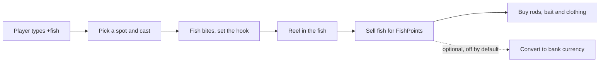

# Greenacres Fishing

Greenacres Fishing is a relaxing fishing game that runs inside Discord. A player types `+fish`, picks a spot, casts a line and then presses buttons to hook and reel in a fish. They sell the catch, buy better rods and bait, and compete on leaderboards.

**You need:**

- Arkon in your server ([Getting started](/guides/getting-started)).
- A text channel where members can use the bot.
- Nothing else. No game server, RCON or registration is needed.

Fishing has its own currency called **FishPoints (FP)**. It does not use the bank (the bot's built-in server currency, see [Economy](/guides/economy)) unless you turn on the optional conversion described below. Conversion is off by default.

## How it works



Each Discord server has its own game. Players, points and settings are never shared between servers.

> Admin commands (`+fishset ...`, `+fishsetup`) can be run by the server owner, anyone with the Admin role, or anyone with the Administrator permission. Manage Server alone is not enough. See [Getting started](/guides/getting-started) for setting the Admin and Mod roles.
{.is-info}

## Setup

### Step 1: Run the setup wizard

Where: any channel the bot can see.

Type:

```
+fishsetup
```

You will see: an embed titled "Greenacres Fishing Setup" with a **Start Setup** button. Only you can press its buttons. The wizard has 5 steps.

### Step 2: Answer the wizard

1. **Select Timezone.** Type your timezone in the chat, for example `America/New_York`, `Europe/London` or `UTC`. Press **View Timezones** to browse a list, or **Skip** to keep the current one. Arkon checks the name and replies "Timezone set to ..." or "is not a recognized timezone".
2. **Select Hemisphere.** Press **Northern Hemisphere** or **Southern Hemisphere**, or **Skip**. This flips the seasons for your server.
3. **Game Time Preview.** Shows the in-game clock, the season and your real time. Press **Enable Game** to turn the game on, or **Keep Disabled** to leave it off.
4. **Currency Conversion.** Press **Enable Conversion** or **Disable Conversion**. Pick Disable if you are unsure. You can change it later.
5. If you enabled conversion: **Set Conversion Rate.** Press **Set Custom Rate** and type a number, or **Keep Default** (1 FishPoint for 1 unit of bank currency). See "Turning points into bank currency" below before keeping the default.

The wizard ends with a "Setup Complete!" summary. It times out after 5 minutes, and the timezone step after 2 minutes of silence. Just run `+fishsetup` again.

### Step 3: Check it worked

Type:

```
+fishset display
```

You should see "Game State: Enabled".


### Step 4: Try the game

Type `+fish`. A first-time player sees a welcome screen with a **Start Fishing!** button. After that they land on the main menu.


### Optional: limit it to one channel

By default `+fish` works in every channel. To restrict it:

```
+fishset channel add #fishing
```

Once at least one channel is on the list, `+fish` and `+fishinfo` only work there. People outside the list get no reply at all. Admins can still use them anywhere.

## How players play

### The main menu

`+fish` opens a menu with buttons. Only the player who opened it can press them. Each menu closes itself after 5 minutes without clicks.

| Button | What it does |
|---|---|
| Go Fishing | Pick Pond, Lake, River or Ocean, then cast |
| Bait Shop | Buy rods, bait and clothing, and sell fish |
| Inventory | See rods, bait, clothing and fish, and equip clothing |
| Leaderboards | Top players by catches, sales, points and per-fish records |
| Search Garbage | Free bait once every 12 hours |
| Close | Closes the menu |

The menu also shows the game clock, the weather and the player's stats.

### Starter kit

A new player gets a Wooden Canepole (a starter rod), 10 Breadballs (bait) and 100 FishPoints.

### Casting and catching

1. Pick a spot: **Pond**, **Lake**, **River** (all fresh water) or **Ocean** (salt water).
2. Press **Cast Line**. Arkon waits about 10 seconds for a bite. If nothing bites, it keeps waiting by itself.
3. You can press **Retrieve** while waiting. That pulls in 5 feet of line. A shorter line makes fish warier.
4. When something follows the bait, wait. If the fish strikes you see "FISH ON! Set the hook!". Press **SET HOOK!** within 5 seconds.
5. Now the fight starts. Arkon shows a message each round:
   - A fighting message means press **Reel In** (5 feet each time).
   - A "HIGH TENSION" message means **do not press anything**. Wait for the tension to ease.
6. You have about 3 seconds to react each round. Reeling during tension, or hesitating when you should reel, is a **mistake**. The fish pulls out 5 more feet of line.
7. Three mistakes snap the line. The fish escapes, you lose one bait item and the rod takes damage.
8. Reel the line all the way in to land the fish. It goes into your fish bucket.


What gets used up:

- **Bait** loses one use for each fish you land. Some bait has several uses per item (see the table below).
- **Rod durability** only drops when a line snaps. The damage is 5 points (never less than 2). A rod at 0 durability is broken and cannot be used. There is no repair, so buy a new one.
- Fish that follow but swim away cost nothing.

Where and how you fish matters:

- **Rods and water.** Each rod only works in some places. Using the wrong one gives "isn't suited for" and a hint about which water it is for.
- **Bait.** Different baits attract different fish. Fresh water bait, salt water bait and "universal" bait are sold separately.
- **Season, weather and time of day** change which fish are around. The season follows your real calendar (set by the timezone and hemisphere). The in-game clock runs at 2 times speed, so one game day lasts 12 real hours.

### What players earn

Fishing pays in **FishPoints**. Catching a fish does not pay anything by itself. Points arrive when the fish is sold.

- Open **Bait Shop** and press **Sell Fish**, then **Sell All**. Each fish pays a fixed amount for its species. Size does not change the price.
- There are 38 species. Prices run from 8 FP (common fish) up to 350 FP (the rarest big game fish). Fish are in 5 rarities: common (8 species), uncommon (12), rare (10), epic (3) and legendary (5).
- You can list every fish with `+fishset listfish` (admin command).
- Your fish bucket has no size limit.

**FishMaster Tokens** are a second, rare currency. You earn one when you land a fish at its absolute maximum weight or maximum length for its species. That is a very rare catch (a fraction of one percent of catches). Tokens only buy the three FishMaster clothing items.

Personal records for each species are tracked too, and the leaderboards show them.

### The Bait Shop

| Category | Items and prices |
|---|---|
| Rods | Wooden Canepole (free, 50 durability, fresh water), Casting Rod (150 FP, 100, fresh water), Spinning Rod (400 FP, 150, fresh and salt water), Flyfishing Rod (300 FP, 100, rivers only), Shark Rod (800 FP, 200, ocean only) |
| Fresh water bait | Breadballs (1 FP, 1 use), Grubs (2 FP, 1 use), Rubber Worm (3 FP, 5 uses), Spinnerbait (5 FP, 5 uses), Jerkbait (5 FP, 5 uses) |
| Salt water bait | Shad (4 FP, 1 use), Cut Squid (6 FP, 1 use), Shrimp (5 FP, 1 use), Mullet (8 FP, 1 use) |
| Universal bait | Spoons (4 FP, 10 uses), Popper (6 FP, 5 uses) |
| Hats | Baseball Cap (50 FP), Sun Hat (150 FP), FishMaster's Hat (500 FP and 1 token) |
| Coats | Sleeveless Vest (75 FP), Mesh Fishing Jacket (200 FP), FishMaster's Coat (600 FP and 1 token) |
| Boots | Tennis Shoes (50 FP), Wading Boots (150 FP), FishMaster's Boots (500 FP and 1 token) |

Bait prices are per item. When you buy bait, a box asks how many. Clothing shows a luck bonus (+1, +2 or +3) in the shop. FishMaster items show as locked until you have a token.

### Search Garbage

Once every 12 hours a player can press **Search Garbage** for free bait. It is a coin flip between 1 to 7 Breadballs and 3 to 5 Grubs. This keeps broke players in the game.

### Profile and records

`+fishinfo` shows a profile: first cast, catches, attempts, fish sold, FishPoints, tokens and the gear in use. Add a member to look at someone else. It has a **Help** button with a short guide. It fails for people who have not started yet.

### Turning points into bank currency

If you enabled conversion, players see two extra buttons on their own `+fishinfo`: **Convert FP** and a button named after your currency. Each opens a box to type an amount.

- FishPoints to bank currency: `FP / rate`, rounded down to whole units. If the amount does not divide evenly, Arkon offers the nearest amount that does.
- Bank currency to FishPoints: `currency x rate`.

The rate is "FP per 1 unit of bank currency". Examples: rate `100` means 100 FP = 1 unit. Rate `0.5` means 1 FP = 2 units.

> The default rate is 1, so 1 FP converts to 1 unit of your bank currency, in both directions. Fish sell for 8 to 350 FP and new players start with 100 FP. At rate 1, fishing would be a very fast way to make bank currency. Set a higher rate such as `100` before you enable conversion. The wizard does not warn you.
{.is-warning}

## Commands

Player commands work for everyone, but only in allowed channels when you set any. They need the game to be enabled.

| Command | Who | What it does | Example |
|---|---|---|---|
| `+fish` | Everyone | Opens the main fishing menu | `+fish` |
| `+fishinfo [member]` | Everyone | Shows a fishing profile | `+fishinfo @TekTitan` |
| `+fishsetup` | Admin | Runs the setup wizard | `+fishsetup` |
| `+fishset` (alias `+fset`) | Admin | Group command, does nothing alone | |
| `+fishset startgame` | Admin | Turns the game on | `+fishset startgame` |
| `+fishset stopgame` | Admin | Turns the game off. Open menus stop working | `+fishset stopgame` |
| `+fishset display` | Admin | Shows game state, conversion, player count and total fish caught | `+fishset display` |
| `+fishset timezone [name]` (alias `+fishset tz`) | Admin | Shows or sets the timezone | `+fishset tz America/New_York` |
| `+fishset hemisphere [north or south]` (alias `+fishset hemi`) | Admin | Shows or sets the hemisphere | `+fishset hemi south` |
| `+fishset gametime` (alias `+fishset gt`) | Admin | Shows the game clock, day, season and year | `+fishset gt` |
| `+fishset conversion [on or off]` | Admin | Turns bank conversion on or off. With no word it flips the current state | `+fishset conversion on` |
| `+fishset setrate <rate>` | Admin | FishPoints per 1 bank unit. Decimals allowed, above 0 | `+fishset setrate 100` |
| `+fishset channel add <channel>` | Admin | Allows a channel | `+fishset channel add #fishing` |
| `+fishset channel remove <channel>` | Admin | Removes a channel | `+fishset channel remove #fishing` |
| `+fishset channel list` | Admin | Lists allowed channels and flags deleted ones | `+fishset channel list` |
| `+fishset fpset <member> <amount>` | Admin | Sets, adds or subtracts FishPoints. `100` sets, `+50` adds, `-25` subtracts | `+fishset fpset @RexRider +50` |
| `+fishset clearuser <member>` | Admin | Deletes one player's data, after a confirm button | `+fishset clearuser @RexRider` |
| `+fishset wipeusers` | Admin | Deletes every player's data. Needs a Confirm button and then typing `CONFIRM` | `+fishset wipeusers` |
| `+fishset listfish [freshwater, saltwater or both]` | Admin | Pages through all fish with water, rarity, size and value | `+fishset listfish saltwater` |

### Defaults

| Setting | Default | Command |
|---|---|---|
| Game | Off until started | `+fishset startgame` |
| Timezone | UTC | `+fishset timezone` |
| Hemisphere | north | `+fishset hemisphere` |
| Bank conversion | Off | `+fishset conversion` |
| Conversion rate | 1 (1 FP = 1 bank unit) | `+fishset setrate` |
| Allowed channels | None (all channels) | `+fishset channel add` |
| Starting FishPoints | 100 | none |
| Game clock speed | 2 game days per real day | none |
| Scavenge cooldown | 12 hours | none |

Notes:

- **Stopping the game** also stops anyone who is in the middle of a menu. They see "Greenacres Fishing is currently disabled. Please try again later."
- **Setting points.** `fpset` with a plus sign raises the "most ever" record if the total passes it. A minus sign never lowers the record. Points cannot go below 0.
- **Timezone.** Use a standard name such as `Europe/Paris`. A partial word like `paris` gives a list of close matches.
- **Wipe** is permanent. It removes every player's rods, bait, fish, points, tokens and records for your server.
- There are also a few owner-only debug commands. The bot owner uses them to test the game, so they are not listed here.

## Common problems

Many of these messages start with a small icon, such as a red cross for errors. The icon is left out below.

| Problem | Why it happens | Fix |
|---|---|---|
| "Greenacres Fishing is currently disabled. Please try again later." | The game is off | `+fishset startgame` |
| `+fish` does nothing at all | Allowed channels are set and this channel is not one of them | Use an allowed channel, or `+fishset channel list` to check |
| "This isn't your fishing session!" | A different member pressed the buttons | Open your own menu with `+fish` |
| "You need to equip a rod first! Use Change Gear." | No rod is equipped | Press **Change Gear**, then **Change Rod** |
| "You need bait! Visit the Bait Shop to buy some." | The equipped bait is gone | Buy bait, or use **Search Garbage** |
| "Your rod is broken! Buy a new one at the Bait Shop." | Durability hit 0 after line snaps | Buy a new rod |
| "... isn't suited for Ocean!" | Wrong rod for that water | Use a Spinning Rod or Shark Rod in the ocean |
| "The garbage has already been picked through recently. Come back in 11h 20m." | 12 hour cooldown | Wait |
| "You don't have any fish to sell!" | The bucket is empty | Catch something first |
| "Not enough FishPoints! You need 150 but only have 100." | Not enough points | Sell fish, then try again |
| "Not enough FishMaster Tokens!" | FishMaster clothing needs a token | Land a maximum size fish |
| "Invalid timezone. Use a valid IANA timezone name." | Not a real timezone | Try `America/New_York` or `UTC` |
| "Invalid hemisphere. Use `north` or `south`." | Typo | `+fishset hemisphere north` |
| "Invalid argument. Use `on`, `enabled`, `off`, `disabled`, or no argument to toggle." | Bad word for conversion | `+fishset conversion on` |
| "Rate must be a positive number." | Rate was 0 or less | Use a number above 0 |
| "You haven't started fishing yet! Use the `fish` command to begin." | The player never opened `+fish` | Run `+fish` first |
| "You need at least 100 FP to receive 1 Credits." | Not enough FP to make one whole unit | Earn more FP |
| "has no data to clear." | The member never played | Nothing to do |

## Related pages

- [Games overview](/guides/games)
- [Economy and the bank](/guides/economy)
- [Getting started](/guides/getting-started)
- [Dino Collector](/guides/game-dinocollector)
- [Hunting](/guides/game-hunting)
- [FAQ](/guides/faq)
