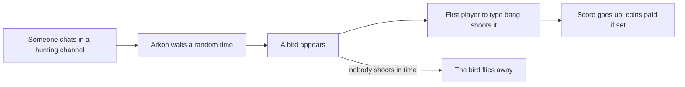

# Hunting

Hunting is a small chat game. Every so often a bird shows up in a channel. The first player to type `bang` shoots it. Players collect a score, and you can pay them coins for every bird.

It keeps a quiet channel alive without any work from you. Set it up once and it runs by itself.

**You need:**

- Arkon in your server with permission to send messages in the channel you pick.
- A bank if you want to pay rewards. The bank is the bot's built-in currency, and it is separate for each Discord server. Rewards are optional. See [Economy](/guides/economy).

## How it works



Birds need chat. Arkon only starts the timer when someone sends a message in a hunting channel. A silent channel never gets a bird.

> Admin commands (`+hunting start`, `+hunting reward` and so on) can be run by anyone with the Mod role or the Manage Server permission. Players can use `+hunting score` and `+hunting leaderboard`. See [Getting started](/guides/getting-started) for setting the Mod role.
{.is-info}

## Setup

### Step 1: Start the hunt in a channel

Where: the channel you want birds in. Or any channel, if you name the channel at the end.

Type:

```
+hunting start #general
```

You will see: **The hunt has started in #general. Good luck to all.**

Leave the channel off and Arkon uses the channel you typed in. You can run the command again for more channels. Every channel you add can get birds.

### Step 2: Pay a reward (optional)

Type:

```
+hunting reward 10 50
```

You will see: `Users can now get 10 to 50 coins for shooting a bird.` (the last word is your own currency name).

Each shot pays a random whole number between the two values. The top value can sometimes come out one higher than you typed. Without this step, shooting a bird pays nothing and only raises the score. To turn rewards off again, type `+hunting reward` with no numbers. Arkon replies "Reward range reset to default(None)."

### Step 3: Change how often birds come (optional)

Type:

```
+hunting timing 900 3600 20
```

The three numbers are all in seconds:

| Number | What it is | Default |
|---|---|---|
| First | Shortest wait before a new bird | 900 (15 minutes) |
| Second | Longest wait before a new bird | 3600 (1 hour) |
| Third | How long players have to shoot before the bird flies away | 20 |

You will see: Arkon repeats the numbers back: "Timing has been set: Min time 900s, Max time 3600s, Bang timeout 20s".

### Step 4: Check it worked

Type `+hunting`. Arkon shows every setting in one box.


Then chat in the hunting channel. A bird shows up after the wait. To test faster, set a short timing such as `+hunting timing 60 120 20`, then put the old numbers back.

## How players hunt

A bird message appears, for example **Quack!** with a duck. Players type a message that contains the word `bang`. The first one wins the shot.


Things to know:

- The birds are a dove, penguin, chicken, duck, turkey, owl, eagle and dodo.
- About 1 shot in 8 misses. Then Arkon says "RexRider missed the shot and the duck got away!"
- If nobody shoots in time, the bird flies away. The penguin waddles away instead.
- Scores are kept for each player across every server that uses Arkon. The server leaderboard only lists players who are in your server.

### Reaction mode

Type `+hunting mode` to switch. In reaction mode Arkon adds a 💥 reaction to each bird, and players click it. Typing `bang` still works too, so reaction mode only adds the button. Run `+hunting mode` again to go back. Arkon replies "Use the reaction to react to the bang message when it appears." or "Type 'bang' to react to the bang message when it appears."

### The eagle rule

By default every bird is fair game. Type `+hunting eagle` to make the eagle special. Arkon replies "Shooting an eagle is now **Bad**". After that:

- Shooting the eagle (`bang`) is a mistake. The player loses coins from their balance, taking from the same reward range, and gets no score.
- Saluting the eagle is the right move. A player types or reacts with 🫡 and gets the score and the reward.

Run `+hunting eagle` again to turn it off ("Shooting an eagle is now **Okay**"). Without a reward range set, the fine is 0, so the eagle rule only matters if you pay rewards.

## Commands

| Command | Who | What it does | Example |
|---|---|---|---|
| `+hunting` | Everyone | Shows the hunting settings | `+hunting` |
| `+hunting score [member]` | Everyone | Shows how many birds a player has shot | `+hunting score @RexRider` |
| `+hunting leaderboard [True]` | Everyone | Top 50 hunters in your server. Add `True` for everyone on every server | `+hunting leaderboard True` |
| `+hunting version` | Everyone | Shows the cog version | `+hunting version` |
| `+hunting start [channel]` | Mod | Starts the hunt in a channel | `+hunting start #general` |
| `+hunting stop [channel]` | Mod | Stops the hunt in a channel | `+hunting stop #general` |
| `+hunting reward [min] [max]` | Mod | Sets the coin reward range. Blank turns it off | `+hunting reward 10 50` |
| `+hunting timing <min> <max> <timeout>` | Mod | Sets the bird timing in seconds | `+hunting timing 900 3600 20` |
| `+hunting mode` | Mod | Switches between typing bang and reacting | `+hunting mode` |
| `+hunting eagle` | Mod | Makes shooting the eagle bad and saluting good | `+hunting eagle` |
| `+hunting bangtime` | Mod | Shows how fast the player shot ("in 1.3s") | `+hunting bangtime` |
| `+hunting next` | Mod | Roughly when the next bird timer ends | `+hunting next` |

The bot owner can also wipe the leaderboard for every server. Server admins cannot.

### Defaults

| Setting | Default | Command |
|---|---|---|
| Hunting channels | None | `+hunting start` |
| Shortest wait | 900 seconds | `+hunting timing` |
| Longest wait | 3600 seconds | `+hunting timing` |
| Time to shoot | 20 seconds | `+hunting timing` |
| Hunting mode | Words (type bang) | `+hunting mode` |
| Show shot time | Off | `+hunting bangtime` |
| Eagle punishment | Off | `+hunting eagle` |
| Reward range | None (no coins) | `+hunting reward` |

Notes:

- The leaderboard needs the Embed Links permission for the bot.
- The reward is only paid once you set a range. A player at the bank's maximum balance gets only what fits.
- `+hunting next` only shows the first timer. After it ends, the bird still waits a further random time before it lands, so the real wait is longer.
- Timing numbers below the minimum are raised for you. The shortest wait cannot go under 60, the longest cannot go under 120 and the shooting time cannot go under 10. Arkon's text for this says 120s and 240s, which is not what is applied.

## Common problems

| Problem | Why it happens | Fix |
|---|---|---|
| No bird ever shows up | The hunt was never started, or nobody is chatting in the channel | Run `+hunting start`, then chat in that channel and wait |
| "I can't send messages in that channel!" | Arkon lacks Send Messages there | Give Arkon the permission, then run `+hunting start` again |
| "We're already hunting in #general!" | The channel is already on the list | Nothing to do |
| "We're not hunting in #general!" | You tried to stop a channel that was not running | Check `+hunting` for the list |
| "Your minimum reward is greater than your max reward..." | The two reward numbers are the wrong way round | Put the smaller number first |
| "`interval_min` needs to be lower than `interval_max`." | The timing numbers are the wrong way round | Put the shortest wait first |
| "Please shoot something before you can brag about it." | The player has no score yet, or the leaderboard is empty | Shoot a bird first |
| Bird shows up but no coins are paid | No reward range is set | `+hunting reward 10 50` |
| Birds show up very slowly | The default wait is 15 to 60 minutes, plus a second wait before the bird lands | Lower the numbers with `+hunting timing` |

## Related pages

- [Games hub](/guides/games)
- [Economy](/guides/economy)
- [Getting started](/guides/getting-started)
- [FAQ](/guides/faq)
