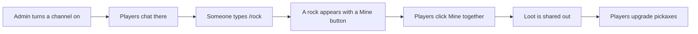

# Miner

Miner is a team game inside Discord. A rock appears in a channel with a Mine button. Players click it together to break the rock. Everyone who helped gets stone, iron and sometimes gems. They spend those on better pickaxes.

It gives your members something to do together between Ark sessions. You can also let players trade their mined resources in for coins (the bank is the bot's built-in currency, and it is separate for each Discord server).

**You need:**

- Arkon in your server.
- A text channel to use for mining.
- A bank, only if you want players to convert resources to coins. See [Economy](/guides/economy).

## How it works



Rocks do not appear by themselves. A player has to type `/rock` (or `+rock`) in a mining channel. There is a waiting time between rocks for your whole server.

> Admin commands (`+minerset ...`) can be run by the server owner, anyone with the Admin role, or anyone with the Manage Server permission. See [Getting started](/guides/getting-started) for setting the Admin and Mod roles.
{.is-info}

> Players, their pickaxes and their resources are kept for each person, not for each server. A player who mines in two Discord servers that use Arkon has one pickaxe and one stash.
{.is-info}

## Setup

### Step 1: Turn on a mining channel

Where: the channel you want to use for mining.

Type:

```
+minerset toggle
```

You will see: `Mining in #mining has been enabled.`

To pick a different channel, put it at the end, for example `+minerset toggle #mining`. Run the command again to turn the channel off. Arkon replies "Mining in #mining has been disabled."

### Step 2: Look at the settings

Type `+minerset view`. Arkon shows the mining channels, the conversion settings and the waiting time between rocks.

### Step 3: Spawn a rock

Where: the mining channel.

Type:

```
/rock
```

You will see: a rock picture with a Mine button, an Inspect button and a health bar. The mineshaft collapses after a set time, shown on the message.

### Step 4: Check it worked

Click Mine a few times. When the rock breaks, Arkon posts the results with each miner's loot. Then type `+miner inventory` to see your resources.


### Step 5: Let players convert to coins (optional)

Resources can be swapped for coins. This is off until you turn it on. Type:

```
+minerset toggleconvert
+minerset convertratio stone 20
```

You will see: "Resource conversion has been enabled." and then "Set the conversion ratio for stone to 20.0. `20.0 stone` = `1 coins`" (with your currency name). The number means how many resources buy 1 coin. A number below 1 flips it, so `0.1` for gems means 1 gem gives 10 coins.

## How players mine

### Spawning rocks

Anyone can type `/rock` in a mining channel. Players should chat in the channel first. Arkon counts people who chatted in the last 5 minutes. The better the pickaxes and the more people active (up to 3), the better the rocks.

| Rock | Loot when fully mined | Time before it collapses |
|---|---|---|
| Small Rock | 45 stone | 90 seconds |
| Medium Rock | 170 stone, 30 iron | 120 seconds |
| Large Rock | 360 stone, 180 iron, 2 gems | 150 seconds |
| Meteor (rare) | 75 stone, 360 iron, 10 gems | 180 seconds |
| Volatile Geode (very rare) | 240 iron, 65 gems | 210 seconds |

If nobody breaks the rock in time, it collapses and miners only get a smaller share. If nobody mined at all, Arkon posts "the mineshaft collapsed before anyone mined it."

Bigger rocks can show a **weak spot** or a **gem vein** button for a few seconds. The first miner to click it gets a big hit or bonus gems. You have to hit the rock first.

Rocks can also carry modifiers. Click Inspect to see them.

| Modifier | Effect |
|---|---|
| Electrified | +20% loot, more dangerous swings |
| Crystalline | +30% loot, +15% HP |
| Volatile | more dangerous swings |
| Enchanted | +15% loot, safer swings |
| Fortified | +40% HP, -10% loot |
| Blessed | +25% loot, much safer swings |

### Swinging too fast

Players can click Mine 3 times every 4 seconds. Faster than that is an overswing. An overswing can damage the pickaxe. It can also shatter it, mostly when the pickaxe is already worn down. A shattered pickaxe drops one tier and loses its perks. The wooden pickaxe is never damaged.

### Pickaxes

Everyone starts with a wooden pickaxe. Players upgrade with `+miner upgrade`, which shows the cost and asks them to confirm.


| Pickaxe | Cost to upgrade | Durability | Perk slots |
|---|---|---|---|
| Wood Pickaxe | Free, you start here | Never wears out | 0 |
| Stone Pickaxe | 90 stone | 98 | 0 |
| Iron Pickaxe | 260 stone, 80 iron | 242 | 1 |
| Steel Pickaxe | 440 stone, 500 iron, 10 gems | 512 | 1 |
| Carbide Pickaxe | 3400 stone, 1750 iron, 30 gems | 968 | 2 |
| Diamond Pickaxe | 6750 stone, 2220 iron, 115 gems | 1682 | 3 |

Durability goes down every time a player mines a rock. When it hits zero, the pickaxe drops one tier. `+miner repair` shows the repair price, and `+miner repair true` pays it. Repairs cost a share of the upgrade price, scaled by how much is missing.

### Perks

From the Iron Pickaxe, players can buy perks with `+miner perks` (the panel only they can see). A perk is permanent until the pickaxe shatters or wears out.

| Perk | What it does |
|---|---|
| Forceful | +15% pickaxe power |
| Lucky | +5% crit chance |
| Steady | 4 swings per 4 seconds before an overswing |
| Closer | +40% damage when the rock is at 25% HP or less |
| Sturdy | Half the durability loss |
| Prospector | +20% gems from every rock |

The first perk costs 1000 stone, 400 iron and 10 gems. The second costs 2500 stone, 1000 iron and 25 gems. The third costs 5000 stone, 2000 iron and 50 gems.

### Spawn pings

`+miner notify` opens a panel (only the player sees it) to get a ping when a rock spawns. A player can only pick rock types they have already mined.

## Commands

`/miner` and its subcommands, `/minerlb` and `/rock` are slash commands. Every one also works with the `+` prefix. The admin commands are prefix only.

| Command | Who | What it does | Example |
|---|---|---|---|
| `+rock` | Everyone | Spawns a rock in a mining channel | `/rock` |
| `+miner` | Everyone | Group command, shows help | `+miner` |
| `+miner inventory [user]` (alias `inv`) | Everyone | Tool, durability, resources, achievements | `+miner inventory @RexRider` |
| `+miner upgrade` | Everyone | Upgrades the pickaxe, with a confirm button | `+miner upgrade` |
| `+miner repair [true]` | Everyone | Shows the repair price. `true` pays it | `+miner repair true` |
| `+miner perks` | Everyone | Buy or remove pickaxe perks | `+miner perks` |
| `+miner trade <user>` | Everyone | Opens a trade with another player | `+miner trade @TekTitan` |
| `+miner transfer <user> <resource> <amount>` | Everyone | Gives resources to another player | `+miner transfer @TekTitan iron 50` |
| `+miner convert <resource> <amount>` | Everyone | Swaps resources for coins, if turned on | `+miner convert stone 200` |
| `+miner leaderboard [true or false]` (alias `lb`) | Everyone | Leaderboard for your server. `false` shows players from every server | `+miner leaderboard false` |
| `+minerlb [true or false]` | Everyone | Same leaderboard as a shortcut | `/minerlb` |
| `+miner achievements [user]` (aliases `achievement`, `achs`) | Everyone | Browse unlocked and locked achievements | `+miner achievements` |
| `+miner notify` | Everyone | Pick which rock types ping you | `+miner notify` |
| `+miner guide` | Everyone | In-game help embed | `+miner guide` |
| `+minerset` | Admin | Group command for admin settings | |
| `+minerset toggle [channel]` | Admin | Turns a mining channel on or off | `+minerset toggle #mining` |
| `+minerset view` | Admin | Shows channels, conversion rates and the rock cooldown | `+minerset view` |
| `+minerset toggleconvert` | Admin | Turns resource-to-coin conversion on or off | `+minerset toggleconvert` |
| `+minerset convertratio <resource> <ratio>` | Admin | Sets how many resources buy 1 coin | `+minerset convertratio iron 5` |

The leaderboard lets players pick a resource (stone, iron or gems) and a timeframe (hourly, daily, weekly, monthly or all time) from drop-downs.

### Defaults

| Setting | Default | Command |
|---|---|---|
| Mining channels | None | `+minerset toggle` |
| Resource conversion | Off | `+minerset toggleconvert` |
| Stone rate | 20 stone = 1 coin | `+minerset convertratio` |
| Iron rate | 5 iron = 1 coin | `+minerset convertratio` |
| Gems rate | 1 gem = 1 coin | `+minerset convertratio` |
| Time between rocks | 5 minutes, for your whole server | Set by the bot owner |

Notes:

- The bot owner controls the time between rocks for all servers. Server admins cannot change it.
- Conversion rounds down. With the stone rate at 20, converting 50 stone pays 2 coins and takes 40 stone.
- Rocks only spawn in channels you turned on. Chatting in other channels does not count.
- Miner stores data in a database that the bot owner runs. If it is down, every command answers "Database connection is not active, try again later".

## Common problems

| Problem | Why it happens | Fix |
|---|---|---|
| "Rocks cannot spawn in this channel. Ask an admin to enable it with `/minerset toggle`." | The channel is not a mining channel | An admin types `+minerset toggle` there. Note that `minerset` is a prefix command, not a slash command |
| "Rock spawn cooldown is active. You can summon more rocks ..." | A rock was spawned less than 5 minutes ago | Wait for the time shown |
| "Database connection is not active, try again later" | The database behind Miner is not connected | Try again later, or ask in the [support server](https://discord.gg/RaR3wR4MgY) |
| "An error occurred while spawning the rock." | Arkon could not post the rock | Check Arkon can send messages, attach files and use buttons in that channel |
| "Resource conversion is not enabled." | Conversion is off by default | An admin types `+minerset toggleconvert` |
| "You need to convert at least `20.0` Stone to receive ..." | The amount is below the rate | Convert more, or lower the rate |
| "You do not have that much Stone!" | The player has less than they typed | Check `+miner inventory` |
| "You do not have enough Stone to transfer." | The player has less than they typed | Check `+miner inventory` |
| "You cannot transfer resources to yourself!" | The player named themselves | Name another player |
| "You cannot trade with a bot!" | The player named a bot | Name a person |
| "The Wooden Pickaxe does not require or support repairs." | Wooden pickaxes never wear out | Upgrade first |
| "Your Stone Pickaxe is already at full durability! (98)" | Nothing to repair | No action needed |
| "You already have the best tool!" | The player has the Diamond Pickaxe | No action needed |
| "Someone beat you to it!" | Another player clicked the weak spot first | Be quicker next time |
| "Hit the rock first to claim this." | Weak spots need at least one hit first | Click Mine, then the spot |
| "This mining event is being finalized!" | The rock just broke or collapsed | Wait for the next rock |
| "Ratio must be greater than 0." | The ratio was 0 or lower | Use a number above 0 |

## Related pages

- [Games hub](/guides/games)
- [Economy](/guides/economy)
- [Getting started](/guides/getting-started)
- [FAQ](/guides/faq)
