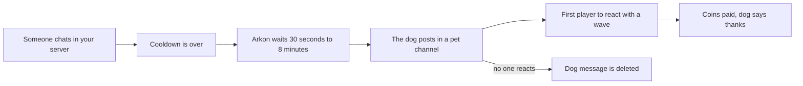

# Pupper

Pupper is a tiny chat game. Now and then a dog appears in one of your channels and asks to be petted. The first player to react with a wave (👋) pets it and wins a few coins.

It rewards players who are paying attention, and it costs you nothing to run. Coins come from the bank (the bot's built-in currency, which is separate for each Discord server).

**You need:**

- Arkon in your server, with permission to send messages, add reactions and delete messages in the channels you pick.
- A bank to pay the coins. See [Economy](/guides/economy).

## How it works



The dog only starts after any message in your server, in any channel. It then picks one of your pet channels at random.

> All Pupper commands can be used by anyone with the Mod role or the Administrator permission. See [Getting started](/guides/getting-started) for setting the Mod role.
{.is-info}

## Setup

### Step 1: Choose the pet channels

Where: any channel.

Type:

```
+pets channel add #general
```

You will see: `#general added to the valid petting channels.`

Repeat for every channel you want. To add every channel Arkon can talk in, type `+pets channel addall`.

### Step 2: Turn the dog on

It is off until you do this. Type:

```
+pets toggle
```

You will see: The pet is now active.

### Step 3: Set the reward (optional)

Type:

```
+pets credits 100 500
```

You will see: `Pet credit range set to 100 - 500.`

Each pet pays a random whole number between the two values. The default is 100 to 500.

### Step 4: Check it worked

Type `+pets`. Arkon shows all the settings.


The dog appears after someone sends a message and the cooldown is over. Give it a few minutes. To test faster, set `+pets cooldown 60`, then put it back.

## How players pet the dog

The dog posts its hello message (default "Hi! Can someone pet me?") and adds a 👋 reaction. The first player to click the 👋 wins. Arkon edits the message to the thanks message and adds the coins won.


Things to know:

- The dog waits between 5 and 7 minutes for a reaction. If nobody reacts, the message is deleted and nothing is paid.
- The thanks message is deleted after 10 seconds by default.
- The cooldown starts when someone pets the dog. If nobody does, the dog can come again on the next message.
- Each server has one dog. Pets are counted for each player in each server for the leaderboard.

## Commands

`+pupper` works the same as `+pets`, so `+pupper toggle` also works.

| Command | Who | What it does | Example |
|---|---|---|---|
| `+pets` | Mod | Shows the settings | `+pets` |
| `+pets toggle` | Mod | Turns the dog on or off | `+pets toggle` |
| `+pets channel add <channel>` | Mod | Adds a channel the dog can use | `+pets channel add #general` |
| `+pets channel addall` | Mod | Adds every channel Arkon can talk in | `+pets channel addall` |
| `+pets channel remove <channel>` | Mod | Removes one channel | `+pets channel remove #general` |
| `+pets channel removeall` | Mod | Removes every channel | `+pets channel removeall` |
| `+pets cooldown [seconds]` | Mod | Time between visits. Blank resets to 3600 | `+pets cooldown 1800` |
| `+pets credits <min> <max>` | Mod | Coin range for a pet | `+pets credits 100 500` |
| `+pets hello [message]` | Mod | Shows or sets the dog's greeting | `+pets hello Woof! Pet me!` |
| `+pets thanks [message]` | Mod | Shows or sets the thank-you | `+pets thanks Borf! Thanks!` |
| `+pets delete [seconds]` | Mod | Deletes the thank-you after this many seconds. 0 keeps it | `+pets delete 30` |
| `+pettop [true]` (aliases `+petlb`, `+petleaderboard`) | Everyone | Petting leaderboard. `true` shows every server | `+pettop` |

### Defaults

| Setting | Default | Command |
|---|---|---|
| Pet channels | None | `+pets channel add` |
| Dog on or off | Off | `+pets toggle` |
| Cooldown | 3600 seconds (1 hour) | `+pets cooldown` |
| Coin range | 100 to 500 | `+pets credits` |
| Hello message | Hi! Can someone pet me? | `+pets hello` |
| Thanks message | borf! (thank for pats h00man, have a doggocoin) | `+pets thanks` |
| Delete thanks after | 10 seconds | `+pets delete` |

Notes:

- The messages can be up to 1000 characters.
- Arkon adds the coins to the end of the thanks message, for example (`+312` coins).
- If a pet channel is deleted, or Arkon loses permission to talk there, Arkon quietly drops it from the list. If the list becomes empty, the dog stops.
- The cooldown cannot be lower than 60 seconds. Arkon's help text says 300 seconds, but 60 is what is applied.
- `+pets delete` only accepts 0, or a number from 6 to 300.
- Players at the bank's maximum balance get only what fits.

## Common problems

| Problem | Why it happens | Fix |
|---|---|---|
| The dog never shows up | No pet channels, or the dog is off | `+pets channel add #general` and `+pets toggle` |
| The dog is off right after setup | It starts off | `+pets toggle` |
| "#general not in the active channel list." | The channel was never added | Check `+pets` for the list |
| "#general is already in the list of petting channels." | Already added | Nothing to do |
| "Min must be less than max." | The two numbers are the wrong way round | Put the smaller number first |
| "Min and max amounts must be greater than 1." | A number was below 1 | Use 1 or higher |
| "Use a slightly larger number, greater than 5." | Delete time was 1 to 5 | Use 6 or higher, or 0 to keep the message |
| "Use a smaller number, less than or equal to 300." | Delete time was over 300 | Use 300 or lower |
| "Use a positive number." | Delete time was negative | Use 0 or higher |
| "That dog sure likes to talk a lot. Try a shorter message." | Message is longer than 1000 characters | Shorten it |
| "No one has pet the doggo yet! Be the first! 🐕" | The leaderboard is empty | Wait for the first pet |

## Related pages

- [Games hub](/guides/games)
- [Economy](/guides/economy)
- [Getting started](/guides/getting-started)
- [FAQ](/guides/faq)
