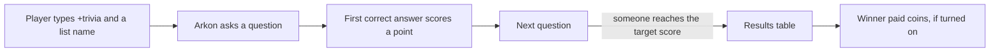

# Trivia

Trivia is a quiz game. Arkon asks a question in a channel. The first player to type the right answer scores a point. The first to reach the target score wins.

It is an easy event for your community and needs no setup. You can also pay the winner coins from the bank (the bot's built-in currency, which is separate for each Discord server).

**You need:**

- Arkon in your server, able to read and send messages in the channel.
- A bank, only if you want to pay winners. See [Economy](/guides/economy).

## How it works



Questions come from a list, and Arkon picks them in random order. Only one game can run in a channel at a time.

> Settings commands (`+triviaset ...`) can be run by anyone with the Mod role or the Administrator permission. Setting the payout needs the Admin role or the Manage Server permission. See [Getting started](/guides/getting-started) for setting the Admin and Mod roles.
{.is-info}

## Setup

Trivia works straight away. These steps are for tuning it.

### Step 1: See what lists you can play

Where: any channel.

Type:

```
+trivia list
```

You will see: an embed called "Available trivia lists" with every list name.

### Step 2: Start a game

Type:

```
+trivia worldcapitals
```

You will see: `Starting Trivia: worldcapitals (by JennJenn)`. A few seconds later, "Question number 1!" and the question.

You can name more than one list, such as `+trivia worldcapitals worldflags`, and the questions are mixed.


### Step 3: Set the winner payout (optional)

Payout is off by default. Type:

```
+triviaset payout 50
```

You will see: `Done. Payout multiplier set to 50.0.`

The prize is the winner's score times this number. With a target of 10 points and a multiplier of 50, the winner gets 500 coins. Type `+triviaset payout 0` to turn it off. Arkon replies "Done. I will no longer reward the winner with a payout."

The payout only happens when at least 3 players scored a point. If two players tie for first, the prize is split between them. The winner gets a message like "Congratulations TekTitan! You have received 500 coins for winning!"

### Step 4: Check it worked

Type `+triviaset showsettings`. Arkon shows every setting.


## Playing

- Players answer by typing in the channel. No command is needed.
- Answers are not case sensitive. A one-word answer must stand alone as a word, so "tirana" works and "tirana!" does not. A longer answer (more than one word) can sit inside a sentence.
- When time runs out, Arkon reveals the answer and moves on. If nobody answers for a long while (2 minutes by default), the game stops with "Guys...? Well, I guess I'll stop then."
- The person who started the game, a Mod, an Admin or the server owner can stop it with `+trivia stop`. Stopping shows the results and pays the winner like a normal finish.
- Wins, games and total score are saved for each player in each server. See them with `+trivia leaderboard`.

### Information about a list

Type `+trivia info worldcapitals`. Arkon shows the author, the number of questions, whether it is a custom list and the description.

## Trivia lists that come with the bot

These 54 lists are built in. Type the name exactly as shown. None of them are about Ark.

| Group | Lists |
|---|---|
| General knowledge | `general`, `2015`, `2016`, `entertainment`, `artandliterature`, `computers`, `music`, `slogans`, `elements`, `cars` |
| Geography | `geography`, `worldcapitals`, `uscapitals`, `usstateabbreviations`, `worldflags`, `usflags`, `worldmap`, `usmap` |
| Sports | `sports`, `hockey`, `mlb`, `nba`, `worldcup` |
| Video games | `games`, `boombeach`, `clashroyale`, `doom`, `dota2abilities`, `dota2items`, `finalfantasy`, `leagueoflegends`, `leagueults`, `overwatch`, `r6siege`, `warcraft`, `pokemon`, `whosthatpokemon`, `whosthatpokemon2` to `whosthatpokemon8` |
| Film, TV, books and music | `anime`, `disney`, `gameofthrones`, `harrypotter`, `lotr`, `startrek`, `starwars`, `greekmyth`, `michaeljackson`, `prince` |

The flag, map and Pokemon lists post a picture link as the question. The rest are text. The bot owner can add more lists. See the next section.

## Custom lists

Custom lists are added by the bot owner only. A server admin cannot upload one. Lists added by the bot owner are available in every server that uses Arkon. To get a list added, send the file to the bot owner in the [support server](https://discord.gg/RaR3wR4MgY).

A list is a text file in a format called YAML. Each question is a line ending in a colon, followed by one line per accepted answer. Save it as `.yaml`. The file name (without `.yaml`) becomes the list name.

```yaml
AUTHOR: Your Name
DESCRIPTION: Questions about our server
CONFIG:
  max_score: 5
  delay: 20
What is the name of the first boss on the Island?:
- Broodmother
- Brood Mother
What resource do you get by punching trees?:
- Wood
```

Rules:

- The first lines `AUTHOR` and `DESCRIPTION` are optional. The description can be up to 200 characters.
- `CONFIG` is optional and changes the settings for that list only. Allowed keys: `max_score`, `timeout`, `delay` (at least 4), `bot_plays`, `reveal_answer`, `payout_multiplier` and `use_spoilers`. It is ignored if a server admin turns lists overriding off with `+triviaset override false`.
- Every question needs at least one answer.
- A list cannot reuse the name of a built-in list or of a trivia command, such as `list` or `stop`.

What the bot owner types to add and remove lists:

| Command | Who | What it does | Example |
|---|---|---|---|
| `triviaset custom upload` (alias `add`) | Bot owner only | Adds a list. Attach the file to the message | `triviaset custom upload` |
| `triviaset custom list` | Bot owner only | Lists the custom lists | `triviaset custom list` |
| `triviaset custom delete <name>` (alias `remove`) | Bot owner only | Deletes a custom list | `triviaset custom delete mylist` |

If the upload works, Arkon replies "Saved Trivia list as mylist." If the name is already taken, Arkon asks whether to overwrite it.

## Commands

| Command | Who | What it does | Example |
|---|---|---|---|
| `+trivia <list> [more lists]` | Everyone | Starts a game | `+trivia worldflags` |
| `+trivia stop` | Starter, Mod, Admin or server owner | Stops the game and shows results | `+trivia stop` |
| `+trivia list` | Everyone | Lists every trivia list | `+trivia list` |
| `+trivia info <list>` | Everyone | Author, question count and description | `+trivia info general` |
| `+trivia leaderboard [server or global] [sort] [top]` (alias `lboard`) | Everyone | Leaderboard. Sort by `wins`, `avg`, `total` or `games`. Default is this server, wins, top 10 | `+trivia leaderboard server avg 5` |
| `+triviaset showsettings` | Mod | Shows the settings | `+triviaset showsettings` |
| `+triviaset maxscore <points>` | Mod | Points needed to win | `+triviaset maxscore 15` |
| `+triviaset timelimit <seconds>` | Mod | Seconds to answer each question (4 or more) | `+triviaset timelimit 20` |
| `+triviaset stopafter <seconds>` | Mod | Stop the game after this long with no answers | `+triviaset stopafter 180` |
| `+triviaset botplays <true or false>` | Mod | The bot gets a point on unanswered questions | `+triviaset botplays true` |
| `+triviaset revealanswer <true or false>` | Mod | Show the answer when time runs out | `+triviaset revealanswer false` |
| `+triviaset usespoilers <true or false>` | Mod | Hide revealed answers in spoilers | `+triviaset usespoilers true` |
| `+triviaset override <true or false>` | Mod | Let a list change your settings | `+triviaset override false` |
| `+triviaset payout <multiplier>` | Admin | Winner prize is score times this number. 0 is off | `+triviaset payout 50` |

### Defaults

| Setting | Default | Command |
|---|---|---|
| Points to win | 10 | `+triviaset maxscore` |
| Answer time limit | 15 seconds | `+triviaset timelimit` |
| Stop after no answers | 120 seconds | `+triviaset stopafter` |
| Bot gains points | No | `+triviaset botplays` |
| Reveal answers | Yes | `+triviaset revealanswer` |
| Answers in spoilers | No | `+triviaset usespoilers` |
| Lists may override settings | Yes | `+triviaset override` |
| Payout multiplier | 0 (no prize) | `+triviaset payout` |

Notes:

- The payout needs at least 3 players who scored. Games that end because nobody is answering pay nothing.
- A player only gets a win on the leaderboard if their score reaches the target exactly.
- The leaderboard splits by server by default. `+trivia leaderboard global` adds up players across every server.
- `+triviaset stopafter` must be longer than the answer time limit.

## Common problems

| Problem | Why it happens | Fix |
|---|---|---|
| "Invalid category `foo`. See `+trivia list` for a list of trivia categories." | The list name is wrong | Check `+trivia list` and type it exactly |
| "There is already an ongoing trivia session in this channel." | A game is running there | Wait, or `+trivia stop` |
| "There is no ongoing trivia session in this channel." | You tried to stop with no game running | Nothing to do |
| "Category foo does not exist. See `+trivia list` for the list of available trivia categories." | `+trivia info` was given a wrong name | Check `+trivia list` |
| "There was an error parsing the trivia list for the `foo` category. It may be formatted incorrectly." | A custom list file is broken | Ask the bot owner to fix or delete it |
| "The trivia list was parsed successfully, however it appears to be empty!" | The list has no questions | Add questions |
| "Must be at least 4 seconds." | Time limit below 4 | Use 4 or more |
| "Must be larger than the answer time limit." | The stop time is not longer than the time limit | Raise `stopafter` |
| "Score must be greater than 0." | Max score was 0 or lower | Use 1 or more |
| "Multiplier must be at least 0." | Payout was negative | Use 0 or more |
| "There are no scores on record!" | Nobody has played yet | Play a game |
| "Unknown field `foo`, see `+help trivia leaderboard server` for valid fields to sort by." | The sort word was wrong | Use `wins`, `avg`, `total` or `games` |
| "Invalid syntax:" followed by an error (custom upload) | The YAML file is badly written | Check the indentation and the colons |
| "The custom trivia list was not saved. The file does not follow the proper data format." | A question has no answers or CONFIG has a wrong key | Fix the file and upload again |
| "mylist is a reserved trivia name and cannot be replaced. Choose another name." | The name clashes with a built-in list or a trivia command | Rename the file |

## Related pages

- [Games hub](/guides/games)
- [Economy](/guides/economy)
- [Getting started](/guides/getting-started)
- [FAQ](/guides/faq)
