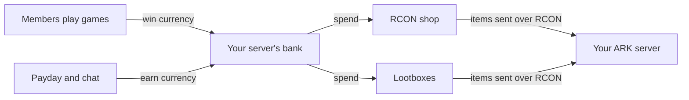

# Minigames

Arkon is more than server tools. It also has games your members can play right in Discord. They give people a reason to hang out in your server between play sessions. Most games pay out in your server's own currency, which players can then spend in your [RCON shop](/guides/rshop) or on [lootboxes](/guides/lootboxes).

**You need:**

- Arkon in your server ([Getting started](/guides/getting-started)).
- Nothing else for most games. They work as soon as Arkon joins.
- For payouts to mean anything, set up your server's currency first: [Server economy](/guides/economy).

## How the games tie together

Every Discord server has its own bank (the bot's built-in currency). Balances in your server never mix with any other server.

## The games

| Game | What players do | Pays into your bank? |
|---|---|---|
| [Casino](/guides/game-casino) | Bet currency on nine games: coin flips, dice, blackjack, war, craps and more | Yes, every game is played with bank currency |
| [Dino Collector](/guides/game-dinocollector) | Catch, collect, trade and sell ARK-style dinos | Optional. It has its own DinoCoins, and an admin can let players convert them |
| [Fishing](/guides/game-fishing) | Cast a line, catch fish, sell the catch and upgrade gear | Optional. It has its own FishPoints, and an admin can let players convert them |
| [Bird Hunting](/guides/game-hunting) | Shoot birds when they fly into a channel | Optional. Off until an admin sets a reward |
| [Miner](/guides/game-miner) | Mine rocks together, collect resources and upgrade your pickaxe | Optional. An admin can let players trade resources for currency |
| [Pupper](/guides/game-pupper) | Pet a dog that wanders into chat and get a few credits | Yes |
| [Trivia](/guides/game-trivia) | Answer quiz questions against other members | Optional. An admin sets a payout for the winner |

## Coming soon: Activities

Arkon will also get **Activities**: games that open in a window inside Discord itself, picked from one menu. This page will link to them once they are live.

## Common problems

| Problem | Why it happens | Fix |
|---|---|---|
| A player cannot afford a bet | Their balance is too low | They earn more with `+payday`, or you change the payday amount ([Server economy](/guides/economy)) |
| A game pays nothing | Most games start with payouts off | Turn the payout on in that game's guide |
| Winnings look tiny or huge | Each server sets its own payday and payout amounts | Adjust them in each game's settings and in [Server economy](/guides/economy) |

## Related pages

- [Server economy](/guides/economy)
- [RCON shop](/guides/rshop)
- [Lootboxes](/guides/lootboxes)
- [Getting started](/guides/getting-started)
- [FAQ](/guides/faq)
