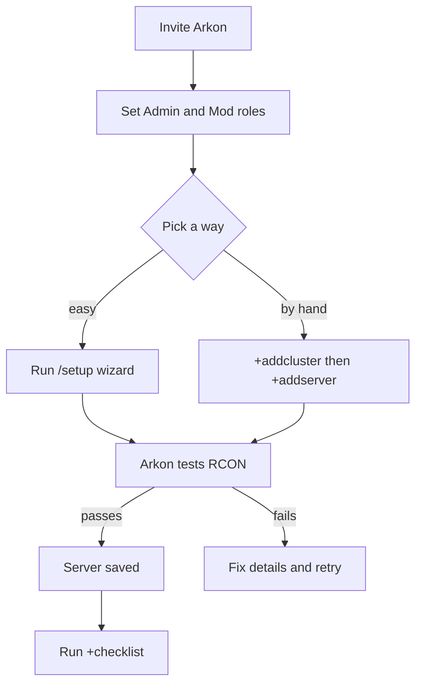

# Getting Started: Connect Your First Ark Server

This page gets Arkon into your Discord and connected to your first Ark server. When you finish, Arkon can talk to your server and everything else in this wiki will work. It takes about 10 minutes.

**You need:**

- An Ark server (ASE or ASA) that you can edit settings for. Arkon does not install or host servers for you.
- RCON turned on, with its IP, port and password written down. RCON (the remote-control connection Arkon uses to send commands to your server) is explained step by step in [RCON Setup](/guides/rcon-setup).
- A Discord server where you are the owner, or where you have the **Manage Server** permission.

> **Nitrado ASE servers do not work.** Nitrado does not allow RCON on ASE, so Arkon cannot connect. Nitrado ASA servers do work.
{.is-warning}

## The big picture

You do two things: give Arkon a **cluster** (a named group of servers, you need one even for a single server) and then a **server** (your IP, RCON port and RCON password). Arkon tests the connection before it saves anything.



---

## Step 1. Invite Arkon

1. Open this link in your web browser: **[Invite Arkon to your Discord](https://discord.com/api/oauth2/authorize?client_id=857070505294430218&permissions=1495118769367&scope=applications.commands%20bot)**
2. Pick your Discord server from the list and click **Authorize**.
3. Leave all the permission boxes ticked. Arkon asks for what it needs (send messages, embeds, manage roles, create threads and similar). It does **not** ask for Administrator.

> Do not remove the permissions. If Arkon cannot **Send Messages** and **Embed Links** in a channel, its commands will not answer there.
{.is-danger}

**Check it worked:** Arkon shows up in your Discord member list. The server owner also gets a private message from Arkon titled "Thanks for adding me!" that points here and mentions `/setup`.

## Step 2. Set your Admin and Mod roles

Arkon uses two kinds of staff roles:

- **Admin**: can change settings and run the setup commands on this page.
- **Mod**: can run the moderation commands. See [Mod Commands](/commands/mod-commands) for the list.

Anyone with Discord's **Manage Server** permission also counts as an Admin for the commands on this page. Roles are optional if only you will run them, but you need them as soon as you want staff to help.

1. Make sure the roles exist in Discord (Server Settings, then Roles). For example `ArkAdmin` and `ArkMod`.
2. Type this in any channel Arkon can see. **Only the server owner can run it.**

```
+set roles addadminrole ArkAdmin
```

3. Do the same for mods:

```
+set roles addmodrole ArkMod
```

4. Run a command again with another role name to add more roles.

**Check it worked:** Arkon replies "That role is now considered an admin role." for the admin command. If the role was already set it says "This role is already an admin role."

---

## Step 3. Connect your first server

Pick **one** of the two paths. The wizard is easier. The manual path is what you use to add more servers later.

Before you start either path, have these three things ready:

| What | Where to find it | Example |
|------|------------------|---------|
| **Public IP address** (or hostname) | [whatismyip.com](https://whatismyip.com) on the PC that hosts the server, or your host's control panel | `203.0.113.25` |
| **RCON port** | `RCONPort=` in `GameUserSettings.ini`. Not your game port or query port | `27020` |
| **Admin password** | `ServerAdminPassword=` in `GameUserSettings.ini`. Not the password players use to join | `MyAdminPass123` |

> Use your **public** IP, not one that starts with `192.168.` or `10.`. Arkon connects over the internet, so a home-network address will never work.
{.is-warning}

If you host at home, your router must forward the RCON port (TCP) to your server PC, and Windows must allow it through the firewall. Arkon connects from the IP `51.79.109.160`, so allow that address if your router or firewall filters by IP. Details are in [RCON Setup](/guides/rcon-setup).

### Path A: The /setup wizard (recommended)

The wizard asks one question at a time, tests the connection, and saves everything. Only you see it (the messages are private).

1. In a Discord channel Arkon can see, type this and press Enter. It is a slash command, so pick it from the popup list.

```
/setup
```


2. Click **ARK: Survival Evolved** or **ARK: Survival Ascended**.
3. Read the prerequisites screen. Click **I'm Ready!** when your server is set up. Click **I Need Help** if any word on that screen is new to you.
4. Click **Set Cluster Name** and type a short name using letters and numbers only. Examples: `pvp`, `pve`, `main`.
5. Click **Enter Server Details**. A form pops up. Fill it in, then submit.


   - **Server Name**: any name you like. Letters, numbers, spaces, hyphens and underscores only. Example: `The Island`.
   - **IP Address (without port!)**: only the IP, no `:27020`. Example: `203.0.113.25`.
   - **RCON Port**: already filled in as `27020`. Change it if yours is different.
   - **Admin Password**: your `ServerAdminPassword`.

   Not sure where these are? Click **Where do I find these?** and pick your hosting company. The choices are Nitrado, G-Portal, Shockbyte, Host Havoc, Self-Hosted (PC/Dedicated), and Other / Not Listed.

6. Wait a few seconds. Arkon tests the connection. If it fails, it tells you why and shows **Edit & Retry**. Fix the detail and try again.
7. Pick a **server chat channel** (recommended). In-game chat for this server will show up there. You can also pick a **cluster chat channel** (chat from all servers in the cluster). These two must be different channels. Click **Continue**, or **Skip (Set up later)**.
8. ASE only: Arkon asks if your server is crossplay. Click **Yes, it's crossplay** and it points you to the Xbox tools in [Xbox / Microsoft Store Features](/guides/xsapi). Click **No, Steam only** otherwise. ASA skips this step.


**Check it worked:** you see "🎉 Setup Complete!" with a summary of your cluster and server. Click **Run Checklist** to see what is left to set up.

> The wizard stops after 10 minutes of no clicking and shows "Setup Timed Out". Run `/setup` again. You can also click **Cancel** at any step.
{.is-info}

> If you already have a server saved, `/setup` does not restart. It shows "You're Already Set Up!" with your clusters and buttons to view servers or add more.
{.is-info}

> Only the server owner or people with the **Manage Server** permission see `/setup` in the command list by default.
{.is-info}

### Path B: Add the cluster and server by hand

1. Create the cluster. Type this in any channel Arkon can see:

```
+addcluster main
```

Arkon replies "**main** cluster created!"

2. Add a server to it. **Type the cluster name in lowercase**, because Arkon saves cluster names in lowercase and `+addserver` is picky about it:

```
+addserver main
```


3. Click **Set Connection Info**. A form titled "Edit Server" pops up. Fill in:
   - **Server Name**: `The Island`
   - **Host IP**: `203.0.113.25` (IP only, no port)
   - **RCON Port**: `27020`
   - **Admin Password**: your `ServerAdminPassword`
   - **Crosschat Channel** (optional): the channel where this server's in-game chat should appear.

4. Click submit. The message changes to "Connection Info Set!" and shows what you typed. The password appears as asterisks.


5. Click **Test & Save!**. Arkon connects to your server. It only saves the server if the test passes. If it fails you see "Failed to connect!" and a checklist of things to check. Fix them and click **Test & Save!** again. You do not have to start over.

**Check it worked:** the message becomes "Success!" and says "Server named **The Island** has been added!"

> **Using `+addserver` with ASA?** Arkon guesses ASE or ASA by looking at players who are online during the test. If nobody is online it saves the server as ASE. The `/setup` wizard asks you directly, so use it for an ASA server if you can. There is no ASE/ASA field in the Edit Server form.
{.is-warning}

> The free version lets you have 2 servers turned on, counted across every Discord server you own that has Arkon. Premium raises it to 100 per Discord server. See [Premium](/guides/premium).
{.is-info}

---

## Step 4. Check everything with +checklist

`+checklist` shows every Arkon feature and whether you have set it up. Run it any time you wonder what is left.

1. Type this in a channel Arkon can see:

```
+checklist
```

2. Use the buttons under the message to flip between pages. Page 1 is an overview. Each next page is one topic, like Servers & Clusters or Moderation.


| Symbol | Meaning |
|--------|---------|
| ✅ | Set up |
| ⚙️ | Partly set up |
| ⚠️ | A channel or role you chose was deleted |
| ❌ | Not set up yet. The line tells you the command to fix it |
| 🔒 | Needs [Premium](/guides/premium) |

**Check it worked:** the Servers & Clusters page shows ✅ next to Clusters and Servers.

> Some checklist lines say `+setup`. The real command is the slash command `/setup`.
{.is-info}

---

## Commands on this page

Who can run them: anyone with Discord's **Manage Server** permission, or an Admin role. A Mod role alone is not enough. Arkon also needs **Embed Links** and **Send Messages** in the channel.

| Command | What it does | Example |
|---------|--------------|---------|
| `/setup` | Guided wizard to connect your first server. Slash command only | `/setup` |
| `+addcluster <name>` | Creates a cluster (a named group of servers) | `+addcluster main` |
| `+addserver <cluster_name>` | Adds a server to a cluster using a button menu | `+addserver main` |
| `+delcluster <cluster_name>` | Deletes a cluster and everything in it. Also `+remcluster` | `+delcluster main` |
| `+delserver <cluster_name> <server_name>` | Deletes one server. Also `+remserver` | `+delserver main "The Island"` |
| `+checklist` | Shows what is and is not set up | `+checklist` |
| `+rconhelp` | Shows a menu of hosting companies. Pick yours for a step-by-step guide to finding your RCON port and admin password. Anyone can run it | `+rconhelp` |
| `+viewservers` | Opens the main server settings menu (see below) | `+viewservers` |

### +addcluster

- **Name rules:** letters and numbers only. If it has spaces, Arkon removes them and lowercases everything. `My Cluster` is saved as `mycluster`.
- **Limit:** 25 clusters per Discord server.
- **Name taken:** "A cluster by that name already exists!"

### +addserver

- Needs at least one cluster first.
- Type the cluster name in lowercase.
- Hard limit of 100 servers per Discord server. The free version allows 2 turned on, counted across every Discord server you own.

### +delserver

- Names are not case-sensitive. Put a name with spaces in quotes, like `"The Island"`.
- Arkon does not ask "are you sure". It replies "Server deleted!"

### +delcluster

> `+delcluster` does **not** ask for confirmation. It deletes every server in the cluster, plus its saved player counts and tribes, then the cluster itself.
{.is-danger}

Arkon replies "Deleting relevant servers" and ends with "Cluster deleted!" Names are not case-sensitive.

### +rconhelp

Use this when you cannot find your RCON port or admin password. Arkon posts a dropdown titled "Who hosts your server? Get a guide..." Pick your hosting company and Arkon shows the steps for it. The same dropdown also appears under the "Failed to connect!" message when `+addserver` cannot reach your server. It works in any Discord server channel, not in private messages.

### +viewservers (a quick look)

`+viewservers` opens a menu of buttons for every cluster and server you have. You use it to rename things, set log channels, and turn features on. The full tour is in [Server Settings](/guides/server-settings). If you have no clusters yet, it tells you to run `+addcluster` first.

---

## What to set up next

Pick what you want. None of these is required.

- Show a live server status message with player graphs: [Status Channel](/guides/status-channel)
- Show game chat, kills and joins in Discord: [Chat and Logs](/guides/chat-and-logs)
- Let players link their Discord to their character: [Player Registration](/guides/player-registration)
- Set your time zone and cluster type: [Server Settings](/guides/server-settings)
- Unlock map tools like hunting and finding tames: [ArkView Setup](/guides/arkview)
- Build a shop players can buy from: [RCON Shop](/guides/rshop)

---

## Common problems

| Problem | Why it happens | Fix |
|---------|----------------|-----|
| "**Wrong password!**" | The admin password does not match. It is case-sensitive | Copy `ServerAdminPassword` again with no extra spaces. Do not use the join password |
| "**Connection timed out**" | Wrong IP or port, port not forwarded, firewall blocking, server offline, or RCON off | Check each item in [RCON Setup](/guides/rcon-setup). Test the port at [canyouseeme.org](https://canyouseeme.org) |
| "**Connection refused**" | Wrong port, RCON disabled, or the server is still loading | Wait for the server to finish starting. Check `RCONEnabled=True` and the port |
| "**No response from server**" | The server gave an empty reply. It is still starting, or the port is not an RCON port | Wait a minute and retry. Use the RCON port, not the game or query port |
| "A cluster with the name `MyCluster` doesn't exist!" | You typed capital letters. Cluster names are saved in lowercase | Type it lowercase: `+addserver mycluster` |
| "Cluster names can only contain letters and numbers!" | The name has a dash, underscore or symbol | Use only letters and numbers |
| "That's an address inside your home network..." | You typed a `192.168.x.x` or `10.x.x.x` address in the wizard | Use your public IP from [whatismyip.com](https://whatismyip.com) |
| "Invalid host address. Please enter a valid IPv4 address or hostname." | You typed the port with the IP, like `203.0.113.25:27020` | Put the IP in Host IP and the port in RCON Port |
| "You cannot have more than 2 servers enabled across all the Discord servers you own on the free version of Arkon" | You hit the free server limit, counting every Discord server you own. Both `/setup` and `+addserver` check it | Switch a server off in any of your Discord servers, or see [Premium](/guides/premium) |
| "That chat channel is already in use by another server!" | Each server needs its own chat channel | Pick a different channel |
| "This isn't your menu!" or "This setup wizard isn't for you!" | Only the person who ran the command can click its buttons | Run the command yourself |
| "Database connection is not active, try again later" | Arkon's database was briefly unavailable | Wait a minute and try again |
| Arkon does not answer commands | It lacks Send Messages or Embed Links in that channel | Fix the channel permissions for Arkon |
| `/setup` is not in the command list | You lack Manage Server, or slash commands are not showing yet | Ask someone with Manage Server, or use Path B |

More help: [FAQ](/guides/faq), [Glossary](/guides/glossary), or the [Arkon support server](https://discord.gg/RaR3wR4MgY).

## Related pages

- [Home](/)
- [RCON Setup](/guides/rcon-setup)
- [Server Settings](/guides/server-settings)
- [Status Channel](/guides/status-channel)
- [ArkView Setup](/guides/arkview)
- [Premium](/guides/premium)
- [Quick Reference](/guides/quick-reference)
- [FAQ](/guides/faq)
- [Glossary](/guides/glossary)
- [Admin Commands](/commands/admin-commands)
