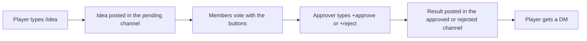

# Ideaboard

Ideaboard is a suggestion box for your Discord server. A player types `/idea` and Arkon posts their idea in a channel with two vote buttons. Everyone votes. Staff then approve or reject the idea, and the player gets told the result.

**You need:**

- Arkon in your server ([Getting started](/guides/getting-started)).
- Three text channels: one for ideas waiting for a decision (pending), one for approved ideas and one for rejected ideas.
- A staff role that will make the decisions (for example `@Moderator`).
- Arkon allowed to Send Messages, Embed Links and Create Public Threads in the server. Arkon also needs Manage Channels in the approved and rejected channels (see the warning in Step 1).

## How it works



Each idea gets a number, like `Suggestion #12`. You use that number to approve, reject or inspect it.

> Admin commands (`+ideaset ...`) can be run by the server owner, anyone with the Admin role, or anyone with the Manage Server permission. See [Getting started](/guides/getting-started) for setting the Admin and Mod roles.
{.is-info}

## Setup

### Step 1: Make the channels and check Arkon's permissions

Where: your Discord server settings.

Create the three channels. Players should be able to read the pending channel. Arkon needs these permissions in them:

| Channel | Arkon needs |
|---|---|
| Pending | Send Messages, Embed Links (and Create Public Threads in the server, for the command to run) |
| Approved | Send Messages, Embed Links, Manage Channels |
| Rejected | Send Messages, Embed Links, Manage Channels |

> Arkon checks for Manage Channels in the approved and rejected channels before it will approve or reject anything. If it is missing, you get "I do not have the required permissions to send messages in the suggestion channels." even when sending is allowed. Give Arkon Manage Channels on those two channels (or an Administrator role).
{.is-warning}

### Step 2: Tell Arkon which channels to use

Where: any channel the bot can see.

Type the channel first, then the word `pending`, `approved` or `rejected`:

```
+ideaset channel #ideas pending
+ideaset channel #approved-ideas approved
+ideaset channel #rejected-ideas rejected
```

You will see: `Set pending channel to #ideas` (and the same for the other two).

> If you change the pending channel later and ideas are already waiting, Arkon asks "Are you sure you want to continue? (y/n)". Type `y` and it moves every waiting idea to the new channel.
{.is-info}

### Step 3: Choose who can approve and reject

Arkon refuses to take any ideas until at least one approver role exists.

```
+ideaset approverole @Moderator
```

You will see: ``Role Moderator `added to` approvers list.``

Run the same command again with the same role to remove it.

### Step 4: Pick your options (optional)

Everything below is optional. The defaults work.

| Want | Type |
|---|---|
| Show who posted each idea | `+ideaset toggleanonymous` |
| Hide the vote counts on the buttons | `+ideaset togglevotecount` |
| Open a discussion thread under every idea | `+ideaset discussions` |
| Stop DMing players the result | `+ideaset toggledm` |
| A wait time between ideas, in seconds | `+ideaset cooldown 600` |
| Different emoji for the buttons | `+ideaset upvoteemoji :tada:` |

See the [Commands](#commands) table for everything else.

### Step 5: Check it worked

Type `+ideaset view`. You should see your three channels, your approver role and your options.


Then post a test idea with `/idea` and a short message. It should appear in the pending channel with a thumbs up and a thumbs down button.

## How players make a suggestion

Type `/idea` and then your idea. The old way `+idea your idea here` also works, and `+suggest` is the same command. Everyone can use it unless you set requirements.


With the slash command, Arkon answers privately (only the player sees it). With `+idea`, Arkon deletes the player's message if it can (it needs Manage Messages in that channel) and sends the player a copy by DM. If the player has DMs closed, the copy goes in the channel and disappears after 10 seconds.

To vote, click a button. Click the same button again to take the vote back. Click the other button to switch. Players cannot vote on their own idea. Arkon tells the voter what happened in a private message that vanishes after a minute.

## Anonymity

- **Anonymous is on by default.** The pending post says "Posted anonymously" and does not show the author. Turn it off with `+ideaset toggleanonymous` to show "Posted by Name (ID)" instead.
- **Staff can always see the author.** `+viewvotes <number>` shows who suggested the idea, even when the board is anonymous.
- **Approved ideas always show the author.** The approved post says "Suggested by Name (ID)" whatever your settings say.
- **Rejected ideas hide the author only if both are true:** anonymous is on and reveal is off. `+ideaset togglereveal` flips reveal. Reveal is on by default, so rejected ideas show the author by default too.

## Approving and rejecting

Staff use the idea number. Add a reason if you want players to see it.

```
+approve 12 Good idea, we will do it from the next wipe.
+reject 7 We already have a wipe warning.
```

You can also use `/approve` and `/reject`. The number box suggests the numbers of ideas that are still waiting.


What happens:

1. The pending post is deleted.
2. The idea is posted in the approved (or rejected) channel with its vote totals and your reason.
3. If the idea had a discussion thread, the thread is deleted. If you turned off `+ideaset deletethreads`, the thread is locked and renamed with `[Approved]` or `[Rejected]` instead.
4. The player gets a DM with a link (unless you turned DMs off, or they left, or their DMs are closed).
5. The idea is removed from the board.

To use these commands a person needs both things: one of your approver roles, and either the Mod role or the Manage Messages permission.

## Who can vote and suggest

Everyone can, unless you add requirements. Requirements are checked each time. Server Admins skip every voting requirement.

| Requirement | Command | Applies to |
|---|---|---|
| Only these roles may suggest | `+ideaset suggestrole @role` | Suggesting |
| Only these roles may vote | `+ideaset voterole @role` | Voting |
| Minimum account age in hours | `+ideaset accountage <to_vote> <to_suggest>` | Both |
| Minimum hours in your server | `+ideaset jointime <to_vote> <to_suggest>` | Both |
| Minimum level (needs the [LevelUp](/guides/levelup) cog) | `+ideaset minlevel <to_vote> <to_suggest>` | Both |
| Minimum Ark playtime in hours | `+ideaset minplaytime <to_vote> <to_suggest>` | Both |
| Block a role from suggesting | `+ideaset roleblacklist @role` | Suggesting only |
| Block a person from suggesting | `+ideaset userblacklist @person` | Suggesting only |

Each of the first commands adds the role when it is not on the list and removes it when it is. The two "to_vote to_suggest" commands take two numbers, vote first. Use `0` for no limit, for example `+ideaset accountage 24 0`.

> The two blacklists only stop people from making suggestions. Blacklisted people can still vote.
{.is-warning}

> Playtime needs the player to be registered ([Player registration](/guides/player-registration)). Arkon counts the playtime it has recorded for them.
{.is-info}

## Cooldowns

`+ideaset cooldown 600` makes every player wait 600 seconds between ideas. `0` turns it off.

`+ideaset rolecooldown @VIP 60` gives one role a different wait. Someone with several cooldown roles gets the shortest. Run it with `0` to remove it. Approvers never have a cooldown.

## Stats and karma

Everyone can see their own numbers with `+ideastats` or `/ideastats`. Add a member to see theirs.

- **Suggestions Made, Approved, Denied:** how many of their ideas got each result.
- **Karma:** upvotes their ideas received minus downvotes received.
- **Wins and Losses:** how many of their votes went the same way as the final decision.

`+ideaset insights` shows top lists for the whole server. `+ideaset resetuser @person` wipes one person's numbers. `+ideaset resetall` wipes everyone's after a yes or no question.

## Commands

| Command | Who | What it does | Example |
|---|---|---|---|
| `/idea <content>` (also `+idea`, `+suggest`) | Everyone | Post an idea | `/idea Add a rules reminder` |
| `/ideastats [member]` (also `+ideastats`) | Everyone | Show suggestion and voting stats | `+ideastats @RexRider` |
| `/approve <number> [reason]` (also `+approve`) | Approver | Approve an idea | `+approve 12 Nice one` |
| `/reject <number> [reason]` (also `+reject`) | Approver | Reject an idea | `+reject 7 Already planned` |
| `/viewvotes <number>` (also `+viewvotes`) | Approver | Private list of who voted each way and who wrote it. Sends a `votes.txt` file when the list is long | `+viewvotes 12` |
| `+refresh <number>` | Approver | Fixes the buttons on an idea if they stop working | `+refresh 12` |
| `+ideaset` (alias `+ideaboard`) | Admin | Group command, does nothing alone | |
| `+ideaset view` | Admin | Shows all settings | `+ideaset view` |
| `+ideaset channel <channel> <pending/approved/rejected>` | Admin | Sets one of the three channels | `+ideaset channel #ideas pending` |
| `+ideaset approverole <role>` | Admin | Adds or removes an approver role | `+ideaset approverole @Moderator` |
| `+ideaset suggestrole <role>` | Admin | Adds or removes a role allowed to suggest | `+ideaset suggestrole @Member` |
| `+ideaset voterole <role>` | Admin | Adds or removes a role allowed to vote | `+ideaset voterole @Member` |
| `+ideaset toggleanonymous` (aliases `toggleanon`, `anonymous`, `anon`) | Admin | Anonymous posts on or off | `+ideaset anon` |
| `+ideaset togglereveal` (alias `reveal`) | Admin | Show the author on rejected ideas on or off | `+ideaset reveal` |
| `+ideaset togglevotecount` (alias `votecount`) | Admin | Show vote numbers on the buttons on or off | `+ideaset votecount` |
| `+ideaset toggledm` (alias `dm`) | Admin | DM players the result on or off | `+ideaset dm` |
| `+ideaset discussions` (aliases `threads`, `discussion`) | Admin | A discussion thread under each idea on or off | `+ideaset threads` |
| `+ideaset deletethreads` (aliases `delete`, `delthreads`) | Admin | Delete threads on decision, or lock and keep them | `+ideaset deletethreads` |
| `+ideaset upvoteemoji <emoji>` (aliases `upvote`, `up`) | Admin | Changes the upvote button emoji | `+ideaset up :tada:` |
| `+ideaset downvoteemoji <emoji>` (aliases `downvote`, `down`) | Admin | Changes the downvote button emoji | `+ideaset down :x:` |
| `+ideaset cooldown <seconds>` (alias `cd`) | Admin | Wait time between ideas for everyone | `+ideaset cd 600` |
| `+ideaset rolecooldown <role> <seconds>` (alias `rolecd`) | Admin | Wait time for one role, `0` removes it | `+ideaset rolecd @VIP 60` |
| `+ideaset roleblacklist <role or ID>` (aliases `blacklistrole`, `rolebl`) | Admin | Adds or removes a role on the suggest blacklist | `+ideaset rolebl @Muted` |
| `+ideaset userblacklist <member or ID>` (aliases `blacklistuser`, `userbl`) | Admin | Adds or removes a person on the suggest blacklist | `+ideaset userbl @RexRider` |
| `+ideaset accountage <to_vote> <to_suggest>` | Admin | Minimum Discord account age in hours | `+ideaset accountage 24 24` |
| `+ideaset jointime <to_vote> <to_suggest>` | Admin | Minimum hours in your server | `+ideaset jointime 48 48` |
| `+ideaset minlevel <to_vote> <to_suggest>` | Admin | Minimum LevelUp level | `+ideaset minlevel 5 10` |
| `+ideaset minplaytime <to_vote> <to_suggest>` | Admin | Minimum Ark playtime in hours | `+ideaset minplaytime 10 20` |
| `+ideaset insights [amount]` | Admin | Top lists for the server, 1 to 10 names each (default 3) | `+ideaset insights 5` |
| `+ideaset resetuser <member>` | Admin | Wipes one person's stats | `+ideaset resetuser @RexRider` |
| `+ideaset resetall` | Admin | Wipes everyone's stats (asks yes or no) | `+ideaset resetall` |
| `+ideaset showstale` | Admin | Lists ideas whose message was lost | `+ideaset showstale` |
| `+ideaset cleanup` | Admin | Removes lost ideas, stats of people who left and their votes | `+ideaset cleanup` |

### Defaults

| Setting | Default | Command |
|---|---|---|
| Pending, approved, rejected channels | Not set | `+ideaset channel` |
| Approver roles | None (nothing works until you add one) | `+ideaset approverole` |
| Anonymous | On | `+ideaset toggleanonymous` |
| Reveal author on rejection | On | `+ideaset togglereveal` |
| DM the result | On | `+ideaset toggledm` |
| Discussion threads | Off | `+ideaset discussions` |
| Delete threads on decision | On | `+ideaset deletethreads` |
| Show vote counts | On | `+ideaset togglevotecount` |
| Button emoji | Thumbs up and thumbs down | `+ideaset upvoteemoji` |
| Cooldown | 0 seconds (off) | `+ideaset cooldown` |
| Suggest and vote requirements | None | See the requirements table |

Notes:

- Idea numbers keep counting up and are never reused.
- If someone deletes a pending idea message by hand, Arkon forgets that idea and takes back its votes.
- When a member leaves, their votes are removed from ideas that are still waiting.
- If a pending message goes missing, `+viewvotes <number>` offers to repost it. Reply `y` or `n` in the channel.
- The Ark playtime option only works on the Arkon bot, and the `minlevel` option only works if LevelUp is available.

## Common problems

| Problem | Why it happens | Fix |
|---|---|---|
| "The pending suggestions channel has not been set!" | No pending channel yet | `+ideaset channel #ideas pending` |
| "The pending suggestions channel no longer exists!" | The channel was deleted | Set a new one |
| "I do not have the required permissions to send messages in the pending suggestions channel." | Arkon cannot send or embed there | Give Arkon Send Messages and Embed Links |
| "No approvers have been set! Admins needs to use the `+ideaset approverole @role` command to add one." | No approver role yet | Do Step 3 |
| "You do not have the required roles to make suggestions." | You set suggest roles and the player has none | Give the role or remove it with `+ideaset suggestrole` |
| "Your account is too young to make suggestions." | Account age requirement | Wait, or lower `+ideaset accountage` |
| "You haven't been in the server long enough to make suggestions." | Join time requirement | Wait, or lower `+ideaset jointime` |
| "You are blacklisted from making suggestions." | The person is on the user blacklist | `+ideaset userblacklist @person` removes them |
| "You are not allowed to make suggestions due to a blacklisted role." | A role of theirs is on the blacklist | `+ideaset roleblacklist @role` removes it |
| "You must wait `5 minutes` before making another suggestion." | Cooldown | Wait, or lower the cooldown |
| "You must be level 10 or higher to make suggestions." | LevelUp requirement | Level up, or lower `+ideaset minlevel` |
| "You must have at least 10 hours of playtime to make suggestions." | Playtime requirement | Play more, or lower `+ideaset minplaytime` |
| "You must be registered in the ArkTools database to make suggestions." | Playtime is required and the player never registered | They run `+register` ([Player registration](/guides/player-registration)) |
| "You do not have the required roles to approve suggestions." | The person has no approver role. Mod and Manage Messages are not enough | Give them an approver role |
| "The approved suggestions channel has not been set!" (or "rejected") | That channel is missing | Do Step 2 |
| "I do not have the required permissions to send messages in the suggestion channels." | Arkon lacks Manage Channels or Embed Links in the approved or rejected channel | See Step 1 |
| "That suggestion does not exist!" | Wrong number, or it was already decided | Check the number in the pending channel |
| "You do not have any of the required roles to vote." | Vote roles are set | Give the role or clear `+ideaset voterole` |
| "You cannot vote on your own suggestion." | Authors cannot vote on their ideas | Ask someone else |
| "Your account is too new! You must wait `2 hours` before you can vote." | Voting account age requirement | Wait |
| "You joined the server too recently! You must wait `2 hours` before you can vote." | Voting join time requirement | Wait |
| "This suggestion no longer exists in the config!" | The idea was removed, but its message is still there | Delete the old message |
| Buttons do nothing | The buttons got stuck | `+refresh <number>` |
| "I cannot find the message associated with this suggestion." | The pending message was deleted | `+viewvotes <number>` to repost, or `+ideaset cleanup` |
| "LevelUp is not loaded. Please load it and try again." | `minlevel` used while LevelUp is not available | Use the other requirements |

## Related pages

- [Getting started](/guides/getting-started)
- [LevelUp](/guides/levelup)
- [Player registration](/guides/player-registration)
- [Tickets](/guides/tickets)
- [Admin commands](/commands/admin-commands)
- [FAQ](/guides/faq)
