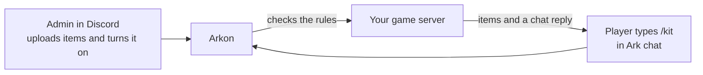
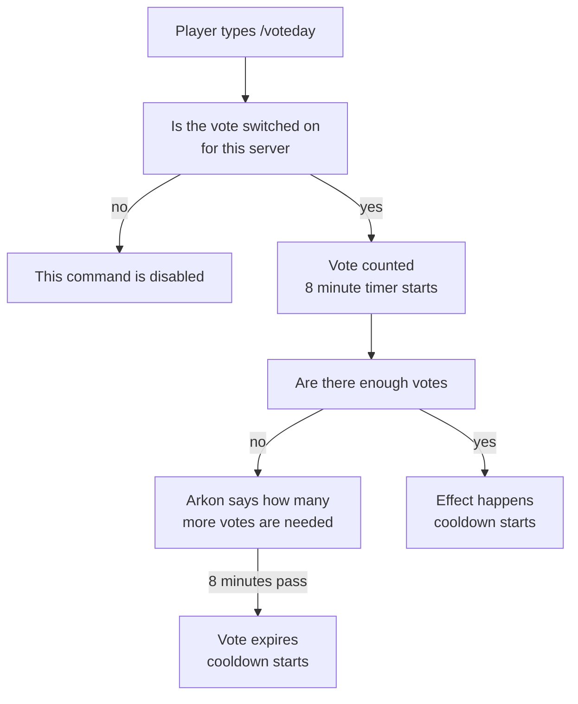

# In-Game Chat Commands: Kits, Payday, Votes and More

Players can type short commands in Ark's chat, and Arkon answers them. Some commands hand out items (a starter kit, a repeating reward called payday, and a rescue care package called imstuck). Some let players vote on the time of day or a dino wipe. Others let them rename their character or see who is online. You switch each one on or off from Discord. This page also shows how to give new players the kit automatically.

**You need:**

- Arkon in your server with an Admin role set. See [Getting Started](/guides/getting-started).
- A cluster (a group of connected maps) with working RCON (the remote-control connection Arkon uses to send commands to your server). See [RCON Setup](/guides/rcon-setup) and [Server Settings](/guides/server-settings).
- The chat relay working, because Arkon reads in-game chat to see the commands. See [Chat and Logs](/guides/chat-and-logs).

> Every command on this page that starts with `+arkset ingame` can only be run by an Admin (anyone with the Discord "Manage Server" permission, or the Admin role you gave Arkon). The same goes for `+resetkit` and `+resetclusterkits`. Players cannot run them. Setting the Admin role is explained in [Getting Started](/guides/getting-started).
{.is-info}

## Every in-game command

Players can start a command with `/`, `!` or your bot prefix (default `+`). So `/kit`, `!kit` and `+kit` all work. Capital letters do not matter.

| In-game command | Short forms | Who | What it does | Default wait | Admin switch |
|---|---|---|---|---|---|
| `kit` | `k` | Everyone | One-time starter kit | None | **Kits** button or `+arkset ingame kit` |
| `payday` | `pd` | Everyone | Reward you can claim again after a wait | 12 hours | **Paydays** button or `+arkset ingame payday` |
| `imstuck` | `is` | Everyone | Care package of basic items | 1 hour | **Imstuck** button or `+arkset ingame imstuck` |
| `voteday` | `vd` | Everyone | Players vote to make it daytime | 1 hour per server | **MapVotes** button |
| `votenight` | `vn` | Everyone | Players vote to make it nighttime | 1 hour per server | **MapVotes** button |
| `votedinowipe` | `vdw` | Everyone | Players vote to wipe all wild dinos | 1 hour per server | **MapVotes** button |
| `votecleanup` | `cleanup` | Everyone | Players vote to remove beaver dams and dropped dino eggs | 1 hour per server | **MapVotes** button |
| `rename <new name>` | `rn` | Everyone | Changes the character name | 1 hour | Second **Rename** button |
| `players` | `online` | Everyone | Says how many people are on this server | None | Always on |
| `help` | `commands` | Everyone | Shows the list of commands that are switched on | 1 minute per player | Always on |
| `mytames` | `tames` | Everyone | 🔹 Counts your tribe's tames on this map | 5 minutes | Needs ArkView on the server |
| `register <Discord name or ID>` | `reg` | Everyone | Links the player's Discord to their character | None | Always on |
| `unregister` | `unregisterme`, `unreg` | Everyone | Unlinks the player's Discord | None | Always on |
| `specimen <number>` | `spec`, `implant`, `impl` | Everyone | Saves the player's specimen number | None | Always on |
| `testreg` | none | Everyone | Shows which character Arkon matched you to | None | Always on |

The waits shown are the defaults. You can change them, as the sections below explain. The registration commands are explained in [Player Registration](/guides/player-registration). Where each switch lives is listed in [Turning commands on and off](#turning-commands-on-and-off).

## How it fits together



Items are not sent until a feature is switched on. Setting items does not switch anything on.

## Before you start: what players must do

Arkon can only give items to a player it can find. Each player must set a **specimen number** (also called an implant ID, the number on their character's implant) once, in Ark chat:

```
/specimen 12345678
```

The number must be 5 to 9 digits. Until they do this, `kit`, `payday` and `imstuck` answer "First set your specimen number! (Ex: /specimen 12345678)".

This applies to `kit`, `payday` and `imstuck`. The vote, rename and players commands do not need a specimen number.

## Step 1: Make the item list (kit example)

Each feature has its own list of items, stored in a plain text file (.txt). One item per line.

1. Open Notepad (or any plain text editor).
2. Type one line per item, in this shape: `"Blueprint'<item path>'" quantity quality blueprintflag`. Example, one Chitin Pants (quality 4, not a blueprint):

```
"Blueprint'/Game/PrimalEarth/CoreBlueprints/Items/Armor/Chitin/PrimalItemArmor_ChitinPants.PrimalItemArmor_ChitinPants'" 1 4 0
```

3. Save the file as `kit_paths.txt`. It must end in `.txt`.

> Keep the opening `"Blueprint` exactly as shown. Arkon treats any line that does NOT start with `"Blueprint` as a raw console command and runs it as typed. A missing quote turns your item line into a broken command.
{.is-warning}

Item paths for every Ark item are in the [Ark RCON Commands](/guides/ark-rcon-commands) reference.

## Step 2: Upload the list

1. Go to any Discord channel the bot can see.
2. Type the command and attach `kit_paths.txt` to the same message. Replace `My Cluster` with your cluster name (type `+viewservers` if you forget it):

```
+arkset ingame setkitpaths My Cluster
```

3. You will see: `Kit paths have been updated for this cluster!`


> Uploading replaces the whole list. It does not add to it. Run `+arkset ingame getkitpaths My Cluster` first to download your current list as a backup.
{.is-warning}

## Step 3: Turn the kit on

1. In the same channel, type:

```
+arkset ingame kit My Cluster
```

2. You will see: `Kit claiming for this cluster has been **Enabled**`. Run the same command again to turn it off.

You can also click the **Kits** button on the cluster page of `+viewservers`. Green means on, grey means off. See [Server Settings](/guides/server-settings).

## Step 4: Check it worked

1. In Ark, a player who has set their specimen number types `/kit`.
2. They see in-game chat: `SurvivorSam, you have claimed your starter kit!` and the items arrive in their inventory.
3. If your chat relay is on, the same line also appears in your Discord chat log as small text.
4. If they type `/kit` again they see `SurvivorSam, you have already claimed your kit on this cluster!`

Each player gets one kit per cluster. There is no wait time on `kit`.

## Payday: a reward players can claim again

Payday works like the kit, but players can claim it again after a wait.

1. Make `payday_paths.txt` the same way as Step 1.
2. Upload it: `+arkset ingame setpaydaypaths My Cluster` (attach the file).
3. Turn it on: `+arkset ingame payday My Cluster`
4. Optional, change the wait (in seconds): `+arkset ingame paydaycooldown 86400 My Cluster` (86400 is once a day).
5. Optional, give one random line instead of every line: `+arkset ingame paydayrandom My Cluster`

Players type `/payday`. They see `SurvivorSam, your payday is on the way!`. If they try too soon they see `SurvivorSam, You can claim your next payday in <time>`.

> The wait starts the first time a player tries the command, even if you have not set any payday items yet. A player who tries `/payday` before you finish setup must wait the full cooldown. Upload the items before you turn payday on.
{.is-warning}

## Imstuck: the rescue care package

Imstuck gives a stuck player a small bundle of basic items so they can get going again. It gives items. It does not move the player.

1. Turn it on: `+arkset ingame imstuck My Cluster`
2. Optional, change the wait: `+arkset ingame imstuckcooldown 900 My Cluster` (900 seconds is 15 minutes).
3. Optional, use your own items: make `imstuck_paths.txt` and upload it with `+arkset ingame setimstuckpaths My Cluster`.

If you never upload your own list, players get the built-in one: Organic Polymer x8, Grappling Hook ammo x9, Crossbow x1, Thatch Floor x1, GPS x1 and Parachute x1. Run `+arkset ingame getimstuckpaths My Cluster` to see the list. To go back to the built-in items later, upload an empty .txt file.

Players type `/imstuck` and see `SurvivorSam, your care package is on the way!`. Too soon gives `SurvivorSam, You can get another care package in <time>`.

## Automatic kits for new players

Auto-kit gives the starter kit to new players without them typing anything. The kit goes out once the player is online and has set their specimen number.

1. Make sure kit items are set (Step 2). Auto-kit refuses to turn on without them: `Set kit paths for this cluster first with setkitpaths!`
2. Turn it on:

```
+arkset ingame autokit My Cluster
```

3. You will see how many existing players were queued: `Auto-kit for this cluster has been **Enabled**` and `3 eligible player(s) queued for delivery`.


Auto-kit does not need the player-typed `kit` command to be on. It uses the same claim list, so nobody gets the kit twice. Waiting players are checked every hour, and a waiting player who is never delivered to is dropped after 7 days.

Who counts as eligible:

- Their total playtime on your Discord server must be under the cap (default 10 hours).
- When you first switch auto-kit on, players last seen within the window (default 30 days) are queued. After that, every new joiner who meets the rules is queued.

## Reset kits

Use these when a player lost their kit or you want everyone to be able to claim again.

**One player:** you need their game ID (a Steam ID, Xbox XUID or Epic EOS ID).

1. Type `+resetkit 2535412345678901`
2. Pick your cluster in the dropdown.
3. You will see: ``Kit has been reset for `2535412345678901` on the **My Cluster** cluster!``


If you turned on **Per-Server Kits** (see below), the kit is reset on all maps instead.

**Everyone:** `+resetclusterkits My Cluster`. You will see how many kits were reset.

> A player who already received an auto-kit and then gets reset is not queued again. Tell them to type `/kit` themselves.
{.is-info}

The kit-scope button on the cluster page of `+viewservers` is labelled **Per-Cluster Kits** when off and **Per-Server Kits** when on. Off (default), a player claims the kit once for the whole cluster. On, they claim it once per map. Switching it does not copy old claims across.

## Votes: day, night, dino wipe and cleanup

Votes let players change the server together. One player alone cannot do it, unless they are the only one online. Several players must type the same command.

**Who can start or join a vote:** Everyone. No specimen number is needed.

**How a vote works:**

1. A player types `/voteday`. Arkon says how many more votes are needed, for example `3 more votes needed to make it day`.
2. Other players type the same command. Each player can vote once.
3. When enough players have voted, Arkon runs the effect and tells the server.
4. If not enough players vote within 8 minutes, the vote ends with `voteday session has expired.` in game. The same line is posted in the server's chat channel in Discord.



**How many votes are needed** (counted from the players online on that map):

| Players online | Votes needed |
|---|---|
| 1 to 10 | Half of them, rounded up (4 players need 2) |
| More than 10 | A third of them, rounded up, but never fewer than 5 (12 players need 5, 18 players need 6) |

| Vote | What happens when it passes | Reply |
|---|---|---|
| `voteday` | Sets the time of day to 07:00 and plays a lantern sound | `Vote successful, let there be light!` |
| `votenight` | Sets the time of day to 22:00 and plays a lantern sound | `Vote successful, let there be darkness!` |
| `votedinowipe` | Destroys all wild (untamed) dinos and plays an explosion sound. Tamed dinos are not touched. | `Asteroids inbound! Wild dinos will be wiped!` |
| `votecleanup` | Destroys beaver dams and dropped fertilized eggs of Rock Drakes, Wyverns, Deinonychus and Cherufe (the spoiled eggs that cause lag) | `Vote successful, wiping beaver dams and spoiled eggs!` |

Other replies players can see:

- `SurvivorSam, You have already voted for that!`
- `voteday command is on cooldown for 59 minutes` (the whole server must wait after a vote ends)
- `SurvivorSam, You can use this command again in <time>` (a player must wait 30 seconds between vote commands)
- `Playerlist is not available, please try again in a minute` (Arkon has not read the player list yet)
- `This command is disabled!` (you switched that vote off)

### Turn votes on or off and set their cooldowns

Votes are switched on by default, with a 3600 second (1 hour) cooldown each. They are set **per server**, not per cluster. Admin only.

1. Type `+viewservers`.
2. Press **Servers** on the cluster page, then use the arrows to find the server.
3. Press **MapVotes** to switch votes on or off. Type `True` or `False` in each box.


4. Press **MapVote Cooldowns** to change the wait. Type whole numbers of seconds. Anything else is refused with `Cooldowns must be numbers!`.


5. You see `Vote commands have been updated for The Island` or `Cooldowns have been updated for The Island`.

> The grey hint text in the two popups looks swapped. MapVotes takes `True` or `False`. MapVote Cooldowns takes seconds. Ignore the hint.
{.is-info}

The server page also shows a "Map Vote Settings" box with the current on or off state and cooldown of each vote. Cooldown timers and open votes are kept in memory, so they reset when the bot restarts. See [Server Settings](/guides/server-settings) for the rest of the server page.

## Rename: players change their own character name

`/rename SurvivorSam2` changes the player's character name in the game. It is **off by default** and is set per cluster. Admin only.

1. Type `+viewservers` and stay on the cluster page.
2. Press the **Rename** button that sits next to the other switches. There are two **Rename** buttons, and the first one renames the cluster.
3. In the "Ingame Rename" popup, set **Enabled** to `True` and **Cooldown** to the wait in seconds (default 3600, which is 1 hour).


4. You see `Ingame rename has been enabled!`, `Ingame rename cooldown has been updated!` or `Ingame rename settings have been updated!`. If nothing changed you see `No changes made!`. A cooldown that is not a number gives `Cooldown must be a number!`.

What players see:

| Reply | Meaning |
|---|---|
| `SurvivorSam, you need to include the new name in the command!` | They typed `/rename` with no name |
| `SurvivorSam, You can rename yourself again in <time>` | The wait is not over |
| `This command is disabled!` | Rename is off on this cluster |
| `SurvivorSam, that is already your name!` | Same name as now |
| `SurvivorSam, that name is blacklisted!` | The name matches your name blacklist, see [Security](/guides/security) |
| `SurvivorSam, that name is already taken!` | Another character on that map has the name |
| `SurvivorSam has been renamed to RexRider` | It worked, and a short sound plays for the player |

Everything after `/rename` is the new name, so spaces are allowed.

## Other chat commands

These need no setup and cannot be switched off.

- **`players`** (also `online`): says `There are 12 people on this server`, or `Youre the only person on this server :p` if there is only one. If Arkon has not read the list yet it says `Playerlist is not available, please try again in a minute`.
- **`help`** (also `commands`): shows a list to the whole server. It always shows `register`, then only the commands that are switched on: imstuck, payday (with its wait), kit, the four votes (each with its wait), players and rename. If the list would get too long, the last lines are sent as normal chat lines. A player who asks again within a minute sees `SurvivorSam, you can use this command again in <time>`.
- **`mytames`** (also `tames`): 🔹 needs [ArkView](/guides/arkview) set up on that server. It counts the tames of the player's tribe. Arkon first says `checking your tame count SurvivorSam, one moment...` and then `Total tribe tames for SurvivorSam: 42... 30 are on the map now`. The total includes tames in cryopods and uploaded tames. The wait is 5 minutes. Other replies are `This server hansn't been setup to work with this command!` (no ArkView port on that server), `I could not find your tribe in the data for this server.`, `SurvivorSam your tribe has no tames on this server`, `Failed to get response from ArkView!` and `Failed to get a response from the server, try again later`. The Discord version is in [Map Tools](/guides/map-tools).
- **`register`, `unregister`, `specimen`**: link or unlink the player's Discord and save the specimen number. Every reply is in [Player Registration](/guides/player-registration). If a player types `/register 12345678` with only a number of fewer than 10 digits, Arkon treats it as `/specimen 12345678`.
- **`testreg`**: a quick check that Arkon knows who you are. It answers `SurvivorSam matched to SurvivorSam (2535412345678901)`. If it cannot match you it says `I couldn't find your Game ID, please try again`.

## Turning commands on and off

If a player types a command that is switched off, Arkon answers `This command is disabled!`. Here is where each switch lives:

| Command | Level | Where |
|---|---|---|
| `kit`, `payday`, `imstuck` | Cluster | **Kits**, **Paydays** and **Imstuck** buttons on the cluster page of `+viewservers`, or the `+arkset ingame` commands below. Green is on, grey is off. |
| `voteday`, `votenight`, `votedinowipe`, `votecleanup` | Server | **MapVotes** button on the server page |
| `rename` | Cluster | The second **Rename** button on the cluster page |
| `players`, `help`, `mytames`, `register`, `unregister`, `specimen`, `testreg` | none | Always on |

The setup checklist (`+checklist`, see [Getting Started](/guides/getting-started)) also lists Kit, Payday, ImStuck and Rename for each cluster. A green check means it is on. A gear on Kit, Payday or ImStuck means it is on but has no items yet.

## Commands

All of these are Admin only. Cluster names do not need quotes, except in `autokitwelcome`. Syntax: `<required>`, `[optional]`.

| Command | What it does | Default |
|---|---|---|
| `+arkset ingame` | Shows help for the group | |
| `+arkset ingame kit <cluster>` | Turns the `kit` command on or off | Off |
| `+arkset ingame getkitpaths <cluster>` | Sends you `kit_paths.txt` | |
| `+arkset ingame setkitpaths <cluster>` | Replaces the kit items from an attached .txt | Empty |
| `+arkset ingame autokit <cluster>` | Turns auto-kit on or off (needs kit items) | Off |
| `+arkset ingame autokitplaytime <hours> <cluster>` | Max lifetime hours a player can have and still get an auto-kit (min 1) | 10 |
| `+arkset ingame autokitwindow <days> <cluster>` | Players seen in the last X days are queued when you switch auto-kit on (min 1) | 30 |
| `+arkset ingame autokitwelcome <cluster> [message]` | Sets the in-game welcome text. Leave the message off to reset it | See below |
| `+arkset ingame payday <cluster>` | Turns payday on or off | Off |
| `+arkset ingame paydaycooldown <seconds> <cluster>` | Wait between paydays | 43200 (12 hours) |
| `+arkset ingame paydayrandom <cluster>` | Switches between giving every line (Static) and one random line (Random). Also `+arkset ingame randompayday` | Static |
| `+arkset ingame getpaydaypaths <cluster>` | Sends you `payday_paths.txt` | |
| `+arkset ingame setpaydaypaths <cluster>` | Replaces the payday items from an attached .txt | Empty |
| `+arkset ingame imstuck <cluster>` | Turns imstuck on or off | Off |
| `+arkset ingame imstuckcooldown <seconds> <cluster>` | Wait between care packages | 3600 (1 hour) |
| `+arkset ingame getimstuckpaths <cluster>` | Sends your list, or shows the built-in one | |
| `+arkset ingame setimstuckpaths <cluster>` | Replaces the imstuck items from an attached .txt | Built-in list |
| `+resetkit <gameid>` | Lets one player claim the kit again | |
| `+resetclusterkits <cluster>` | Lets everyone claim the kit again | |

`+arkset` also works as `+arktools`.

Examples:

- `+arkset ingame autokitplaytime 5 My Cluster` (only players under 5 hours)
- `+arkset ingame autokitwindow 14 My Cluster`
- `+arkset ingame paydaycooldown 86400 My Cluster`

**Number first, cluster second.** `paydaycooldown`, `imstuckcooldown`, `autokitplaytime` and `autokitwindow` take the number before the cluster name.

**Welcome message.** `autokitwelcome` takes the cluster name first, as one word, so put multi-word names in quotes. `{username}` becomes the player's name:

```
+arkset ingame autokitwelcome "My Cluster" Welcome {username}! Type register to link your Discord!
```

The default message is: `Welcome {username}! A starter kit has been dropped into your inventory. Get a base and a bed down early. Type /register in chat to link your Discord for perks!`

## Extra: console commands in your lists

A line that does not start with `"Blueprint` is run as an RCON console command. You can put these words in it and Arkon fills them in for that player: `{name}`, `{charactername}`, `{username}`, `{gamertag}`, `{playerid}`, `{eos}`, `{xuid}`, `{gameid}`, `{id}`, `{implant}` and `{specimen}`.

## Common problems

| Problem | Why it happens | Fix |
|---|---|---|
| Player sees "First set your specimen number! (Ex: /specimen 12345678)" | They have not set their specimen number | Tell them to type `/specimen 12345678` (their own 5 to 9 digit number) in chat |
| "This command is disabled!" | The feature is switched off | Turn it on with the `kit`, `payday` or `imstuck` command |
| "Starter kit has not been configured on this cluster yet!" | Kit is on but the list is empty | Upload items with `setkitpaths` |
| "Payday loot table has not been configured on this cluster yet!" | Payday is on but the list is empty | Upload items with `setpaydaypaths` |
| "I couldn't find your Game ID, please try again" | Arkon cannot match the player yet | Make sure the player has joined and your chat relay works |
| "A cluster by that name doesn't exists!" or "A cluster with that name doesn't exist!" | Cluster name is wrong | Check it with `+viewservers`. Capital letters do not matter |
| "Upload must be a `.txt` file!" | Wrong file type | Save it as plain .txt |
| "You must attach a text file containing the paths!" | No file on the message | Attach the .txt to the same message as the command |
| "Set kit paths for this cluster first with `setkitpaths`!" | Auto-kit needs a kit list | Run `setkitpaths` first |
| Nothing happens and no error | Arkon could not reach the server through RCON | See [RCON Setup](/guides/rcon-setup) |
| Cooldowns start over | Cooldowns are kept in memory and reset when the bot restarts | Nothing to fix |
| "This command is disabled!" on a vote | That vote is switched off on this server | Press **MapVotes** on the server page and set it to `True` |
| "This command is disabled!" on rename | Rename is off, which is the default | Turn it on with the second **Rename** button |
| "voteday command is on cooldown for ..." | A vote on this server ended recently | Wait, or lower the time with **MapVote Cooldowns** |
| A vote never passes | Not enough players voted within 8 minutes | Ask players to type the command together |
| Arkon cannot send the .txt file | The bot lacks Attach Files permission | Give Arkon the Attach Files permission in that channel |

## Related pages

- [Getting Started](/guides/getting-started)
- [Server Settings](/guides/server-settings)
- [RCON Setup](/guides/rcon-setup)
- [Chat and Logs](/guides/chat-and-logs)
- [Player Registration](/guides/player-registration)
- [Map Tools](/guides/map-tools)
- [Security](/guides/security)
- [RCON Shop](/guides/rshop)
- [Guide for Players](/guides/player-getting-started)
- [Ark RCON Commands](/guides/ark-rcon-commands)
- [Admin Commands](/commands/admin-commands)
