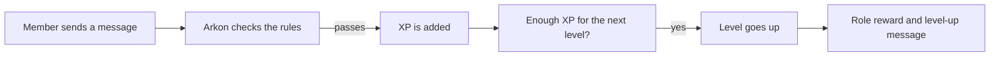

# LevelUp

LevelUp gives your members XP (experience points) for chatting and for sitting in voice channels. When they collect enough XP they go up a level. You can announce it, hand out roles as rewards, show profile cards and run leaderboards. It keeps your community active because people can see their progress.

LevelUp is **off** until you turn it on, and level-up announcements are **off** until you pick a place for them. The quick start below does both in a few minutes.

**You need:**

- Arkon in your server ([Getting started](/guides/getting-started)).
- The Admin role, the Manage Server permission, or server owner, to change settings. Members need no permission to use `+profile`, `+leveltop` and `+stars`.
- For role rewards: Arkon needs the Manage Roles permission, and its own top role must sit above the reward roles in your role list.

## How it works



The rules Arkon checks: LevelUp is on, the channel and member are not ignored, the member's cooldown has passed, the message is long enough and it is not a copy of a recent message (anti-spam). Messages that start with the bot prefix (`+`) give no XP.

By default a member earns 3 to 6 XP for a message, at most once a minute, and 2 XP for every minute in a voice channel.

The XP needed for a level is `100 x level x level`. Early levels come fast and later ones get slower:

| Level | Total XP needed |
|---|---|
| 1 | 100 |
| 2 | 400 |
| 5 | 2,500 |
| 10 | 10,000 |
| 20 | 40,000 |

You can change the curve with `+levelset algorithm` (see Tuning below).

> All `+levelset ...` commands can also be typed as `+lvlset ...` or `+lset ...`. This guide uses `+levelset`.
{.is-info}

## Quick start

This is the smallest setup that works. Do these four steps, then add anything else you want from the sections below.

### Step 1: Turn LevelUp on

Where: any channel the bot can see. You must be an admin.

Type:

```
+levelset toggle
```

You will see: `LevelUp has been **Enabled**`. Type it again to turn it off.

### Step 2: Choose where level-up messages go

Without this step members level up silently. Pick one or both:

```
+levelset levelnotify
+levelset levelchannel #levelups
```

- `levelnotify` posts the message in the same channel where the member was chatting. You will see `LevelUp notifications have been **Enabled**`.
- `levelchannel` posts every level-up in one channel of your choice. You will see `LevelUp messages will now be sent to #levelups`. Run `+levelset levelchannel` with no channel to stop using it.

If both point at the same channel, the message is only posted once.

### Step 3: Test it

Fresh members need 100 XP for level 1, which takes a while by chatting. To test right now, give yourself almost enough:

```
+levelset addxp @YourName 99
```

You will see: `Added 99 XP to YourName`. Now write a normal message (not starting with `+`), for example "hello everyone". You get 3 to 6 XP, cross 100, and Arkon posts that you reached level 1.


### Step 4: Check it worked

Type `+profile`. You should see your level, stars, message count, voice time and a progress bar.


Type `+levelset view` to see every setting in one place.


That is the whole quick start. Everything below is optional.

> The test XP you gave yourself stays on your profile. To take it back, run `+levelset removexp @YourName 99`.
{.is-info}

## Custom level-up messages

You can write your own text instead of the default ones. Placeholders (words in curly brackets) are replaced for each member:

| Placeholder | Becomes |
|---|---|
| `{username}` | The member's name |
| `{displayname}` | The member's server nickname |
| `{mention}` | A ping of the member |
| `{level}` | The level they reached |
| `{server}` | Your server name |
| `{role}` | The reward role (only in the two role messages) |

```
+levelset levelupmessages msg {mention} just hit level {level} in {server}!
+levelset levelupmessages msgrole {mention} reached level {level} and earned {role}!
```

`msg` is used for a normal level-up. `msgrole` is used when that level also gives a role. `dm` and `dmrole` are the same two messages sent as a private message (turn those on with `+levelset dm`). Arkon replies with a preview. Run a command with no text to clear it and go back to the default. `+levelset levelupmessages view` shows what is set.

Other level-up switches:

- `+levelset mention` pings the member in level-up messages (off by default).
- `+levelset ignore notify #channel` stops level-up messages being posted in that channel. Run it again to undo.
- Members can silence their own level-up messages with `+lvlupnotify` (also `+notify`). Run it again to turn them back on. Arkon replies `Level up notifications are now **disabled** for you.`

## Role rewards

Role rewards give a member a role when they reach a level, like "Survivor" at level 5.

### Step 1: Add the reward

```
+levelset roles add 5 @Survivor
+levelset roles add 10 @Veteran
```

You will see: `The role associated with level 5 has been added`. Adding the same level again changes its role (`has been updated`). You cannot use a role that is above Arkon's top role or above your own top role.

### Step 2: Decide what happens to old roles

By default members keep every earlier reward role. To keep only the highest one:

```
+levelset roles autoremove
```

You will see: `Automatic removal of previous level roles has been **Enabled**`. Run it again to turn it off.

### Step 3: Give roles to members who already qualify

If members were already past level 5 before you added the reward, hand out the roles in one go:

```
+levelset roles initialize
```

You will see a "Synchronizing level roles" message, then how many roles were added and removed. This can be run once every 4 minutes. Arkon needs the Manage Roles and Embed Links permissions.

To remove a reward use `+levelset roles remove 5`.

> If a reward role is deleted, or moved above Arkon's top role, Arkon quietly drops it from your list the next time it tries to hand roles out. If nobody ever gets a role, check Arkon's role position first.
{.is-warning}

## Profile cards

`+profile` (also `+pf`) shows your own profile. `+profile @RexRider` shows someone else's. You can also right-click a member, choose Apps, then View Profile. A member can use `+profile` three times per 10 seconds. Slash `/profile` answers privately, so only the person who used it sees it.

New members see a short welcome the first time. Turn it off with `+levelset profilewelcome`.

There are two looks:

- **Embeds** (the default): a clean Discord embed with level, prestige, stars, messages, voice time, progress bar and rank.
- **Images**: a generated picture card. Switch with `+levelset embeds`. If the bot owner has locked profiles to embeds, you will see `Profile rendering is locked to Embeds only by the bot owner!` and nothing changes.

In embed mode most `+setprofile` options do nothing and Arkon says `Image profiles are disabled here, this setting has no effect!`. In image mode members customise their card:

| Command | Who | What it does | Example |
|---|---|---|---|
| `+setprofile` (aliases `+myprofile`, `+mypf`, `+pfset`) | Everyone | Group command, does nothing alone | |
| `+setprofile view` | Everyone | Shows your profile settings (only you see it) | `+setprofile view` |
| `+setprofile shownick` | Everyone | Switch between showing your nickname or your username. Works in both looks | `+setprofile shownick` |
| `+setprofile style <style>` | Everyone | Card style: `default`, `runescape`, `minimal` or `gaming` | `+setprofile style minimal` |
| `+setprofile background <url or name>` (alias `bg`) | Everyone | Set your card background from a link, a built-in name, or an attached image. `random` picks a new one each time, `default` resets it | `+setprofile background random` |
| `+setprofile backgrounds` | Everyone | Shows a picture of all built-in backgrounds | `+setprofile backgrounds` |
| `+setprofile font <name>` | Everyone | Set your font. `default` resets it | `+setprofile font default` |
| `+setprofile fonts` | Everyone | Shows a picture of all fonts | `+setprofile fonts` |
| `+setprofile namecolor <color>` (alias `name`) | Everyone | Colour of your name. A name, a hex code or a number. `default` means random each time | `+setprofile namecolor #ff8800` |
| `+setprofile statcolor <color>` (alias `stat`) | Everyone | Colour of your stats | `+setprofile statcolor blue` |
| `+setprofile barcolor <color>` (aliases `levelbar`, `lvlbar`, `bar`) | Everyone | Colour of your level bar | `+setprofile barcolor green` |
| `+setprofile blur` | Everyone | Turns the soft blur behind your text on or off | `+setprofile blur` |
| `+levelset forcestyle <style>` | Admin | Force one style on everyone: `default`, `runescape`, or `none` to stop forcing | `+levelset forcestyle none` |
| `+levelset defaultbackground [background]` | Admin | Background for members who have not picked one. Run with nothing to see the current one | `+levelset defaultbackground random` |
| `+levelset showbalance` (alias `showbal`) | Admin | Show a member's bank balance on their profile ([Economy](/guides/economy)) | `+levelset showbalance` |
| `+levelset emojis <level> <prestige> <star> <chat> <voice> <xp> <balance>` | Admin | Change the seven icons used on profiles and leaderboards. Arkon reacts with each emoji to test them | `+levelset emojis 🏅 🏆 ⭐ 💬 🎙 💡 💰` |
| `+levelset resetemojis` | Admin | Back to the default icons | `+levelset resetemojis` |

Notes:

- Background images can be a link or an attached file (Discord attachment links expire, so Arkon saves attached images itself).
- Image cards are cached by the bot owner for a short time, so a change may take a moment to show.
- The `runescape` and `gaming` styles have a fixed look. For these, colour, background, font and blur changes are refused with `You cannot change your name color with the current profile style!` (that wording is used for all of them).
- The bot owner controls the pool of built-in backgrounds and fonts.

## Stars

Stars are a thank-you between members. They show on the profile and have their own leaderboard.

Two ways to give a star:

1. React with the star emoji (the white one) to someone's message.
2. Type `+stars @RexRider` (also `+givestar`, `+addstar`, `+thanks`, or slash `/stars`).

By default each member can give one star per hour. The cooldown is shared by both ways. Stars to yourself or to bots do not work. After you have given a star, running `+stars` with no name tells you when you can give again.

| Command | Who | What it does | Example |
|---|---|---|---|
| `+stars <member>` | Everyone | Give a star | `+stars @RexRider` |
| `+startop [globalstats] [displayname]` (aliases `+topstars`, `+starleaderboard`, `+starlb`) | Everyone | Star leaderboard | `+startop` |
| `+starset view` | Admin | Shows the star settings | `+starset view` |
| `+starset cooldown <seconds>` | Admin | Seconds between stars per member | `+starset cooldown 1800` |
| `+starset mention` | Admin | Turn the public "gave a star" message on or off (off by default) | `+starset mention` |
| `+starset mentiondelete <seconds>` | Admin | Delete that message after this many seconds. `0` keeps it | `+starset mentiondelete 30` |

`+levelset starcooldown <seconds>` does the same as `+starset cooldown`.

## Leaderboards

`+leveltop` (aliases `+lvltop`, `+topstats`, `+membertop`, `+topranks`, or slash `/leveltop`) shows the top members, ten per page with buttons to flip pages. Add the stat you want:

```
+leveltop xp
+leveltop voice
+leveltop messages
+leveltop stars
```


Two optional extras after the stat: `globalstats` (`True` adds up every server Arkon is in) and `displayname` (`False` shows usernames instead of nicknames). Example: `+leveltop xp False True`.

If nobody has data yet, Arkon says `There is no data for the Experience leaderboard yet`.

**Role groups** let a whole role compete as a team. Run `+levelset rolegroup @Red Team` to add a role (run it again to remove it). Every XP a member with that role earns also goes to the role. Show the team standings with `+roletop`.

## Prestige

Prestige lets members who have hit your top level start again for a badge. They go back down and keep a permanent prestige role. It is optional and needs two things set up first.

### Step 1: Set the level required

```
+levelset prestige level 20
```

You will see: `Prestige level has been set to 20`.

### Step 2: Add prestige ranks

Each rank needs a role and an emoji:

```
+levelset prestige add 1 @Prestige1 🏆
+levelset prestige add 2 @Prestige2 🥇
```

You will see: `Role and emoji have been set for prestige level 1`.

### Step 3: Members prestige

At level 20 a member types `+prestige` (or slash `/prestige`). Their level drops by 20 (never below 1), their XP matches the new level, and they get prestige rank 1 and its role. Arkon needs the Manage Roles and Embed Links permissions.

| Command | Who | What it does | Example |
|---|---|---|---|
| `+prestige` | Everyone | Prestige when you are high enough | `+prestige` |
| `+levelset prestige level <level>` | Admin | Level needed to prestige | `+levelset prestige level 20` |
| `+levelset prestige add <rank> <role> <emoji>` | Admin | Create a prestige rank | `+levelset prestige add 1 @Prestige1 🏆` |
| `+levelset prestige emoji <rank> <emoji>` | Admin | Change a rank's emoji | `+levelset prestige emoji 1 🔥` |
| `+levelset prestige remove <rank>` (aliases `rem`, `del`) | Admin | Delete a rank | `+levelset prestige remove 2` |
| `+levelset prestige stack` | Admin | Keep older prestige roles when moving up (on by default). Off means only the newest one | `+levelset prestige stack` |
| `+levelset prestige keeproles` | Admin | Keep level reward roles after prestiging (off by default) | `+levelset prestige keeproles` |
| `+levelset setprestige <member> <rank>` | Admin | Set a member's prestige number. Roles are not changed | `+levelset setprestige @RexRider 1` |

## Weekly stats

Weekly stats track XP, messages, voice time and stars for the current week only. At the end of the week Arkon can announce the winners, give them a role and a bonus. It is off by default.

### Step 1: Turn it on and pick a channel

```
+weeklyset toggle
+weeklyset channel #weekly-winners
```

You will see: `Weekly stat tracking enabled` and `Weekly winners will now be announced in #weekly-winners`. (`+wset` works instead of `+weeklyset`.)

### Step 2: Turn on the automatic reset

Without this, the week never ends by itself.

```
+weeklyset autoreset
+weeklyset day 6
+weeklyset hour 20
```

Day is `0` for Monday up to `6` for Sunday. Hour is `0` to `23`. The time follows the clock of the computer the bot runs on, which may be in another time zone than yours. `+weeklyset view` shows the exact next reset time in your own time.

### Step 3 (optional): Winner role and bonus

```
+weeklyset role @Weekly Champion
+weeklyset bonus 500
+weeklyset winners 5
```

The top member gets the role, and the previous winner loses it (turn that off with `+weeklyset autoremove`). `+weeklyset roleall` gives the role to all winners instead of only first place. The bonus is extra XP for each of the top winners. `winners` is how many are shown and counted, 1 to 25 (default 3).

Members can look any time:

- `+weekly [stat]` shows this week's board. The stat can be `exp` (default), `messages`, `voice` or `stars`.
- `+lastweekly` shows last week's winners.

| Command | Who | What it does | Example |
|---|---|---|---|
| `+weekly [stat]` (alias `+week`) | Everyone | This week's leaderboard | `+weekly messages` |
| `+lastweekly` | Everyone | Last week's winners | `+lastweekly` |
| `+weeklyset view` | Admin | Shows all weekly settings and the next reset | `+weeklyset view` |
| `+weeklyset toggle` | Admin | Weekly tracking on or off | `+weeklyset toggle` |
| `+weeklyset channel <channel>` | Admin | Where winners are announced | `+weeklyset channel #weekly-winners` |
| `+weeklyset autoreset` | Admin | Reset by itself every week, on or off | `+weeklyset autoreset` |
| `+weeklyset day <0-6>` | Admin | Reset day, 0 is Monday | `+weeklyset day 6` |
| `+weeklyset hour <0-23>` | Admin | Reset hour | `+weeklyset hour 20` |
| `+weeklyset reset <yes or no>` | Admin | End the week now and announce winners | `+weeklyset reset yes` |
| `+weeklyset winners <1-25>` | Admin | Number of winners | `+weeklyset winners 5` |
| `+weeklyset role <role>` | Admin | Role for the winner(s) | `+weeklyset role @Weekly Champion` |
| `+weeklyset bonusrole <role>` | Admin | Extra winner role (add or remove, run again to undo) | `+weeklyset bonusrole @Gold Name` |
| `+weeklyset excluderole <role>` | Admin | Members with this role can never win the role. They still show on the board | `+weeklyset excluderole @Staff` |
| `+weeklyset roleall` | Admin | All winners get the role, or only first place | `+weeklyset roleall` |
| `+weeklyset autoremove` | Admin | Take the role from last week's winner (on by default) | `+weeklyset autoremove` |
| `+weeklyset ping` | Admin | Ping winners in the announcement (off by default) | `+weeklyset ping` |
| `+weeklyset bonus <xp>` | Admin | Bonus XP for the top winners. `0` for none | `+weeklyset bonus 500` |

## Where XP is earned: allowed, ignored

You can limit XP to some places and people. Each command adds the item. Run it again with the same item to remove it.

| Command | Who | What it does | Example |
|---|---|---|---|
| `+levelset ignore channel <channel or category>` | Admin | No XP there | `+levelset ignore channel #bot-spam` |
| `+levelset ignore role <role>` | Admin | Members with this role earn no XP | `+levelset ignore role @Muted` |
| `+levelset ignore user <member>` | Admin | This member earns no XP and is not tracked at all | `+levelset ignore user @RexRider` |
| `+levelset allowed channel <channel or category>` | Admin | If the list has anything in it, ONLY these places give XP | `+levelset allowed channel #general` |
| `+levelset allowed role <role>` | Admin | If the list has anything in it, ONLY members with one of these roles earn XP | `+levelset allowed role @Member` |
| `+levelset commandxp` | Admin | Let messages that start with a command prefix earn XP (off by default) | `+levelset commandxp` |

Channels can be text, voice, forum or a whole category. A category covers every channel inside it, and a forum covers its posts.

> Be careful with the "allowed" lists. Once one channel is on the list, every other channel stops giving XP.
{.is-warning}

## XP bonuses

Bonuses add extra XP on top of the normal amount. Each one is a range, so a bonus of 1 to 3 adds a random 1, 2 or 3 each time. They stack with each other. Setting both numbers to `0` removes a bonus.

| Command | Who | What it does | Example |
|---|---|---|---|
| `+levelset messages channelbonus <channel or category> <min> <max>` | Admin | Extra XP per message in that place | `+levelset messages channelbonus #events 2 5` |
| `+levelset messages rolebonus <role> <min> <max>` | Admin | Extra XP per message for members with the role | `+levelset messages rolebonus @Supporter 1 3` |
| `+levelset voice channelbonus <voice channel> <min> <max>` | Admin | Extra XP per voice minute there | `+levelset voice channelbonus #Lounge 1 2` |
| `+levelset voice rolebonus <role> <min> <max>` | Admin | Extra voice XP per minute for the role | `+levelset voice rolebonus @Supporter 1 2` |
| `+levelset voice streambonus <min> <max>` | Admin | Extra voice XP while screen sharing | `+levelset voice streambonus 1 3` |
| `+levelset messages appbonus <app name> <min> <max>` | Admin | Extra message XP for people playing that game. Use quotes for names with spaces | `+levelset messages appbonus "ARK: Survival Evolved" 2 4` |
| `+levelset voice appbonus <app name> <min> <max>` | Admin | Extra voice XP for people playing that game | `+levelset voice appbonus ARK 1 2` |
| `+levelset presencebonus message <status> <min> <max>` (alias `msg`) | Admin | Extra message XP for an online status: `online`, `idle`, `dnd` or `offline` | `+levelset presencebonus message online 1 2` |
| `+levelset presencebonus voice <status> <min> <max>` | Admin | Extra voice XP for a status | `+levelset presencebonus voice online 1 2` |
| `+levelset presencebonus view` | Admin | Lists the status bonuses | `+levelset presencebonus view` |

`+levelset message` and `+levelset msg` work the same as `+levelset messages`. The settings view (`+levelset view`) lists every bonus you set.

## Tuning message and voice XP

| Command | Who | What it does | Example |
|---|---|---|---|
| `+levelset messages xp <min> <max>` | Admin | XP range per message (default 3 to 6) | `+levelset messages xp 5 10` |
| `+levelset messages cooldown <seconds>` | Admin | Seconds before another message earns XP (default 60) | `+levelset messages cooldown 30` |
| `+levelset messages length <characters>` | Admin | Shortest message that counts. `0` turns it off | `+levelset messages length 5` |
| `+levelset voice xp <xp>` | Admin | XP per minute in voice (default 2) | `+levelset voice xp 3` |
| `+levelset voice muted` | Admin | Whether self-muted members earn voice XP (they do not by default) | `+levelset voice muted` |
| `+levelset voice deafened` | Admin | Whether deafened members earn voice XP (they do not by default) | `+levelset voice deafened` |
| `+levelset voice solo` | Admin | Whether members alone in a channel earn voice XP (they do not by default; bots do not count as company) | `+levelset voice solo` |
| `+levelset voice invisible` | Admin | Whether invisible members earn voice XP (they do not by default) | `+levelset voice invisible` |
| `+levelset algorithm <base or exp> <value>` (alias `algo`) | Admin | Change the level curve. `base` default 100, `exp` default 2 (must be above 0 and below 10) | `+levelset algorithm base 150` |
| `+levelset seelevels` | Admin | Shows a graph and table of the first 20 levels with your settings | `+levelset seelevels` |

The four voice toggles flip each time you run them. Arkon replies with what it is now, for example `Muted users will no longer gain XP while in a voice channel`.

### Anti-spam

Anti-spam stops people farming XP by repeating themselves. It is on by default. A message earns no XP if it is too similar to the member's last few messages, or if it repeats the same words too much.

| Command | Who | What it does | Example |
|---|---|---|---|
| `+levelset messages antispam view` | Admin | Shows the anti-spam settings | `+levelset messages antispam view` |
| `+levelset messages antispam toggle` | Admin | On or off | `+levelset messages antispam toggle` |
| `+levelset messages antispam similarity <0-100>` | Admin | How alike messages can be (default 85, higher is stricter) | `+levelset messages antispam similarity 90` |
| `+levelset messages antispam history <1-20>` | Admin | How many recent messages to compare (default 5) | `+levelset messages antispam history 10` |
| `+levelset messages antispam uniqueratio <0.0-1.0>` | Admin | Share of different words a message needs (default 0.4) | `+levelset messages antispam uniqueratio 0.5` |

## Using levels to gate commands

LevelUp can require a level before someone uses a command, or slow a command down for low-level members. This applies to any command on Arkon in your server, not only LevelUp commands.

| Command | Who | What it does | Example |
|---|---|---|---|
| `+levelset lvlreq add <level> <command>` | Admin | Members under this level cannot use the command | `+levelset lvlreq add 5 hunt` |
| `+levelset lvlreq del <command>` | Admin | Remove the requirement | `+levelset lvlreq del hunt` |
| `+levelset lvlreq list` | Admin | List the requirements | `+levelset lvlreq list` |
| `+levelset cooldowns add <level> <seconds> <command>` | Admin | Members at this level or lower wait this long between uses. Add several levels for steps | `+levelset cooldowns add 5 60 hunt` |
| `+levelset cooldowns del <level> <command>` | Admin | Remove one step | `+levelset cooldowns del 5 hunt` |
| `+levelset cooldowns list` | Admin | List the cooldowns | `+levelset cooldowns list` |
| `+levelset bypass member [member]` | Admin | Members who skip the above. With nothing, lists them. A member already on the list is removed | `+levelset bypass member @RexRider` |
| `+levelset bypass role [role]` | Admin | Roles who skip the above | `+levelset bypass role @Staff` |

A member who is too low sees: `You need level `5` to use `hunt`. (current level: 2)`. The command name must be a real one, or you get `Invalid command: `name``.

## Fixing and managing members

| Command | Who | What it does | Example |
|---|---|---|---|
| `+levelset addxp <member or role> <xp>` | Admin | Add XP to one member, or to everyone with a role. Does not hand out role rewards by itself, run `+levelset roles initialize` after | `+levelset addxp @RexRider 500` |
| `+levelset removexp <member or role> <xp>` | Admin | Take XP away | `+levelset removexp @RexRider 500` |
| `+levelset setlevel <member> <level>` | Admin | Put a member at an exact level. Roles are updated | `+levelset setlevel @RexRider 10` |
| `+profiledata <user id>` | Mod | Shows the numbers of someone by their ID, even if they left | `+profiledata 123456789012345678` |

## Server data

| Command | Who | What it does | Example |
|---|---|---|---|
| `+leveldata cleanup` (aliases `+lvldata`, `+ldata`) | Admin | Deletes data for members who left and for roles and channels that no longer exist | `+leveldata cleanup` |
| `+leveldata backup` | Admin | Sends a file with all your LevelUp settings and member data | `+leveldata backup` |
| `+leveldata restore` | Admin | Restores from a backup file you attach to the message | `+leveldata restore` |
| `+leveldata reset` | Admin | Deletes ALL member XP, levels and weekly stats on your server. Arkon asks you to confirm | `+leveldata reset` |
| `+leveldata importmee6 <level or exp> <replace> <include_settings> <all_users>` | Server owner | Copy levels from MEE6 (the member leaderboard must be public) | `+leveldata importmee6 exp False True False` |
| `+leveldata importpolaris <replace> <include_settings> <all_users>` | Server owner | Copy from Polaris (needs a public leaderboard) | `+leveldata importpolaris False True False` |
| `+leveldata importamari <level or exp> <replace> <api_key> <all_users>` | Server owner | Copy from AmariBot (needs your Amari API key) | `+leveldata importamari exp False YOURKEY False` |

`replace` means overwrite members who already have LevelUp data. `all_users` also imports people who are no longer in your server. Imports ask you to confirm first.

> `+leveldata reset` cannot be undone. Run `+leveldata backup` first.
{.is-danger}

## All commands at a glance

Slash commands that exist for LevelUp: `/profile`, `/setprofile`, `/leveltop`, `/stars`, `/prestige`, and the right-click member menu View Profile. Everything else is typed with `+`.

| Command | Who | What it does | Example |
|---|---|---|---|
| `+profile [member]` | Everyone | Show a profile | `+profile @RexRider` |
| `+leveltop [stat]` | Everyone | Leaderboard | `+leveltop voice` |
| `+roletop` | Everyone | Role group standings | `+roletop` |
| `+stars <member>` | Everyone | Give a star | `+stars @RexRider` |
| `+startop` | Everyone | Star leaderboard | `+startop` |
| `+prestige` | Everyone | Prestige | `+prestige` |
| `+weekly` | Everyone | Weekly leaderboard | `+weekly` |
| `+lastweekly` | Everyone | Last week's winners | `+lastweekly` |
| `+lvlupnotify` | Everyone | Toggle your own level-up messages | `+lvlupnotify` |
| `+setprofile ...` | Everyone | Customise your card | `+setprofile view` |
| `+levelset ...` | Admin | All LevelUp settings | `+levelset view` |
| `+weeklyset ...` | Admin | Weekly settings | `+weeklyset view` |
| `+starset ...` | Admin | Star settings | `+starset view` |
| `+leveldata ...` | Admin | Backup, cleanup, reset, imports | `+leveldata backup` |

### Defaults

| Setting | Default | Command |
|---|---|---|
| LevelUp | Off | `+levelset toggle` |
| Level-up message in the chat channel | Off | `+levelset levelnotify` |
| Level-up log channel | Not set | `+levelset levelchannel` |
| Level-up DM | Off | `+levelset dm` |
| Ping member in level-up | Off | `+levelset mention` |
| Message XP | 3 to 6 | `+levelset messages xp` |
| Message cooldown | 60 seconds | `+levelset messages cooldown` |
| Minimum message length | 0 (off) | `+levelset messages length` |
| XP for command messages | Off | `+levelset commandxp` |
| Anti-spam | On (85% similar, 5 messages, 0.4 unique) | `+levelset messages antispam` |
| Voice XP | 2 per minute | `+levelset voice xp` |
| Muted, deafened, solo, invisible earn voice XP | No for all four | `+levelset voice muted` and the others |
| Level curve | base 100, exp 2 | `+levelset algorithm` |
| Auto remove old reward roles | Off | `+levelset roles autoremove` |
| Profile look | Embeds | `+levelset embeds` |
| Profile welcome message | On | `+levelset profilewelcome` |
| Show bank balance on profile | Off | `+levelset showbalance` |
| Star cooldown | 3600 seconds (1 hour) | `+starset cooldown` |
| Star public message | Off | `+starset mention` |
| Prestige | Off | `+levelset prestige level` |
| Prestige roles stack | On | `+levelset prestige stack` |
| Keep level roles after prestige | Off | `+levelset prestige keeproles` |
| Weekly stats | Off | `+weeklyset toggle` |
| Weekly auto reset | Off (Monday, hour 0 once on) | `+weeklyset autoreset` |
| Weekly winners | 3 | `+weeklyset winners` |
| Weekly remove old winner role | On | `+weeklyset autoremove` |
| Weekly ping winners | Off | `+weeklyset ping` |

## Common problems

| Problem | Why it happens | Fix |
|---|---|---|
| "Leveling is disabled in this server!" | LevelUp is still off | An admin runs `+levelset toggle` |
| Nobody gets XP | LevelUp is off, the channel or member is ignored, an "allowed" list is set and the channel is not on it, or the 60 second cooldown has not passed | `+levelset view`, then check the Ignored and Allowed lists |
| Level-ups happen but nothing is announced | No place chosen for announcements | `+levelset levelnotify` or `+levelset levelchannel #levelups` |
| Members never get the reward role | Arkon lacks Manage Roles, or the role is above Arkon's top role, or the member's level is below it | Move Arkon's role higher, then run `+levelset roles initialize` |
| "I cannot assign roles higher than my top role!" | The role is above Arkon's role | Move Arkon's role above it |
| "You cannot assign roles higher than your top role!" | The role is above your own top role | Ask someone higher to set it |
| "Image profiles are disabled here, this setting has no effect!" | Your server uses embed profiles | Admin runs `+levelset embeds` for image cards |
| "Profile rendering is locked to Embeds only by the bot owner!" | Image cards are not allowed on this bot | Nothing to change, embeds are used |
| "You cannot change your name color with the current profile style!" | The `runescape` and `gaming` styles have a fixed look | `+setprofile style default` first |
| "That is an invalid color, please use a valid name, integer, or hex color." | Colour not understood | Use a name like `blue`, or a hex code like `#ff8800` |
| "No background found with that name!" | No built-in background matches | Run `+setprofile backgrounds` to see the names |
| "That image is too large for this server's upload limit!" | The background picture is too big for your server's upload size | Use a smaller image |
| "You must provide a url, filename, or attach a file" | `+setprofile background` with nothing | Add a link, a name or an attachment |
| "Bots cannot have profiles!" | You asked for a bot's profile | Ask for a member |
| "You can't give stars to yourself!" | Self stars are blocked | Thank someone else |
| "You can give more stars" followed by a time | Star cooldown | Wait until the time shown |
| "There is no data for the Experience leaderboard yet" | Nobody has any of that stat | Chat first, or pick another stat |
| "You have no level data yet!" | The member never earned XP | Chat for a bit |
| "Prestige has not been configured for this server!" | No prestige level or no ranks | See the Prestige section |
| "You need to be at least level 20 to prestige!" | Level too low | Keep earning XP |
| "You have reached the maximum prestige level!" | No higher prestige rank exists | Add the next rank with `+levelset prestige add` |
| "The prestige role for this level no longer exists, please contact an admin!" | The role was deleted | Remove and re-add the rank |
| "This prestige level has already been set!" | That number is taken | Pick the next number, or remove it first |
| "Weekly stats are not enabled on this server" | Weekly is off | `+weeklyset toggle` |
| "There is no recorded weekly embed saved" | No week has ended yet | Wait for the first reset |
| "There are no users with XP in the weekly data yet" | Nobody earned XP since tracking began | Wait for chat |
| "Invalid placeholder used: 'role'" | `{role}` was used in a message that has no role | Only use `{role}` in `msgrole` and `dmrole` |
| "Min XP value cannot be greater than Max XP value" | Numbers in the wrong order | Smaller number first |
| "XP range cannot be 0" | You tried to set a bonus of 0 to 0 on something that has none | Use real numbers |
| "Role groups have not been configured in this server yet!" | `+roletop` with no role groups | `+levelset rolegroup @Role` |
| "You need level `5` to use `hunt`. (current level: 2)" | A level requirement you set | Level up, or add the member to the bypass list |
| "Invalid command: `name`" | The command you typed does not exist | Check the spelling |
| "Threshold must be between 0 and 100" | Bad anti-spam number | Use 0 to 100 |
| "Day must be between 0 and 6" / "Hour must be between 0 and 23" | Bad weekly time | Use the ranges shown |
| "That prestige level does not exist!" | Wrong rank number | Check `+levelset view` |
| "Failed to restore data!" | The backup file is damaged or from something else | Use a file made by `+leveldata backup` |

## Related pages

- [Getting started](/guides/getting-started)
- [Economy](/guides/economy)
- [Extras](/guides/extras)
- [FAQ](/guides/faq)
