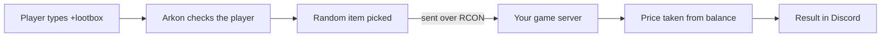

# Lootboxes

A lootbox is a paid mystery prize. A player types `+lootbox`, pays a price, and Arkon sends one random item straight into their game. You decide what the prizes are, how likely each one is, what it costs and how often a player can open one.

**You need:**

- Arkon in your server with at least one server connected ([Getting started](/guides/getting-started)).
- Working RCON (the remote-control connection Arkon uses to send commands to your game server). See [RCON setup](/guides/rcon-setup).
- Players who have linked their Discord to their character ([Player registration](/guides/player-registration)).
- A way for players to earn currency. Lootboxes charge the currency of your server's Red bank (the bot's built-in economy). See [RCON shop](/guides/rshop).

## How it works



Arkon only takes the price after the item was sent. If anything fails, the player is not charged.

> Admin commands (`+lootboxset ...`) can be run by the server owner, anyone with the Admin role, or anyone with the Manage Server permission. See [Getting started](/guides/getting-started) for setting the Admin and Mod roles.
{.is-info}

## Setup

### Step 1: Download the starter spreadsheet

Where: any Discord channel the bot can see.

Type:

```
+lootboxset download
```

You will see: Arkon replies "Here is your lootbox export!" and attaches `lootboxes.xlsx`. With no prizes yet, the file holds only the column headings. Open it in Excel.

> Do not start from `+lootboxset template`. The shipped template file has a duplicated first column and a first example path with missing quotes, so uploading it unchanged fails. Use the download from this step instead.
{.is-warning}

### Step 2: Fill in the spreadsheet

Add one row per prize. Keep the sheet named `lootboxes` and keep the columns in this order (Arkon reads by position, not by header name):

| Column | Name | What to put | Rule |
|---|---|---|---|
| 1 | name | Prize name shown to players | Required |
| 2 | chance | How likely, like `0.2` | Number from 0 to 1 |
| 3 | path | The item path, or a custom command | Required |
| 4 | quantity | How many to give | Whole number, 1 or more |
| 5 | quality | Item quality | Whole number 0 to 100 |
| 6 | blueprint | `1` gives a blueprint, `0` gives the item | 0 or 1 |
| 7 | stacksize | Items per stack | Whole number, 1 or more |
| 8 | gametype | `ase`, `asa` or `both` | One of those three |
| 9 | cluster_blacklist | Clusters that must not give this prize, separated by commas | Optional |

Example row (type the path into the cell exactly like this, including the double quotes at both ends):

| name | chance | path | quantity | quality | blueprint | stacksize | gametype | cluster_blacklist |
|---|---|---|---|---|---|---|---|---|
| Element | 0.1 | `"Blueprint'/Game/PrimalEarth/CoreBlueprints/Resources/PrimalItemResource_Element.PrimalItemResource_Element'"` | 30 | 1 | 0 | 100 | both | |

Chances are weights, not percentages. They do not have to add up to 1. If every chance is 0, every prize is equally likely.

A normal item path must start with a double quote followed by `Blueprint`, contain `.P`, and have exactly two double quotes and exactly two single quotes. Anything else is treated as a custom command (see below).

### Step 3: Upload it

Where: any channel the bot can see. Attach your `.xlsx` file to the message and type `+lootboxset upload`. You can also reply to a message that holds the file.

You will see: `Lootboxes have been updated! (N items loaded)`

> Upload REPLACES your whole list. Nothing is saved if any row has an error. Arkon instead sends `lootbox_errors.txt` listing each problem, for example `Row 3 (Element): Chance must be between 0 and 1, got '5' (column 2)`. Row 1 is your first data row, not the header.
{.is-danger}

> A wrong item path is not caught on upload if it is shaped correctly. It only fails later, when a player opens a box.
{.is-warning}

### Step 4: Set the price, cooldown and log channel

```
+lootboxset price 250
+lootboxset cooldown 600
+lootboxset logchannel #lootbox-log
```

### Step 5: Test the odds

Type `+lootboxset simulate 1000`. Arkon pretends to open 1000 boxes and attaches `lootbox_sim_results.txt`, the most common prize first. Nothing is given or charged.

### Step 6: Check it worked

Type `+lootboxset view`. You should see your price, cooldown, log channel and number of prizes.


Then open one yourself with `+lootbox` while you are online in the game.

> The setup checklist from [Getting started](/guides/getting-started) marks Lootboxes as done once at least one prize exists.
{.is-info}

## Custom commands as prizes

If the path does not start with a double quote followed by `Blueprint`, Arkon sends the text as an RCON command instead, once per quantity. These placeholders are filled in for the player: `{implant}` and `{specimen}` (the player's specimen number), `{playerid}`, `{eos}`, `{xuid}`, `{steamid}`, `{id}` (all the player's game ID), `{username}` and `{gamertag}`. Example for a mod command:

```
scriptcommand PCS.SpawnDino {playerid} Blueprint'/...' 150 100 100 ? 0
```

This only works if your server runs the mod that owns the command.

## How players open a lootbox

Type `+lootbox` (also `+lootcrate`) in Discord. Everyone can use it. The player must be registered, online on one of your servers, and have a specimen number set. If the player just joined, they may need to wait a couple of minutes.


While Arkon works, it posts a green "Preparing your lootbox! Please wait..." message, then replaces it with the result. If the player is online on more than one of your servers, Arkon uses the first one it finds them on. The result shows the item's picture when Arkon has one, and a lootbox picture otherwise.

If a player opens boxes too fast, they see when they can try again. Mods (Ban Members permission or the Mod role) skip the cooldown and see "Oh I see you're a mod, you can bypass the cooldown!".


> Cooldowns live in memory. If the bot restarts, everyone's cooldown resets.
{.is-info}

If a prize has a bad item path, the player sees "An item failed to send for this lootbox! Admins have been notified." and is not charged. Admins get a red "Bad Item Path (Lootbox)" alert.

## Commands

| Command | Who | What it does | Example |
|---|---|---|---|
| `+lootbox` (alias `+lootcrate`) | Everyone | Pay and get one random prize | `+lootbox` |
| `+lootboxset` (alias `+lbs`) | Admin | Group command, does nothing alone | |
| `+lootboxset view` | Admin | Shows price, cooldown, log channel, prize count, disabled clusters | `+lootboxset view` |
| `+lootboxset add <chance> <quality> <quantity> <blueprint> <stacksize> <path> <name>` | Admin | Adds one prize to the list (game type is always both). No checks are done. For normal items use the spreadsheet instead, because the double quotes around the path may be stripped | `+lootboxset add 0.5 0 1 0 1 mycommand Test` |
| `+lootboxset template` | Admin | Sends an example spreadsheet (see warning above) | `+lootboxset template` |
| `+lootboxset download` | Admin | Sends your current list as `lootboxes.xlsx` | `+lootboxset download` |
| `+lootboxset upload` | Admin | Replaces the list from an attached `.xlsx` | `+lootboxset upload` |
| `+lootboxset price <price>` | Admin | Sets the price in your bank currency. 0 is free | `+lootboxset price 250` |
| `+lootboxset cooldown <seconds>` | Admin | Seconds a player waits between boxes | `+lootboxset cooldown 600` |
| `+lootboxset logchannel <channel>` | Admin | Posts a "LootBox Opened!" message there for every open | `+lootboxset logchannel #lootbox-log` |
| `+lootboxset toggle <cluster name>` | Admin | Turns lootboxes off or on for one cluster | `+lootboxset toggle My Cluster` |
| `+lootboxset simulate [times]` | Admin | Test rolls, 1 to 100000 (alias `+lootboxset sim`) | `+lootboxset simulate 1000` |

### Defaults

| Setting | Default | Command |
|---|---|---|
| Price | 100 | `+lootboxset price` |
| Cooldown | 600 seconds (10 minutes) | `+lootboxset cooldown` |
| Log channel | Not set | `+lootboxset logchannel` |
| Prizes | None | `+lootboxset upload` |
| Disabled clusters | None (all on) | `+lootboxset toggle` |
| Simulate runs | 100 | `+lootboxset simulate` |

Notes:

- Toggle replies "Lootboxes disabled for the following cluster: **My Cluster**" or "enabled". The name is not case sensitive. A wrong name gives "A cluster by that name doesn't exist!"
- The log channel needs Send Messages, Embed Links and Attach Files for the bot. Without them, logging is silently skipped. There is no command to clear the log channel once set.
- `price` and `cooldown` do not reject negative numbers, so do not type them.
- `download` and `template` need the Attach Files permission for the bot, and `template` also needs Embed Links. `view` needs Embed Links.
- Items are filtered by the game: an ASE server only gives `ase` and `both` prizes, an ASA server gives `asa` and `both`. Prizes whose blacklist names the server's cluster are skipped.
- Items with more quantity than a stack are split into full stacks plus one remainder.

## Common problems

| Problem | Why it happens | Fix |
|---|---|---|
| "No lootboxes have been set up!" | The prize list is empty | Do Steps 1 to 3 |
| "You have not registered your profile yet!" | The player never linked their character | They run `+register` ([Player registration](/guides/player-registration)) |
| "I can't find you on any of the servers! If you're currently in-game, wait a couple minutes and try again." | Arkon does not see the player online | Join the game, wait a couple of minutes |
| "You do not have an implant set for the server you're on!" | No specimen number saved | Set it as shown in [Player registration](/guides/player-registration) |
| "Lootboxes are disabled for the **My Cluster** cluster." | Toggled off | `+lootboxset toggle My Cluster` |
| "You do not have enough ... to open a lootbox! (Need 250)" | Balance too low | Player earns more, or lower the price |
| "No lootboxes have been set up for the current game type!" | All prizes are for the other game or blacklisted | Check the gametype and blacklist columns |
| "You're already opening a lootbox! Please wait until it's done." | A previous open is still running | Wait a moment |
| "Something went wrong while trying to send your lootbox items!" | RCON failed. Nothing was charged | Check [RCON setup](/guides/rcon-setup) |
| "The lootbox sheet must have 8 or 9 columns!" | Wrong column count in the file | Start again from `+lootboxset download` |
| "Failed to parse lootbox file" | Sheet not named `lootboxes` or file unreadable | Rename the sheet to `lootboxes` |
| "You must attach your excel file to this command!" | No file on the message | Attach the `.xlsx` |
| "The file must be in Excel format!" | File is not `.xlsx` | Save as `.xlsx` |
| "There are no servers available!" | No server is connected to your Discord | Connect one ([Getting started](/guides/getting-started)) |
| "No valid lootboxes found in the file!" | The sheet had no usable rows | Add at least one prize row |
| "Invalid blueprint path format (column 3)..." in `lootbox_errors.txt` | The item path has the wrong quotes | Copy the path with its double quotes, as in the example row |
| "Failed to select a lootbox!" | The odds could not be worked out | Check the chance column, then upload again |
| "Number of times should be less than 100,000." | Simulate number too big | Use 100000 or fewer |

## Related pages

- [Getting started](/guides/getting-started)
- [RCON setup](/guides/rcon-setup)
- [Player registration](/guides/player-registration)
- [RCON shop](/guides/rshop)
- [Player getting started](/guides/player-getting-started)
- [Admin commands](/commands/admin-commands)
- [FAQ](/guides/faq)
