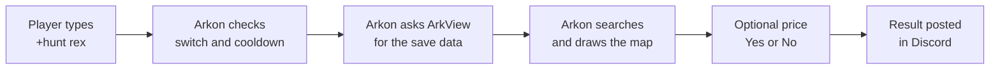

# Map Tools: Hunt Dinos, Find Tames and Map Structures

Map tools let people ask Arkon "where is it?" right from Discord. Players can hunt for a wild Rex, find a lost tame, or see how many structures are near them. Staff can look up a tribe, count its buildings and draw territory maps. Nobody has to log into the game.

**You need:**

- 🔹 ArkView working on each map. ArkView is the free helper program that reads your Ark save file and hands the data to Arkon. Set it up here: [ArkView setup](/guides/arkview).
- Your servers added to Arkon: [Getting started](/guides/getting-started).

> Every command on this page needs ArkView. A server with no ArkView port set is invisible to all of them.
{.is-warning}

## The big picture

Arkon never looks inside your game. It asks ArkView for the latest save data, searches it, draws a map picture and posts the result.



The data is only as fresh as ArkView's last save read. Most results show a "Last Synced" time so you can see how old it is.

## Who can use what

Arkon has two staff roles. **Admin** means a person with the Discord Administrator permission or Arkon's Admin role. **Mod** means a person with Arkon's Mod role (or the Discord permission named in the table). To set these roles, see [Getting started](/guides/getting-started).

| Group | Commands |
|-------|----------|
| Everyone | hunt, findtame, mytames, mystructures, mapstats, creaturepie, structurepie, tamepie, playerheat, arkviewer |
| Mod | tamesfor, finditem always. findplayer, findtribe, structures only on clusters where an Admin turned on Mod Access |
| Admin | findstructure, territory, structuregraph, tribesize, sortdinos, setcustomdinos, showcustomdinos, clearcustomdinos, servermetrics, viewsysinfo, avsync |

> All commands only work inside a Discord server, never in direct messages. The bot needs the Embed Links and Attach Files permissions in the channel.
{.is-info}

## Set it up (do this once)

1. Set up ArkView for each map. Follow [ArkView setup](/guides/arkview) until it says it works.
2. In any channel the bot can see, type `+viewservers` (Admin only: Admin role or the Manage Server permission). Pick your cluster, press **Servers**, pick a server, then press **ArkView**.
3. Fill in the **Port** box with your ArkView port, for example `8080`. This is not your RCON port. Leave **Host IP** blank to use the same address as RCON. The box holds 15 characters, so a long hostname will not fit. Submit. If the popup refuses it you see `Port must be a number!`, `Port must be between 1 and 65535!` or `Invalid host!`. A blank port turns map tools off for that server.
4. Make sure the server shows **Enabled**. Disabled servers never appear in map commands.
5. Wait a few minutes for ArkView to read the save.
6. **Check it worked:** type `+arkviewer`. You should see a list like this, one line per server:


7. Type `+hunt rex` and pick a server. If you see results, you are done.
8. Admins: type `+avsync` once to copy your ArkView players and tribes into Arkon (see [avsync](#avsync) below).

If a command says `There is no data ready for this server yet, come back later.`, ArkView is connected but has not read the save yet. Wait a few minutes and try again.

## How a map command asks you which server

Most commands first ask which map you mean. You get a "Select a Server" message with a dropdown.


1. Type the command, for example `+hunt rex`.
2. Pick your map from the dropdown. Only you can use it ("This isn't your menu!" for everyone else).
3. Press the red X to cancel. The menu deletes itself after 2 minutes.

Each server line shows the host gamertag in backticks if one is set. If you have more than 5 clusters, or a cluster has more than 25 servers, the four biggest clusters get their own dropdown and the rest are merged into one called **Other Servers**. If nothing qualifies you see `There are no servers to select!`.

On slash commands, the `dino` box of `/hunt` suggests dino names as you type, and `/findtame`, `/findplayer`, `/structures` and `/findstructure` suggest names too.

If you use a command as a slash command (for example `/hunt`), the menu is private: only you see it.

## Player commands

### hunt

Finds wild dinos of one kind on a map and shows their level, stats and where they stand. Also works as `/hunt`.

- **Who:** Everyone.
- **Syntax:** `+hunt <dino>`
- **Example:** `+hunt rex`
- **Limit:** one use every 3 seconds, plus the cluster cooldown if your Admin set one.

What you get:

1. Pick a map.
2. Arkon searches the wild dinos. It tries an exact name first, then a close match, then a partial name. Highest level comes first.
3. If your Admin set a price, Arkon asks you to confirm before showing results. Press **Yes** to pay or **No** to cancel. No answer in 60 seconds cancels it too.
4. You get a paged list, 2 dinos per page, plus one map picture with a red dot per dino.


Each result shows the sex, name, level and map coordinates (lat and lon), then the six color numbers and the wild stat points (Health, Stam, Melee, Weight, Speed, Food, Oxygen) and a Trait line if it has one. The page buttons are left arrow, X (close) and right arrow. With more than 10 pages you also get skip-10 buttons and a search button. The results stay open for 1 hour.

If nothing matches you see "No matches found" and nothing is charged. The price is taken only after the results are shown.

> The word "unicorn" is refused with "Hey! That's cheating!".
{.is-info}

### findtame

Finds your tamed dinos, even ones you lost. Also works as `/findtame`.

- **Who:** Everyone.
- **Syntax:** `+findtame <search_query>`
- **Example:** `+findtame Bob` or `+findtame Dino Ranchers`
- **What you can search:** dino name, tamer name, imprinter name, tribe name or tribe ID. Type `unclaimed` to find tames that belong to no tribe.
- **Limit:** one use every 5 seconds, plus the cluster cooldown.

How it goes:

1. Pick a map.
2. Arkon asks "Would you like to include dinos inside a cryopod?" Press **Yes** or **No**.
3. If there is a price, confirm it like in hunt.
4. You get 2 tames per page. Each shows the level, position, name, tamer, imprinter, tribe, whether it is in a cryopod, mating status and a stat table (wild points `w` / tamed points `t`).

> Arkon posts a text file called `tame_search_results.txt` in the channel for everyone to see, even if you used the slash command. Use it in a private channel if the tame list is sensitive.
{.is-warning}

### mytames

Counts your tribe's tames on a map and lists them in text files.

- **Who:** Everyone, but you must be registered first (`+register`, see [Player registration](/guides/player-registration)).
- **Syntax:** `+mytames`
- **Limit:** one use every 20 seconds.

You see how many tames your tribe has on that map, split into in cryopods, not in cryopods and uploaded. You also get up to three files: `cryopod_tames.txt`, `uncryopod_tames.txt` and `uploaded_tames.txt` (only the ones that have tames in them).

### mystructures

Counts how many buildings are near you.

- **Who:** Everyone, but you must be registered.
- **Syntax:** `+mystructures`
- **Limit:** one use every 20 seconds.

Arkon counts every structure within 10,000 map units of where you were last seen, and how many belong to your tribe. The position is from the last ArkView read, not live. If it says "I don't have a last known location for you on {map} yet", wait for the next sync and try again.

### mapstats

A quick summary of one map.

- **Who:** Everyone.
- **Syntax:** `+mapstats`
- **Limit:** one use every 5 seconds per Discord server.

Pick a map and you get totals for structures, tribes, wild dinos, players (and how many are alive), tames (and how many are in cryopods) and items.

### creaturepie, structurepie and tamepie

Three pie charts of a map.

| Command | What the pie shows |
|---------|--------------------|
| `+creaturepie [count]` | Which dino species live on the map |
| `+structurepie [count]` | Structures per tribe |
| `+tamepie [count]` | Tames per tribe |

- **Who:** Everyone.
- **Syntax:** `+structurepie [count]`
- **Example:** `+structurepie 12`
- **Count:** how many slices to show before everything else is lumped into "Others". Default 10. The most you can ask for is 19.
- **Limit:** one use every 5 seconds per Discord server.

> `creaturepie` only counts dinos that Arkon already knows by name. Modded or unknown creatures are left out.
{.is-info}

### playerheat

Draws a heatmap showing where living players are standing right now.

- **Who:** Everyone (unless an Admin turned it off).
- **Syntax:** `+playerheat`
- **Limit:** one use every 5 seconds, plus the cluster cooldown.

Pick a map. Arkon uses only players who are alive. If a price is set you confirm first. You get a map picture with red shading. If nobody is alive you see "There are no players alive on {map}".

### arkviewer

Shows when each map was last read by ArkView. This is also the best way to test your setup. Also answers to `+arkview` and `+lastsynced`.

- **Who:** Everyone.
- **Syntax:** `+arkviewer`
- **Limit:** one use every 10 seconds per channel.

You get one line per enabled server with its ArkView version and last sync time. A server that does not answer shows an error or "No Response". If no server has a port set: "There are no servers with an ArkView port set!".

## Staff commands

### tamesfor

Same as `mytames`, but for another player's tribe.

- **Who:** Mod (Mod role, Admin role, or the Manage Messages permission).
- **Syntax:** `+tamesfor <player>`
- **Example:** `+tamesfor SurvivorSam`
- **Player can be:** a Discord mention or ID, gamertag or username, game ID, specimen number, or a character name.
- **Limit:** one use every 20 seconds.

The player does not need to be registered. If several people match you see "Multiple players found, please be more specific".

### findplayer

Looks up a player and shows where they are and their stats. Also works as `/findplayer`.

- **Who:** Mod (Mod role, Admin role, or Ban Members permission). Mods only see clusters where an Admin turned on **FindPlayer** under Mod Access. Admins see everything.
- **Syntax:** `+findplayer <search_query>`
- **Example:** `+findplayer RexRider`
- **Search by:** game ID, specimen number, tribe ID, gamertag or character name.

You get 5 players per page: gamertag and game ID, character name, tribe, coordinates, when they were seen, level and stat points, plus a map picture. Online players are listed first. No match shows "No results found!".

### findtribe

Looks up a tribe and lists its members.

- **Who:** Mod, same rule as findplayer, with the **FindTribe** switch.
- **Syntax:** `+findtribe <search_query>`
- **Example:** `+findtribe Dino Ranchers`
- **Search by:** tribe name or ID, or a member's gamertag, character name, specimen number or game ID.

You get one tribe per page: owner, tame count, structure count, last active, allies and every member. A member on your ban list is marked `[⚠️Banned]`. A linked Discord user is shown too.

### finditem

Finds where an item is: in player inventories, tames, structures and loot crates.

- **Who:** Mod (Mod role, Admin role, or Manage Messages). Works on every ArkView map; Mod Access does not apply.
- **Syntax:** `+finditem <item_blueprint> [tribe_id]`
- **Example:** `+finditem PrimalItemResource_Element 1234567`
- **item_blueprint:** one word, the item's technical name (not the in-game name). Wrap spaces in "double quotes".
- **tribe_id:** optional, to search one tribe only.

If nothing matches, Arkon tells you the closest match and its score.

### structures

Counts a tribe's structures and plots them on a map. Also works as `/structures`.

- **Who:** Mod (Mod role, Admin role, or Ban Members). Mods need **Structures** switched on under Mod Access for the cluster.
- **Syntax:** `+structures <search_query>`
- **Example:** `+structures Dino Ranchers`
- **search_query:** a tribe name or tribe ID. The name must match almost exactly.
- **Limit:** one use every 30 seconds.

You get a public text file `coords.txt` (location, owner and health of each structure), then an embed titled "Tribe Structure Count" with a map picture and the tribe's share of all structures.

### findstructure

Finds every structure of one type on a map, or only a tribe's.

- **Who:** Admin. Someone without the Admin role needs both Manage Server and Ban Members permissions.
- **Syntax:** `+findstructure <structure_class> [search_query]`
- **Example:** `+findstructure CookingPot_C "Dino Ranchers"`
- **structure_class:** the exact class name, for example `StructureTurretTek_C`. As a slash command the box suggests names.
- **search_query:** optional tribe name or ID.

The output looks like `structures`. If the name is wrong, Arkon shows the closest match.

### territory

Draws a colored map of which tribes own which areas.

- **Who:** Admin (same rule as findstructure).
- **Syntax:** `+territory [include_other] [top]`
- **Example:** `+territory true 15`
- **include_other:** `true` adds a gray "Other" group for tribes outside the top. Default `false`.
- **top:** how many tribes to show. Default 10.
- **Limit:** one use every 5 seconds.

### structuregraph

Makes an interactive chart of structures per tribe.

- **Who:** Admin (same rule as findstructure).
- **Syntax:** `+structuregraph`
- **Limit:** one use every 45 seconds.

You get a file called `plot.html`. Download it and open it in your web browser. Click a tribe in the legend to hide it.

### tribesize

Sorts one tribe's buildings into bases, outposts, traps and spam.

- **Who:** Admin (same rule as findstructure).
- **Syntax:** `+tribesize <search_query>`
- **Example:** `+tribesize Dino Ranchers`

Arkon groups nearby buildings and labels each group:

| Label | Rule |
|-------|------|
| Massive Base | more than 8,000 structures |
| Large Base | more than 4,000 |
| Base | more than 500 |
| Outpost | more than 100, or has defenses |
| Trap | more than 5 |
| Tek Stryder | only Tek Stryders |
| Spam | everything smaller |

You get a map picture and a file `structure_dump.txt` with counts per structure type.

### sortdinos

Lists tames above a level you choose.

- **Who:** Admin (Admin role, or Ban Members permission).
- **Syntax:** `+sortdinos <level> [dino_name]`
- **Example:** `+sortdinos 200 rex`

You get 2 tames per page like `findtame`. No match shows "No results found!".

### Custom dinos

If you use mods, Arkon may not know a dino's name, so `hunt` and `findtame` cannot find it. When it meets an unknown dino it posts `unknown_dinos.txt` once a day in your alert channel (or event log channel). Teach Arkon the names with custom dinos.

| Command | What it does | Who |
|---------|--------------|-----|
| `+setcustomdinos [custom_dinos]` | Replaces your whole custom list | Admin (or Manage Server) |
| `+showcustomdinos` | Shows the list (also `+listcustomdinos`, `+getcustomdinos`) | Admin |
| `+clearcustomdinos` | Deletes the whole list at once, no confirmation | Admin |

1. Write one line per dino as `FriendlyName|ClassName`. The class name must contain `_C`.
2. Type `+setcustomdinos` followed by your lines, or attach a `.txt` file and leave the command empty.
3. Example:

```
+setcustomdinos Royal Griffin|RoyalOwlGriffin_MM_Character_BP_C
Gecko|Gecko_Character_BP_C
```

4. You should see "2 custom dinos added!". Type `+showcustomdinos` to check.

If a line is wrong you see one of these: `Invalid format! Use FriendlyName|ClassName`, `The attachment must be a text file!` or `No custom dinos found!`. With no custom dinos saved, `+showcustomdinos` says "There are no custom dinos set!" and `+clearcustomdinos` says "Custom dinos cleared!" when done.

> `setcustomdinos` replaces everything. Include your old lines too, or they are lost.
{.is-warning}

### servermetrics

Shows memory or CPU use of every ArkView machine.

- **Who:** Admin (Admin role, or Manage Server).
- **Syntax:** `+servermetrics <metric>`
- **Metric:** exactly `mem` or `cpu`.
- **Example:** `+servermetrics cpu`

### viewsysinfo

Shows a health page for each map's machine: CPU, memory, disk, disk load and network.

- **Who:** Admin (Admin role, or Manage Server).
- **Syntax:** `+viewsysinfo`
- **Limit:** one use per 60 seconds per Discord server.

You get one page per map. A map that fails shows "Failed to fetch response!".

### avsync

Copies your ArkView players and tribes into Arkon's own records.

- **Who:** Admin (Admin role, or Manage Server).
- **Syntax:** `+avsync`
- **Limit:** one use per 10 minutes per Discord server. The timer starts even if nothing was found.

Arkon asks every ArkView server for its players and tribes, then creates the ones it is missing and updates the rest. This can take a while. When done you get a summary.


Arkon also does a quiet sync every hour on its own. That hourly sync updates names and tribes but never creates new players, which is why you run `+avsync` yourself.

## Turn player commands on or off

Admins can switch `hunt`, `findtame` and `playerheat` off for each server.

1. Type `+viewservers`.
2. Pick your cluster, press **Servers**, pick the server.
3. Press **ArkView Toggles**.
4. Type `True` or `False` in the **Hunt**, **FindTame** and **Playerheat** boxes (`yes`, `on` and `1` also count as on). Leave any other box in the popup as it is. Submit.


You should see "Arkview commands have been updated for {server cluster}". All of them default to on. These switches are per server.

> A switched-off server simply does not appear in the menu for players. Admins still see it, and an Admin can still run `findtame` on it. `hunt` and `playerheat` stop everyone, Admins too, with a "not enabled" message.
{.is-info}

## Charge a price or set a cooldown

Admins can make `hunt`, `findtame` and `playerheat` cost currency or add a wait. These are set per cluster. Admins themselves never pay and never wait. Arkon charges your server's Red bank currency (the money system built into the bot's Red framework).

1. Type `+viewservers` and pick your cluster.
2. Press **MapView Prices** and type a whole number in each price box. `0` means free. Leave any other box as it is.


3. Go back and press **MapView Cooldowns**. Type seconds in the **Hunt**, **FindTame** and **Playerheat** boxes. `0` means no cooldown. Leave any other box as it is.
4. Submit. You should see "Map view prices have been updated for {cluster}" or "Map view cooldowns have been updated for {cluster}".

Prices and cooldowns must be whole numbers from 0 to 2147483647. Anything else gives "Prices must be whole numbers from 0 to 2147483647!" (or the same for cooldowns).

The price is taken only after the player confirms and sees results. The cooldown starts only when results are delivered. A restart of the bot clears cooldown timers.

## Let mods use the staff lookups

By default mods cannot use `findplayer`, `findtribe` or `structures`. Admins turn them on per cluster.

1. Type `+viewservers` and pick your cluster.
2. Press **Mod Access**.
3. Type `True` in the box for each command you want mods to use (**FindPlayer**, **FindTribe**, **Structures**). All three boxes must be filled in. Submit.
4. You should see "Mod access for {cluster} is now: ...".

The Mod Access button turns green when at least one switch is on. Admins and anyone with the Manage Server permission can always use all three.

## All settings at a glance

| Setting | What it does | Default | Where |
|---------|--------------|---------|-------|
| ArkView Port | Turns map tools on for a server (0 or blank = off) | Off | `+viewservers` > Servers > ArkView |
| Hunt, FindTame, Playerheat switches | Let players use that command on a server | On | `+viewservers` > Servers > ArkView Toggles |
| MapView Prices | Currency cost per command | 0 (free) | `+viewservers` > MapView Prices |
| MapView Cooldowns | Seconds between uses | 0 (none) | `+viewservers` > MapView Cooldowns |
| Mod Access | Lets mods use findplayer, findtribe, structures | Off | `+viewservers` > Mod Access |
| Custom dinos | Names for modded dinos | Empty | `+setcustomdinos` |

## Common problems

| Problem | Why it happens | Fix |
|---------|----------------|-----|
| `There are no servers to select!` | No server has an ArkView port, the command is switched off for you, or you are a mod and Mod Access is off | Set the ArkView port, check the toggles, or turn on Mod Access |
| `There are no servers with an ArkView port set!` | No enabled server has an ArkView port | Fill in the **Port** under **ArkView** in `+viewservers` |
| `There is no data ready for this server yet, come back later.` | ArkView has not read the save yet | Wait a few minutes, then run `+arkviewer` |
| An "ArkView Error" message | Arkon cannot reach ArkView, or the key is wrong (status 401 or 403) | Check ArkView is running and the port is open. See [ArkView setup](/guides/arkview) |
| `Hunting is not enabled for {map}` | An Admin switched Hunt off for that server | Admin: use **ArkView Toggles** |
| `You can use hunt again ...` | The cluster cooldown has not finished | Wait for the time shown |
| `You don't have enough ... to do that :(` | The command has a price and your balance is too low | Earn more currency, or ask an Admin to lower the price |
| `You have not registered your profile yet!` | `mytames` and `mystructures` need registration | Run `+register`. See [Player registration](/guides/player-registration) |
| `You are on cooldown. Try again in X seconds.` | The built-in per-command wait | Wait and try again |
| `I could not find your tribe in the data for {map}.` | ArkView has no tribe matching your registered character on that map | Check you picked the right map and wait for the next sync |
| `It seems like your tribe has no tames on {map}.` | Your tribe has no tames there | Pick another map |
| `There are no players alive on {map}` | `playerheat` has nobody to draw, nothing is charged | Try again later |
| Hunt cannot find a modded dino | Arkon does not know its name | Add it with `+setcustomdinos` |
| `finditem` finds nothing | It matches the technical item name, not the in-game name | Use the blueprint name in one word |

## Related pages

- [ArkView setup](/guides/arkview)
- [ArkView for Nitrado ASA servers](/guides/arkview-nitrado)
- [Getting started](/guides/getting-started)
- [Server settings and clusters](/guides/server-settings)
- [Player registration](/guides/player-registration)
- [Guide for players](/guides/player-getting-started)
- [Anti-cheat checks](/guides/anti-cheat)
- [Quick reference](/guides/quick-reference)
- [FAQ](/guides/faq)
- [All commands](/commands/all-commands)
