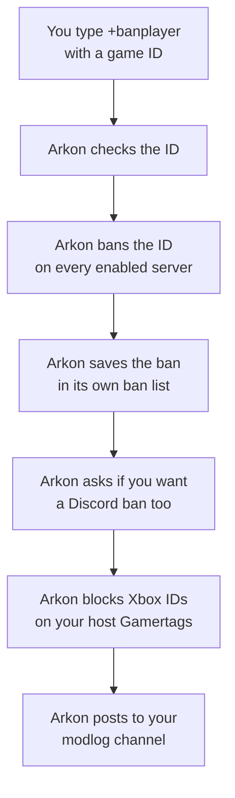
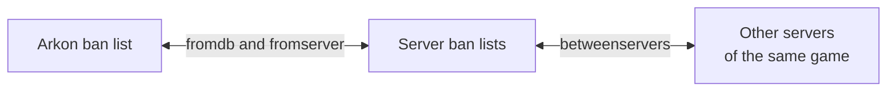

# Moderation: Bans, Temp Bans and Tribe Warnings

Arkon lets you ban a player from every one of your Ark servers with one command. You type the player's game ID and a reason, and Arkon bans them everywhere, remembers the ban, and can ban them from your Discord too.

**You need:**

- Arkon in your Discord server with at least one server connected ([Getting started](/guides/getting-started)).
- Working RCON (the remote-control connection Arkon uses to send commands to your game server). See [RCON setup](/guides/rcon-setup).
- A Mod or Admin role set up for Arkon. **Mod** can ban, unban and browse bans. **Admin** is needed for tribe commands, the watchlist and ban syncing. See [Getting started](/guides/getting-started) to set these roles. The Discord "Ban Members" permission also works for the ban commands, and "Manage Server" works for the Admin ones. Browsing bans (`+bans`, `+globalbans`) needs "Manage Messages" instead of "Ban Members".

All commands use the prefix `+` (the character you type before a command). `+banplayer`, `+unbanplayer` and `+tempbanplayer` also work as `/banplayer`, `/unbanplayer` and `/tempbanplayer`. Every other command in this guide only works with `+`.

## The whole picture



## Before you start: what is a game ID?

Arkon bans by **game ID**, never by name. Names change. IDs do not.

| ID type | What it looks like | Example | Goes to |
|---|---|---|---|
| Xbox ID (XUID) | 16 digits | `2535437775463072` | ASE servers |
| Steam ID | digits only | `76561198012345678` | ASE servers |
| EOS ID | 32 letters and numbers | `0002a1b2c3d4e5f60718293a4b5c6d7e` | ASA servers |

Arkon sends the ban only to servers of the matching game. An ID that is all digits goes to ASE servers. An ID with letters goes to ASA servers.

> Only **enabled** servers get the ban. Servers that Arkon switched off (for example, over the free limit on [Premium](/guides/premium)) are skipped.
{.is-warning}

> A player Arkon has never seen is saved with the name "Unknown". The ban still works.
{.is-info}

## Set up Moderation

1. **Set a modlog channel (optional but recommended).** In any Discord channel Arkon can see, type `+modlogset modlog #mod-log` (use your own channel). This is a Red command (Red is the bot framework Arkon runs on). Arkon posts a record there for every ban and unban. If you skip this, no record is posted.
2. **Give Arkon the permissions it needs.** In Discord, open Server Settings, then Roles, then Arkon's role. Turn on **Ban Members** (to ban people from Discord), **Embed Links** (for the ban list) and **Attach Files** (for result files).
3. **Check your roles.** Make sure your Mod and Admin roles are set ([Getting started](/guides/getting-started)).
4. **Ban a test ID.** In a channel Arkon can see, type `+banplayer 2535437775463072 Testing the ban` (use an ID you are happy to ban, then unban it in step 5).
5. **Undo it.** Type `+unbanplayer 2535437775463072 Test finished`.

**Check it worked:** after step 4 Arkon posts "Marking **SurvivorSam** as banned!" (with the player's own name) followed by a box with one line per server, each starting with a green tick. After step 5 it posts "Marking **SurvivorSam** as unbanned!".

## Ban a player

### `+banplayer <game_id> <reason>`

**Who:** Mod. Also works as `/banplayer`.

Bans one player on every enabled server of the right game and saves the ban.

- `<game_id>`: the player's ID, for example `2535437775463072`.
- `<reason>`: why you are banning them, for example `Cheating with mods`. Required.

Example: `+banplayer 2535437775463072 Cheating with mods`

What happens, in order:

1. Arkon sends the ban to every enabled server of the right game.
2. It saves the ban in its own list and flags the player as banned.
3. If the player has linked their Discord account (see [Player registration](/guides/player-registration)) and is still in your Discord, Arkon asks if you want to ban them from Discord too.
4. It posts what each server answered.
5. For Xbox IDs, it blocks the account on every host Gamertag.
6. It posts a record to your modlog channel.


The **Yes** and **No** buttons last 60 seconds and only the person who ran the command can press them. **Yes** only works if your top role is higher than the player's top role. If it is not, Arkon says "I cannot ban them from the Discord, as you do not have a role higher than theirs."

> If the ID is wrong, Arkon replies "Xbox IDs are 16 digits, Steam IDs are between 17 and 19 digits, and EOS IDs are 32 characters long. Please use a valid player ID". Copy the ID again.
{.is-info}

### `+tempbanplayer <game_id> [duration] [reason]`

**Who:** Mod. Short name: `+tbp`. Also works as `/tempbanplayer`.

Bans a player for a set time. Arkon unbans them by itself when the time ends.

- `<game_id>`: the player's ID.
- `[duration]`: how long, for example `15m`, `6h`, `1d` or `1h30m`. Leave it out to use your default (24 hours unless you changed it).
- `[reason]`: why.

Examples:

- `+tempbanplayer 2535437775463072 15m You need a timeout`
- `+tempbanplayer 2535437775463072 Because I say so` (uses the default length)

When the time ends, Arkon does a full unban and writes the reason "Tempban Expired". If Arkon restarts, it picks the timers back up. A ban that ended while Arkon was off is lifted when it starts again.

> Do not temp ban a player who already has a permanent ban. Arkon says it is leaving the permanent ban alone, but it still starts a timer that later removes that permanent ban.
{.is-danger}

To change the default length, the Discord server owner types `+arkset tempbandefault <duration>`, for example `+arkset tempbandefault 1h30m`. Arkon answers "Default tempban duration set to: ...".

## Unban a player

### `+unbanplayer <game_id> [reason]`

**Who:** Mod. Also works as `/unbanplayer`.

Lifts a ban on every enabled server and removes it from Arkon's ban list.

- `<game_id>`: the player's ID.
- `[reason]`: why, for example `Appeal accepted`.

Example: `+unbanplayer 2535437775463072 Appeal accepted`

What else happens:

- Arkon writes a note on the player: the original reason, when they were banned, and your unban reason.
- If the player is banned from your Discord, Arkon unbans them there too.
- If the player is still in your Discord, Arkon asks "<name> is still in the Discord, would you like me to let them know they are unbanned?" with Yes and No buttons. Yes sends them a message: "You have been unbanned from the Ark servers in **<your server>**".
- Xbox IDs are unblocked on your host Gamertags.
- A "Player Unbanned" record goes to your modlog channel.

The Discord unban and the message only happen if Arkon already knows the player.

## Browse and edit bans

### `+bans [search]`

**Who:** Mod (Arkon needs Embed Links). The Edit and Delete buttons only show for Admins.

Opens a pager showing the bans for your Discord server, newest first.

- `[search]`: optional. Digits only finds that exact game ID. Anything else finds names or reasons that contain your words.

Examples: `+bans` or `+bans Sam` or `+bans cheating`


| Button | What it does |
|---|---|
| ⏪ ⬅️ ➡️ ⏩ | Go back 10, back 1, forward 1, forward 10 pages (it wraps around) |
| ✖️ | Close the list (deletes the message) |
| 📝 | Edit the ban (Admin only) |
| 🔍 | Search the list |
| 🗑️ | Delete the ban and unban the player (Admin only) |

Only the person who ran the command can press the buttons ("This isn't your menu!" for anyone else). They stop working after 5 minutes. If nothing matches, Arkon says "No bans found matching that filter".

**Edit** opens a popup called "Edit Ban Reason" with fields for the reason, the ban time, the name and the "Banned Until" time. Times look like `2026-10-12T14:30:00+00:00`.


> Always write the `+00:00` on the end of a time. Without it, Arkon reads the time in its own computer's time zone, which may not be yours.
{.is-warning}

Leaving "Banned Until" empty does not turn a ban from temporary to permanent or back. Setting a time restarts the automatic unban timer.

**Delete** opens a popup called "Unban player?". Only the answers `no`, `n`, `0` or `false` cancel it. Any other answer unbans the player.

### `+globalbans [search]`

**Who:** Mod (Arkon needs Embed Links). Short name: `+allbans`.

A read-only pager of every ban in Arkon's database, from every Discord server Arkon is in, with each ban's "Discord Server" shown. Digits-only searches match a game ID or a Discord server ID. It has the same page arrows, close and search buttons as `+bans`, but no edit or delete.

## Ban or unban from a list of IDs

### `+banfromtext` (with a .txt file attached)

**Who:** Mod (Arkon needs Attach Files).

Bans many players at once. Write the IDs in a plain text file.

1. On your computer, make a file called `bans.txt`. Put one ID per line (commas or spaces also work):
   ```
   2535437775463072
   2535437775463073
   0002a1b2c3d4e5f60718293a4b5c6d7e
   ```
2. In a Discord channel Arkon can see, type `+banfromtext` and attach `bans.txt` to the same message. Replying to a message that has the file attached also works.
3. Wait. Arkon bans each ID one at a time.

Every ban uses the reason "Bulk ban from text file". Arkon uploads a file called `bulk_ban_results.txt` with "Bulk ban complete!". Each line shows a tick, the ID, and `[Discord banned]`, `[Discord ban failed]` or `[No Discord linked]`.

> This command is chatty: each ID posts its own messages, and any player with a linked Discord account gets the Discord Yes/No question. It does not block Xbox accounts, so do that by hand. All bans are permanent.
{.is-warning}

Errors: "No text file provided!", "Invalid file type!" (the file must end in `.txt`), "Failed to read file!" and "No player IDs found in the text file!". A bad ID shows as "Invalid player ID: <id>".

### `+unbanfromtext` (with a .txt file attached)

**Who:** Mod.

Unbans many players at once. Attach a `.txt` file the same way. It removes each ban from Arkon's list, unbans the ID on all your servers, and unblocks Xbox IDs on your host Gamertags.

Arkon finishes with one message, for example "Bulk unban complete! Removed 3 ban entries from the database. Xbox unblocks: 2/2."

It does **not** unban people from Discord, send them a message or post to your modlog. Do those by hand if you need them.

## Tribe commands

These four commands act on a whole tribe at once. They are for Admins. You need the tribe's ID number (the number the game uses for that tribe).

**Find the tribe ID:** a player types `+tribe` and Arkon shows a page for their tribe with a line like "Tribe ID: `12345`". An Admin can look at someone else's tribe with `+tribe @RexRider`.

All four work the same way:

1. You type the command with the tribe ID.
2. Arkon shows a menu called "Select a Server". Pick the server the tribe lives on. You have 2 minutes.
3. Arkon finds every player linked to that tribe on that server and runs the action on each one.


> A tribe on several maps needs one run per map. Arkon only looks at the server you pick.
{.is-info}

| Command | Who | What it does | Example |
|---|---|---|---|
| `+bantribe <tribe_id> <reason>` | Admin | Permanently bans every member. Also bans linked Discord accounts, with no question asked. Xbox accounts get blocked. | `+bantribe 12345 Meshing` |
| `+tempbantribe <tribe_id> [duration] [reason]` (short name `+tbt`) | Admin | Temp bans every member. Default length is your temp ban default (24 hours unless changed). | `+tempbantribe 12345 1d Meshing` |
| `+warntribe <tribe_id> <warning>` | Admin | Sends every member a warning. | `+warntribe 12345 Please stop blocking the obelisk` |
| `+tribenote <tribe_id> <note>` | Admin | Writes a private note on every member's record. | `+tribenote 12345 Warned about base spam` |

**Bans:** a linked Discord member is sent a message with the reason first, then banned from Discord. Arkon shows a line for each player, such as `✓ Banned SurvivorSam (2535437775463072) [Discord banned]`. The tags are `[Discord banned]`, `[Discord ban failed]` or `[No Discord linked]`.

**Warnings:** a player with a linked Discord account in your server gets a message titled "Warning". If their messages are closed, Arkon writes a note on them instead. A player with no Discord account gets an Xbox message from the host Gamertag if that is possible. Otherwise a note is added.

**Notes:** you see `✓ Note added to <name>` for each player.

Errors: "No tribe found with that ID on this server!", "No players found in that tribe!" and "Could not find player objects for any tribe members."

## The watchlist

### `+suswatch [game_id]`

**Who:** Admin (Arkon needs Embed Links).

Keeps a list of players you want to keep an eye on.

- `+suswatch 2535437775463072` adds the player. Run it again with the same ID to remove them.
- `+suswatch` with no ID shows the list.

Typing `+suswatch` with nothing after it shows the list (one line per player, like `• SurvivorSam (2535437775463072)`), followed by the command help. The list is a record only: this page does not promise any alert when a listed player joins.

Arkon answers "`SurvivorSam` added to the watchlist" or "`SurvivorSam` removed from the watchlist". Use an ID, not a name. A bad ID gives "Invalid gameid!".

## Keep your ban lists in step: syncbans

Each server keeps its own ban list, and Arkon keeps another. Over time they can drift apart. `+syncbans` finds the differences and fixes them.

**You need:** [ArkView](/guides/arkview) 🔹 running on your servers. Without it Arkon says "There are no servers with an ArkView port set!".

**Who:** Admin. Arkon needs Embed Links and Attach Files.



### Dry run first

Every syncbans command is a **dry run** by default. Nothing changes. Arkon only shows what it would do. To really do it, add `true` on the end.

1. Type `+syncbans all` and read the report.
2. If you are happy, type `+syncbans all true`.


| Command | What it does |
|---|---|
| `+syncbans all [true]` | Does everything: shares bans between servers, sends missing database bans to servers, and saves server-only bans into the database. Waits 10 minutes before it can run again. |
| `+syncbans fromdb [true]` | Treats Arkon's list as the truth. Bans anyone missing from a server. **Unbans anyone on a server who is not on Arkon's list.** |
| `+syncbans fromserver [true]` | Treats the servers as the truth. Adds any server ban to Arkon's list. Never bans or deletes anything. |
| `+syncbans betweenservers [true]` | Only compares servers with each other (ASE with ASE, ASA with ASA). A ban on one is added to the others. It does not touch Arkon's list. |

Each of the last three waits 5 minutes before it can run again. The wait is per Discord server, and dry runs count.

> `fromdb` removes bans that exist only on a server. If you ever banned someone straight in the game, save it first with `+syncbans fromserver true`.
{.is-danger}

Good to know:

- A server that does not answer is skipped. Arkon says "Resp failed for <map> <cluster>: ..." or "Failed to get banlist for <map>".
- Entries in a server's list that are not valid IDs for that game are treated as junk. `all` and `fromserver` remove them when you add `true`.
- Reports come as files: `ban_sync_summary.txt`, `ban_sync_details.txt` and `sync_results.txt`, depending on the command.
- If nothing is different: "No bans to sync between servers!" or "No servers returned a usable banlist, nothing to sync!".

### The safety net

Arkon also guards you automatically. When a banned player joins a server whose own list forgot them, Arkon bans them again on the spot. It then posts once in your alert channel: "Banned player **SurvivorSam** (`2535437775463072`) joined **My Cluster The Island** and has been re-banned on sight. The server's ban list may be out of sync, consider running the `syncbans` command."

## Common problems

| Problem | Why it happens | Fix |
|---|---|---|
| "Database connection is not active, try again later" | Arkon's database is down for a moment | Wait a minute and try again |
| "Xbox IDs are 16 digits, Steam IDs are between 17 and 19 digits, and EOS IDs are 32 characters long" | The ID you typed is not a valid ID | Copy the ID again and check for extra spaces |
| "No servers found" | You have no enabled server of the right game for that ID | Check `+viewservers` ([Server settings](/guides/server-settings)). Steam and Xbox IDs need an ASE server, EOS IDs need an ASA server |
| "No servers found!" (from `+unbanfromtext`) | Your Discord server has no enabled server connected | Check `+viewservers` ([Server settings](/guides/server-settings)) |
| "Failed to execute command" | No server answered the ban, so Arkon saved nothing | Check RCON ([RCON setup](/guides/rcon-setup)) and try again |
| "I cannot ban them from the Discord, please do it manually." | Arkon is missing Ban Members, or its role is below theirs | Move Arkon's role above theirs and give it Ban Members |
| "I cannot ban them from the Discord, as you do not have a role higher than theirs." | Your top role is not above the player's | Ask someone with a higher role |
| "cannot block user since it has no tokens" | The host Gamertag is not signed in for Xbox blocking | The server ban still worked. Block the account by hand on Xbox |
| No record in the modlog | No modlog channel is set | Type `+modlogset modlog #mod-log` |
| "No text file provided!" | You forgot the `.txt` attachment | Attach the file to the same message |
| "This isn't your menu!" | Someone else ran the command | Run it yourself |
| "There are no servers with an ArkView port set!" | syncbans needs ArkView | Set up [ArkView](/guides/arkview) |
| A syncbans command says to wait | The wait between runs has not ended | Wait 5 minutes (10 for `all`) |
| A banned player is back on a server | The server's ban list lost them. Arkon re-bans them when they join | Run `+syncbans fromdb` |

## Related pages

- [Getting started](/guides/getting-started)
- [Security](/guides/security)
- [Anti-cheat](/guides/anti-cheat)
- [Player registration](/guides/player-registration)
- [Tribe logs](/guides/tribe-logs)
- [Mod commands](/commands/mod-commands)
- [Admin commands](/commands/admin-commands)
- [Premium](/guides/premium)
