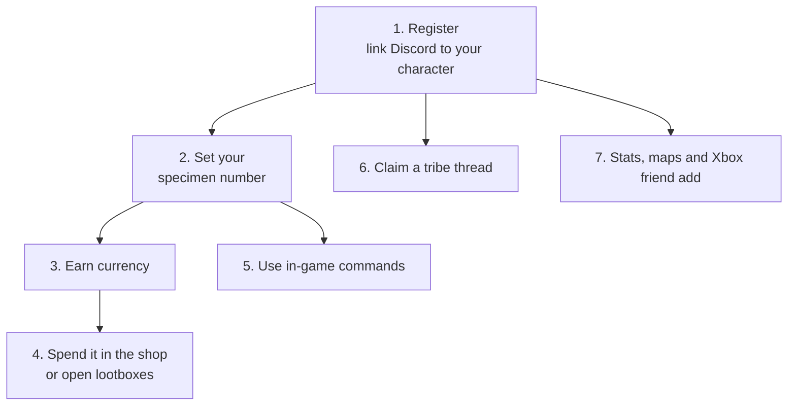

# Player Guide: Everything You Do With Arkon

Arkon is a Discord bot that connects your Ark server to your Discord. Once you link your Discord account to your Ark character, you can buy items, open lootboxes, get a private tribe log thread and look up stats. This page walks you through it in order. You do not need to know anything technical.

**You need:**

- A Discord server that already has Arkon set up by its admins (they use [Getting Started](/guides/getting-started)).
- To be able to join the Ark server at least once.

> Stuck? Check the [FAQ](/guides/faq). Unfamiliar word? Check the [Glossary](/guides/glossary). Want the short list of commands? See [Quick Reference](/guides/quick-reference).
{.is-info}

**Words used on this page:**

- **Admin** and **Mod** are Arkon's two staff levels, chosen by your server owner. Players are neither.
- **Cluster** is a group of connected Ark maps that share players.
- **Specimen number** (also called Implant ID) is the number in the top left of your in-game inventory. Arkon uses it to send items to your character.
- 🔹 means the command needs ArkView (the helper program that reads your server's save file). Your admins set it up with [ArkView setup](/guides/arkview). If it is missing, those commands will not work.
- 🔸 means the feature is only for Xbox and Microsoft Store Ark: Survival Evolved (ASE) servers.

## The big picture

Step 1 comes first. Almost everything else needs it.

## Step 1: Register (link Discord to your character)

You can register in the game or in Discord. Pick one.

**In the game (easiest, works for ASE and ASA):**

1. In Ark global chat, type `+register` and your Discord name. Example: `+register SurvivorSam`
2. Arkon replies in game: `SurvivorSam, your Discord has been linked!`

You can also start a command with `/` or `!` instead of `+`.

**In Discord:**

1. In any channel the bot can see, type `+register`. It also works as `/register`.
2. If asked, click **ASA** or **ASE**, then **Xbox** or **Steam**. You have 60 seconds.
3. Xbox: type your Gamertag as a normal message, for example `SurvivorSam`. If your Gamertag has a `#` and numbers after it, type those too.
4. Steam: click **Set Steam Username/ID** and fill in the popup.
5. ASA: click **Set EOS ID** and paste your EOS ID into the popup.

**Check it worked:** you see **Registration Successful** (Discord) or the "linked" reply (in game). To unlink, type `+unregister`. In game, Arkon answers `your Discord has been unlinked!`, or tells you that you are not linked.

If the in-game `+register` does not work, Arkon tells you why in chat. The common reasons are: it cannot find you in the player list, you typed no name after the command, that name is not in the Discord server, you are already linked, or another character already holds that Discord account. If you switch between ASA and ASE, Arkon says so. Details are in [Player Registration](/guides/player-registration).

If you leave the Discord server and rejoin, your link stays and Arkon gives your playtime roles back (see [Playtime and Roles](/guides/playtime-and-roles)).

> On ASA you must join a server once before you can register in Discord, or you get "No player found with that EOS ID." Registering in game avoids this. Full details are in [Player Registration](/guides/player-registration).
{.is-warning}

## Step 2: Set your specimen number

The shop, lootboxes and kits send items to your character. They need your specimen number to find you. You set it once per map.

1. In game, open your inventory and read the number at the top left. It has 5 to 9 digits.
2. In Discord, type `+specimen 12345678` (use your own number).
3. Pick your server from the **Select a Server** menu.

You can also set it in game by typing `+specimen 12345678` in chat. The short names `spec`, `implant` and `impl` work too. If you type no number, or a number that is not 5 to 9 digits, Arkon tells you. It also tells you when the number is already taken by someone else, already yours, or has been set or updated.

In Discord, Arkon tells you if you need to register first, if you cancelled the server menu, if the number is already set, if someone else has it, or that it changed from the old number to the new one.

**Check it worked:** Arkon says "You have set your specimen number to **12345678**".

> You must be registered, and you must have played on that map. Nobody else on that map can use the same number.
{.is-info}

## Step 3: Earn currency

The shop and lootboxes spend your Discord server's bank currency. Its default name is "credits". The shop spends each member's bank balance, and the shop cannot earn money by itself. Money gets into your balance from other money features that pay into the same bank, from refunds when a purchase fails to send, and from an admin refund setting for playtime. Ask your admins how to earn it. Your balance shows in the footer of the `+rshop` menu.

> The in-game `payday` command gives items, not shop currency. See Step 6.
{.is-warning}

To see your purchases, type `+shopstats`. It also works as `/shopstats`.

## Step 4: Buy items in the shop

Before you buy: be registered, have a specimen number, have enough currency and be online on the server when you check out. Browsing works even when you are offline.

1. In any Discord channel the bot can see, type `+rshop`. To jump to an item, type its name, like `+rshop flak`.
2. Press a number button to open a category. Arrow buttons change pages.
3. Press a number button on an item.
4. A popup asks how many. If the item allows it, it also asks for quality and for whether you want a blueprint (type `yes` or `no`).
5. Choose **Add To Cart**, **Cancel**, or **BUY NOW!** (skips the cart for that item).
6. Press the cart button (🛒) to review your cart.

7. Press **Checkout**. If Arkon cannot find you on a server, it asks you to pick one.
8. Arkon shows the total price and asks if you are sure. Press **Yes!** (or **No!** to cancel).
9. Arkon shows your specimen number and asks "Is this correct?". Press **Yes!** to confirm. If it is wrong, press **No!** and type the right number.

**Check it worked:** Arkon says "Purchase Complete!" and the items are in your inventory.

For one item with no cart, use `/quickbuy item [quantity] [quality] [blueprint]`. It buys instantly with no confirmation, so be sure first.

Also open to everyone: `+shopoverview` (server-wide shop numbers) and `+shopsettings` (the shop's current settings). More in [RCON Shop](/guides/rshop).

## Step 5: Open a lootbox

A lootbox is a paid mystery prize.

1. Be registered, online on the server and have a specimen number set. If you just joined, wait a couple of minutes.
2. In Discord, type `+lootbox` (also `+lootcrate`).

**Check it worked:** Arkon posts a **Lootbox Opened** message and the item lands in your game. If you open boxes too fast, Arkon tells you when to try again. If sending fails, you are not charged. More in [Lootboxes](/guides/lootboxes).

## Step 6: Use in-game chat commands

Type these in Ark global chat. Set your specimen number first, or Arkon says "First set your specimen number! (Ex: /specimen 12345678)".

| Command | Short form | What it does |
|---|---|---|
| `/kit` | `k` | One-time starter kit |
| `/payday` | `pd` | A reward you can claim again after a wait |
| `/imstuck` | `is` | A care package of basic items (it does not move you) |
| `/help` | `commands` | Lists the commands that are switched on |
| `/register` | `reg` | Links your Discord (Step 1) |
| `/unregister` | `unregisterme`, `unreg` | Unlinks your Discord |
| `/specimen` | `spec`, `implant`, `impl` | Sets your specimen number (Step 2) |
| `/testreg` | none | Shows which character Arkon matched you to |
| `/players` | `online` | Says how many people are on this server |
| `/rename <new name>` | `rn` | Changes your character name (admins must switch it on) |
| `/mytames` | `tames` | 🔹 Counts your tribe's tames on this map (wait 5 minutes between uses) |
| `/voteday` | `vd` | Vote for daytime |
| `/votenight` | `vn` | Vote for nighttime |
| `/votedinowipe` | `vdw` | Vote to wipe all wild dinos |
| `/votecleanup` | `cleanup` | Vote to remove beaver dams and dropped dino eggs |

Your admins choose which of these are on and what they give. If one says "This command is disabled!", it is switched off. If you try too soon, Arkon tells you how long to wait. `/help` has a one-minute wait per player. `/register`, `/unregister`, `/specimen`, `/players`, `/testreg` and `/help` are always on.

**Votes:** each vote is open for 8 minutes. It passes when about half of the players on the map vote yes (on a busy map with over 10 players, about a third, with a minimum of 5). Each player can vote once every 30 seconds, and each vote command has a wait per server, 1 hour by default. Voting is on by default. More in [In-Game Commands](/guides/in-game-commands).

**Rename:** the default wait is 1 hour. If the new name is on your admins' blacklist, Arkon says "that name is blacklisted!" (see [Security](/guides/security)).

## Step 7: Claim a private tribe log thread

A private thread shows your tribe's events (kills, deaths, tames and more). Only people added to the thread can see it. Your admins must have set this up first ([Tribe Logs](/guides/tribe-logs)), and you need the claim role they chose.

1. Be registered, and be seen online in game at least once so Arkon knows your tribe.
2. In Discord, type `+tribe` (also `/tribe`).
3. Use the arrows to find your tribe and map.
4. Press **Claim** while your tribe's page is showing.

**Check it worked:** Arkon creates a private thread named like `Dino Ranchers (The Island My Cluster)` and adds you.

- **Pings:** press **Notifications**, then press the events you want. Green is on, grey is off. Everything starts off.
- Your notification choices are saved per player. The help text does not list Tame Kill, but the button exists.
- **Tribemates:** they open `+tribe`, find the same tribe page and press **Join**. Nobody has to approve it. The **Close** button deletes the menu. If the tribe has no thread yet, Arkon says "This tribe has no thread associated with it!".
- **Claim acts on the page you see**, so flip to the right map first.

If you see "Private tribelogs have not been configured yet!", ask an admin to finish setup.

## Step 8: Map commands 🔹

These need [ArkView](/guides/arkview). Everyone can run them, and most first ask you to pick a server.

| Command | What it does | Example |
|---|---|---|
| `+hunt <dino>` | Finds wild dinos, highest level first, with a map picture. | `+hunt rex` |
| `+findtame <search>` | Finds tames by tame name, tamer, imprinter or tribe. Arkon first asks if you want tames inside cryopods included. | `+findtame Dino Ranchers` |
| `+mytames` | Counts your tribe's tames on a map. You must be registered. | `+mytames` |
| `+mystructures` | Counts buildings near where you were last seen. You must be registered. | `+mystructures` |
| `+mapstats` | Detailed stats for one map. | `+mapstats` |
| `+playerheat` | Heatmap of where living players are. | `+playerheat` |
| `+creaturepie [count]`, `+structurepie [count]`, `+tamepie [count]` | Pie charts of species, structures or tames. | `+structurepie 12` |

Your admin may set a price on `+hunt`, `+findtame` or `+playerheat`. Arkon then asks you to confirm with **Yes** or **No**. If a command says "There is no data ready for this server yet, come back later.", wait a few minutes. More in [Map Tools](/guides/map-tools).

> `+findtame` posts a text file in the channel that everyone can see. Use a private channel if the tame list is sensitive.
{.is-warning}

When a command asks you to pick a server, the list shows your gamertag per server. With many clusters, an **Other Servers** dropdown appears. `+hunt` and `+findtame` can also suggest names as you type the slash command.

## Welcome message and Discord invite

When Arkon sees a player for the first time ever, it can post a welcome message. Your admins choose the text. Free servers show "Powered by Arkon - https://arkonbot.com" at the bottom, and Premium servers show nothing there. If you type `discord` in game chat, Arkon replies `ServerChat <discord name> -> invite: <link>`, with no wait between uses. See [Playtime and Roles](/guides/playtime-and-roles).

## Step 9: Stats and leaderboards

Nothing to set up. These only read what Arkon has already saved.

| Command | What it does | Example |
|---|---|---|
| `+playerstats [player]` | A stat card for you or another player. Leave the name off for yourself. Also works as `/playerstats`. | `+playerstats RexRider` |
| `+players [time] [cluster]` | Playtime ranking, 10 per page. | `+players 7d` |
| `+clusterlb [stat]` | Top players in a cluster. Pick the cluster from the dropdown. Stats: `playtime`, `tamed`, `kills`, `tamekills`. Default `kills`. | `+clusterlb kills` |
| `+tribelb <stat>` | Tribe ranking. Use `kills`, `tamed` or `destroyed`. | `+tribelb kills` |

**Check it worked:** `+playerstats` posts a card titled "Player Stats for" your name, with one box per server you played on. Use the arrow buttons to flip pages, or press **Search** and type a name or page number to jump. Right-clicking a member and choosing **View Player Stats** works too. More in [Stats and Leaderboards](/guides/stats-and-leaderboards).

## Step 10: Get friended by the host Gamertag 🔸

If your server is Xbox or Microsoft Store ASE and you join through a host Gamertag (the Xbox account that hosts the server), Arkon can make that account add you as a friend.

1. Register with your Xbox Gamertag (Step 1).
2. In any channel the bot can see, type `+addme`.
3. Pick your server from the menu.
4. If your Xbox shows a friend request from the host, accept it. Then join the server through the host Gamertag.

**Check it worked:** a green **Success!** message says "You have been added as a friend by ...". Steam and ASA accounts are refused. Your admins must have signed the host in first. More in [Xbox Features](/guides/xsapi).

## Common problems

| Problem | Why it happens | Fix |
|---|---|---|
| "You have not registered your profile yet!" | You are not registered. | Run `+register` (Step 1). |
| "You are already registered as ..." | You already have a linked player here. | Type `+unregisterme`, then `+register` again. |
| "You have not set your specimen number for {map} yet!!!" | No number saved for that map. | Run `+specimen` (Step 2). |
| "You don't have enough credits ..." | Your balance is too low. | Earn more, or buy something cheaper. |
| "I could not find you on any of the servers. Please select one above!" | You are not online right now. | Join the server, wait a minute, retry. |
| "The shop is not enabled in this server!" | Admins switched the shop off. | Ask an admin. |
| "You are not in any tribes yet!" | Arkon has not seen you online in a tribe. | Join the server, wait a minute, try again. |
| "You must have one of the following roles to claim private tribelogs!" | You lack a claim role. | Ask an admin for the role. |
| "You need to register first, type `+register` to register" | `+addme` needs a registered Xbox player. | Register first. |
| "This command is disabled!" | Admins switched that in-game command off. | Ask an admin. |
| A vote never passes | Not enough players voted yes within 8 minutes. | Get more players to vote, then try again after the wait. |
| "There are no servers to select!" | No server is available for that command. | Ask an admin to check the setup. |
| "This command can only be used in a server." | You used right-click **View Player Stats** outside a server. | Use it inside the Discord server. |
| "Database is not connected. Please try again later." | Arkon is briefly unable to reach its data. | Wait a few minutes and retry. |

## Related pages

- [Player Registration](/guides/player-registration)
- [RCON Shop](/guides/rshop)
- [Lootboxes](/guides/lootboxes)
- [In-Game Commands](/guides/in-game-commands)
- [Tribe Logs](/guides/tribe-logs)
- [Map Tools](/guides/map-tools)
- [Stats and Leaderboards](/guides/stats-and-leaderboards)
- [Xbox Features](/guides/xsapi)
- [Player Commands](/commands/player-commands)
- [Quick Reference](/guides/quick-reference)
- [FAQ](/guides/faq)
- [Glossary](/guides/glossary)
