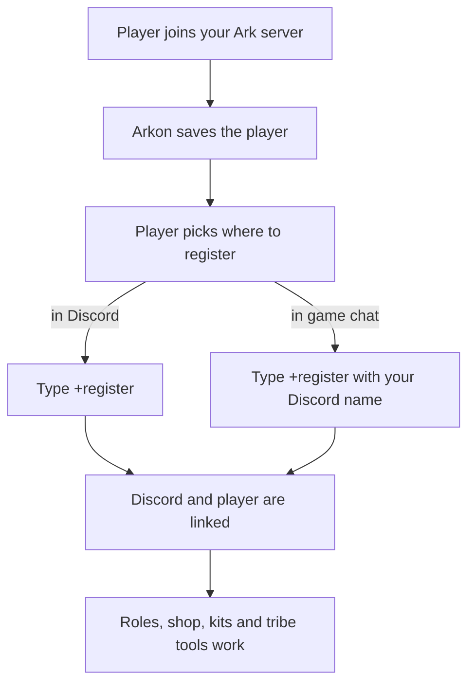

# Player Registration: Link Discord Accounts to Ark Players

Registering tells Arkon "this Discord account and this Ark character are the same person". Without that link, Arkon cannot give a player roles, shop items, kits or tribe tools, because it does not know who they are.

**You need:**

- Arkon in your Discord with at least one cluster and one enabled server connected (see [Getting Started](/guides/getting-started)).
- For role rewards: Arkon's own role must sit **above** the roles it hands out (see [Playtime and Roles](/guides/playtime-and-roles)).

## The big picture

A player can register in two places. Both end the same way: one Discord account linked to one in-game player.

**Words used on this page:**

- **Admin** and **Mod** are Arkon's two staff levels. The server owner counts as both. Set them up in [Getting Started](/guides/getting-started).
- **Gamertag** is your Xbox name. **XUID** is the long 16-digit number behind it.
- **Steam ID** is a 17 to 19 digit number. **EOS ID** is a long mix of letters and numbers that ASA (Ark: Survival Ascended) uses.
- **Specimen number** (also called Implant ID) is the number in the top left of your in-game inventory. Arkon uses it to send items to your character.

## Register in Discord (for players)

1. In any Discord channel the bot can see, type `+register`. It also works as `/register`. You can add your name right away, like `+register SurvivorSam`. Do not type a number as your name, Arkon refuses it.
2. If your server has any ASA server, Arkon asks which type you are registering for. Click **ASA** or **ASE**. You have 60 seconds.

   

3. If you picked ASE and your server has both Xbox and Steam players, Arkon asks for your cluster type. Click **Xbox** or **Steam**. If your server only has one type, this step is skipped.

   

4. Now follow the path that matches you.

### Xbox (ASE)

1. Arkon asks for your Gamertag. Type it in the channel as a normal message, for example `SurvivorSam`. If your Gamertag has a number part like `SurvivorSam#1234`, type the numbers but leave out the `#`. Type `cancel` to stop. You have 60 seconds.

   

2. Arkon looks the Gamertag up. If it works, you see **Registration Successful** with your Gamertag, XUID and Gamerscore.

   

3. If the avatar does not look like you, type `+unregisterme` and try again.

> If the Xbox lookup is not available, Arkon says it is "Switching to manual mode". You then click **Set Gamertag/XUID** and fill in two boxes: **Gamertag** and **XUID** (exactly 16 digits).
{.is-info}

### Steam (ASE)

1. Click the blue **Set Steam Username/ID** button.
2. In the popup **Set your account info**, fill in **Steam Username** and **Steam ID** (17 to 19 digits). Press submit.
3. You see **Registration Successful** with your username and SteamID.

### ASA

1. Arkon says "Click the button below to set your information". Click the blue **Set EOS ID** button. You have 10 minutes.
2. In the popup **Set your account info**, paste your EOS ID into the **EOS ID** box, for example `0002c7cde9d24e1994d9cf87096e32f8`.

   

3. You see **Registration Successful** with your username and EOS ID.

> You must join an ASA server once before you can register, so Arkon has seen you. Otherwise you get "No player found with that EOS ID." If you do not know your EOS ID, register in game instead (next section), or run `+playerstats` with your username.
{.is-warning}

### Check it worked

You see **Registration Successful**. If your admin set a register role, you also get that role, plus any playtime roles you earned.

## Register in game (for players)

This works for ASE and ASA, and is the easiest way for ASA players.

1. In Ark global chat, type `+register` followed by your Discord name or Discord ID, for example `+register SurvivorSam`. You can also use `/` or `!` instead of `+`. The short name `reg` works too.
2. Arkon finds you in the live player list and replies in game. Success looks like "SurvivorSam, your Discord has been linked!"

If you type only a 5 to 9 digit number (like `+register 12345678`), Arkon treats it as your specimen number instead.

To unlink in game, type `+unregister` (also `+unregisterme` or `+unreg`). Arkon replies "SurvivorSam, your Discord has been unlinked!"

Players can also find `+register` in the in-game help list. Typing `+help` or `+commands` in game shows the line "+register - link your discord or set your specimen #".

**What Arkon says back in game:**

| Arkon says | What it means | What to do |
|---|---|---|
| "I couldn't find your Game ID, please try again" | Arkon cannot find you in the live player list yet. | Wait a minute, then try again. |
| "You must include your Discord ID or Name in the command" | You typed `+register` with nothing after it. | Type `+register SurvivorSam`. |
| "I couldnt find you in the Discord!" | That name or ID is not a member of your Discord. | Check the spelling, or use your Discord ID. |
| "SurvivorSam, your Discord is already linked!" | You are already linked to that member. | Nothing. You are done. |
| "SurvivorSam, that account is already linked to an ASE player named RexRider. If this was a mistake, run +unregister in the Discord to unlink it." | Someone else's character already holds that Discord account. | Unlink it with `+unregister` in Discord, then try again. |
| "SurvivorSam, your discord link was switched from ASA to ASE!" (or ASE to ASA) | Your name matched your old character on the other platform, so Arkon moved the link to this one. | Nothing. You are done. |
| "SurvivorSam, your Discord is not linked!" | You typed `+unregister` but were not linked. | Nothing. |

In game, `+specimen` has its own replies too: "You must include your specimen number in the command" (no number typed), "Invalid #, must be 5 to 9 digits long!", "SurvivorSam, that specimen number already belongs to RexRider!", and "SurvivorSam, that is already your specimen number!". When it works you see "your specimen number has been set as 12345678", or "updated from ... to ..." if you had one before. Setting it can also hand you a waiting starter kit (see [In-Game Commands](/guides/in-game-commands)).

## Set your specimen number

Some features (kits, shop) need your specimen number so Arkon can send items to your character. You set it once per map.

1. Find the number in the top left of your player inventory in game.
2. In Discord, type `+specimen 12345678`.
3. Pick your server from the **Select a Server** menu.

   

4. Arkon replies "You have set your specimen number to **12345678**".

You can also do this in game: `+specimen 12345678` (short names `spec`, `implant`, `impl`).

> A specimen number must be 5 to 9 digits. You must be registered, and you must have played on that map. Nobody else on that map can already use the same number.
{.is-info}

## Commands

| Command | Who can run it | What it does | Example |
|---|---|---|---|
| `+register [name]` | Everyone | Links your Discord to your Ark player. Also works as `/register`. | `+register SurvivorSam` |
| `+unregister` (also `+unregisterme`) | Everyone | Unlinks every player linked to you. Your roles and stats stay. | `+unregister` |
| `+registerplayer <member> <gameid> [overwrite]` | Admin, or anyone with Discord's Ban Members permission | Links a Discord member to a player by game ID (XUID, Steam ID or EOS ID). Also works as `/registerplayer`. | `+registerplayer @SurvivorSam 2533274812345678` |
| `+unregisterplayer <player>` | Mod, or anyone with Discord's Manage Messages permission | Unlinks a player and removes their playtime roles. | `+unregisterplayer RexRider` |
| `+specimen <number>` (also `+implant`, `+implantid`) | Everyone who is registered | Sets your own specimen number on one map. | `+specimen 12345678` |
| `+setplayerimplant <gameid> <implant>` | Admin, or anyone with Discord's Ban Members permission | Sets someone else's specimen number on one map. Also works as `/setplayerimplant`. | `+setplayerimplant 2533274812345678 87654321` |
| `+findsurvivor <name>` (also `+findcharname`) | Everyone | Finds players by their in-game character name. | `+findsurvivor Rex` |
| `+kickme` | Everyone who is registered | Kicks your own character off the servers so you can rejoin. | `+kickme` |

### Admin: link or unlink someone

- **Link:** `+registerplayer @SurvivorSam 2533274812345678`. The player must already be known to Arkon. If that game ID belongs to someone else, Arkon tells you and asks you to run the command again with `overwrite` set to `True`. This command does not give roles.
- **Unlink:** `+unregisterplayer SurvivorSam`. You can use a gamertag, Steam name, game ID, Discord name, Discord ID or @mention. If several players match, Arkon asks you to narrow it down with `+playerstats`.
- **Set a specimen number:** `+setplayerimplant 2533274812345678 87654321`. Pick the server from the menu. Admins can set any number, Arkon does not check for duplicates here.

### Find a player by character name

`+findsurvivor Rex` lists matches in pages of 10 under **Found Survivors**. Each line shows the gamertag, game ID, server and cluster. You can use `%` as a wildcard. If nothing matches you get "No players were found with that search query".

### Get unstuck with +kickme

Stuck on the loading screen? Type `+kickme`. Arkon sends a kick to every enabled server of your platform (ASA or ASE). It only works if your character is actually signed in. You can use it once every 60 seconds.

### Admin settings

Only an Admin (or anyone with Discord's Manage Server permission) can run `+arkset` commands.

| Setting | What it does | Default | Command |
|---|---|---|---|
| Cluster type | Which platform choice `+register` offers: Xbox, Steam or both | Both | `+arkset clustertype xbox` (or `steam`, `both`) |
| Register role | A role given to players when they register | None | `+arkset registerrole @Registered` (leave the role off to remove it) |

### Specimen number messages in Discord

| Arkon says | What it means |
|---|---|
| "You need to register first, type `+register` to register" | You are not linked yet. Run `+register`. |
| "Server select cancelled!" | You closed the **Select a Server** menu. |
| "You already have this specimen number set on **The Island**!" | Nothing to change. |
| "... that specimen number already belongs to ..." | Another player on that map uses it. Check the number. |
| "You have changed your specimen number from **11111111** to **12345678**" | You had one set before and it was replaced. |

## New players show up automatically

You do not add players by hand. When someone joins one of your Ark servers for the first time, Arkon saves them and posts a **New Player Detected** message in your event log channel, with their name, game ID and server. If you turned on the welcome message, it also greets them in game and in the server's chat channel (see [Playtime and Roles](/guides/playtime-and-roles)). That saved player is what `+register` and `+registerplayer` attach a Discord account to.

When a registered player leaves your Discord, Arkon keeps the link and just notes the date. If they come back, their playtime roles are given back automatically.

## What breaks if players are not registered

Anything that needs to know "who is this player" stops. The player sees "I don't have you saved..." or "You need to register first". That covers role rewards, the shop ([RCON Shop](/guides/rshop)), kits and in-game commands ([In-Game Commands](/guides/in-game-commands)), and `+kickme`.

## Common problems

| Problem | Why it happens | Fix |
|---|---|---|
| "You are already registered as ..." | You already have a linked player in this Discord. | Type `+unregisterme`, then `+register` again. |
| "When registering from Discord, you must use your Username, Not your ID!" | You typed only numbers. | Type your name, not your ID. |
| "This server does not have any clusters configured yet." | The admin has not set up a cluster. | Admin: follow [Server Settings](/guides/server-settings). |
| "This server does not have any active Ark servers configured yet." | No server is enabled. | Admin: enable a server in [Server Settings](/guides/server-settings). |
| "... has already claimed this Gamertag" | Another Discord member still in the server holds that name. | That member, or a Mod using `+unregisterplayer`, unlinks it first. |
| "You cannot register to this Gamertag because it has been banned." | The player is banned. | Admin: see [Moderation](/guides/moderation). |
| "I could not find that Gamertag!" | Typo, or the `#` was included. | Check spelling. Type the numbers without the `#`. |
| "No player found with that EOS ID." | Arkon has not seen you on an ASA server yet. | Join an ASA server once, then try again. |
| "That is **NOT** an EOS ID..." | You entered only digits. | An EOS ID has letters too, like `0002c7cde9d24e1994d9cf87096e32f8`. |
| "ID must be a number!" or a "typically 16 digits" message | The XUID or Steam ID is the wrong length. | XUID is 16 digits, Steam ID is 17 to 19 digits. |
| "Specimen number must be 5 to 9 digits long!" | The number is too short or too long. | Copy it from the top left of your inventory. |
| "You have not played on ... with this account!" | Arkon has no record of you on that map. | Play on that map, then try again. |
| "I don't have you saved in the database for this server!" | You are not registered. | Run `+register`. |
| Roles do not appear | Arkon's role is below the role it should give. | Move Arkon's role above the register and playtime roles. |
| "Failed to authenticate through Xbox API" | The Xbox host sign-in needs fixing. | Admin: see [Xbox Features](/guides/xsapi). Players can use manual mode or register in game. |

## Related pages

- [Getting Started](/guides/getting-started)
- [Player Getting Started](/guides/player-getting-started)
- [Playtime and Roles](/guides/playtime-and-roles)
- [In-Game Commands](/guides/in-game-commands)
- [RCON Shop](/guides/rshop)
- [Xbox Features](/guides/xsapi)
- [Player Commands](/commands/player-commands)
- [FAQ](/guides/faq)
