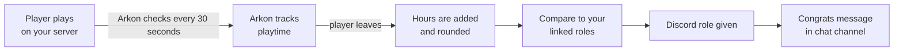

# Playtime Tracking, Playtime Roles and Welcome Messages

Arkon counts how long each player spends on your Ark servers. You can turn those hours into Discord roles that players earn on their own, greet new players in game, and send a Discord invite when someone types "discord" in chat.

**You need:**

- Your servers connected, with RCON working (RCON is the remote-control connection Arkon uses to talk to your server). See [Getting Started](/guides/getting-started) and [RCON Setup](/guides/rcon-setup).
- A chat channel set on each server, so Arkon has somewhere to post role and welcome messages. See [Server Settings](/guides/server-settings).
- Players who have linked their Discord to their game character with `+register`. Only these players get roles. See [Player Registration](/guides/player-registration).
- The **Manage Roles** permission for Arkon in your Discord server.

> Every `+arkset` command on this page can be run by the server owner, a bot Admin, or anyone with the Manage Server permission. Set your Admin and Mod roles in [Getting Started](/guides/getting-started). These are text commands only (no slash version).
{.is-info}

## How it works

Arkon looks at each server's player list every 30 seconds. When a player leaves, their time is added. Hours are rounded, so 9.6 hours counts as 10.

> A player only gets a role if they registered. Arkon needs to know which Discord account is theirs.
{.is-warning}

## Set up playtime roles

1. **Move Arkon's role to the top.** In Discord, open **Server Settings**, then **Roles**. Drag Arkon's role above every role you plan to hand out. Arkon cannot give a role that sits above or equal to its own.
2. **Link your first role.** In any channel Arkon can see, type `+arkset linkrole 10 @Rookie`. This means "at 10 hours, give the Rookie role". You will see: *When a player hits 10 hours the Rookie role will be assigned to them if theyre registered*.
3. **Link more roles.** Example: `+arkset linkrole 100 @Veteran`
4. **Pick stacking or not.** Type `+arkset autoremoverole` to switch it. Arkon replies *Auto-removal of previous playtime role **Enabled*** or *Disabled*. Enabled: players keep only their highest role. Disabled (the default): they keep every role they qualify for.
5. **Check your list.** Type `+arkset viewranks`.

6. **Give roles to players who already have hours.** Type `+arkset initroles`. It goes through every registered player in your Discord and fixes their roles.

7. **Check it worked.** `viewranks` shows your roles. After `initroles`, you see a green *Role initialization completed!* message. When a player later passes an hour milestone, Arkon posts this in the server's chat channel:

When you have more than one role, this is how Arkon decides who keeps what:

| Auto-remove setting | Player has 120 hours, roles at 10 and 100 | Player's hours drop to 50 |
|---|---|---|
| Disabled (default) | Gets both Rookie and Veteran. | Keeps Rookie, loses Veteran. |
| Enabled | Gets only Veteran. | Gets only Rookie. |

Roles are checked each time a registered player finishes a play session, when you run `+arkset initroles`, and when a linked player rejoins your Discord.

> Linking a role does not hand it out right away. Run `+arkset initroles` or wait for the next playtime update.
{.is-info}

> Never link one role to two different hour levels. Arkon will quietly delete both links. If you run `+arkset linkrole` with a role that is already linked, Arkon moves it to the new hours and the reply only says it unlinked the old hours.
{.is-danger}

> If Arkon's role sits below one of your playtime roles, Arkon skips that role and posts *The playtime role @Veteran is higher or equal to my top role! I can not assign it to users!* in your alert channel (see [Server Settings](/guides/server-settings)).
{.is-warning}

## Give a role when players register

Type `+arkset registerrole @Player`. Anyone who registers gets that role. Type `+arkset registerrole` with no role to turn it off. Example reply: *Register role set! Users will be given the Player role when they register*.

Arkon's role must be above this role too. If not, Arkon posts *The register role is higher or equal to my top role! I can not assign it to users!* in your alert channel.

## Welcome new players in game

1. Type `+arkset autowelcome`. Arkon replies *Auto-welcome **Enabled***. Run it again to turn it off. It is off by default.
2. Optional: set your own message with `+arkset autowelcomemessage Welcome {username}! Read the rules in Discord.` Arkon replies *Welcome message set!*
3. **Check it worked.** When a brand-new player is first seen, everyone in game sees a broadcast, and the chat channel gets this:

Arkon only welcomes a player the very first time it ever sees them. Players who come back are not welcomed again. The welcome shows in game as a broadcast (a message everyone on the server sees), not as a Discord message to the player. The default broadcast says *A new player has joined the server!* and *Everyone say hi to SurvivorSam!* in random colors. A custom message is broadcast exactly as you typed it.

The chat embed has a small footer, *Powered by Arkon - https://arkonbot.com*, on free servers. [Premium](/guides/premium) servers do not get the footer.

Separately, whether or not auto-welcome is on, Arkon posts a green **New Player Detected** card (or **New Players Detected**) in your event log channel. It shows the chat channel, the player's name and their game ID. Set that channel with `+arkset eventlog`, see [Server Settings](/guides/server-settings).

The two placeholders you can use are `{username}` and `{gameid}`. Any other text in curly braces is refused with *Invalid welcome message! Only the {username} and {gameid} placeholders are allowed.* Run `+arkset autowelcomemessage` with no text to go back to the default (*Welcome message reset to default!*).

## Send a Discord invite in game

When a player types a message with "discord" in it, Arkon replies in game with an invite link. This is **on by default**.

1. To set your own link, type `+arkset invitelink discord.gg/mycommunity`. It must be one word, up to 100 characters. Discord invites are checked to make sure they exist.
2. To turn the reply off or on, type `+arkset autoinvite false` (or `true`).
3. To go back to automatic, type `+arkset invitelink` with no address.
4. **Check it worked.** In your game's chat, type a message with the word "discord" in it. Arkon answers in game chat with `invite:` and your link.

In game, the reply is sent as a chat line from your Discord server's name, for example *My Server -> invite: discord.gg/mycommunity*. It fires every time a message contains "discord" in any capitals, and the code has no cooldown.

With no link set, Arkon uses your server's vanity link, then a never-expiring invite, then makes a 1-hour invite. Finding or making invites needs the **Manage Server** permission. Set a never-expiring invite yourself to avoid dead links.

## Check your setup

- `+checklist` has rows for **Playtime Roles** (how many tiers you linked), **Register Role** and **Auto-Welcome**. See [Getting Started](/guides/getting-started).
- `+arkset view` shows the **Ark Settings** card. It lists your register role, auto-invite on or off, and your invite link (*Auto* if none is set).
- If you unlink a player with `+unregisterplayer`, their playtime roles are removed too. See [Player Registration](/guides/player-registration).

## Reset or set playtime

Every reset asks you first. Click **Yes** to go ahead or **No** to cancel (Arkon says *Cancelled!*). Only you can click the buttons.

1. In any channel Arkon can see, type a reset command from the Commands table, for example `+arkset resetplaytime cluster My Cluster`.
2. Click **Yes** on the question Arkon posts.
3. **Check it worked.** Arkon edits its message to *Reset playtime for **N** players on the My Cluster cluster!*

> Resets cannot be undone. Lowered hours do not remove roles instantly. Roles are fixed at the next playtime update or when you run `+arkset initroles`.
{.is-warning}

## Commands

| Command | What it does | Example |
|---|---|---|
| `+arkset linkrole <hours> <role>` | Give a role at this many hours (minimum 1). | `+arkset linkrole 10 @Rookie` |
| `+arkset unlinkrole <hours>` | Stop giving the role linked to those hours. Players keep roles they have. | `+arkset unlinkrole 10` |
| `+arkset autoremoverole` | Toggle: keep only the highest role. Default off. | `+arkset autoremoverole` |
| `+arkset viewranks` | Show your linked roles. | `+arkset viewranks` |
| `+arkset initroles` | Fix roles for all registered players. Once every 15 minutes. | `+arkset initroles` |
| `+arkset registerrole [role]` | Role given at registration. Empty clears it. | `+arkset registerrole @Player` |
| `+arkset autowelcome` | Toggle the in-game welcome. Default off. | `+arkset autowelcome` |
| `+arkset autowelcomemessage [message]` | Set the welcome text. Empty resets it. Also `+arkset welcomemsg`. | `+arkset autowelcomemessage Hi {username}!` |
| `+arkset autoinvite <true/false>` | Reply with an invite when someone says "discord". Default on. | `+arkset autoinvite true` |
| `+arkset invitelink [address]` | Set the invite link. Empty clears it. Also `+arkset discordlink`. | `+arkset invitelink discord.gg/mycommunity` |
| `+arkset resetplaytime all` | Zero everyone's playtime. | `+arkset resetplaytime all` |
| `+arkset resetplaytime cluster <cluster>` | Zero one cluster's playtime. | `+arkset resetplaytime cluster My Cluster` |
| `+arkset resetplaytime server <cluster> [server]` | Zero one server (or all in the cluster). | `+arkset resetplaytime server "My Cluster" Ragnarok` |
| `+arkset resetplaytime player <player> [cluster] [server]` | Zero one player, or only their time on a cluster or server. | `+arkset resetplaytime player SurvivorSam` |
| `+setplayertime <time> <player>` | Set one player's total time (replaces it, no confirmation). | `+setplayertime 6h SurvivorSam` |

Notes:

- `<player>` can be a Gamertag or Steam name, a game ID, a Discord ID or username, or a character name. Put names with spaces in quotes. If several match, the first is used.
- `<time>` for `+setplayertime` looks like `45m`, `6h`, or `2d6h`. It changes only the total, not per-server time. It needs Admin or Manage Server.
- `+arkset autoinvite` with no true/false shows Discord's missing-argument help.

## Common problems

| Problem | Why it happens | Fix |
|---|---|---|
| That role is higher than my highest role, so I cannot assign it! | Arkon's role is below the role you linked. | Drag Arkon's role higher in Server Settings, Roles. |
| Hours must be at least 1 | You used 0 or a negative number. | Use 1 or more. |
| That amount of time isnt linked to a role! | No role is linked to those hours. | Check with `+arkset viewranks`. |
| `+arkset unlinkrole` shows a generic error | The link is removed but the reply fails. | Run `+arkset viewranks` to confirm it is gone. |
| I do not have permissions to manage roles! | Arkon lacks Manage Roles. | Give Arkon the Manage Roles permission. |
| There are no playtime roles configured and no register role set! | Nothing to hand out yet. | Run `linkrole` or `registerrole` first. |
| A player has hours but no role | They have not registered, or Arkon is below the role. | Have them use `+register`, then run `+arkset initroles`. |
| The playtime role @Veteran is higher or equal to my top role! I can not assign it to users! | Arkon's role is below a playtime role. | Drag Arkon's role higher. |
| The register role is higher or equal to my top role! I can not assign it to users! | Arkon's role is below the register role. | Drag Arkon's role higher. |
| Invalid welcome message! | Used braces other than `{username}` or `{gameid}`. | Remove other brace text. |
| That invite doesn't exist or has expired. | The link is dead. | Make a new never-expiring invite. |
| The invite link must be a single address with no spaces, up to 100 characters. | Link has spaces or is too long. | Shorten it. |
| A cluster by that name doesn't exists! | The cluster name does not match. | Check the name in [Server Settings](/guides/server-settings). |
| No playtime to reset on the My Cluster cluster! | Nobody has recorded time there. | Nothing to do. |
| No player data found for **SurvivorSam** | Name not matched. | Try their game ID or Discord ID. |
| Invalid time format! | Time not like `6h`. | Use `45m`, `6h` or `2d6h`. |

## Related pages

- [Getting Started](/guides/getting-started)
- [Server Settings](/guides/server-settings)
- [Player Registration](/guides/player-registration)
- [Stats and Leaderboards](/guides/stats-and-leaderboards)
- [Premium](/guides/premium)
- [All Commands](/commands/all-commands)
