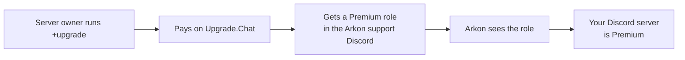
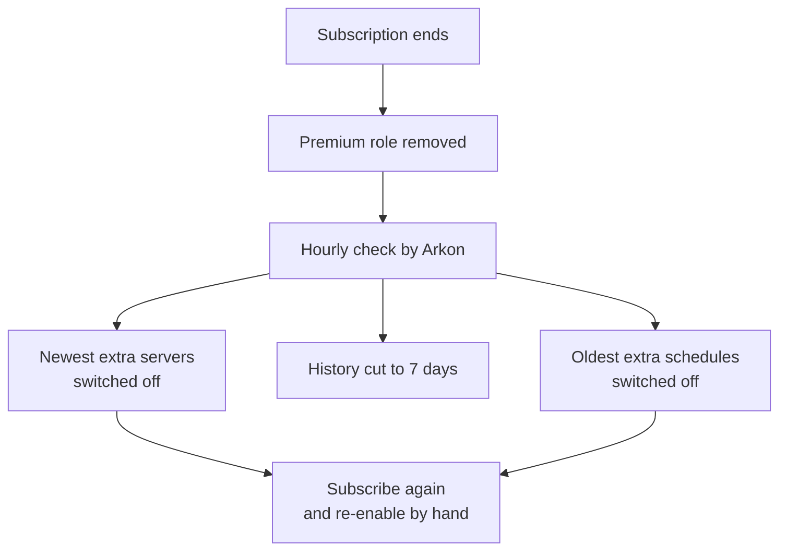

# Arkon Premium: Free vs Premium

Arkon is free to start. Premium removes the limits (up to 100 servers instead of 1, longer graphs) and unlocks a few extra tools. It costs $10/month and you buy it on Upgrade.Chat (a payment site that Arkon uses).

**You need:**

- A Discord server with Arkon in it. See [Getting Started](/guides/getting-started).
- A Discord account. Premium is tied to the **owner** of your Discord server (the person who created it), not to the server itself.

## How Premium works

The owner buys Premium. Arkon then sees that the owner holds a Premium role in the Arkon support Discord. If so, **your whole Discord server** counts as Premium.

> The owner must have joined the Arkon support Discord, or Arkon cannot see the Premium role. The support server link is in the message from `+setuphelp`.
{.is-warning}

## Free vs Premium

| | Free | Premium |
|---|---|---|
| Ark servers per Discord server | 1 | Up to 100 |
| Scheduled commands | 3 | 20 |
| Player count history kept | 7 days | Up to 5 years |
| Status graph length | 1 hour | Up to 12 hours |
| Arkon branding on status and welcome messages | Shown (footer "Powered by Arkon - https://arkonbot.com") | Removed |
| Servers that sit offline for 30 days | Switched off automatically | Left alone |
| 🔸 Auto-friend (see [Xbox features](/guides/xsapi)) | Locked | Yes |
| 🔸 Alt detection (see [Xbox features](/guides/xsapi)) | Locked | Yes |
| 🔸 Auto-unfriend when a registered player leaves Discord | No | Yes |
| 🔹 Cheated tame scanning (see [Anti-cheat](/guides/anti-cheat)) | No | Yes |
| Faster event log delivery | No | Yes |
| `+rcon` on servers you switched off | No | Yes |
| Interactive `playerstats` menu (buttons) instead of a plain pager | No | Yes |
| Discord servers one person can add Arkon to | 1 | 5 |

🔹 = needs [ArkView](/guides/arkview). 🔸 = Xbox / Microsoft Store ASE only.

Cheated tame scanning also needs ArkView set up and your valid server names filled in.

Where you will see the locks and limits:

- **Status channel message:** on Free the footer says "Powered by Arkon - https://arkonbot.com". On Premium it just says "Last Updated". See [Status channel](/guides/status-channel).
- **New player welcome message:** on Free it has the same "Powered by Arkon" footer. On Premium there is no footer. See [Playtime and roles](/guides/playtime-and-roles).
- **Schedule menu (`+scheduledrcon`):** the footer shows "Schedule Limit: 2/3" (schedules used out of the most you may have). See [Server control](/guides/server-control).
- **Setup checklist (`+checklist`):** on Free, Auto-Friend and Alt Detection show a lock icon with the words "premium - auto-friend registered players" and "premium - detect alt accounts on join".

### Free for everyone

These have no Premium lock: game chat relay, live status channel, economy and shop, leveling, logging, stats, leaderboards, tribe logs, in-game commands, kits, map commands, playtime roles and moderation tools.

## Buy Premium

1. In any Discord channel Arkon can see, type `+upgrade`. (Aliases: `+donate`, `+donatelink`, `+getpremium`. Anyone can run it.)
2. Click the green link in the message.
3. Pay on Upgrade.Chat. Log in with the Discord account that **owns** your Discord server.
4. Make sure that account is in the Arkon support Discord.
5. Check it worked: wait a few minutes, then type `+serverstatus time 43200` in a channel Arkon can see (this sets your status graph to 12 hours, and you can change it back later). If Premium is active, Arkon replies "Status channel graph time set!". On Free it replies that the free version allows only 1 hour.

> Changes can take up to 5 minutes to show, and up to an hour for background clean-up to catch up.
{.is-info}

## Cancel Premium

1. Type `+downgrade`. (Anyone can run it.)
2. Click the link. It opens your Upgrade.Chat profile.
3. Cancel the subscription there. The command does not cancel anything by itself.

## What happens when Premium ends

Nothing is deleted at once. Arkon checks every hour and then:

1. Switches off your **newest** Ark servers until only the free number are left. They are switched off, not deleted. The owner gets a ping listing them.
2. Cuts player count history to 7 days. Older data is deleted and does not come back.
3. Switches off your **oldest** scheduled commands until only 3 are left.
4. Auto-friend and alt detection settings stay saved but stop working.
5. Arkon branding comes back.
6. Any server that has been offline for 30 days is switched off.

The server, history and schedule clean-up runs only for Free servers. On Premium none of it happens.

To get them back, subscribe again. Then turn servers back on in the `+viewservers` menu (see [Server settings](/guides/server-settings)) and schedules in `+scheduledrcon` (see [Server control](/guides/server-control)).

> Switched-off servers still count toward the limit when you add a new server.
{.is-warning}

### Messages Arkon posts when this happens

Arkon posts these in your alert channel (set it with `+arkset alertchannel #channel`, Admin or Manage Server). If none is set, it falls back to your event log channel, then your Red mod log channel.

- **Premium ran out (owner has too many servers):** `Premium subscription has expired! Servers over the free tier limit will be disabled soon!` The Discord server owner is pinged.
- **Servers switched off:** `The following servers have been disabled due to the free tier limit:` then a list like `- The Island My Cluster (#island-chat)`, then `You can re-anable them in the +viewservers menu after re-subscribing.` (the typo "re-anable" is in the bot itself).
- **Schedules switched off:** `The following schedule has been disabled due to exceeding the limit of 3 schedules:` followed by the schedule card.
- **Offline too long (Free only):** `The following servers have been disabled because they've been inactive for 30 days:` with the server names.

## Commands

All are normal prefix commands (default prefix `+`).

| Command | Who | What it does | Example |
|---|---|---|---|
| `+upgrade` | Everyone | Shows the buy link | `+upgrade` |
| `+downgrade` | Everyone | Shows the cancel link | `+downgrade` |
| `+serverstatus time <seconds>` | Admin or Manage Server | Sets how far back the status graph shows. Free max 3600, Premium max 43200 | `+serverstatus time 43200` (12 hours) |
| `+arkset retention <days>` | Admin or Manage Server | Sets how many days of player count history to keep. Free max 7, Premium max 1825 | `+arkset retention 30` |

Admin means someone allowed to manage Arkon. See [Getting Started](/guides/getting-started) for setting roles.

## Common problems

| Problem | Why it happens | Fix |
|---|---|---|
| "You cannot have more than 1 server using the free version of Arkon" | You hit the free server limit | Subscribe, or remove a server. Switched-off servers still count |
| "You have reached the maximum number of enabled servers for the free tier!" | Re-enabling a server in `+viewservers` while at the free limit | Subscribe to Premium, or switch another server off first |
| "The total amount of servers I can manage is 100..." | The 100 server cap, even on Premium | Remove a server you no longer use |
| "Sorry, the maximum time the free version of Arkon allows is 1 hour" | Status graph over 3600 seconds on Free | Use 3600 or less, or subscribe |
| "The histogram can display a maximum of 12 hours" | More than 43200 seconds | Use 43200 or less |
| "You need a premium subscription to set historical data longer than 7 days" | Retention above 7 days on Free | Use 7 or less, or subscribe |
| "You cannot set the retention period to more than 5 years!" | Over 1825 days | Use 1825 or less |
| "You have reached the maximum number of schedules for the free tier." | 3 schedules already | Delete one or subscribe |
| "This feature requires your server owner to have an Arkon Premium subscription!" | Owner has no Premium role | Owner subscribes and joins the support Discord |
| "You have reached the maximum number of schedules." | 20 schedules already, even on Premium | Delete one you no longer use |
| Arkon posts "You may have the bot in up to N Discord servers(s) that you own." and leaves | You own more Discord servers with Arkon than your plan allows | See the next row |
| Arkon left a new Discord server | You already own as many Discord servers with Arkon as your plan allows (1 Free, 5 Premium) | Subscribe, or use Arkon in fewer servers |

## Related pages

- [Getting Started](/guides/getting-started)
- [Server settings](/guides/server-settings)
- [Status channel](/guides/status-channel)
- [Xbox features](/guides/xsapi)
- [Anti-cheat](/guides/anti-cheat)
- [FAQ](/guides/faq)
