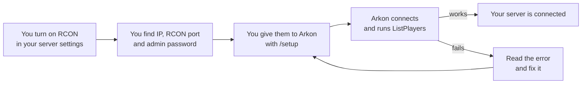
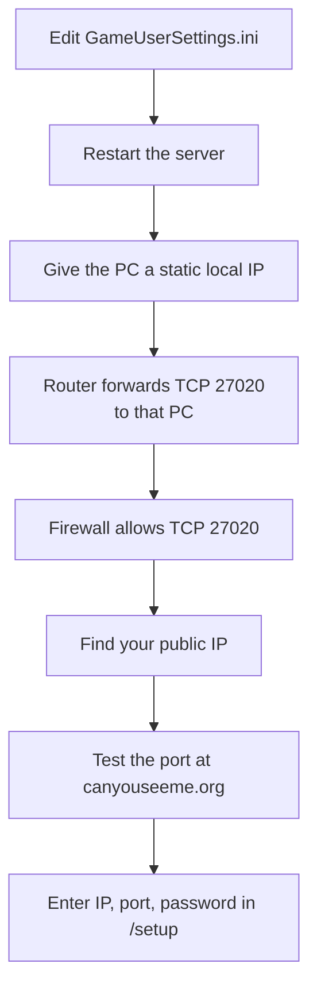

# Turn On RCON and Find Your RCON Details

Arkon needs three facts about your Ark server before it can control it: an IP, an RCON port and an admin password. This page shows you how to turn RCON on and find all three.

RCON is the remote-control connection Arkon uses to send commands to your server and read the player list. Your game server has it built in, but it may be switched off.

**You need:**

- A running Ark server (ASE or ASA) that you own or admin.
- Arkon already invited to your Discord server. See [Getting Started](/guides/getting-started).

## The big picture



> The RCON port is NOT the game port and NOT the query port. It is a third, separate number. This is the most common mistake.
{.is-warning}

## Get a guide for your host with +rconhelp

Arkon can show you the steps for your host inside Discord. Anyone in your Discord server can use it.

1. In any Discord channel the bot can see, type `+rconhelp` and send it. Example: `+rconhelp`
2. Arkon posts a message with a dropdown that says "Who hosts your server? Get a guide...".


3. Click the dropdown and pick your host: Nitrado, G-Portal, Shockbyte, Host Havoc, Self-Hosted (PC/Dedicated), or Other / Not Listed.
4. Arkon sends you the guide as a private message in the channel. Only you can see it.


5. Check it worked: you see a blue guide with a title like "Nitrado: Finding your RCON info". You can pick another host from the same dropdown as often as you like.

The dropdown stops working after 10 minutes. If it goes dead, type `+rconhelp` again.

## Find your details by host

Pick your host below. Each section tells you where to click.

### Nitrado

> Nitrado does not allow RCON on ASE (Survival Evolved) servers, so Arkon cannot connect to them. Nitrado ASA (Survival Ascended) servers work fine.
{.is-danger}

1. Open your Nitrado dashboard. Your server is shown as `IP:Port`. Write down only the IP part. The port shown there is the game port, not RCON.
2. Go to `Settings → General`. Find the **RCON Port**. Nitrado picks it for you. RCON is on by default for Nitrado ASA.
3. On the same page, find **Admin Password** (`Settings → General → Admin Password`). For ASA you can also find it under `Settings → Expert Settings → GameUserSettings.ini → ServerAdminPassword`.

> Do not use the join password. The admin password is a different one.
{.is-warning}

### G-Portal

1. Open your server's **Status** page. Write down the IP (no port).
2. On the same page you will see several ports (game, query, RCON). Use the one labeled **RCON**, not the query port.
3. Go to `Basic Settings → Admin Password`. Set or read the password there.
4. Save, then restart the server.

> G-Portal only applies new settings after a restart. A new password will not work until you restart.
{.is-info}

### Shockbyte

1. In the panel, open **Server Details**. It shows your IP and ports. The RCON port is separate from the game and query ports.
2. Go to `Configuration Files → GameUserSettings.ini`. Under `[ServerSettings]` add or change these lines:

```ini
[ServerSettings]
RCONEnabled=True
RCONPort=27020
ServerAdminPassword=YourPasswordHere
```

3. Save and restart the server.
4. If Arkon still cannot reach the RCON port, ask Shockbyte support to open it (TCP).

### Host Havoc

1. Open your service page. It shows your IP and the assigned ports. The RCON port is listed with them.
2. Go to `Configuration Files → GameUserSettings.ini`. Under `[ServerSettings]` set:

```ini
[ServerSettings]
RCONEnabled=True
ServerAdminPassword=YourPasswordHere
```

3. Leave `RCONPort` at the value Host Havoc gave you.
4. Save and restart the server.

### Self-hosted (your own PC or dedicated machine)

You must turn RCON on, open the door in your router and firewall, and give Arkon your public IP. Here is the whole path.



1. Open `GameUserSettings.ini` on the server PC. Under `[ServerSettings]` add:

```ini
[ServerSettings]
RCONEnabled=True
RCONPort=27020
ServerAdminPassword=YourPasswordHere
```

You can also use launch arguments instead, for example `?RCONEnabled=True?RCONPort=27020`.

2. Restart the server.
3. Give the server PC a static local IP in your router. (A static IP means the PC always keeps the same address on your home network.)
4. Log in to your router. It is usually at `192.168.1.1`. Find **Port Forwarding** or **NAT**.
5. Forward TCP port `27020` (or whatever your `RCONPort` is) to the server PC's local IP. Help for many routers: [portforward.com](https://portforward.com/router.htm).
6. Allow TCP inbound on that port in your firewall. On Windows, add an inbound rule for TCP on the RCON port. On Linux, use ufw or iptables. If you filter by address, allow `51.79.109.160` (the address Arkon connects from).
7. Find your **public** IP at [whatismyip.com](https://whatismyip.com). Do not use an address that starts with `192.168`. That one only works inside your home.
8. Test the port at [canyouseeme.org](https://canyouseeme.org). Type your RCON port. "Success" means it is open.

> If your IP changes often, use a free dynamic DNS name such as [DuckDNS](https://www.duckdns.org). Use that name in place of the IP.
{.is-info}

> If you cannot port forward, your internet provider may use CGNAT (they share one public IP between many homes). Contact them and ask for a public IP.
{.is-warning}

### Other host or not listed

Every Ark server reads the same three lines from `GameUserSettings.ini` under `[ServerSettings]`:

```ini
RCONEnabled=True
RCONPort=27020
ServerAdminPassword=YourPasswordHere
```

In your host's panel look for:

- A config file editor (often called Configuration Files or Expert Settings).
- A list of ports on the overview page. The RCON port is separate from the game and query ports.
- An Admin Password field in the basic settings.

If your host does not show the RCON port, ask their support to open it as TCP. Still stuck? Join the [Support Server](https://discord.gg/RaR3wR4MgY).

## Give the details to Arkon

Run `/setup` and enter these when asked. See [Getting Started](/guides/getting-started) for the full walk-through.

| Field | What to type | Example |
|-------|--------------|---------|
| Server Name | Any name, letters, numbers, spaces, hyphens, underscores, 1-32 characters | `The Island` |
| IP Address (without port!) | Your public IP or hostname, no `:port` | `123.45.67.89` |
| RCON Port | The RCON port from your config or panel (27020 is the default) | `27020` |
| Admin Password | Your `ServerAdminPassword` | `YourPasswordHere` |

If you type `123.45.67.89:27020` in the IP box, Arkon splits it for you. Do not rely on this. Type the IP alone.

Arkon tests the connection by running `ListPlayers`. It waits up to 10 seconds to connect and gives up after 30 seconds in total.

On public Arkon these IP entries are refused:

- A home-network address like `192.168.1.5`: "That's an address inside your home network. The bot connects over the internet, so it needs your public IP address."
- A partial IP like `1.2.3`: "That isn't a complete IP address. It needs four numbers from 0 to 255 separated by dots, e.g. 123.45.67.89."
- A name with no dot: "Enter your server's IP address or full hostname, not the name of your host."

Other messages you may see in the pop-up form:

- "Please enter a valid IP address or hostname."
- "Server names can only contain letters, numbers, spaces, hyphens, and underscores!"
- "Invalid port number! Must be between 1 and 65535."

If a server with the same address, port and password is already added, Arkon shows "Duplicate Server Detected" and tells you to run `+viewservers` to see your existing servers. Click **Edit Details** to change the entry or **Cancel Setup** to stop. See [Server Settings](/guides/server-settings).

The `/setup` screen sits idle for 10 minutes. After that it says "Setup Timed Out" and you run `/setup` again.

## Commands

### +rconhelp

- **Who can run it:** Everyone in your Discord server. It does not work in direct messages.
- **What it does:** Posts a host dropdown. Each pick sends you a private step-by-step guide.
- **Syntax:** `+rconhelp`
- **Example:** `+rconhelp`
- **Limits:** Prefix command only (there is no slash version). The dropdown works for 10 minutes. Anyone in the channel can use the dropdown, but each guide is shown only to the person who clicked.

The same guide dropdown also appears inside `/setup`, on the button "Where do I find these?" and after a failed connection test.

## What each connection error means

When the test fails, Arkon shows "Connection Failed" with one of these messages. Every message ends with the address it tried.

| Error | What it means | Fix |
|-------|---------------|-----|
| **Wrong password!** | Arkon reached the server, but the password was rejected. | Check `ServerAdminPassword` in `GameUserSettings.ini`. It is case-sensitive. Remove stray spaces. |
| **Connection timed out** | Arkon could not reach your server at all. | Check the IP and port, port forwarding, the firewall, that the server is fully started, and that `RCONEnabled=True`. |
| **Connection refused** | Arkon reached your machine, but nothing is listening on that port. | Check `RCONPort`, make sure `RCONEnabled=True`, and wait if the server is still loading. |
| **No response from server** | The connection worked but the reply was empty. | The server may still be starting, or the port may not be an RCON port. Check the port and try again. |
| **Unexpected response from server. It may not be fully compatible.** | The server answered in a way Arkon did not expect. | Check the port is the RCON port and the server is fully started. |
| **Connection failed:** followed by text | Something else went wrong. Arkon shows the first 200 characters of the error. | Read the text, then use the checklist below. |

Under the error you get buttons: **Edit & Retry** (change your details), **Back**, **Troubleshooting Guide** (a five-step checklist: server running, firewall, port test, IP, password), **Get Help** (opens the Support Server) and **Cancel**. The same host dropdown is there too.

A quick way to remember it: timed out means "can't get there", refused means "got there, nobody home", wrong password means "got in the door, bad key".

## Common problems

| Problem | Why it happens | Fix |
|---------|----------------|-----|
| Connection timed out on a self-hosted server | Port not forwarded or firewall blocking | Redo the forwarding and firewall steps, then test at canyouseeme.org. |
| It works inside my home but not from Arkon | You used a `192.168.x.x` address | Use your public IP from whatismyip.com. |
| It worked yesterday, now it times out | Your home IP changed | Use a DDNS name such as DuckDNS, or enter the new IP. |
| Wrong password right after changing it | Host has not restarted yet (G-Portal especially) | Save, then restart the server. |
| Connection refused | Wrong port, often the game or query port | Read `RCONPort=` in your config or panel. Do not guess from the game port. |
| Nitrado ASE server will not connect | Nitrado blocks RCON on ASE | This cannot be fixed. Nitrado ASA works. |
| Port forwarding is impossible | Your provider uses CGNAT | Ask your provider for a public IP. |
| Dropdown from +rconhelp does nothing | It expired after 10 minutes | Type `+rconhelp` again. |

## Related pages

- [Getting Started](/guides/getting-started)
- [Server Settings](/guides/server-settings)
- [FAQ and Troubleshooting](/guides/faq)
- [Ark RCON Commands](/guides/ark-rcon-commands)
- [Glossary](/guides/glossary)
