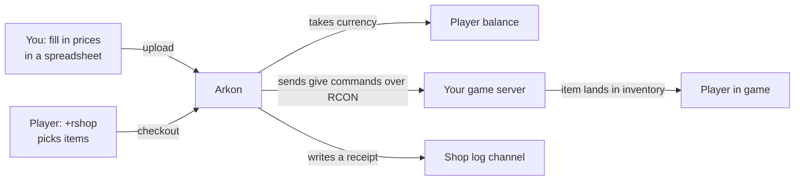
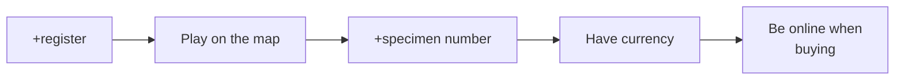

# The RCON Shop (Rshop): Sell In-Game Items

The Rshop lets your players spend your server's currency in Discord and get real items in their Ark inventory. You set the prices in a spreadsheet, upload it once, and the bot does the rest.

**You need:**

- Arkon in your Discord with at least one server connected. See [Getting Started](/guides/getting-started).
- RCON working on that server (RCON is the remote-control connection Arkon uses to send commands to your game server). See [RCON Setup](/guides/rcon-setup).
- A way for players to earn currency (see "Where does the currency come from?" below).
- Players who have linked their account with `+register`. See [Player Registration](/guides/player-registration).

> Commands marked **Admin** can be run by anyone with the Arkon Admin role or the Discord "Manage Server" permission. The server owner always can. To set those roles, see [Getting Started](/guides/getting-started).
{.is-info}

## The big picture



## Where does the currency come from?

The shop spends your Discord server's "bank" balance. Think of it as one wallet per member, kept by the bot, and the shop only takes money out of it. Its default name is "credits".

The Rshop has no way to earn money by itself. That is the most common surprise for new owners. If nobody has a balance, nobody can buy anything.

Players get a balance in these ways:

- From any other money feature you run on your Discord bot that pays into the same bank. The Rshop does not care where the money came from. Lootboxes spend from this same balance too, see [Lootboxes](/guides/lootboxes).
- From you, using the refund tools at the bottom of this page. `+arkset refundplaytimedelta` is the one built for handing out money: it pays every linked player a set amount for each hour they played in a date range. See Part 6.
- Back into their wallet when a purchase fails and they are refunded.

Players can see their balance in the footer of the `+rshop` menu.

> If you only want players to earn shop money by playing, use `+arkset refundplaytimedelta` on a schedule you pick (for example once a week), with a dry run first. Arkon does not run it for you.
{.is-success}

> The in-game `payday` command gives items, not shop currency. Do not tell players it earns shop money.
{.is-warning}

## Part 1: Admin setup

### Step 1. Download the price template

1. In any Discord channel the bot can see, type `+rshopset template` and press Enter.
2. Arkon replies with an embed titled "RCON Shop Template" and an Excel file called `template.xlsx`.
3. Download the file and open it in Excel. No Excel? Upload it to Google Sheets for free.

The file has two tabs: `items` (1,326 items in 26 categories such as Armor, Resources and Saddles) and `packs` (empty).

> Every price in the template starts at 0. Nothing is for sale until you type prices in.
{.is-warning}

### Step 2. Fill in your prices

Open the `items` tab. Each row is one item. Arkon reads the columns **by position, not by name**, so keep the column order the same.

| Column | What it does | Example |
|---|---|---|
| 1. Item | Name players see. Required. | `Flak Chestpiece` |
| 2. Price | Cost for ONE item. Decimals are fine. `0` hides the item. | `30` |
| 3. Quality Select | `TRUE` lets players pick a quality. Blank means no. | `TRUE` |
| 4. Blueprint Select | `TRUE` lets players buy it as a blueprint. Blank means no. | `FALSE` |
| 5. Stack Size | Biggest stack of this item on your server. Blank counts as 1. | `100` |
| 6. Category | Items with the same category share one menu. Blank becomes "Unset". | `Armor` |
| 7. Description | Optional text shown to players. | `Good all-round armor` |
| 8. Class Name | The item's game class. | `PrimalItemArmor_ChitinShirt_C` |
| 9. Blueprint | The full item path. Required. | already filled in for you |
| 10. Server Type | `ase`, `asa` or `both`. | `both` |
| 11. Cluster Blacklist | Optional. Cluster names, separated by commas, where the item is NOT sold. | `My Cluster` |

Tips:

- To stop selling an item, set its price to `0` or delete the row.
- Yes answers for columns 3 and 4 are `true`, `yes`, `y` or `1`.
- If the server type is blank or misspelled, it silently becomes `both`.
- Cluster names in the blacklist must match exactly, including capital letters.

**Packs (bundles).** On the `packs` tab, one row sells many things for one flat price.

| Column | What it does |
|---|---|
| 1. Pack Name | Name players see. Required. |
| 2. Price | One price for the whole pack. |
| 3. Category | Menu group. |
| 4. Description | Optional. |
| 5. Commands | What to give. Required. Separate several with commas. |
| 6. Server Type | `ase`, `asa` or `both`. |
| 7. Cluster Blacklist | Optional. |

In the Commands cell, a part that starts with `"Blueprint` gets the give command and the player's ID added for you. Write the blueprint path, then the quantity, quality and blueprint numbers, for example:

```
"Blueprint'/Game/PrimalEarth/CoreBlueprints/Items/Structures/Misc/PrimalItemStructure_Turret.PrimalItemStructure_Turret'" 1 1 0
```

Anything else you put in a part is treated as a full custom command. These words are swapped for the buyer's details: `{specimen}`, `{playerid}` and `{username}`. Packs are always bought one at a time, with no quality or blueprint choice.

### Step 3. Upload the file

1. Go to a Discord channel the bot can see.
2. Type `+rshopset upload`, attach your saved `.xlsx` file to the same message, and send it. You can also reply to a message that already holds the file.
3. Success looks like: `Rshop has been updated!`

If anything in the file is wrong, nothing is saved. Arkon posts "There were errors while parsing your file" with a file called `errors.txt`. Fix the rows it lists and upload again. The row number in the error counts rows after the header, so the spreadsheet row is that number plus 1.

> Upload replaces the whole shop. Anything not in your file is removed. Run `+rshopset download` first to save a backup.
{.is-danger}

### Step 4. (Optional) Fix stack sizes from your Game.ini

Big purchases are split into stacks. Wrong stack sizes mean wrong stack counts. To copy them from your server settings, type `+rshopset readstacks` and attach your `Game.ini` file. Arkon reads the stack limits, updates any that differ, and replies with how many items changed.

### Step 5. Set a shop log channel

Type `+arkset shoplog #shop-log` (use your own channel). Arkon replies `Shop log set!` Every successful purchase then posts a receipt there. If you skip this, receipts are simply not posted.

### Step 6. Check your settings

Type `+rshopset view`. You see an embed titled "General Shop Settings" listing whether the shop is on, the log channel, quality and blueprint rules, how many items are shown and hidden, and your discounts.

### Step 7. Check it worked

Ask a registered player to type `+rshop`. They should see the "RCON Shop" menu with your categories. If it says "There is nothing in the shop yet!", no item has a price above 0 yet.

## Part 2: Prices, quality, blueprints and discounts

Here is how Arkon works out a price, in order:

1. Item price x quantity x (quality to the power of the quality exponent).
2. If it is a blueprint, multiply by the blueprint multiplier.
3. Subtract discounts (server or cluster, plus role, plus weekday, up to 99% in total).
4. Round up to a whole number. Every line costs at least 1.

Example with the defaults: price 10, quantity 5, quality 3 gives 10 x 3 x 5 = 150. As a blueprint, 150 x 4 = 600. With 20% off the normal version, 150 becomes 120.

A cluster is a group of connected servers. If you have clusters, many shop settings below accept an optional `[cluster]` name. A non-zero cluster value replaces the server-wide value for that cluster only. See [Server Settings](/guides/server-settings).

> Cluster names are matched ignoring capital letters in these commands.
{.is-info}

### Settings table

| Setting | What it does | Default | Command |
|---|---|---|---|
| Quality exponent | How fast price grows with quality. 1 = straight line, 2 = squared. | 1.0 | `+rshopset qualityexp` |
| Max quality | Highest quality for normal items. | 10 | `+rshopset maxquality` |
| Max blueprint quality | Highest quality for blueprints. | 10 | `+rshopset maxbpquality` |
| Blueprint multiplier | Blueprint price = normal price x this. | 4.0 | `+rshopset bpmultiplier` |
| Static discount | Percent off everything. | 0% | `+rshopset discount` |
| Weekday discount | Percent off on one day of the week. | 0% | `+rshopset discountdays` |
| Role discount | Percent off for members with a role. | none | `+rshopset discountrole` |
| Pack delimiter | The character that separates commands in a pack cell. | `,` | `+rshopset delimiter` |
| Auto refund | Give currency back if sending items fails. | On | `+rshopset autorefund` |
| Shop on or off | Turn the whole shop off or on. | On | `+arkset toggleshop` |

> Setting a server-wide `maxquality`, `maxbpquality` or `bpmultiplier` to `0` does NOT mean "no limit". It blocks every quality purchase or makes blueprints cost 1. A `0` only clears a cluster override. To lift a limit, set a big number such as `10`.
{.is-warning}

## Part 3: Command reference (admin)

All `+rshopset` commands are **Admin** only and also have the short name `+rss`. They are prefix commands (no slash version). Running `+rshopset` alone just shows help.

### Template, upload and download

| Command | What it does | Example |
|---|---|---|
| `+rshopset template` | Sends the price template file. | `+rshopset template` |
| `+rshopset upload` | Replaces the shop with the attached `.xlsx`. | `+rshopset upload` + file |
| `+rshopset download` | Sends your current shop as `RShop-Export.xlsx`. Use it for backups or bulk edits. | `+rshopset download` |
| `+rshopset readstacks` | Copies stack sizes from an attached `Game.ini`. | `+rshopset readstacks` + file |
| `+rshopset view` | Shows your shop settings. | `+rshopset view` |
| `+rshopset delimiter <delimiter>` | Changes the pack separator. Use `;` or a pipe character. | `+rshopset delimiter ;` |

If you ever set a delimiter other than a comma, avoid more than one cluster in the blacklist cell. The blacklist is always read split by commas on upload, so a download then upload round trip can scramble it.

### Quality, blueprints and discounts

Syntax uses `<required>` and `[optional]`.

| Command | What it does | Example |
|---|---|---|
| `+rshopset qualityexp <exponent> [cluster]` | Sets the quality price exponent. 0 or higher. | `+rshopset qualityexp 1.5` |
| `+rshopset maxquality <max_quality> [cluster]` | Highest quality for normal items. Whole number. | `+rshopset maxquality 5 My Cluster` |
| `+rshopset maxbpquality <max_bp_quality> [cluster]` | Highest quality for blueprints. | `+rshopset maxbpquality 8` |
| `+rshopset bpmultiplier <multiplier> [cluster]` | Blueprint price multiplier. | `+rshopset bpmultiplier 3` |
| `+rshopset discount <discount> [cluster]` | Percent off, as a number from 0 up to under 1. `0.15` is 15%. `0` turns it off. | `+rshopset discount 0.15` |
| `+rshopset discountdays <day> <discount>` | Discount for one weekday. Day is `0` (Monday) to `6` (Sunday). Short names: `discountday`, `dd`. | `+rshopset discountdays 5 0.1` |
| `+rshopset discountrole <role> <discount>` | Discount for a role. `0` removes it. A member with several discount roles gets them added together. | `+rshopset discountrole @Supporter 0.05` |
| `+rshopset autorefund` | Flips auto refunds on or off. Short names: `refunds`, `refund`. | `+rshopset autorefund` |

Notes:

- Weekday discounts use your server's timezone (default UTC).
- A cluster discount replaces the server discount for that cluster. Role and weekday discounts are added on top.
- If a cluster's max quality is HIGHER than the server-wide max, the checkout can still reject the higher quality. Use cluster values to lower limits, or raise both.
- With auto refund off, a purchase that sends exactly one command is still refunded. Bigger purchases (packs, many blueprints, big stacks, multi-item carts) are not.

### Turning the shop on or off

| Command | Who | What it does | Example |
|---|---|---|---|
| `+arkset toggleshop` | Admin | Turns the shop on or off for the whole Discord server. Replies "Shop **Enabled**" or "Shop **Disabled**". | `+arkset toggleshop` |
| `+arkset toggleshopcluster <cluster_name>` | Admin | Turns the shop on or off for one cluster. Players there can browse but cannot check out. | `+arkset toggleshopcluster My Cluster` |
| `+arkset shoplog <channel>` | Admin | Sets where receipts are posted. | `+arkset shoplog #shop-log` |

If the shop is off, players see "The shop is not enabled in this server!".

### Where failure warnings go

When a purchase breaks (wrong RCON password, server not answering, a bad item path), Arkon posts a red warning for your staff. It lands in the channel you set with `+arkset alertchannel #alerts`, which replies "Alert channel set!". If you never set one, the warning falls back to your event log channel. Set one so you hear about broken items before players complain.

### What the shop log receipt shows

Each purchase posts a receipt with the item, quantity, quality, blueprint yes or no, price, discount, the player's channel, username, game ID, specimen number and server. The author line says "RCON Shop Purchase", "RCON Shop Purchase (Private)" or "RCON Shop Purchase (QuickBuy)". There is no command to unset the log channel.

## Part 4: How players buy

### What a player needs first



1. Register with `+register`. See [Player Registration](/guides/player-registration).
2. Set the specimen number (also called the implant number, found in the top left of the player inventory) with `+specimen <number>`. It must be 5 to 9 digits and is set per map.
3. Have enough currency.
4. Be online on the server at checkout.

Browsing the shop works even when offline. Players only see items sold for their game version and not blacklisted for their cluster. Full details: [Player Getting Started](/guides/player-getting-started).

### Buying with the menu: `+rshop [item]`

Anyone can run it. It also works as `/rshop` (the slash version makes the menu private; the prefix version is public but only the person who opened it can click). The optional `item` jumps straight to a matching item, for example `+rshop flak`. The menu closes after 15 minutes.


1. Press a number button (1 to 4) to open a category. Arrow buttons change pages. Back (↩️) returns to categories. Close (✖️) deletes the menu.
2. Press a number button on an item.
3. A popup asks how many. If the item allows it, it also asks for quality, and for blueprint (yes or no).


4. Choose **Add To Cart**, **Cancel**, or **BUY NOW!** (skips the cart for this one item).
5. Press the cart button (🛒) to see your cart. Search (🔍) finds items by name, for example `flak chestpiece`.


6. Press **Checkout**. Arkon finds the player on a server. If it cannot, it asks the player to pick one.
7. Arkon shows the specimen number it will use and asks "Is this correct?". Pressing "No!" lets the player type the right one.
8. Press **Yes!** to confirm. Arkon takes the currency, sends the items, and shows "Purchase Complete!".


The cart buttons: **Delete** removes the item on the current page, **Clear** empties the cart (with a confirm), **Summary** shows a cost breakdown, and Home returns to the shop. The cart is saved on the player, so it is still there next time.

Limits: one purchase can send at most 100 stacks. If a player asks for too much, Arkon says "You are trying to purchase too many items at once!" and charges nothing.

### Buying fast: `/quickbuy`

Slash command only. Anyone can use it, and all replies are private. It buys ONE item instantly with no cart and no confirmation, so be sure before pressing Enter.

Syntax: `/quickbuy item [quantity] [quality] [blueprint]`

| Value | What it means | Example |
|---|---|---|
| item | Exact item name (pick from the suggestions). | `Flak Chestpiece` |
| quantity | How many. Default 1. | `1` |
| quality | Quality number. Default 1. | `3` |
| blueprint | `true` for a blueprint. Default false. | `false` |

QuickBuy needs the exact item name. It ignores quantity, quality and blueprint for packs, and custom-command packs do not work through it. Use the menu for those.

## Part 5: Stats and overview

| Command | Who | What it does | Example |
|---|---|---|---|
| `+shopstats [user]` | Everyone | Shows one member's purchases: totals, top items, biggest purchase, and each purchase page by page. Also works as `/shopstats`. | `+shopstats @SurvivorSam` |
| `+shopoverview` | Everyone | Shows the whole server's shop numbers for the last 30 days plus pie charts of top items and top spenders. Also works as `/shopoverview`. | `+shopoverview` |
| `+shopsettings` | Everyone | Shows the shop settings and current discounts, plus a page per cluster. Same output as `+rshopset view`. | `+shopsettings` |

> These three are open to every member, so players can see who spends the most and what discounts are active.
{.is-info}

## Part 6: Refund tools

All are **Admin** only. They give currency back to players. Times use the format `YYYY-MM-DDTHH:MM:SS`.

| Command | What it does | Example |
|---|---|---|
| `+arkset refundclusterdelta <start_time> <end_time> <cluster_name>` | Refunds every shop purchase in a cluster between two times. | `+arkset refundclusterdelta 2026-10-01T00:00:00 2026-10-02T00:00:00 My Cluster` |
| `+arkset refundserverdelta <start_time> <end_time> <server_name> <cluster_name>` | Same, but for one server. Quote a name with spaces. It also attaches `refunds.txt` to review. | `+arkset refundserverdelta 2026-10-01T00:00:00 2026-10-02T00:00:00 "The Island" My Cluster` |
| `+arkset refundplaytimedelta <credits_per_hour> <start_date> <end_date> [dry_run]` | Pays players currency for hours played in a date range. Good after downtime. | `+arkset refundplaytimedelta 10 "Oct 1, 2026" "Oct 3, 2026" true` |

How the first two work:

1. Arkon adds up each buyer's purchases and asks "Are you sure you want to refund..." with Yes and No buttons (60 seconds).
2. Press Yes. Arkon deposits the money and says "Refunded ... players for a total of ...!".

How `refundplaytimedelta` works: pick a cluster from the list, then Arkon works out each linked player's hours in the date range. Players under 1 credit are skipped. With `dry_run` set to `true`, it only shows what it WOULD pay. Without it, you confirm first.

> Always do a dry run first for playtime refunds. The purchase refunds do not delete purchase records, and running one twice refunds twice.
{.is-danger}

## Check it worked

1. A registered player with a specimen number and some currency is online on your server.
2. They type `+rshop`, add an item to the cart and check out.
3. They see "Purchase Complete!", the item is in their inventory, and a receipt appears in your shop log channel.

## Common problems

| Problem | Why it happens | Fix |
|---|---|---|
| "There is nothing in the shop yet!" | No item has a price above 0, or none match the player's game version or cluster. | Set prices and upload again. Check Server Type and the blacklist. |
| "The shop is not enabled in this server!" | The shop is switched off. | Run `+arkset toggleshop`. |
| "You have not registered your profile yet!" | The player has not linked their account. | Player runs `+register`. |
| "You have not played on any servers yet, please join a server and try again!" | Arkon has no record of the player on a server. | Player joins a server, then tries again. |
| "I could not find you on any of the servers. Please select one above!" | The player is not online right now. | Join the server, wait a minute, retry, or pick the server. |
| "You have not set your specimen number for {map} yet!!!" | No specimen number saved for that map. | Player runs `+specimen`. |
| "You don't have enough credits" | Balance is too low. | Earn more currency or lower the price. |
| "The shop is currently **disabled** for the cluster you're on!" | You turned the shop off for that cluster. | Run `+arkset toggleshopcluster <cluster>` again. |
| "The server password is incorrect! Staff have been notified." | The RCON password in Arkon is wrong. | Fix it in [Server Settings](/guides/server-settings). This failure does not refund automatically. |
| "The server is not responding, staff have been notified." | Server offline or RCON blocked. | Check [RCON Setup](/guides/rcon-setup). Player is refunded when refunds apply. |
| "You are trying to purchase too many items at once!" | The purchase needs more than 100 stacks. | Buy less, or fix stack sizes with `+rshopset readstacks`. |
| "There were errors while parsing your file" | A row in the upload is wrong. | Open `errors.txt` and fix those rows. |
| "You must attach your excel file to this command!" | No file on the upload message. | Attach the `.xlsx` and send again. |
| "Could not find an item with that name!" (QuickBuy) | The name is not exact, or the item is unpriced or for the other game version. | Use the menu, or type the exact name. |
| New items do not appear in QuickBuy suggestions | Suggestions are saved for up to 30 minutes. | Wait a little. |

## Related pages

- [Getting Started](/guides/getting-started)
- [RCON Setup](/guides/rcon-setup)
- [Server Settings](/guides/server-settings)
- [Player Registration](/guides/player-registration)
- [Player Getting Started](/guides/player-getting-started)
- [Lootboxes](/guides/lootboxes)
- [Quick Reference](/guides/quick-reference)
- [FAQ](/guides/faq)
