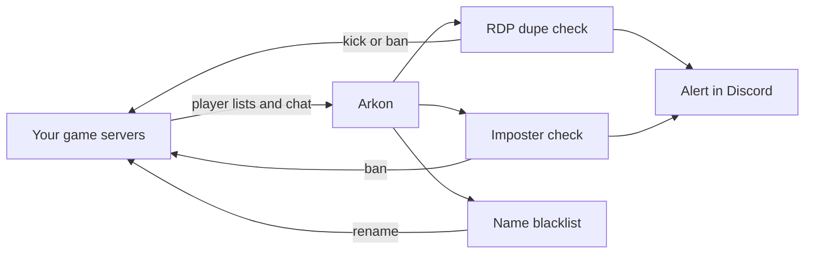
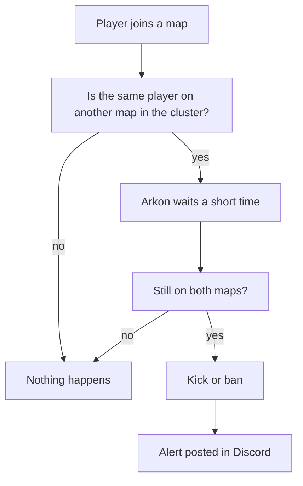
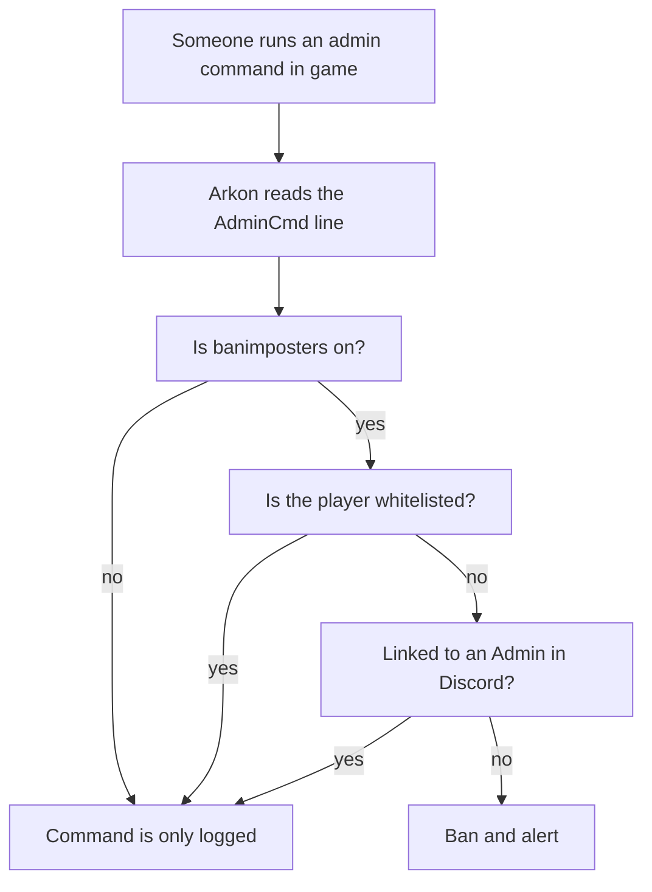

# Security: RDP Dupes, Imposters and Name Blacklist

Arkon can watch your Ark servers for cheating and punish it for you. It catches players who copy items by being on two maps at once, bans anyone who runs admin commands without being allowed to, and renames players with banned character names. All of it is free. It works the same on Free and Premium.

**You need:**

- Arkon in your Discord server with at least one server connected ([Getting started](/guides/getting-started)).
- Working RCON (the remote-control connection Arkon uses to send commands to your game server). See [RCON setup](/guides/rcon-setup).
- A cluster (a group of connected maps) set up in the `+viewservers` menu ([Server settings](/guides/server-settings)).

Some commands here are for Admins or Mods. Admin and Mod are Discord roles you tell Arkon about. See [Getting started](/guides/getting-started) to set them.

## The whole picture



Arkon reads who is online and what they type. If a rule is broken, Arkon acts in the game and posts an alert in Discord.

> All three protections are **off by default** (the name blacklist starts empty). Nothing happens until you turn them on.
{.is-info}

## Part 1: RDP dupe protection

An RDP dupe is a trick where one player is logged in on two maps of the same cluster at the same time to copy items. Arkon sees that and kicks or bans the player.

It works when a cluster has **at least 2 enabled servers**. It cannot catch anything with only one server in the cluster.

### Set it up

1. In any Discord channel the bot can see, turn detection on:

   ```
   +rdpdupe toggle
   ```
   You will see: `RDP dupe detection **Enabled**. Current action: kick.` followed by a hint on how to change the action.

2. (Optional) Pick what happens to a cheater. The default is `kick`. To ban instead:

   ```
   +rdpdupe action ban
   ```
   You will see: `RDP dupe enforcement action set to **ban**`

3. Pick the channel for alerts:

   ```
   +rdpdupe channel #security-alerts
   ```
   You will see: `RDP dupe alerts will be sent to #security-alerts.`

4. (Optional) Add your own game ID to the whitelist so testing never gets you kicked:

   ```
   +rdpdupe whitelist 76561198000000001
   ```
   You will see: `76561198000000001 added to the RDP dupe whitelist`

5. **Check it worked.** Run `+rdpdupe view`. Detection should say Enabled, and your channel and whitelist should show.


When Arkon catches someone, this alert appears in your channel:


> The whitelist command is a **toggle**. Typing the same ID a second time removes it. Run `+rdpdupe view` to see what is on the list.
{.is-warning}

### How the check works



The wait stops false alarms when a player is just travelling between maps. Arkon alerts at most once per player every 15 minutes. Whitelisted players are skipped. Players reported as Xbox players are skipped too, because they cannot do this trick.

### RDP dupe commands

All of these are for **Mods and Admins**. `+rdp` works as a short name for `+rdpdupe`. The bot needs the Embed Links permission in the channel.

| Command | What it does | Example |
|---|---|---|
| `+rdpdupe view` | Shows detection, action, log channel and whitelist | `+rdpdupe view` |
| `+rdpdupe toggle` | Turns detection on or off. Default: off | `+rdpdupe toggle` |
| `+rdpdupe action <kick or ban>` | Chooses the punishment. Default: `kick` | `+rdpdupe action ban` |
| `+rdpdupe channel [channel]` | Sets the alert channel. Leave it blank to clear it. If none is set, alerts go to your main alert channel | `+rdpdupe channel #security-alerts` |
| `+rdpdupe whitelist <gameid>` | Adds an ID to the whitelist, or removes it if already there | `+rdpdupe whitelist 76561198000000001` |

A kick is sent to every enabled server in the cluster. A ban is sent through RCON and saved as a ban record.

## Part 2: Imposter protection

If someone learns your admin password, they can run admin commands in the game. Imposter protection bans them when they do.

Arkon reads the "AdminCmd" lines your server writes and checks who typed each one. A player is banned if any of these is true:

- They are not in Arkon's player list.
- They have no Discord account linked.
- Their linked Discord account is not in your Discord server.
- Your server has Admin roles and they have none of them.
- The command is on your command blacklist (see "Forbidden admin commands" below).

Players on the imposter whitelist are never banned.



> Turn this on **last**, after steps 1 and 2 below. If your admins have not linked their game accounts to Discord, the first admin who runs a command gets banned, including you.
{.is-danger}

### Set it up

1. Make sure every admin has linked their game character to Discord. See [Player registration](/guides/player-registration).

2. Whitelist yourself. Type this in any channel the bot can see (you must be an Admin):

   ```
   +arkset imposterwhitelist 76561198000000001
   ```
   You will see: `76561198000000001 has been added to the whitelist`

3. Make sure your cluster has an admin log channel, so you see the alerts. Set it in the `+viewservers` menu ([Server settings](/guides/server-settings)).

4. Turn protection on:

   ```
   +arkset banimposters
   ```
   You will see: `Auto-banning of unauthorized player admin commands **Enabled**`

5. **Check it worked.** Run `+arkset view`. It shows the imposter ban status and the whitelist.

When Arkon bans an imposter, it posts this alert and pings your Admin roles:


The ban happens in the game. It does not ban the person from your Discord server.

If protection is off, or the player is allowed, Arkon still copies each admin command into your cluster's admin log channel as plain text, starting with the chat channel it came from. So you always have a record of who ran what.

### Forbidden admin commands

You can also ban anyone who runs one particular admin command, even a real admin. This is the command blacklist. Only the first word of the command is compared, so `DestroyAll` matches `DestroyAll Raptor`. Imposter protection must be on for it to ban.

Type this (you must be an Admin):

```
+arkset commandblacklist destroyall
```
You will see: `destroyall has been added to the blacklist`

Run the same command again to remove it. You will see: `destroyall has been removed from the blacklist`. `+arkset view` lists them as "CMD Blacklist".

### Imposter commands

These are for **Admins**.

| Command | What it does | Default |
|---|---|---|
| `+arkset banimposters` | Turns imposter banning on or off | Off |
| `+arkset imposterwhitelist <player_id>` | Adds a game ID to the safe list, or removes it if already there | Empty |
| `+arkset commandblacklist <command>` | Adds an admin command that gets the player banned, or removes it if already there | Empty |

> `imposterwhitelist` is a toggle. Typing the same ID twice removes it. A mistyped ID is accepted and does nothing, so double-check it.
{.is-warning}

## Part 3: Character name blacklist

This keeps rude or fake character names out of your game. When a player chats with a blacklisted character name, Arkon renames them in the game and announces it in the game chat and in your Discord chat log (for example: `SurvivorSam has been renamed to Brave Rex since that name is blacklisted`). It also blocks them from using the in-game `rename` command to pick a blacklisted name. The player is told: `<player>, that name is blacklisted!`. It does not ban or kick.

The match is close to exact. A blacklisted name matches the same name in any capital letters, but it does **not** match a name that merely contains it.

### Set it up

1. Add a name. Type this in any channel the bot can see (you must be an Admin):

   ```
   +arkset characternameblacklist Admin
   ```
   You will see: `admin has been added to the blacklist`

   Names can have spaces, for example `+arkset characternameblacklist Server Owner`. Other names for the command: `charnameblacklist`, `charbl`, `badname`.

2. To remove a name, run the exact same command again. You will see: `admin has been removed from the blacklist`

3. **Check it worked.** Run `+arkset view`. The names appear under "Name Blacklist".

## Part 4: Get a list of player IPs 🔹

`+getips` sends you a file with the IP address (the number that identifies a player's internet connection) of each player. Use it to spot players who share an address. It needs [ArkView](/guides/arkview) set up on your servers. It is for **Admins**.

1. Type this in a Discord channel the bot can see:

   ```
   +getips
   ```
2. Arkon asks each ArkView server for its players. This can take a while.
3. **Check it worked.** Arkon replies with a file called `player_ips.json`. Each entry looks like `"76561198000000001": ["SurvivorSam", "203.0.113.5"]`.

If a player has different IPs on different servers, the IPs are joined in one entry. Servers that do not answer are skipped. The bot needs the Embed Links and Attach Files permissions. You can use it once every 3 seconds.

## Common problems

| Problem | Why it happens | Fix |
|---|---|---|
| Nothing is detected for RDP dupes | Detection is off, or the cluster has only one enabled server | Run `+rdpdupe view`. Turn it on and make sure 2 or more servers in the cluster are enabled |
| A whitelist ID stopped working | The whitelist commands are toggles, so a second run removed it | Run `+rdpdupe view` or `+arkset view`, then add it again |
| Admins keep getting banned as imposters | Their game account is not linked, they left the Discord server, or they have no Admin role | Link their account and give them the Admin role, or add their ID to `+arkset imposterwhitelist`. Then unban them |
| Action must be kick or ban | You typed something else for `+rdpdupe action` | Use `+rdpdupe action kick` or `+rdpdupe action ban` |
| `Please provide a gameid` | You left the ID off `+rdpdupe whitelist` | Add the ID after the command |
| A blacklisted name was not renamed | Only a near-exact match counts | Add the exact name the player uses |
| `There are no servers with an ArkView port set!` | ArkView is not set up | Follow [ArkView setup](/guides/arkview) |
| `No player IPs found!` | ArkView returned no IPs | Check ArkView is running and try again |
| `Failed to initialize database. Bot developer has been notified.` | Arkon's database is briefly down | Wait a minute and try again |

## Related pages

- [Moderation](/guides/moderation): bans, temp bans, notes and the watchlist
- [Anti-cheat](/guides/anti-cheat): tame dupes, mass breeding and foreign tames
- [Player registration](/guides/player-registration): link Discord to game characters
- [Server settings](/guides/server-settings): clusters and the admin log channel
- [ArkView setup](/guides/arkview)
- [Admin commands](/commands/admin-commands)
