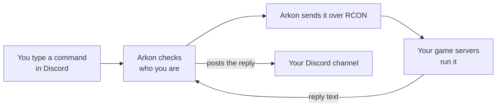
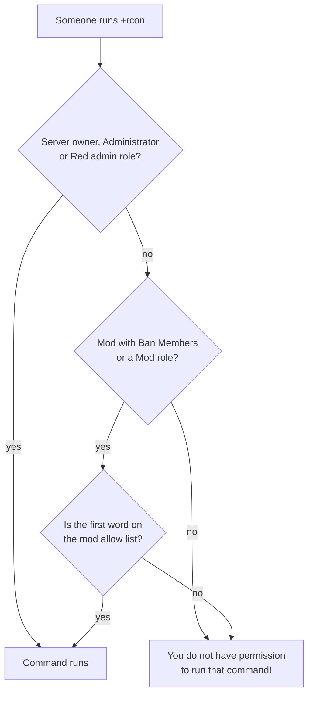
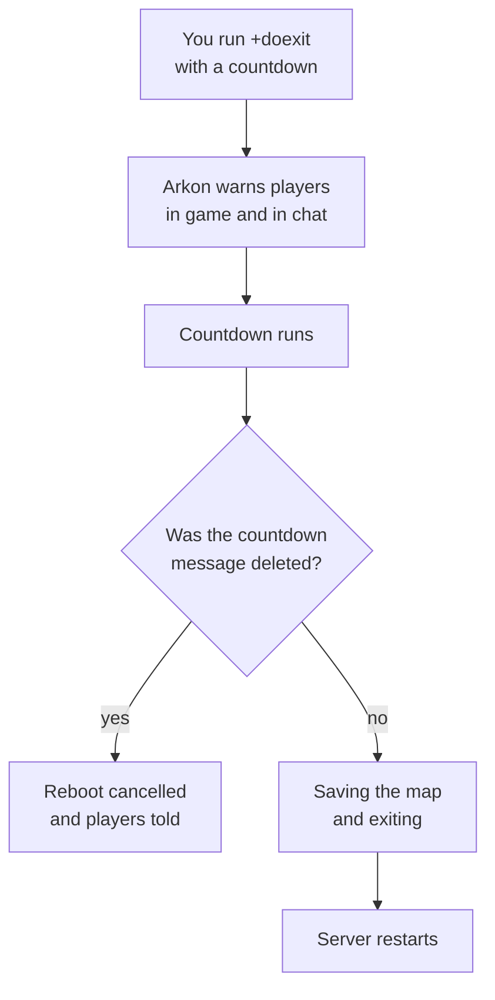

# Server Control: RCON Commands, Schedules and Restarts

Arkon lets you run admin commands on your Ark servers from Discord, so you never have to log into the game or the host panel. You can run a command once, run it on a timer, restart a server with a warning for your players, and hand out items for events.

**You need:**

- Arkon in your server with at least one game server connected. See [Getting Started](/guides/getting-started).
- RCON (the remote-control connection Arkon uses to send commands to your game server) working. See [RCON Setup](/guides/rcon-setup).
- Your Admin and Mod roles set. See [Getting Started](/guides/getting-started).

Words used on this page:

- **Cluster**: a group of connected maps, like "My Cluster".
- **Server**: one map, like "The Island".
- **Admin**: the server owner, anyone with a Red admin role, or anyone with the Discord permission Manage Server.
- **Mod**: anyone with a Red moderator role, or the Discord permission Manage Messages.
- Default prefix is `+`. Syntax like `+command <required> [optional]` means: type the `<required>` parts, and the `[optional]` parts are not needed.

## The big picture



## Run a command with +rcon

`+rcon` sends one command to one map, one cluster, or every map at once. Also works as `/rcon`. The short name `+run` does the same thing.

1. Go to any Discord channel that Arkon can see and where you are allowed to type.
2. Type the command with a cluster, a server, and the RCON command. Put names with spaces in quotes.

```
+rcon "My Cluster" "The Island" ListPlayers
```

3. Arkon first says `Running... ` followed by your command. Then it posts the answer in a code block, with `Elapsed time:` and the milliseconds at the bottom of the block.


4. **Check it worked:** you see a green check mark and the map name above the reply text. A `⚠️` means a partial or error reply. A `❌` with `No Response!` means that map did not answer.

To run on everything, use `all` for the cluster, the server, or both:

```
+rcon all all SaveWorld
```

> `all` skips servers that are turned off. Servers that are turned off can only be reached by naming one cluster and one server, and only on Premium.
{.is-info}

Things to know:

- Do not type `cheat` before the command. RCON commands are written plain, like `ListPlayers`.
- Arkon waits up to 60 seconds for each server to answer. Long replies are split into several messages.
- In the slash version, Arkon suggests commands you used recently. These suggestions reset when the bot restarts.
- For a list of commands you can send, see [Ark RCON Commands](/guides/ark-rcon-commands).

> For restarts, use `+doexit` or `+dorestartlevel` (below), not `+rcon DoExit`. Plain `rcon` skips the countdown and the warnings to your players.
{.is-warning}

### Who may run +rcon

Server owners, people with the Discord Administrator permission, and people with a Red admin role can run everything. Mods can only run commands you allow for them (see [Let mods run commands](#let-mods-run-commands)).



> Having only the Discord permission Manage Messages or Manage Server is not enough for `+rcon`, `+doexit` or `+dorestartlevel`. A person who is not the server owner, an Administrator or a Red admin role holder also needs the Ban Members permission or a Red moderator role, plus the command on the allow list.
{.is-warning}

## Restart a server safely with a countdown

`+doexit` and `+dorestartlevel` warn your players, count down, and then restart. Both also work as slash commands.

| Command | What it does |
|---|---|
| `+doexit <cluster> <server> [countdown]` | Counts down, then fully shuts the game server down (Arkon sends the RCON command `doexit`). Your host or restart script must start it again. |
| `+dorestartlevel <cluster> <server> [countdown]` | Counts down, then restarts the map without shutting down the whole program (RCON command `dorestartlevel`). |

Both use the same permissions as `+rcon`: Admins always, Mods only if `doexit` or `dorestartlevel` is on the allow list.

1. In a Discord channel Arkon can see, type the command. The countdown is optional. Examples that work: `30s`, `1m`, `1m30s`, `5m`.

```
+doexit "My Cluster" "The Island" 5m
```

2. Arkon posts `Rebooting` with a live timer. In the game, players see a red message `SERVER REBOOT IN` with the time, and Arkon sends `Reboot in` chat lines about every 10 seconds, then every second at the end.
3. Arkon posts an orange `INCOMING REBOOT` message in each server's chat channel.


4. At zero, Arkon says `Saving the map and exiting...` in game, waits 3 seconds, and sends the command.
5. **Check it worked:** the Discord message changes to `Reboot for ... complete!`.



> To cancel a countdown, delete the countdown message Arkon posted. Players are told `Server reboot has been cancelled!`. This is the only way to cancel.
{.is-info}

> If you do not type a countdown, or Arkon cannot read what you typed (like `abc`), it uses your saved default. The default is 30 seconds. Arkon does not send its own `SaveWorld` before the exit, so run `+rcon "My Cluster" "The Island" SaveWorld` first if you want an extra save.
{.is-warning}

You can use `all` for the cluster or server to restart many maps at once.

### Change the default countdown

`+arkset countdown <seconds>`: Admin. Sets how long the countdown lasts when you do not type one.

```
+arkset countdown 60
```

Arkon replies `Countdown set!`. The default is 30 seconds.

## Let mods run commands

`+arkset modcommands <command>`: Admin. Adds a command to the list mods may run. Run the same thing again to remove it. Short name: `+arkset modcmd`.

```
+arkset modcommands listplayers
```

Arkon replies with the command in backticks and `has been added to the allow list`, or `has been removed from the allow list`.

- Only the **first word** counts. Type `broadcast`, not `broadcast hello`.
- Useful words: `listplayers`, `broadcast`, `doexit`, `dorestartlevel`.
- Admins never need this list.
- The list shows in `+arkset view` as `Mod Commands:`.

## Block in-game admin commands (commandblacklist)

`+arkset commandblacklist <command>`: Admin. This is a different list from the one above, and it is not about Discord.

It only does something if Anti-Nuke is on (`+arkset banimposters`). When it is on, anyone who types a blacklisted command in the game chat is banned on all your servers of the same game version (ASA or ASE), even if they were an admin.

```
+arkset commandblacklist destroyall
```

Arkon replies `has been added to the blacklist`, or `has been removed from the blacklist` when you run it again. It does **not** stop anyone from using `+rcon` in Discord.

## Colored admin command log (ansicolors)

`+arkset ansicolors`: Admin. Turns colors on or off. Short name: `+arkset ansi`. Default is off. Arkon replies `ANSI colors **Enabled**` or `ANSI colors **Disabled**`.

It only changes the lines Arkon posts in your admin log channel when someone runs an admin command in the game. Each line reads like `SurvivorSam (ID 76561198000000001, Implant 123456789): DestroyWildDinos`. With it on, the command is yellow, the player name red, the implant number (the player's specimen number) blue, and the game ID cyan. It does not color the replies from `+rcon`.

> Discord shows these colors on the desktop app and website. They may not show on phones.
{.is-info}

## Run commands on a timer (scheduledrcon)

`+scheduledrcon [query]`: Admin. Opens a menu where you make commands that run by themselves, like a nightly wild dino wipe. Arkon needs the Embed Links permission in the channel.

- `query` is optional. Type part of a name to show only matching schedules, like `+scheduledrcon restart`.
- Only the person who opened the menu can press its buttons (others see `This isn't your menu!`). The menu closes itself after 15 minutes.
- Free servers can have **3** schedules. Premium can have **20** (see [Premium](/guides/premium)).

### Make a schedule

1. In a channel Arkon can see, type `+scheduledrcon`.


2. Press the green `➕` button. A form opens.


3. Fill it in. Example values:

| Field | What to type | Example |
|---|---|---|
| Scheduled Command Name | Any name you will recognize (max 45 characters) | `Nightly Wild Dino Wipe` |
| Target Server | A map name, or `all` | `The Island` |
| Target Cluster | A cluster name, or `all` | `My Cluster` |
| Channel ID (Optional) | The ID of a channel where Arkon posts the output | `123456789012345678` |
| Command | The RCON command, up to 490 characters, without `cheat` | `DestroyWildDinos` |

4. Arkon saves it **turned off** and says `Scheduled command added, please configure it before enabling!`.
5. Set when it runs (next section).
6. Press the red `Off` button. It turns green and reads `On`.
7. **Check it worked:** the `Runtime Info` section lists `Next 3 runtimes`. After it runs, `Last run` shows a time. If you set a channel, the output appears there. To test right now, press `⏯️`.

### What a schedule posts

- Each time it runs, Arkon posts `Running...` and your command, then the server replies in a code block, in the channel you chose. If you left the channel blank, the command still runs but nothing is posted.
- A long reply is split into several messages. A very long reply (over about 5,850 characters) comes as a file named `scheduled_command.txt` instead, if Arkon has the Attach Files permission.
- The `Last run` time updates after every run.

### Set when it runs

Pick one of these buttons. Do not mix interval and cron.

| Button | What it does | Example |
|---|---|---|
| `Interval` | Runs every N units. Units that work: `seconds`, `minutes`, `hours`, `days`, `weeks`. | Interval `6`, Units `hours` |
| `Cron` | Runs at clock times. Boxes: Hour, Minute, Second. Use a number, `*` for every, or `*/2` for every second one. | Hour `4`, Minute `30`, Second `0` runs at 4:30 each day |
| `Advanced` | Limits by Days of Week (`mon`, `tue`), Days of Month (`1`, `2-14`, `last`) and Months of Year. | Days of Week `mon` |
| `Times` | Start Date, End Date, and a daily window (Between Time Start and End, as `HH:MM`). | Start `10/20/2026 17:00` |

- Times use your server's time zone. Set it with `+arkset timezone`. The default is UTC.
- The cron boxes are tricky. For help, press `❓` in the menu. It links to crontab.guru, a website that explains cron.
- If you set nothing, the schedule runs at the start of every hour.
- `months` and `years` are accepted by the form but do not work. Use `days` or `weeks` instead.
- The daily window (Between Time) only works with `minutes` or `hours` intervals.

> A schedule cannot run more often than every 5 minutes. Arkon refuses to turn it on with `Scheduled command is not safe to enable, please configure it first.`
{.is-warning}

### Other menu buttons

| Button | What it does |
|---|---|
| `⏪` `⬅️` `➡️` `⏩` | Move between schedules (one page each). |
| `✖️` | Close the menu. |
| `🗑️` | Delete the schedule. Type `yes` (or `y`) to confirm. Anything else says `Cancelled.` |
| `🔍` | Search by name, ID, server, cluster, command or channel. Type a number to jump to that page. Leave it empty to clear the search. |
| `Configure` | Edit the five fields you filled in at the start. |
| `🪄` | AI helper: type "run every 5 minutes" and it fills the timing for you. It only shows if the bot has it set up. It overwrites your timing boxes, and it sends your sentence to an outside AI text service to work out the timing. |
| `⏯️` | Run it right now and show the result only to you. It also posts to the schedule's channel, if one is set. If nothing comes back you see `Scheduled command returned no results or did not run successfully.` |

### When Arkon turns a schedule off

Arkon switches the schedule to Off and posts an alert in your alert channel if the items below happen. Set that channel with `+arkset alertchannel #alerts` (Admin). If you have not set one, the alert goes to your event log channel instead.

The alert comes with the schedule's details so you can see which one it was. Arkon turns it off if:

- No server matches the name (`A scheduled command was disabled because the target server was not found.`).
- It would run more than once per 5 minutes.
- The output channel is a forum, category or DM (`A scheduled command was disabled because the target channel is not supported.`).
- Arkon cannot send messages in the channel (`A scheduled command was disabled because i'm missing permissions to send to the target channel.`). Fix the permission, or remove the channel.

If something else goes wrong during a run, Arkon posts `An error occured while running a scheduled command` with the error, and the schedule stays on.

Scheduled commands run exactly what an Admin saved. The mod allow list does not apply to them.

## Bulk item sends

Both commands give a player an item many times. They need the player's **implant** (the player's specimen number).

### /bulksend (slash)

`/bulksend <cluster> <server> <implant> <item> <amount> <runcount> [quality] [blueprint]`

Who: needs the Discord permission Kick Members **and** a Red admin role.

| Value | Meaning | Example |
|---|---|---|
| `cluster`, `server` | Where the player is. `all` is not allowed. | `My Cluster`, `The Island` |
| `implant` | The player's specimen number (suggestions appear as you type). | `123456789` |
| `item` | Pick from the suggestions. It must match exactly. | `Polymer` |
| `amount` | How many items each time. | `100` |
| `runcount` | How many times to send, at least 1. | `10` |
| `quality` | Item quality. Default 0. | `0` |
| `blueprint` | `true` to send a blueprint. Default false. | `false` |

Arkon first says `Bulk sending` with the item, implant and map in backticks, then `Items sent!` when done. Errors (only you see them): `You cannot use \`all\` for cluster or server!`, `Run count must be at least 1!`, `Invalid item!`, `No servers found!`.

### +bulksend (prefix)

`+bulksend <cluster> <server> <implant> <count> <blueprint_string>`

Who: Admin only. `<blueprint_string>` is the item path, amount, quality and blueprint flag, all in one piece:

```
+bulksend "My Cluster" "The Island" 123456789 10 "Blueprint'/Game/PrimalEarth/CoreBlueprints/Resources/PrimalItemResource_Polymer.PrimalItemResource_Polymer'" 100 0 0
```

Arkon replies with the implant and server name in backticks. It does not say when it is done. `all` is accepted but only the first server it finds is used.

## Send items from an Excel sheet (excelsend)

`+excelsend`: Admin. Short name: `+xlsend`. Sends a whole list of items to **yourself** in the game. Good for building a test base.

1. Make an Excel file (`.xlsx`) with **two columns** and a header row. The first row must be the titles, or that row is lost.

| command | amount |
|---|---|
| `"Blueprint'/Game/PrimalEarth/CoreBlueprints/Resources/PrimalItemResource_Element.PrimalItemResource_Element'" 5 0 0` | 1 |

The `command` cell is the item path, then amount, quality and blueprint flag (0 or 1). The `amount` cell is how many times to send that row. Fill every `amount` cell with a whole number.

2. Be online on the server and have your profile registered. See [Player Registration](/guides/player-registration). Wait a couple of minutes after joining.
3. In a Discord channel, type `+excelsend` and attach the file to the same message (or reply to a message that has the file).
4. Arkon shows progress: `Reading the Excel file...`, `Finding you on the servers...`, and so on.
5. **Check it worked:** `All commands were sent successfully on ... to ...`. If some failed you get `Some commands failed. Check the file below for more info.` with `failed_commands.txt` listing each one.

| Problem | Fix |
|---|---|
| `File must be a \`.xlsx\` file.` | Save the sheet as .xlsx. |
| `File size is too large. Max size is 2MB.` | Split the list into smaller files. |
| `Excel file must have two columns, \`command\` and \`amount\`.` | Use exactly two columns. |
| `You have not registered your profile yet!` | Register first. |
| `I can't find you on any of the servers! If you're currently in-game, wait a couple minutes and try again.` | Join the server and wait. |

## Event helpers

### clearall

`+clearall <cluster> <server> [inventory=true] [hotbar=true] [equipped=true]`: Admin or Mod with Manage Server (also `/clearall`). Clears items from every player on one map. Admins are skipped. Arkon needs the Attach Files permission.

```
+clearall "My Cluster" "The Island"
+clearall "My Cluster" "The Island" true false false
```

The second example clears only inventory. Arkon replies `<N> players had their inventory cleared on ...` and attaches `cleared_inventories.txt` listing each player. Players with no known implant are marked `No implant found`. The number means commands were sent, not confirmed.

### equipall

`+equipall <cluster> <server>` with an `.xlsx` file attached: same permission as `clearall`. It gives every non-admin player on the map the items in your sheet. The sheet has the same two columns as `excelsend`.

```
+equipall "My Cluster" "The Island"
```

Arkon replies `Sent <N> commands to <P> players on ...` with `equipped_players.txt`.

> Keep every `amount` at 1 and use one row per copy. An amount over 1 creates broken commands.
{.is-danger}

Use the prefix version with the file attached. `all` is not allowed for cluster or server. Errors include `That server is offline.` and `No players found on that server.`.

### dummywall and dummyfloor

`+dummywall <width> <height>` and `+dummyfloor <width> <depth>`: Admin. They print text for building loadout dummies (display mannequins that hold gear) in a grid. Arkon sends nothing to your server: you copy the text and paste it into the in-game console yourself.

```
+dummywall 4 3
```

Long results come as a file named `dummywall.txt`. Keep the numbers small, since a huge grid makes a huge file.

## Poll and reaction helpers

### pollvotetime

`+pollvotetime <message> [cluster] [use_maptime=false]`: Mod with Manage Server, or Admin. For a Discord poll, adds up the game hours of the people who voted for each answer. Arkon needs Embed Links.

```
+pollvotetime https://discord.com/channels/111/222/333 "My Cluster" true
```

- `message`: the poll message link or ID.
- `cluster`: only count players on that cluster.
- `use_maptime`: `true` counts only hours this wipe.

Result lines look like `• Option A: 120 hours`. Voters who have not linked their Discord to a character count as 0. Errors: `That message is not a poll!`, `No voters found!`.

### pollvotefilter

`+pollvotefilter <message> <cluster_name> [this_wipe=false]`: same permission. Counts how many voters play on a given cluster, per answer. `this_wipe` also requires them to have played this wipe. Lines look like `• Option A: 14 votes`. Extra error: `I could not find a cluster with that name!`.

### remreacts

`+remreacts <message> [min_playtime=0] [min_joined=0] [min_age=0]`: Admin. Removes reactions from people who do not qualify. A reaction is removed if the person:

- left the Discord,
- joined less than `min_joined` hours ago,
- has an account younger than `min_age` hours,
- or has less than `min_playtime` game hours (people not linked to a character count as 0).

Bots, the message author and the server owner are never removed.

```
+remreacts https://discord.com/channels/111/222/333 10 24 168
```

Arkon replies `Removed <N> reactions` with `removed_reactions.txt`. Someone who reacted with two emojis counts twice.

## unhex

`+unhex <text>`: Mod. Turns hex (a code like `48656c6c6f`) back into readable text. Use it when a player name in logs shows as hex.

```
+unhex 48656c6c6f
```

Arkon posts `Hello`. Errors: `Failed to decode hex string: ...` and `Decoded string is too long to send!`.

## Command summary

| Command | Who | What it does |
|---|---|---|
| `+rcon <cluster> <server> <command>` | Admin, or Mod with allow list | Run one command. Also `/rcon`. |
| `+scheduledrcon [query]` | Admin | Menu for timed commands. |
| `+doexit <cluster> <server> [countdown]` | Admin, or Mod with allow list | Countdown then shut down. Also `/doexit`. |
| `+dorestartlevel <cluster> <server> [countdown]` | Admin, or Mod with allow list | Countdown then restart map. Also `/dorestartlevel`. |
| `+arkset countdown <seconds>` | Admin | Default countdown. Default 30. |
| `+arkset modcommands <command>` | Admin | Allow list for mods. |
| `+arkset commandblacklist <command>` | Admin | In-game auto-ban list (needs Anti-Nuke). |
| `+arkset ansicolors` | Admin | Colors in the admin command log. Default off. |
| `/bulksend ...` and `+bulksend ...` | Admin (slash also needs Kick Members) | Send an item many times. |
| `+excelsend` | Admin | Send a sheet of items to yourself. |
| `+clearall <cluster> <server>` | Mod with Manage Server, or Admin | Clear all players' items. |
| `+equipall <cluster> <server>` | Mod with Manage Server, or Admin | Give a sheet of items to all players. |
| `+dummywall <width> <height>` | Admin | Print dummy wall spawn text. |
| `+dummyfloor <width> <depth>` | Admin | Print dummy floor spawn text. |
| `+pollvotetime <message>` | Mod with Manage Server, or Admin | Hours played by poll voters. |
| `+pollvotefilter <message> <cluster_name>` | Mod with Manage Server, or Admin | Votes from one cluster. |
| `+remreacts <message>` | Admin | Remove reactions by rules. |
| `+unhex <text>` | Mod | Decode hex text. |

## Common problems

| Problem | Why it happens | Fix |
|---|---|---|
| `You do not have permission to run that command!` | You are a Mod, and the first word of the command is not on the allow list, or you lack Ban Members or a Mod role. | An Admin runs `+arkset modcommands <first word>`. |
| `No servers found with those criteria` | The cluster or server name is wrong, or the server is turned off. | Check names with `+viewservers`. See [Server Settings](/guides/server-settings). |
| `No Response!` or a `❌` | The server did not answer in 60 seconds. | Check RCON. See [RCON Setup](/guides/rcon-setup). |
| `No response!` | No server returned anything. | Same as above. |
| `You cannot use \`all\` for cluster or server!` | `/bulksend`, `clearall` and `equipall` need a real cluster and server. | Type the names. |
| Schedule will not turn on | It runs more often than every 5 minutes. | Make the interval 5 minutes or more. |
| `You have reached the maximum number of schedules for the free tier.` | Free servers get 3 schedules. | Delete one or see [Premium](/guides/premium). |
| `You don't need to include \`cheat\` when using Rcon commands!` | The command starts with `cheat`. | Remove `cheat`. |
| `This isn't your menu!` | Someone else opened it. | Run `+scheduledrcon` yourself. |
| `No servers matching ... for cluster and ... for server.` | The cluster or server name in the schedule form is wrong. | Check the names with `+viewservers`, then try again. |
| `Channel ID must be a number.` or `Channel for that ID was not found.` | The channel ID is not a plain number, or Arkon cannot see that channel. | Copy the ID again (Discord Developer Mode, right-click the channel, Copy ID). |
| `Interval must be a number.` or `Units must be one of [...]` | The Interval form got text where it wanted a number, or an unknown unit. | Use a number, and a unit from the list above. |
| `Hour expression is invalid!` (also Minute, Second, Days of week, Days of month, Months of year) | The timing text is not valid cron. | Press `❓` for examples. |
| `You have reached the maximum number of schedules.` | You are at 20 schedules (Premium). | Delete one you no longer use. |
| `That message is not a poll!` | The message is not a real Discord poll. | Use a native Discord poll. |

## Related pages

- [Getting Started](/guides/getting-started)
- [RCON Setup](/guides/rcon-setup)
- [Server Settings](/guides/server-settings)
- [Ark RCON Commands](/guides/ark-rcon-commands)
- [Moderation](/guides/moderation)
- [Security](/guides/security)
- [Premium](/guides/premium)
- [Admin Commands](/commands/admin-commands)
- [Mod Commands](/commands/mod-commands)
- [Quick Reference](/guides/quick-reference)
