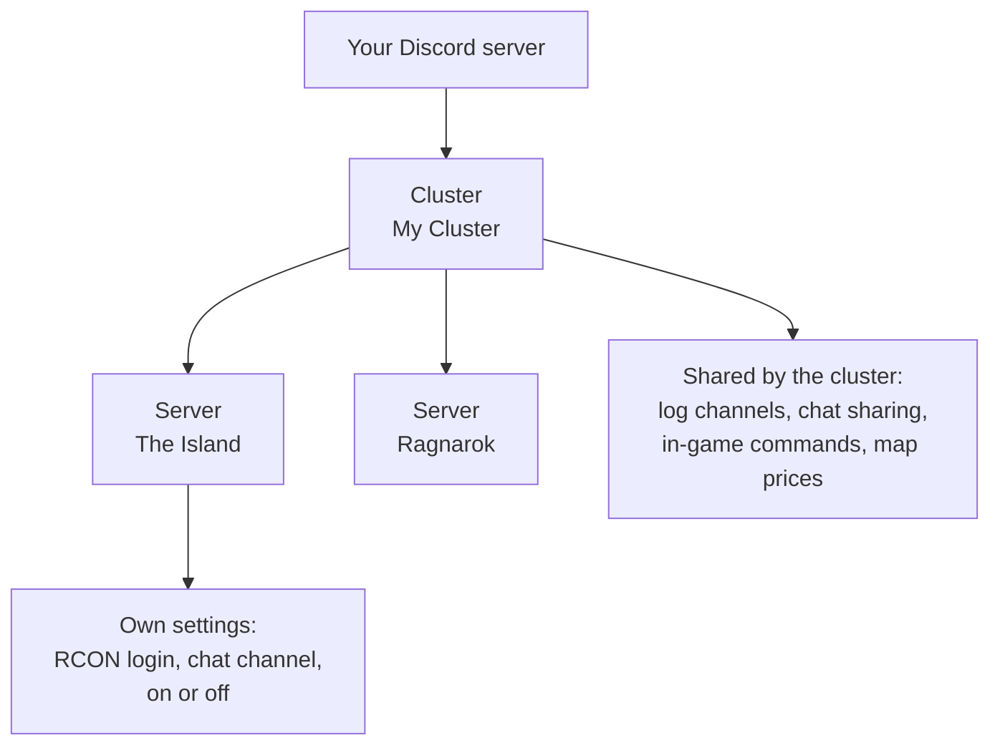
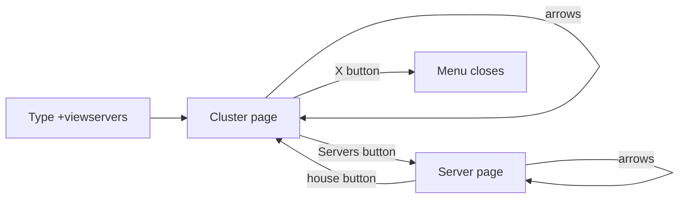
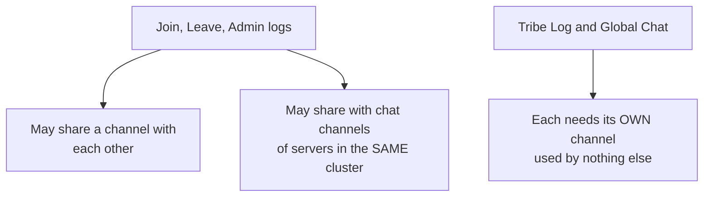
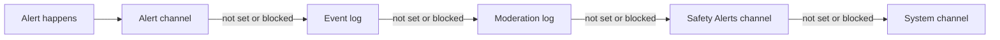

# Server Settings: Clusters, Servers and Bot Settings

This page shows you how to change how Arkon treats your Ark servers and your Discord. Almost everything lives in one menu (`+viewservers`) and one command family (`+arkset`).

**You need:**

- Arkon invited to your Discord, with you set up as an Admin ([Getting Started](/guides/getting-started)).
- At least one server already connected, or follow the steps below to add one. You need your RCON details first ([RCON Setup](/guides/rcon-setup)).

**Who can use what:** Most commands here need the **Manage Server** permission in Discord, or the Admin role you gave Arkon. A few need the **Server owner** (the person who owns the Discord server). Each command below says which.

## The big picture: clusters and servers

A **server** is one Ark map, like "The Island". A **cluster** is a named group of servers. Think of a cluster as a folder, and each server as a file in the folder.

You must make at least one cluster before you can add a server, even if you only have one server.

The cluster holds the shared things: log channels, chat sharing between maps, in-game command switches and map tool prices. The server holds its own connection details (RCON), its own chat channel and its own on/off switch.



You can have up to 25 clusters and 100 servers in one Discord server. The free version of Arkon allows fewer servers; see [Free vs Premium](/guides/premium).

## Add your first cluster and server

1. In any Discord channel Arkon can see, type your cluster name.

   ```
   +addcluster mycluster
   ```

   Use only letters and numbers. Arkon makes the name lowercase. You will see: **mycluster** cluster created!

2. In the same channel, add a server to that cluster. Type the cluster name exactly as shown in step 1 (lowercase).

   ```
   +addserver mycluster
   ```

   You will see a green message titled "Set the connection info for your server" with two buttons.

3. Press **Set Connection Info**. A popup form opens. Fill it in:
   - **Server Name**: `The Island`
   - **Host IP**: your server's public IP address, for example `203.0.113.10`
   - **RCON Port**: for example `27020`. This is NOT the query port or the game port.
   - **Admin Password**: the admin password, NOT the password players use to join.
   - **Crosschat Channel** (optional): the Discord channel where in-game chat should show up.

   Not sure where to find these? See [RCON Setup](/guides/rcon-setup).

   

4. Press **Test & Save!**. Arkon tries to connect to your server.

5. Check it worked: you see a message titled "Success!" saying "Server named **The Island** has been added!".

If you see a red "Failed to connect!" message instead, read the reason and the checklist under it, fix the problem, then press **Test & Save!** again. Common reasons are in the Common problems table at the bottom.

> Name rules: `+addcluster` allows letters and numbers only. Names typed into popup forms may also use spaces, hyphens and underscores.
{.is-info}

## The +viewservers menu

`+viewservers` opens one message with buttons. You use it to change nearly every setting for your clusters and servers.

- **Who can run it:** Admin (Manage Server).
- **Syntax:** `+viewservers`
- Only the person who ran the command can press the buttons. Anyone else sees "This isn't your menu!".
- The menu closes its buttons by itself after 15 minutes. Just run the command again.
- If you have no clusters yet, Arkon tells you to make one with `+addcluster`.

The menu has two levels. First you see a **cluster page**. Press **Servers** to go down to the **server page**. Press the house button to go back up.



### The cluster page


The top shows the cluster's current settings: how many servers it has, the sort order, the five log channels, whether Interchat and Crosschat are on, the tame limit (only if you set one), and which commands moderators may use. Below that are boxes for Kit, Imstuck and Payday settings, MapView prices and cooldowns, and the Rename command.

The footer shows "Page 1/1". If you have more than one cluster, the arrows flip between them.

| Button | What it does |
|---|---|
| Left arrow, right arrow | Show the previous or next cluster. |
| X | Closes the menu and deletes the message. |
| **Logs** | Opens a form to pick the five log channels (see below). What each log posts: [Chat and Logs](/guides/chat-and-logs) and [Tribe Logs](/guides/tribe-logs). |
| **Rename** (first one) | Renames the cluster. Spaces and capital letters are allowed here. |
| **Servers** | Goes to the server page. If the cluster has no servers you see "This cluster has no servers added to it!". |
| **MapView Prices** | 🔹 Sets what players pay each time they use the map commands Hunt, Find, FindTame and Playerheat. Whole numbers, `0` means free. Admins are never charged. Needs [ArkView](/guides/arkview). What the commands do: [Map Tools](/guides/map-tools). |
| **MapView Cooldowns** | 🔹 Sets the wait time in seconds between uses of the same four map commands. `0` means no wait. See [Map Tools](/guides/map-tools). |
| **Interchat** | Switch. When on, in-game chat on one map is also sent to every other map in the cluster. Default: off. See [Chat and Logs](/guides/chat-and-logs). |
| **Crosschat** | Switch. When on, in-game chat is posted to Discord (the server's chat channel and the cluster's Global Chat channel). When off, in-game chat is not posted to Discord. Default: on. See [Chat and Logs](/guides/chat-and-logs). |
| **Sort Order** | Opens a popup with one field, "Sort Order", that only takes a whole number. Sets the order clusters appear in. Lower numbers come first. Default: 0. You see "Sort order has been updated to 2". A non-number gives "Sort order must be a number!". |
| **Kits**, **Imstuck**, **Paydays** | Switches that turn the in-game `!kit`, `!imstuck` and `!payday` commands on or off for this cluster. Default: all off. When off, players are told "This command is disabled!". Setup details (kit items, wait times, auto kits) are in [In-Game Commands](/guides/in-game-commands). |
| **Per-Server Kits** / **Per-Cluster Kits** | Switch. The label shows the current mode. Per-Server means each server gives its own kit claim. Per-Cluster means one claim for the whole cluster. See [In-Game Commands](/guides/in-game-commands). |
| **Rename** (second one) | Settings for the in-game rename command: a popup titled "Ingame Rename" with the fields "Enabled" and "Cooldown" (seconds). Default: off, 3600 seconds. The button turns green when it is on. How players use it is in the next section. |
| **Mod Access** | A popup with the fields "FindPlayer", "FindTribe" and "Structures". Type `True` or `False` in each. It lets non-admin moderators use those commands for this cluster. Default: all off. The commands are in [Map Tools](/guides/map-tools). The button is green when any of the three is on. |

### The in-game rename command

The second **Rename** button lets players change their own character name from inside the game, with no staff needed.

1. Press the second **Rename** button on the cluster page. The popup "Ingame Rename" opens.
2. In "Enabled" type `True`. In "Cooldown" type the wait in seconds, for example `3600` (one hour).
3. Press Submit. You see "Ingame rename has been enabled!".
4. A player types this in game chat: `!rename SurvivorSam` (`!rn` also works).

Arkon changes the character name on the server and plays a small sound for the player. If something stops it, it tells the player in chat:

| Message in game chat | Why |
|---|---|
| "you need to include the new name in the command!" | The player typed `!rename` with no name. |
| "You can rename yourself again in ..." | The wait has not passed. |
| "that is already your name!" | The new name matches the old one. |
| "that name is blacklisted!" | The name is on your name blacklist ([Security](/guides/security)). |
| "that name is already taken!" | Another player on that server already has that name. |
| "This command is disabled!" | Rename is switched off for this cluster. |

When rename is on, it also appears in the list the in-game help command shows. Other in-game commands: [In-Game Commands](/guides/in-game-commands).

> There are two buttons named **Rename** on the cluster page. The first one renames the cluster. The later one (next to the other switches) sets up the in-game rename command. Tell them apart by position.
{.is-warning}

> In popup forms that ask for True/False, type exactly `True` or `False`. Arkon reads any text containing the letter y, the letter t or the number 1 as "yes", so even a word like "not" counts as yes.
{.is-warning}

### Pick your log channels (the Logs button)

Press **Logs** to open a popup titled "Edit Cluster Logs". It has five channel pickers. Pick a text channel or a public thread for each. Leave one empty to turn it off.


| Picker | What gets sent there |
|---|---|
| Joinlog Channel | Player join events. |
| Leavelog Channel | Player leave events. |
| Adminlog Channel | In-game admin command events. |
| Tribelog Channel | All tribe events. See [Tribe Logs](/guides/tribe-logs). |
| Global Chat Channel | All server chat from every map in the cluster. |

**Channel sharing rules** (this is where most people get errors):



- Join, Leave and Admin logs can share one channel with each other, and with the chat channels of servers in the same cluster. They cannot use a channel that another cluster's logs use, or a chat channel from a server in a different cluster.
- Tribe Log and Global Chat must each have a channel of their own. No other log, server chat channel or cluster may use it.
- If one picker breaks a rule, the whole form is rejected and nothing is saved. You see an error such as "That tribelog channel is already in use by another log in this cluster!". Pick a different channel and try again.
- For the Tribe Log channel to receive anything, your Ark server needs the start options `servergamelogincludetribelogs` and `ServerRCONOutputTribeLogs`.

### The server page

Press **Servers** on the cluster page to see one server.


It shows when the server was last online, its chat channel, host IP, RCON port and the password (hidden as stars). Boxes below show the ArkView settings, the map vote settings, and two boxes that only show up when they apply. "Xbox Info" shows the host Gamertag and whether its sign-in tokens are set (🔸 see [Xbox and Microsoft Store Features](/guides/xsapi)). "Kit Claims" shows how many players have claimed a kit on this server ([In-Game Commands](/guides/in-game-commands)). The footer shows "Page 1/2" style numbers. The arrows flip between servers in this cluster.

The server page has no X button. Press the house button to go back to the cluster page, then use X there.

| Button | What it does |
|---|---|
| Left arrow, right arrow | Show the previous or next server. |
| House | Goes back to the cluster page. |
| Memo icon (📝) | Opens the "Edit Server" popup: server name, host IP, RCON port, admin password and chat channel. Only fields you change are saved. |
| **Enabled** (green) / **Disabled** (red) | Shows the current state. Press it to flip it. A disabled server is skipped by Arkon (no player checks, no chat relay) but nothing is deleted. |
| **ArkView** | 🔹 Popup "ArkView Connection Info" with "Host IP" and "Port" for this server's [ArkView](/guides/arkview). Leave both blank to clear. The port must be a number from 1 to 65535 (not your RCON port). Errors: "Port must be a number!", "Port must be between 1 and 65535!", "Invalid host!". Full setup: [ArkView Setup](/guides/arkview) (Nitrado ASA: [ArkView on Nitrado](/guides/arkview-nitrado)). |
| **ArkView Toggles** | 🔹 Popup with "Hunt", "Find", "FindTame" and "Playerheat". `True` or `False` for each, to allow or block that map command on this server. Default: all True. What the commands do: [Map Tools](/guides/map-tools). |
| **MapVotes** | Popup "Toggle Vote Commands" with "Voteday", "Votenight", "Votedinowipe" and "Votecleanup". `True` or `False` for each. Default: all on. This switches the in-game vote commands on or off for this server. Setup and how voting works: [In-Game Commands](/guides/in-game-commands). |
| **MapVote Cooldowns** | Popup "Set Cooldowns" with the same four votes. Type whole numbers of seconds. Default: 3600 each (one hour). A non-number gives "Cooldowns must be numbers!". How voting works: [In-Game Commands](/guides/in-game-commands). |
| **Sort Order** | Same popup as the cluster one, titled "Server Sort Order". Sets the order servers appear in. Lower numbers come first. |

To rename a server, use the memo button and change the "Server Name" field. The server page has no separate Rename button.

> The MapVotes and MapVote Cooldowns popups show hint text that looks swapped (one says "Seconds", the other says "T/F"). Ignore the hint. MapVotes takes True or False. MapVote Cooldowns takes seconds.
{.is-info}

> The Edit Server popup does not test the connection. Only `+addserver` does. If you save a wrong host or port, Arkon will turn the server off during its next check (it checks every 2 hours).
{.is-warning}

> Each server needs its own chat channel. Two servers cannot share one. A chat channel cannot be a cluster's Tribe Log or Global Chat channel. It can be the same as a Join, Leave or Admin log.
{.is-info}

### Free version limits on enabling servers

On the free version, you can only have so many servers turned on. If you press **Disabled** to enable a server and you are at the limit, you see: "You have reached the maximum number of enabled servers for the free tier!". [Arkon Premium](/guides/premium) raises the limit.

Arkon also turns servers off by itself if they have not been online for 30 days, or if their host or port is invalid. It posts a message in your alert channel (see `+arkset alertchannel`).

## What Arkon does by itself

These jobs run in the background. You do not start them. You change them with the settings on this page.

| How often | What happens | How to change it |
|---|---|---|
| Every 30 seconds | Arkon asks each enabled server who is online. This keeps "Last Online" fresh and works out whether a server is ASE or ASA. | Disable a server to stop it. |
| Every 10 minutes | 🔹 Tame limit check (see `+arkset uncryolimit`). | Set the limit to `0`. |
| Every 2 hours | Deletes player history older than your retention days. Turns off servers that have a bad host or port, or that were offline for 30 days. On the free version it also turns off servers over the free limit, newest first. | `+arkset retention`, fix the server details, or [Premium](/guides/premium). |

When Arkon turns servers off it posts in your alert channel and tags the Discord server owner. Over the free limit the message reads "The following servers have been disabled due to the free tier limit:" followed by the server names. Offline servers get "The following servers have been disabled because they've been inactive for 30 days:". After you fix the cause, turn the server back on from its server page.

If Arkon cannot reach a server's ArkView for 10 days in a row, it clears that server's ArkView host and port and posts "The ArkView connection for ... has been reset because it hasn't been able to connect for 10 days straight!" Enter the details again with the **ArkView** button.

## Other cluster and server commands

These are small helpers that go with the menu. All need Admin (Manage Server).

| Command | What it does | Example |
|---|---|---|
| `+addcluster <name>` | Makes a cluster. Letters and numbers only. | `+addcluster mycluster` |
| `+addserver <cluster_name>` | Starts the add-server buttons for that cluster. Use the lowercase cluster name. | `+addserver mycluster` |
| `+delcluster <cluster_name>` | Deletes a cluster, its servers, their player counts and their tribes. Asks no question first. Also works as `+remcluster`. | `+delcluster mycluster` |
| `+delserver <cluster_name> <server_name>` | Deletes one server. Asks no question first. Put quotes around names with spaces. Also works as `+remserver`. | `+delserver mycluster "The Island"` |

> `+delcluster` and `+delserver` delete right away with no "are you sure". Double check the name before you press Enter.
{.is-danger}

## General settings: +arkset

`+arkset` is the group of commands for settings that apply to your whole Discord server. Typing `+arkset` alone does nothing useful; add one of the words below. `+arktools` works the same way as `+arkset`.

**Who can run these:** Admin (Manage Server), unless the table says Server owner.

| Setting | What it does | Default | Command |
|---|---|---|---|
| Show all settings | Shows your current settings | n/a | `+arkset view` |
| Timezone | Times in schedules, graphs and stats | UTC | `+arkset timezone <timezone>` |
| Cluster type | How `+register` asks players to register | Both | `+arkset clustertype <xbox/steam/both>` |
| Alert channel | Where Arkon posts warnings | Not set | `+arkset alertchannel <channel>` |
| Event log | Where Arkon posts bot activity | Not set | `+arkset eventlog <channel>` |
| History kept | Days of player history to keep | 7 days | `+arkset retention <days>` |
| Display names | Name shown in game for Discord messages | Off | `+arkset usedisplaynames` |
| ArkView key | New secret key for ArkView | Made for you | `+arkset regenkey` |
| Default tempban | Ban length when a mod gives none | 24 hours | `+arkset tempbandefault <duration>` |
| Tame limit | Warn tribes near a tame limit | 0 (off) | `+arkset uncryolimit <limit> <cluster_name>` |

### +arkset view

Shows your general settings in one gold message titled "Ark Settings". It lists how many clusters and servers you have, the cluster type, event log and alert channel, timezone, ArkView key, display names, tempban default and how many days of player history are kept. It also shows settings that have their own guides, such as auto welcome, status channel, register role, killfeed, command blacklist, banned player count and the name blacklist. See [Playtime and Roles](/guides/playtime-and-roles), [Status Channel](/guides/status-channel) and [Security](/guides/security).

- **Who:** Admin.
- **Syntax:** `+arkset view`
- **Example:** `+arkset view`

> This message prints your ArkView key in plain text in the channel where you run it. Run it only in a private staff channel.
{.is-danger}

### +arkset timezone

Sets the timezone Arkon uses for scheduled commands, graphs and stats.

- **Who:** Admin.
- **Syntax:** `+arkset timezone <timezone>`
- **Example:** `+arkset timezone America/New_York`
- Use a standard timezone name such as `US/Eastern`, `America/New_York`, `Europe/London` or `UTC`. Capital letters matter.
- If the name is wrong, Arkon suggests the closest one: "Invalid Timezone, did you mean `...`?" and saves nothing.
- On success it shows the current time in that zone so you can check it.

### +arkset clustertype

Tells Arkon which kind of players you have. This only changes what players see when they run `+register` ([Player Registration](/guides/player-registration)).

- **Who:** Admin.
- **Syntax:** `+arkset clustertype <xbox/steam/both>`
- **Example:** `+arkset clustertype both`
- `xbox`: players go straight to Xbox registration.
- `steam`: players register with a Steam ID.
- `both`: players are asked "Which cluster type are you registering for?" and pick Xbox or Steam.
- This is one setting for your whole Discord server. It is not set per cluster.
- Arkon decides by the letters you type: any text with an `x` means Xbox, otherwise any text with an `s` means Steam, otherwise Both. Type exactly `xbox`, `steam` or `both` to be safe.

### +arkset alertchannel

Picks the channel where Arkon posts warnings: a server goes down, an unauthorized in-game admin command, a tribe auto-banned for foreign tames, and servers turned off by the free limit or by 30 days offline.

- **Who:** Admin.
- **Syntax:** `+arkset alertchannel <channel>`
- **Example:** `+arkset alertchannel #arkon-alerts`
- You will see: "Alert channel set!"
- If no alert channel is set, or Arkon cannot post there, it tries the next channel in this order:



### +arkset eventlog

Picks the channel for bot activity, such as new players added, welcome messages, players unfriended and tame limit warnings.

- **Who:** Admin.
- **Syntax:** `+arkset eventlog <channel>`
- **Example:** `+arkset eventlog #arkon-events`
- You will see: "Event log set!"
- Arkon needs the **Embed Links** permission in that channel or nothing will post.
- On Premium servers Arkon also makes a webhook there. It needs **Manage Webhooks** in that channel, or it warns you (at most once a day): "I don't have permission to manage webhooks in the event log channel. Please give me permission to manage webhooks in that channel."
- If the channel is deleted, Arkon forgets the setting and posts in your alert channel: "Event log channel not found, please set a new one." Set a new one with the command above.

### +arkset retention

Sets how many days of player count history and join/leave records Arkon keeps. Older records are deleted automatically.

- **Who:** Admin.
- **Syntax:** `+arkset retention <days>`
- **Example:** `+arkset retention 30`
- Default: 7 days. Premium can go higher. The largest allowed value is 1825 days (5 years).
- Messages you may see: "Days must be at least 1", "You need a premium subscription to set historical data longer than 7 days" (the number shown is your free limit), "You cannot set the retention period to more than 5 years!". On success: "Playercount days retention set!"
- If your Premium ends, Arkon lowers this number back to the free limit by itself.

### +arkset usedisplaynames

Switch between two ways of showing a Discord person's name when their Discord message is sent into the game.

- **Who:** Admin.
- **Syntax:** `+arkset usedisplaynames`
- Off (default): the Discord username is shown in game. On: the person's server nickname is shown.
- Each time you run it, it flips. You see "Use of display names **Enabled**" or "Use of display names **Disabled**".
- A change can take up to a minute to apply.

### +arkset regenkey

Makes a brand new ArkView key. The old key stops working right away.

- **Who:** Server owner only.
- **Syntax:** `+arkset regenkey`
- Arkon sends the new key to you in a private message: "Your new ArkView API key is: ...". If your private messages are closed, it tells you to use `+arkset view` instead.
- After this, put the new key into each [ArkView](/guides/arkview) `config.ini` (the `APIKey` line) and restart each ArkView. Until then, map commands fail with "Invalid API key".

### +arkset tempbandefault

Sets how long a temporary ban lasts when the moderator does not type a length. See [Moderation](/guides/moderation).

- **Who:** Server owner only.
- **Syntax:** `+arkset tempbandefault <duration>`
- **Examples:** `+arkset tempbandefault 2d`, `+arkset tempbandefault 1h30m`
- Units: `w` weeks, `d` days, `h` hours, `m` minutes, `s` seconds.
- You will see: "Default tempban duration set to: ..." Default: 24 hours.

### +arkset uncryolimit

🔹 Sets a limit on how many uncryoed tames (tames not stored in cryopods) one tribe may have in a cluster. Arkon warns tribes that get close. It does not delete anything. Needs [ArkView](/guides/arkview) set up for the servers. Arkon checks ASE servers only. For more checks of this kind see [Anti-Cheat](/guides/anti-cheat).

- **Who:** Admin.
- **Syntax:** `+arkset uncryolimit <limit> <cluster_name>`
- **Example:** `+arkset uncryolimit 200 mycluster`
- `0` turns it off. You see "Tribe tame limit disabled!". Otherwise: "Tribe tame limit set to 200 for mycluster!"
- Every 10 minutes Arkon looks for tribes at 95 percent of the limit or more. It sends the tribe owner a private message with a list of the tames (if they are registered and their messages are open), sends a message in game if they are online, and posts a "Tame Limit Warning" in your event log. Each warning repeats at most once every 24 hours.
- The warning text says tames may be wiped. Arkon itself only warns. Any action is up to you.
- The cluster name is not case sensitive. If it is wrong you see "A cluster by that name doesn't exists!".

### +arkset exportregisteredplayers

Gives you a spreadsheet file (CSV) of every player who has linked their Discord account with `+register`.

- **Who:** Admin. Arkon needs the **Attach Files** permission. You can run it 3 times per 5 minutes.
- **Syntax:** `+arkset exportregisteredplayers <specimen_set>`
- **Example:** `+arkset exportregisteredplayers false`
- `specimen_set` is a yes/no value (`true` or `false`). With `true`, only players who also have an implant (specimen) number set on at least one map are included.
- You get a message "Found 42 registered players" with a file `registered_players.csv`. Its columns are `Username`, `XUID/SteamID/EOSID`, `Discord ID` and `Discord Username` ("Not in Discord" if the person left).
- If nobody matches you see "No registered players to export!".

### +arkset recentlycreated

Lists players whose characters were first seen after a date and time. Handy for spotting new players. Also works as `+arkset rc`.

- **Who:** Admin.
- **Syntax:** `+arkset recentlycreated <created_after>`
- **Examples:** `+arkset recentlycreated 2026-10-01` or `+arkset recentlycreated 2026-10-01T20:00:00`
- The format is `YYYY-MM-DDTHH:MM:SS`. The date alone also works. A bad format gives "Invalid datetime format! Format should be `YYYY-MM-DDTHH:MM:SS`".
- You get a text file `recently_created.txt`, then a paged list in Discord. Only you can flip the pages. If nobody matches: "No players found!".

## Wipe a whole cluster (dangerous)

Use these at the start of a new season, when you wipe your Ark servers. Each one affects every server in the cluster and **cannot be undone**. There is no backup.

**Who can run these:** Admin. The cluster name is not case sensitive. If it is wrong you see "A cluster by that name doesn't exists!". If the cluster has no servers you see "This cluster has no servers!".

| Command | What it deletes | What stays |
|---|---|---|
| `+arkset wipeclusterstats <cluster_name>` | All per-map player stats: playtime on each map, last seen, implant (specimen) number, character names, PvP kills and deaths, PvE deaths, tame kills, tames, and tribe links. | The players themselves (name, game ID and Discord link) and their lifetime total playtime. |
| `+arkset wipeclusterimplants <cluster_name>` | Every player's implant (specimen) number on that cluster. Players must set theirs again. | Everything else. |
| `+arkset wipeclustertribes <cluster_name>` | All tribes on that cluster, and their private tribe log threads. | The players. Tribes are created again over time. |


- `wipeclusterstats` and `wipeclustertribes` first show how many will be deleted and ask "Are you sure you want to wipe **1250** player stats?" (or tribes) with **Yes** and **No** buttons. If you do not answer in 60 seconds the question is deleted. **No** shows "Cancelled!".
- `wipeclusterimplants` does NOT ask. It runs at once and answers "Reset **N** player implants!".
- If there is nothing to wipe you see "No stats to wipe!" or "No tribes to wipe!".
- For `wipeclustertribes`, Arkon needs the **Create Private Threads**, **Manage Threads** and **Manage Permissions** permissions so it can delete the tribe log threads.

**Examples:**
```
+arkset wipeclusterstats mycluster
+arkset wipeclusterimplants mycluster
+arkset wipeclustertribes mycluster
```

> Wipe commands delete data for good. Run them only after you have wiped your Ark servers for a new season, and only for the right cluster.
{.is-danger}

## Common problems

| Problem | Why it happens | Fix |
|---|---|---|
| "You must create a cluster before you can add servers to it." | You have no clusters yet. | Run `+addcluster mycluster`. |
| "Failed to connect!" with "Wrong password!" | You used the join password, not the admin password. | Use the admin password. See [RCON Setup](/guides/rcon-setup). |
| "Failed to connect!" with "Connection timed out!" or "No response!" | Arkon cannot reach the RCON port. | Check the server has a fixed IP, the RCON port is forwarded as TCP in your router, and the firewall allows it. Make sure you used the RCON port, not the query port. |
| "A cluster with the name `x` doesn't exist!" | `+addserver` needs the exact lowercase cluster name. | Type the name as it was created, in lowercase. |
| "You cannot have more than N servers using the free version" | You hit the free server limit. | Remove a server or see [Free vs Premium](/guides/premium). |
| "This isn't your menu!" | Someone else pressed a button. | Run `+viewservers` yourself. |
| "This cluster has no servers added to it!" | You pressed **Servers** on an empty cluster. | Add a server with `+addserver`. |
| "That tribelog channel is already in use by another log in this cluster!" (or a similar channel error) | Channel sharing rules were broken. | Pick a channel that follows the rules in the Logs section. Nothing was saved, so try again. |
| "Invalid host address. Please enter a valid IPv4 address or hostname." | The Host IP in the Edit Server form is wrong. | Enter your real public IP or hostname. |
| "Port must be a number between 1 and 65535." | The RCON port is not a number in range. | Enter only digits, for example `27020`. |
| "Server name can only contain letters, numbers, spaces, hyphens, and underscores." | The name has other symbols. | Remove them. |
| "Invalid Timezone, did you mean `...`?" | The timezone name is not exact. | Use the suggested name. |
| Map commands say "Invalid API key" | You made a new key with `+arkset regenkey`. | Update the key in each ArkView `config.ini` and restart it. |
| Discord says you lack permission for `+arkset regenkey` or `+arkset tempbandefault` | These need the Server owner. | Ask the owner of the Discord server to run them. |
| A server turned itself off | It was offline for 30 days, had a bad host or port, or you went over the free limit. | Fix the cause, then press **Disabled** on its server page to enable it. |
| Arkon says "Database is currently migrating. Try again later." | Arkon is updating its database. | Wait a minute and try again. |

## Related pages

- [Getting Started](/guides/getting-started)
- [RCON Setup](/guides/rcon-setup)
- [In-Game Commands](/guides/in-game-commands)
- [Tribe Logs](/guides/tribe-logs)
- [Chat and Logs](/guides/chat-and-logs)
- [Player Registration](/guides/player-registration)
- [Moderation](/guides/moderation)
- [ArkView Setup](/guides/arkview)
- [Anti-Cheat](/guides/anti-cheat)
- [Free vs Premium](/guides/premium)
- [FAQ and Troubleshooting](/guides/faq)
