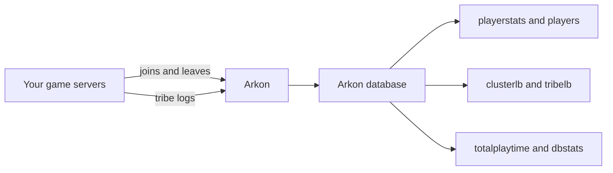

# Player Stats and Leaderboards

Arkon remembers what your players do on your Ark servers. These commands let you (and your players) look at that data in Discord: a stat card for one player, top-player rankings, tribe rankings and a playtime report between two dates.

You do not set anything up for these commands. They only read what Arkon has already saved. If Arkon has not been collecting data yet, the lists will be empty.

**You need:**

- Arkon in your Discord server with at least one server connected ([Getting Started](/guides/getting-started)).
- Players who have joined your servers while Arkon was running. Players can link their Discord to their character with [Player Registration](/guides/player-registration).
- Tribe logs working if you want tribe rankings ([Tribe Logs](/guides/tribe-logs)). Tribe kills and tames come from there.

## Where the numbers come from

These commands never talk to your game server. They read Arkon's own saved records.

> Run these commands in a normal server channel. They do not work in direct messages. Arkon needs permission to send messages and embed links (rich message boxes) in that channel.
{.is-info}

## Who can run what

| Command | Who can run it |
|---|---|
| `+playerstats` | Everyone |
| `+players` | Everyone |
| `+clusterlb` | Everyone |
| `+tribelb` | Everyone |
| `+dbstats` | Everyone |
| `+totalplaytime` | Mod, or anyone with the Discord "Manage Server" permission |

"Mod" is a role you set up for Arkon. See [Getting Started](/guides/getting-started) to set it.

The default prefix is `+`. If you changed it, use yours instead.

## Step by step: look up a player

1. Open any channel where Arkon can send messages.
2. Type `+playerstats` to see your own card. You must have registered first.
3. To see someone else, type their name after the command, for example `+playerstats SurvivorSam`.
4. Read the card Arkon posts.

**Check it worked:** Arkon posts a card titled "Player Stats for SurvivorSam" with one box per server the player has played on.

## Step by step: see the top players by playtime

1. In any channel, type `+players`.
2. Wait a moment. Arkon first says "Fetching players and sorting data, one moment...".
3. Use the arrow buttons under the list to flip pages. Press the X button to close it.

To see only the last week, type `+players 7d`. To see one cluster, type `+players "My Cluster"`.

**Check it worked:** you see a "Playtime Leaderboard" with players ranked 1, 2, 3 and so on, 10 per page.

## Step by step: top players in a cluster

A cluster is a group of your servers that share players and characters.

1. Type `+clusterlb kills`.
2. Open the "Select a cluster" dropdown and pick your cluster.
3. Flip pages with the arrows.

**Check it worked:** the same message changes into "Cluster Leaderboard for My Cluster - Kills".

## Step by step: tribe ranking

1. Type `+tribelb kills` to rank tribes by kills.
2. Arkon posts "Tribe Kill Leaderboard". Flip pages with the arrows.

**Check it worked:** you see tribes listed like `1. Dino Ranchers - 1,234`.

## Step by step: playtime between two dates (Mod)

1. In a channel, type `+totalplaytime SurvivorSam 2025-08-01 2025-08-31`.
2. Read the "Playtime Report".

**Check it worked:** the report shows the requested range, the total time played and the top maps.

## Commands

### +playerstats

Shows a stat card for one player. Also works as /playerstats. Also, you can right-click a member, open Apps and choose "View Player Stats". That reply is private to you.

Syntax: `+playerstats [player]`

- Leave `player` empty to see yourself.
- You can type a Discord @mention, a Discord name or ID, an Xbox gamertag, a Steam name, an Xbox or Steam ID, a character name, or an implant number (the number of a character's implant).
- Several matches give several cards. Use the arrows to flip between them.

Example: `+playerstats RexRider`

What the card shows (only the lines that apply):

| Line | Meaning |
|---|---|
| Discord | The linked Discord account, or "Not Registered" |
| Time Played | Total time across all servers, like `3d 4h 5m` |
| XUID, Steam ID or EOS ID | The player's game ID |
| Rank | Their playtime rank role, if they have one |
| Discovered, Last Seen | When Arkon first and last saw them |
| Last Map | The last server they played on |
| Kit Claims | Where they claimed a kit |
| Left Discord | When they left your Discord |
| Notes | How many mod notes exist |
| Past Names | Earlier gamertags |

Below that, there is one box per server (up to 25, most played first) with Playtime, Last Seen, Character, Implant, Tribe, PvP Kills, PvP Deaths, PvE Deaths and Tamed. A banned player gets a warning line.

> A time under one minute can show as just "seconds" with no number. That is normal.
{.is-info}

**Premium servers, Mods only:** the card gets extra buttons: Note (add or remove), Show, Edit, Xbox DM (needs Xbox sign-in set up by the bot owner) and left/right arrows. See [Premium](/guides/premium).

### +players

Ranks players by playtime. Aliases: `+arkleaderboard`, `+arklb`, `+arktop`.

Syntax: `+players [timespan] [cluster]`

| Value | What it does | Default |
|---|---|---|
| `timespan` | `all`, or a length like `7d`, `2w`, `30d` | `all` |
| `cluster` | Only players whose last server is in that cluster. Quote names with spaces. | all clusters |

Example: `+players 30d "My Cluster"`

Shortcut: `+players mycluster` works too, Arkon sees it is not a time and treats it as a cluster name.

- `all` uses each player's saved lifetime total.
- A timespan adds up finished play sessions in that window. A session that has not ended yet (the player is online now) is not counted.
- Only players with more than zero time are listed. 10 per page.
- The footer shows your own rank (like `You 3/45`) if you are registered and ranked.

### +clusterlb

Ranks players across all servers of one cluster. No aliases.

Syntax: `+clusterlb [sort_by]`

| sort_by | Ranks by | Default |
|---|---|---|
| `kills` | PvP kills | yes |
| `tamed` | Dinos tamed | |
| `tamekills` | Tamed dinos the player killed | |
| `playtime` | Time played | |

Example: `+clusterlb tamed`

Only you can use the dropdown on your own command. This list shows playtime as raw seconds, not hours. Closing with the X deletes the message.

### +tribelb

Ranks tribes. Alias: `+tribetop`.

Syntax: `+tribelb <sort_by> [cluster]`

| sort_by | Ranks by |
|---|---|
| `kills` (or anything starting with k) | Kills |
| `tames` (or anything starting with t) | Dinos tamed |
| anything else, like `destroyed` | Structures destroyed |

Example: `+tribelb tames "My Cluster"`

> If you misspell the stat, Arkon quietly uses "structures destroyed" instead of telling you.
{.is-warning}

Only tribes with more than zero are listed.

### +totalplaytime

Adds up how long one player played between two dates. Mod, or Manage Server.

Syntax: `+totalplaytime <player> <start_date> <end_date>`

- `player`: one word. Put quotes around names with spaces. Only the first match is used, so use an ID to be exact.
- `start_date`: one word. Put quotes if it has spaces, like `"Aug 1, 2025"`.
- `end_date`: the rest of the line. No quotes needed.
- Dates like `2024-12-01`, `Aug 12, 2025` and `2024-12-15T23:59:59` work. Dates with no time zone use your server's time zone (default UTC).

Example: `+totalplaytime "SurvivorSam" "Aug 1, 2025" Aug 31, 2025`

The report shows the requested range, the actual range found, the total, and the top 10 maps.

### +dbstats

Shows how much data Arkon holds, as counts such as clusters, servers, players, tribes, bans and tribe logs.

Syntax: `+dbstats [showglobal]`

- `+dbstats` counts only your server.
- `+dbstats True` counts every server that uses Arkon.

> The "Players Online" number in the this-server view can be off. Treat it as approximate.
{.is-info}

## Paging buttons

Leaderboards use the same buttons. Only the person who ran the command can press them. Others see "This isn't your menu!". The buttons stop working after 5 minutes.

- Left and right arrows flip pages.
- X closes (deletes) the message.
- With more than 10 pages, you also get jump back 10, jump forward 10 and a search button. Search opens a small form called "Search" with one box, "Enter Search Query or Page". Type a page number to jump there, or a word to find the page that has it. If there is no exact match, Arkon guesses the closest page and tells you privately, like "Found closest match of 80%". If nothing is close, you see "No page found matching that query."

## Automatic recaps

Arkon does not post daily or weekly stat recaps on its own. The recap jobs in the code only work for a private feature that public servers cannot turn on, so there is nothing to set up. Everything on this page runs only when someone types a command.

## Common problems

| Problem | Why it happens | Fix |
|---|---|---|
| `You haven't registered yet! Type **+register** to register.` | You ran `+playerstats` with no name and are not linked | Register with `+register`, or add a name. See [Player Registration](/guides/player-registration) |
| `No player data found for **Name**` | Arkon has no one by that name | Check spelling, or try a Discord ID or game ID |
| `**Name** never registered...` | You @mentioned someone who never linked their Discord | Ask them to register |
| `` `abc` is not a valid time span! Use something like 7d or 2w. `` | The timespan could not be read | Use values like `7d` or `2w` |
| `The cluster `Name` does not exist!` | No cluster has that name | Check names in [Server Settings](/guides/server-settings) |
| `There is no player data saved for this server yet` | Arkon has not saved players yet | Connect servers and wait for players to join |
| `There is no tribe data saved for this server yet` | No tribe data | Make sure [Tribe Logs](/guides/tribe-logs) work |
| `No data available for the leaderboard.` | Nobody has a value above zero for that stat | Try a different stat |
| `There are no servers in that cluster!` | The cluster is empty | Add servers to it |
| `No playtime data found for ... between those dates!` | The player has no finished sessions in that window | Widen the dates |
| `This command can only be used in a server.` or `Database is not connected. Please try again later.` | You used the right-click "View Player Stats" outside a server, or the database is down | Use it inside your server, or wait and retry |
| `This isn't your menu!` | You pressed someone else's buttons | Run the command yourself |
| `Initializing database, One moment...` | Arkon's database is starting | Wait and retry |
| `Database is currently migrating. Try again later.` | The database is updating | Wait and retry |
| A player online right now is missing time | Unfinished sessions are not counted in date-based reports | Check again after they leave |

## Related pages

- [Getting Started](/guides/getting-started)
- [Player Registration](/guides/player-registration)
- [Playtime and Roles](/guides/playtime-and-roles)
- [Tribe Logs](/guides/tribe-logs)
- [Premium](/guides/premium)
- [Quick Reference](/guides/quick-reference)
- [Player Commands](/commands/player-commands)
