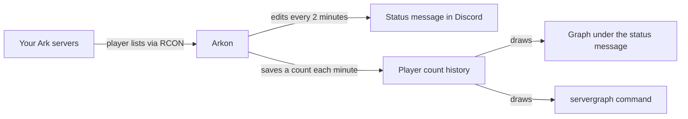

# Live Server Status Channel and Player Count Graphs

Arkon can keep one message in a Discord channel that always shows how many players are on each of your Ark servers. It updates by itself every 2 minutes, so your players never have to ask "is the server up?". It also draws a graph of player counts over time.

**You need:**

- Arkon invited, and you are an Admin or have the Discord "Manage Server" permission ([Getting started](/guides/getting-started)).
- At least one server added and enabled, with RCON working ([RCON setup](/guides/rcon-setup), [Server settings](/guides/server-settings)). RCON is the remote-control connection Arkon uses to ask your server who is online.
- A text channel for the status message, where Arkon can **View Channel**, **Send Messages**, **Embed Links**, **Attach Files** and **View Message History**.

## How it works

Arkon asks each server for its player list. It shows the live numbers in the status message. Once a minute it also saves the count, and the graphs are drawn from those saved counts.

## Set it up

1. **Make a channel for it.** In Discord, create a text channel such as `#server-status`. Give Arkon the five permissions listed above in that channel.

2. **Tell Arkon to use that channel.** In any channel Arkon can see, type:

   `+serverstatus channel #server-status`

   You will see:

   

   If a permission is missing, Arkon replies "I am missing the following permissions for that channel!" and lists which ones. Fix them and run the command again.

3. **Post the message now.** Setting the channel does not post anything by itself. Type:

   `+serverstatus init`

   Arkon replies "Status channel initialized!" and the status message appears in `#server-status`. If you skip this step, the message appears on its own within about 2 minutes.

4. **(Optional) Change the graph window.** The graph under the message shows the last hour by default. To show more, type the number of **seconds**:

   `+serverstatus time 7200`

   That example is 2 hours. Premium can go up to 43200 (12 hours). Free servers are limited to 3600 (1 hour).

5. **Check it worked.** Open `#server-status`. You should see one message titled "Server Status":

   

   - Each cluster (a group of linked servers, see [Server settings](/guides/server-settings)) has its own heading in capital letters, with one line per server and its player count.
   - "Total Players" appears at the top when you have more than one cluster and at least one player online.
   - When a cluster has more than one server, the last line says how many players are on the whole cluster.
   - The graph is at the bottom. If there is no data yet, the message appears without it.

   Type `+serverstatus view` to confirm which channel is set. It replies "The status channel is set to #server-status".

> Arkon only edits the message. It does not delete the old one if you move the status to a different channel. Delete the old message by hand.
{.is-info}

## What the message shows

| What you see | What it means |
|---|---|
| Green color | Every server is online |
| Orange color and a "Dino 404" icon | At least one server is offline |
| Red color | A server has been offline for more than 10 minutes |
| `Offline` and a time like "3 hours ago" | That server is down, and that is when it was last seen online |
| A bold **0** next to a server | The server is online but empty |
| Footer "Powered by Arkon - https://arkonbot.com" | Free server |
| Footer "Last Updated" | Premium server |

How often things change:

| Thing | How often |
|---|---|
| Player numbers in the message | Every 2 minutes |
| Graph picture in the message | At most every 15 minutes (a new `serverstatus time` setting can take this long to show) |
| Saved player count for the history | Once a minute per server that is online |
| Brand new message (new link) | About every 7 days, so do not link to the message itself |

When a server has been offline for more than 10 minutes, Arkon sends one alert to your alert channel (or event log channel if no alert channel is set) and pings your Admin roles. It alerts again only if the server comes back and goes down again.

> Arkon turns the status feature off by itself (it sets the channel back to none) when it loses permissions in the channel, the channel stays deleted for about 6 hours, you have no enabled servers, or every server has been offline for 30 days or more. It posts the reason in your alert channel. To turn it back on, fix the problem, then run `+serverstatus channel` and `+serverstatus init` again.
{.is-warning}

> You may notice Arkon's own Discord status (the small line under its name) reads "Managing N servers", where N is how many Discord servers Arkon is in. Arkon refreshes it every 15 minutes when the bot's owner has turned that on. It is not a setting for your server and you cannot change it.
{.is-info}

## Commands

Admin means a Red bot admin, or anyone with the Discord "Manage Server" permission (see [Getting started](/guides/getting-started) for setting roles). The `serverstatus` commands work with the `+` prefix only.

| Command | Who | What it does |
|---|---|---|
| `+serverstatus` | Admin | Shows help for the commands below |
| `+serverstatus channel <channel>` | Admin | Picks the channel for the status message |
| `+serverstatus init` | Admin | Posts or refreshes the message right now |
| `+serverstatus time <seconds>` | Admin | Sets how far back the status graph looks |
| `+serverstatus view` | Admin | Shows which channel is set |
| `+servergraph [timespan] [clusters_only] [include_total] [search_query] [start_time] [end_time]` | Everyone | Draws a player count graph on demand |
| `+playercounts [local]` | Everyone | Lists live player counts as text (add `true` to see only your own servers) |

### serverstatus channel

`+serverstatus channel <channel>`

`channel` can be a mention, a name or an ID. Example: `+serverstatus channel #server-status`. Arkon checks that it has the four permissions to post there and replies "Status channel set!". View Message History is not checked here, but you need it or the feature gets switched off later.

### serverstatus init

`+serverstatus init`

It has no options. If no channel is set, it says "You must set a status channel first!" and shows the command to use. If it cannot post, it says which permission is missing, for example "I do not have permission to embed links in that channel!".

### serverstatus time

`+serverstatus time <seconds>`

| Value | Meaning |
|---|---|
| `3600` | 1 hour (the default, and the free maximum) |
| `7200` | 2 hours (Premium) |
| `43200` | 12 hours (the highest allowed, Premium) |

Use a whole number from 1 to 43200. It must be seconds. Typing `1h` does not work.

### serverstatus view

`+serverstatus view`

It shows only the channel. It does not show the graph window. If nothing is set it says "No status channel has been set!".

### servergraph

Also works as `/servergraph`. It cannot be used in direct messages. Each person can use it 3 times every 30 seconds.

`+servergraph [timespan] [clusters_only] [include_total] [search_query] [start_time] [end_time]`

| Option | What it does | Default | Example |
|---|---|---|---|
| `timespan` | How far back to look. Uses letters: `30m`, `4h`, `3d`, `2w`, or `all` for everything saved | 1 hour | `4h` |
| `clusters_only` | `true` gives one line per cluster. `false` gives one line per map | `false` | `true` |
| `include_total` | `true` adds a dotted "Total" line (only shown when there is more than one line) | `false` | `true` |
| `search_query` | Only show maps or clusters whose name contains this text | none | `island` |
| `start_time` | Start of a date range | none | `"April 10 2026 5:00pm"` |
| `end_time` | End of a date range | none | `"April 11 2026 5:00pm"` |

Examples:

- `+servergraph` : the last hour.
- `+servergraph 4h true true` : last 4 hours, grouped by cluster, with a total line.
- `+servergraph 7d false false island` : last 7 days, only maps with "island" in the name.
- `/servergraph` : the slash version has a named box for each option, which is easier for dates.

> With the `+` version, the options go in the order shown above, so you must fill in earlier ones to reach later ones. Put dates in quotes. Use `/servergraph` if this is confusing.
{.is-info}

Reading the graph:

- Dates and times use your server's timezone (UTC unless you changed it).
- The left label says "Player Count (Max N)". N is the real highest count in that window.
- Lines are averaged, so for long windows the peaks look a little lower than the real highest count.
- A break in a line means the server was offline or Arkon had no data. It does not mean zero players.
- A new server shows gaps until Arkon has collected data for it.
- If nothing was saved for that time, Arkon replies "There is no data for that timeframe."

### playercounts

`+playercounts [local]`

Shows each server and how many players are on it right now. Each person can use it once every 10 seconds. Always add `true` so the list shows only your own servers:

`+playercounts true`

Only the person who ran the command can use the buttons. The X button closes (deletes) the list. The buttons stop working after 5 minutes. If there are many pages, extra buttons let you jump by 10 or search.

## Free vs Premium

| | Free | Premium |
|---|---|---|
| Status graph window (`serverstatus time`) | Up to 1 hour | Up to 12 hours |
| Status message footer | "Powered by Arkon - https://arkonbot.com" | "Last Updated" |
| Saved history (`+arkset retention <days>`) | Up to 7 days (the default) | Up to 1825 days (5 years) |

Premium means the owner of your Discord server has Arkon Premium. See [Premium](/guides/premium).

`servergraph` has no Premium check, but it can only draw data that is still saved. On a free server that is about 7 days. To keep more history, Premium owners can raise it with `+arkset retention <days>`. Free servers get "You need a premium subscription to set historical data longer than 7 days".

## Common problems

| Problem | Why it happens | Fix |
|---|---|---|
| Nothing was posted after `+serverstatus channel` | That command only saves the channel | Run `+serverstatus init`, or wait about 2 minutes |
| "I am missing the following permissions for that channel!" | Arkon cannot post there | Give Arkon View Channel, Send Messages, Embed Links, Attach Files, then try again |
| `+serverstatus view` says "No status channel has been set!" | Never set, or Arkon turned the feature off | Run `+serverstatus channel #your-channel`, then `+serverstatus init`. Check your alert channel for the reason |
| "I could not find the channel you set!" | The channel was deleted | Set a new channel with `+serverstatus channel` |
| "Sorry, the maximum time the free version of Arkon allows is 1 hour" | Free servers are limited to 3600 seconds | Use `3600` or less, or get [Premium](/guides/premium) |
| "The histogram can display a maximum of 12 hours" | The number is more than 43200 | Use 43200 or less |
| `+serverstatus time 1h` gives an error | It needs seconds | Type `+serverstatus time 3600` |
| Graph did not change after `serverstatus time` | The graph picture is only redrawn about every 15 minutes | Wait up to 15 minutes |
| Server shows `Offline` but it is running | Arkon cannot reach it over RCON | Fix RCON using [RCON setup](/guides/rcon-setup) |
| The status message has no graph | No history saved yet, or the graph could not be drawn | Wait a few minutes and the next update adds it |
| Old status message left behind | You changed the channel | Delete the old message by hand |
| The link to the status message stopped working | Arkon posts a fresh message about every 7 days | Link to the channel instead |
| "There is no data for that timeframe." | Nothing was saved in that range | Use a shorter or more recent range |
| "The database is not ready yet! Please try again later." | Arkon is still starting up | Try again in a minute |
| "Initializing database, One moment..." | Arkon is still starting up | Wait a few seconds and run the command again |
| "No players found" or "No servers found" | Arkon has no live player data yet | Check your servers are added, enabled and connected |

## Related pages

- [Getting started](/guides/getting-started)
- [RCON setup](/guides/rcon-setup)
- [Server settings](/guides/server-settings)
- [Premium](/guides/premium)
- [Player commands](/commands/player-commands)
- [Admin commands](/commands/admin-commands)
- [FAQ](/guides/faq)
