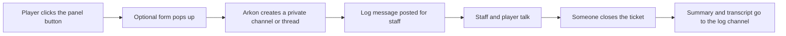

# Tickets

A ticket is a private place where one player talks to your staff, for example to report a bug or ask for help. A player clicks a button on a message (called a panel), and Arkon creates the private ticket for them. When the problem is solved, someone closes it and Arkon can save a copy of the chat (a transcript).

**You need:**

- Arkon in your server ([Getting started](/guides/getting-started)).
- A role for your staff (for example `@Support`).
- A Discord category (a folder of channels) where new ticket channels will be created.
- Optional: a private log channel where Arkon posts a note about every ticket and saves transcripts.
- Arkon needs these permissions in the category: View Channel, Read Message History, Manage Channels, Manage Permissions and Attach Files.

> Ticket commands are typed with the prefix, like `+close`. They are not slash commands. The setup commands (`+tickets ...`) can be run by the server owner, anyone with the Admin role, or anyone with the Administrator permission. See [Getting started](/guides/getting-started) for setting the Admin and Mod roles.
{.is-info}

## How it works



Words used on this page:

- **Panel:** one ticket type. It is a button on a message. You can have many (for example `support`, `report`, `apply`).
- **Support roles:** the staff roles that can see and close tickets.
- **Thread:** a private mini-chat inside a normal channel. The other choice is a full private channel.
- **Form (modal):** a pop-up with questions the player answers before the ticket opens.

## Setup

### Step 1: Make the category and the log channel

Where: your Discord server settings.

Make a category called `Tickets` (nobody but staff needs to see it). If you want logs, make a private text channel called `ticket-log` that only staff can see. Give Arkon the permissions listed in "You need" on both. In the log channel Arkon needs View Channel, Read Message History, Send Messages, Embed Links and Attach Files.

> Turn on Developer Mode (Discord settings, Advanced) so you can right-click a category and choose Copy Category ID.
{.is-info}

### Step 2: Create a panel

Where: any channel the bot can see.

Type a one-word name (it is saved in lowercase):

```
+tickets addpanel support
```

You will see: an embed titled `support Panel Saved` saying "Your panel has been added and will need to be configured."

### Step 3: Set the category

```
+tickets category support 123456789012345678
```

Use the category ID you copied. You will see a green tick and "New tickets will now be opened under that category!"

If Arkon is missing a permission, it tells you which one, for example "I need the `manage channels` permission to set this category".

### Step 4: Post the panel message

The panel is a message sent by Arkon that gets the button. Make one with the embed command in the channel where players should click:

```
+tickets embed "Support" Need help? Click the button below and a private ticket will open just for you.
```

Arkon asks yes or no (with buttons) about a footer, a thumbnail and an image, then about extra fields. Click No to each. You will see "Your embed has been sent!"

To post it in another channel, add the channel before the title: `+tickets embed #support "Support" Need help?`. You can also add a color before the channel, like `+tickets embed #5865F2 #support "Support" Need help?`.

### Step 5: Attach the button to that message

Where: the same channel as the panel message.

Right-click the message, choose Copy Message ID, then type:

```
+tickets panelmessage support 123456789012345678
```

You will see a green tick, and the message now has an "Open a Ticket" button.


> The message must have been sent by Arkon. The category must be set first. If you ran `+tickets channel support #channel` earlier, the message must be in that channel.
{.is-warning}

### Step 6: Add your staff role

```
+tickets supportrole @Support
```

You will see "Support has been added to support roles". Run it again with the same role to remove it. Staff roles see every ticket, can close them and can add people. Add `true` at the end (`+tickets supportrole @Support true`) to also ping that role when a ticket opens.

### Step 7: Add the log channel and transcripts (recommended)

```
+tickets logchannel support #ticket-log
+tickets transcript
```

The first command sends a "Ticket Opened" note to that channel for every new ticket. The second one turns on transcripts, so the chat is saved when a ticket closes. Transcripts are only saved to the log channel (see [Transcripts](#transcripts)).

### Step 8: Check it worked

Click the button yourself. A new private channel should appear in your category, with a welcome message and two buttons (Close and Escalate). Then type `+tickets view` and `+tickets panels` to see your settings.


If you set a log channel, you also see this note there. Staff can click Join Ticket to be added to the ticket.


Close your test ticket with the Close button or `+close`.

## Channels or threads

Each panel opens either a private channel or a private thread. Channels are the default.

| | Channel | Thread |
|---|---|---|
| Where it appears | A new channel in your category | A private thread in the panel's channel |
| Who can see it | The player, support roles, admins | The player, people added to it, and anyone with Manage Threads |
| Needs | Manage Channels and Manage Permissions in the category | Create Private Threads, Send Messages in Threads and Manage Threads in the panel channel |
| When closed | The channel is deleted | The thread is archived and locked (or deleted, see `+tickets threadclose`) |

Switch a panel with `+tickets usethreads support` (run it again to switch back). Set the panel channel first with `+tickets channel support #support`. Thread panels still need a category set (Step 3).

Staff are not in a private thread automatically. They get in one of these ways: you turn on `+tickets autoadd` (adds every member of the support roles, which pings them), you set a support role to ping with `true`, or staff click the Join Ticket button in the log channel.

## Ticket forms (modals)

A panel can ask questions before it opens a ticket. There is no on or off switch: a panel with at least one question shows the form, a panel with none opens straight away. You can add up to 5 questions per panel.

```
+tickets addmodal support issue
```

The last word is only a private name for the field (use no spaces). Arkon then asks you, one message at a time: the question (45 characters or fewer), long or short answer box, an optional placeholder (grey hint text, 100 characters or fewer), an optional default answer, whether it is required, and optional minimum and maximum lengths. Type `cancel` at any time to stop. Run the same command with the same name to delete that question.


The answers are shown in the ticket (and pinned) and in the log message. Use `+tickets modaltitle support Tell us about your issue` to change the form title (45 characters or fewer, default is `<panel> Ticket`). `+tickets viewmodal support` lets you page through, edit and delete questions.

> In servers listed in Discord's Server Discovery, Discord does not allow the word "discord" in answers. The player sees "Your response cannot contain the word 'Discord' in discoverable servers."
{.is-info}

## The welcome message

By default Arkon says "Welcome to your ticket channel Name!" and, if players may close their own tickets, how to close it. To write your own:

```
+tickets addmessage support
```

Arkon walks you through a title (optional), the message (required), a footer (optional), a hex color like `#FF0000` (optional) and an image link (optional). You can add several messages to a panel. Use these placeholders in any of them:

| Placeholder | Becomes |
|---|---|
| `{username}` | The player's Discord username |
| `{displayname}` | The player's server nickname |
| `{mention}` | A ping of the player |
| `{id}` | The player's ID number |
| `{server}` or `{guild}` | Your server name |
| `{members}` | Your member count |
| `{toprole}` | The player's highest role |

Use `+tickets viewmessages support` to page through your messages and delete one with the trash button.

## Ticket names

By default a ticket channel is named after the player's username. Change that per panel:

```
+tickets ticketname support support-{num}
```

You can use `{num}` (ticket number), `{user}`, `{displayname}`, `{id}`, `{shortdate}` (month-day), `{longdate}` (month-day-year) and `{time}`. Names are saved in lowercase.

> Only use the placeholders from the list. Anything else in curly braces (including `{default}`, which the setup help mentions) makes the ticket fail to open. To go back to the default name, you cannot clear it with a command, so set it to `{user}`.
{.is-danger}

## Who can do what in a ticket

| Action | Command or button | Who can |
|---|---|---|
| Close | Close button, or `+close` | Support roles, server owner, Admins. The ticket owner too, unless you turned it off or the ticket is locked |
| Rename | `+renameticket <name>` | Support roles, owner, Admins. The ticket owner only if you turned on `+tickets selfrename` and it is not locked |
| Add a person | `+add @person` | Support roles, owner, Admins. The ticket owner only if you turned on `+tickets selfmanage` and it is not locked |
| Escalate | Escalate button, or `+escalate` | Server owner, anyone with Manage Server, Admins. The ticket owner only if you turned on `+tickets selfescalate` |
| Claim | `+claimticket [channel]` | Support roles and Admins |
| Lock | `+lockticket` | Support roles and Admins |
| Unlock | `+unlockticket` | Support roles and Admins |

Players can close their own tickets by default. Turn that off with `+tickets selfclose`.

### Closing

Click Close or type `+close`. If the panel asks for a reason (the default), a small form pops up. You can also give a reason or a delay in the command:

```
+close thanks for helping!
+close 1h
+close 10m thanks for helping!
```

A delay (like `1h`) posts "This ticket will close" with a countdown and pings the player. If anyone writes a message in the ticket before the time is up, closing is cancelled and the message becomes "Closing cancelled!". Turn the reason form off per panel with `+tickets closemodal support`.

When a ticket closes, Arkon posts a "Ticket Closed" summary (who opened it, who closed it, when, and why) in the log channel, deletes the "Ticket Opened" note, and deletes the channel (or archives the thread). Arkon also closes a ticket on its own if the player leaves your server.

### Locking and escalating

**Lock** stops the player from closing, renaming or adding people to their ticket. Only staff can. Unlock puts it back.

**Escalate** is for sensitive tickets. It removes your support roles from the ticket so only the player, people you added by hand, and Admin roles (the ones set in Red) keep access. It says "Ticket escalated to admins. Removed: ..." and cannot be undone by a command. In a thread, Arkon removes support staff who are not Admins. Once a ticket is escalated, only Admins can use its Join Ticket button.

### Claiming

The first support staff member to write in a ticket automatically claims it, and the time they took to answer is recorded. Use `+claimticket` to take over a ticket. To limit how many staff can use Join Ticket on one panel, type `+tickets maxclaims support 2`. Staff over the limit see "The maximum amount of staff have claimed this ticket!".

## Transcripts

A transcript is a saved copy of the whole chat. It is created when a ticket closes if you ran `+tickets transcript`.

- **Simple** (default): a `.txt` file with each message and a list of files uploaded.
- **Interactive:** `+tickets interactivetranscript` makes an `.html` page you can open in a web browser. Images are built into it when they fit.
- Uploaded files are also put into `attachments.zip` when there is room.
- The transcript is posted in the panel's log channel together with the "Ticket Closed" summary. **If a panel has no log channel, nothing is saved.** Set one with `+tickets logchannel` before tickets are opened, because tickets opened earlier have no log note and are not saved.
- `+tickets dm` also sends the closed summary and the transcript to the player by DM (it can fail if they block DMs).
- If a file is too big for Discord, Arkon strips images out of the HTML, and then falls back to a shortened `.txt`.

To get a download link from an old HTML transcript message, type `+tickets getlink <message link>`.

## Opening hours

You can set the hours your staff answer, per panel. Times are 24 hour (HH:MM).

```
+tickets timezone support America/New_York
+tickets workinghours support monday 09:00 17:00
+tickets workinghours support saturday off
+tickets blockoutside support
+tickets outsidehoursmsg support We are offline right now, we will answer in the morning!
+tickets viewhours support
```

- Once any day has hours, every day without hours counts as closed all day.
- Outside hours, a ticket still opens by default, and the player sees an "Outside Working Hours" notice. Run `+tickets blockoutside support` to refuse tickets outside hours instead (run it again to switch back).
- The timezone must be a name like `America/New_York`, `Europe/London` or `UTC`. The default is `UTC`.

## Other panel and server settings

- **Who may open:** `+tickets openrole support @Member` limits a panel to a role (run again to remove). People with none of the roles are refused.
- **Blacklist:** `+tickets blacklist @person_or_role` stops someone from opening any ticket (run again to remove).
- **Panel staff:** `+tickets panelrole support @Moderators` adds a role that only sees tickets of that panel. Add `true` to ping it.
- **How many tickets at once:** `+tickets maxtickets 2` (default 1, counted across all panels).
- **Suspend the system:** `+tickets suspend We are closed for the weekend.` shows that message to anyone who clicks a button. Run `+tickets suspend` with no text to turn it off.
- **Turn one panel off:** `+tickets toggle support` greys out its button.
- **Button look:** `+tickets buttontext support Get Help`, `+tickets buttoncolor support green` (red, blue, green or grey) and `+tickets buttonemoji support :ticket:`. Arkon shows a sample button to confirm.
- **Several buttons on one message:** run `+tickets panelmessage` with the same message ID for more than one panel. `+tickets priority <panel> 1-25` sets the order and `+tickets row <panel> 0-4` the row.
- **Open from another place:** `+tickets altchannel support <channel or category>` opens that panel's tickets there. Use a category for channel tickets and a normal text channel for threads. Run again with the same one to remove it.
- **Auto-close:** `+tickets noresponse 24` closes tickets where the player has not written anything after 24 hours (0 turns it off). Arkon warns them about 20 minutes before. A ticket whose form was filled in counts as answered and is never auto-closed.
- **Live overview:** `+tickets overview #open-tickets` keeps one message updated with all open tickets. Run it with no channel to turn it off. `+tickets overviewhide <panel>` hides one panel from it, and `+tickets overviewmention` switches channel names to clickable mentions.
- **Pings for new tickets:** staff can type `+ticketpings` to be pinged for every new ticket they can see. Type it again to stop.
- **Show the average answer time:** `+tickets showresponsetime` switches the "Our average staff response time is ..." notice on or off. It is on by default.

## Statistics

`+ticketstats` (alias `+tstats`) shows how your tickets are doing. Admin only. Time ranges look like `7d`, `24h`, `30d` and default to 7 days.

| Command | What it shows |
|---|---|
| `+ticketstats server [timespan]` | Tickets opened and closed, average time to solve |
| `+ticketstats staff [member] [timespan]` | One staff member's claims, answer times and messages |
| `+ticketstats user <user> [timespan]` | One player's ticket history |
| `+ticketstats frequent [timespan] [limit]` | Players who open the most tickets (up to 25) |
| `+ticketstats busytimes [timespan]` | Busiest hours and days |
| `+ticketstats panel [panel] [timespan]` | Per panel numbers |
| `+ticketstats responsetime` | Average first answer time, from the last 100 tickets |
| `+ticketstats retention [days]` | How many days of detailed data to keep (default 90, 0 keeps all) |
| `+ticketstats pruneresponse <member> <days>` | Removes answer times above that many days from one person's stats |
| `+ticketstats reset <staff/user/server/responsetime/all> [user]` | Wipes stats (asks for confirmation) |

To keep a panel out of the stats, use `+tickets analyticsblacklist <panel>`.

## Commands

### In a ticket

| Command | Who | What it does | Example |
|---|---|---|---|
| `+add <member>` | Staff, ticket owner if allowed | Adds a person to the ticket | `+add @RexRider` |
| `+renameticket <name>` | Staff, ticket owner if allowed | Renames the ticket | `+renameticket base-wipe` |
| `+close [delay] [reason]` | Staff, ticket owner if allowed | Closes the ticket | `+close 1h thanks!` |
| `+escalate` | Manage Server, Admin, owner if allowed | Admins only from now on | `+escalate` |
| `+claimticket [channel]` | Support role, Admin | Take responsibility for a ticket | `+claimticket` |
| `+lockticket` | Support role, Admin | Only staff can close, rename or add | `+lockticket` |
| `+unlockticket` | Support role, Admin | Undo the lock | `+unlockticket` |
| `+ticketpings` | Support role, Admin | Get pinged for new tickets, on or off | `+ticketpings` |
| `+openfor <member> <panel>` | Mod (Mod role or Manage Messages) | Posts a button that opens a ticket for that person | `+openfor @RexRider support` |

### Setup (all need Admin)

`+tickets` has the alias `+tset`. All of these start with `+tickets`.

| Command | What it does | Example |
|---|---|---|
| `setuphelp` | Shows a short setup guide | `+tickets setuphelp` |
| `view` | Shows the server settings | `+tickets view` |
| `panels` | Pages through your panels, trash button deletes one | `+tickets panels` |
| `addpanel <name>` | Creates a panel | `+tickets addpanel support` |
| `category <panel> <category>` | Where new ticket channels go | `+tickets category support 123456789012345678` |
| `channel <panel> <channel>` | The channel the panel is in | `+tickets channel support #support` |
| `panelmessage <panel> <message>` | Puts the button on a message | `+tickets panelmessage support 123456789012345678` |
| `embed [color] [channel] <title> <text>` | Posts a message to hold the button | `+tickets embed "Support" Need help?` |
| `updatemessage <source> <target>` | Copies the embeds of one Arkon message onto another | `+tickets updatemessage 111 222` |
| `buttontext <panel> <text>` | Button label (80 characters or fewer) | `+tickets buttontext support Get Help` |
| `buttoncolor <panel> <color>` | red, blue, green, grey | `+tickets buttoncolor support green` |
| `buttonemoji <panel> <emoji>` | Button emoji | `+tickets buttonemoji support :ticket:` |
| `toggle <panel>` | Turns a panel off or on | `+tickets toggle support` |
| `priority <panel> <1-25>` | Button order on a shared message | `+tickets priority support 2` |
| `row <panel> <0-4>` | Button row on a shared message | `+tickets row support 1` |
| `ticketname <panel> <format>` | Name of new tickets | `+tickets ticketname support support-{num}` |
| `usethreads <panel>` | Channels or threads for a panel | `+tickets usethreads support` |
| `closemodal <panel>` | Ask for a reason on close, on or off | `+tickets closemodal support` |
| `logchannel <panel> <channel>` | Log and transcript channel | `+tickets logchannel support #ticket-log` |
| `addmodal <panel> <name>` | Add (or delete) a form question | `+tickets addmodal support issue` |
| `viewmodal <panel>` | Page through, edit or delete questions | `+tickets viewmodal support` |
| `modaltitle <panel> [title]` | Form title, empty removes it | `+tickets modaltitle support Tell us more` |
| `addmessage <panel>` | Add a welcome message | `+tickets addmessage support` |
| `viewmessages <panel>` | Page through or delete welcome messages | `+tickets viewmessages support` |
| `supportrole <role> [true]` | Add or remove a staff role | `+tickets supportrole @Support true` |
| `panelrole <panel> <role> [true]` | Add or remove a staff role for one panel | `+tickets panelrole support @Mods` |
| `openrole <panel> <role>` | Add or remove a role needed to open | `+tickets openrole support @Member` |
| `blacklist <member or role>` | Block from opening tickets, run again to undo | `+tickets blacklist @RexRider` |
| `maxtickets <number>` | Open tickets per person | `+tickets maxtickets 2` |
| `maxclaims <panel> <number>` | Staff who can join one ticket | `+tickets maxclaims support 2` |
| `altchannel <panel> <channel or category>` | Open tickets somewhere else | `+tickets altchannel support #help` |
| `noresponse <hours>` | Auto-close silent tickets, 0 is off | `+tickets noresponse 24` |
| `suspend [message]` | Pause the whole system with a message | `+tickets suspend Back Monday` |
| `workinghours <panel> <day> <start> <end>` | Hours for one day, or `off` | `+tickets workinghours support monday 09:00 17:00` |
| `timezone <panel> <timezone>` | Timezone for the hours | `+tickets timezone support Europe/London` |
| `blockoutside <panel>` | Refuse tickets outside hours, on or off | `+tickets blockoutside support` |
| `outsidehoursmsg <panel> [text]` | Notice text, empty resets (1000 characters or fewer) | `+tickets outsidehoursmsg support We are offline` |
| `viewhours <panel>` | Shows the hours | `+tickets viewhours support` |
| `overview [channel]` | Live list of open tickets | `+tickets overview #open-tickets` |
| `overviewhide <panel>` | Hide a panel from the overview, on or off | `+tickets overviewhide apply` |
| `overviewmention` | Mention channels in the overview, on or off | `+tickets overviewmention` |
| `cleanup` | Removes tickets whose channel is gone | `+tickets cleanup` |
| `getlink <message>` | Download link for an HTML transcript | `+tickets getlink <message link>` |
| `dm` | DM the closed summary to the player, on or off | `+tickets dm` |
| `transcript` | Save transcripts, on or off | `+tickets transcript` |
| `interactivetranscript` (aliases `intertrans`, `itrans`, `itranscript`) | HTML transcripts, on or off | `+tickets itrans` |
| `threadclose` | Archive thread tickets instead of deleting, on or off | `+tickets threadclose` |
| `autoadd` | Add staff to thread tickets automatically, on or off | `+tickets autoadd` |
| `selfclose` | Players can close their ticket, on or off | `+tickets selfclose` |
| `selfrename` | Players can rename their ticket, on or off | `+tickets selfrename` |
| `selfmanage` | Players can add people, on or off | `+tickets selfmanage` |
| `selfescalate` | Players can escalate, on or off | `+tickets selfescalate` |
| `showresponsetime` | Show the average answer time, on or off | `+tickets showresponsetime` |
| `analyticsblacklist <panel>` | Keep a panel out of the stats, on or off | `+tickets analyticsblacklist apply` |

### Defaults

| Setting | Default |
|---|---|
| Tickets per person | 1 |
| Panel type | Channel (not thread) |
| Button | "Open a Ticket", blue, no emoji |
| Reason form when closing | On |
| Players can close their ticket | On |
| Players can rename, add people, escalate | Off |
| Transcripts | Off (Simple when on) |
| DM the closed summary | Off |
| Close thread tickets (not delete) | On |
| Auto-add staff to threads | Off |
| Auto-close silent tickets | Off |
| Show average answer time | On |
| Working hours | None (open all day), timezone UTC, outside hours allowed |
| Stats kept for | 90 days of detail |

## Common problems

| Problem | Why it happens | Fix |
|---|---|---|
| "Panel does not exist!" | Wrong panel name | Check with `+tickets panels`. Names are lowercase with no spaces |
| "I need the `manage channels` permission to set this category" (also `manage permissions`, `attach files`) | Arkon lacks a permission in that category | Give it, then run the command again |
| "I cannot see that category!" | Arkon cannot view the category | Let Arkon view it |
| "Category ID must be set for this panel first!" | You ran `panelmessage` before `category` | Do Step 3 first |
| "I cannot add buttons to messages sent by other users!" | The message was not sent by Arkon | Make it with `+tickets embed` |
| "This message is part of a different channel from the one you set!" | The panel channel is set to another channel | Run the command in the message's channel, or set `+tickets channel` again |
| "Channel of message must be a TEXT CHANNEL!" | The message is in a thread, voice or forum channel | Use a normal text channel |
| "Set a panel channel first!" | `usethreads` needs the panel channel | `+tickets channel support #support` |
| "I am missing the `Create Private Threads` permission!" | Thread tickets need it in the panel channel | Give Arkon the permission |
| "I don't have permissions to create threads!" | Arkon lacks Manage Threads in the panel channel | Give Arkon the permission |
| "I don't have permissions to create channels!" | Arkon lacks Manage Channels in the category | Give Arkon the permission |
| "The category for this support panel cannot be found! please contact an admin!" | No category, or it was deleted | `+tickets category <panel> <category>` |
| "You have the maximum amount of tickets opened already!" | The player hit the limit | They close one, or raise `+tickets maxtickets` |
| "You must have one of the following roles to open this ticket: ..." | The panel has open roles | Give the player a role, or remove it with `+tickets openrole` |
| "You been blacklisted from creating tickets!" | The player is on the blacklist | `+tickets blacklist @person` removes them |
| "You have a role that has been blacklisted from creating tickets!" | One of their roles is on the blacklist | `+tickets blacklist @role` removes it |
| "Ticket System Suspended" | You turned on `+tickets suspend` | `+tickets suspend` with no text |
| "Outside Working Hours" / "Tickets cannot be opened outside of working hours. Please try again later." | `blockoutside` is on and it is outside the hours | Wait, or run `+tickets blockoutside <panel>` to turn it off |
| The player clicks and nothing happens after "Your ticket is being created, one moment..." | A bad `ticketname` format | Use only the placeholders from [Ticket names](#ticket-names) |
| "This is not a ticket channel, or it has been removed from config" | The command was used outside a ticket | Use it inside the ticket |
| "You do not have permissions to close this ticket" | Not staff, and player closing is off or the ticket is locked | `+tickets selfclose`, or ask staff |
| "I am missing the `Manage Channels` permission to close this ticket!" | Arkon lost permission | Give it back. For threads it is `Manage Threads` |
| "This ticket has already been closed! Please delete it manually." | The Close button on a ticket Arkon no longer tracks | Delete the channel and run `+tickets cleanup` |
| "You do not have permissions to escalate this ticket" | Not allowed to escalate | See the table above |
| "There are no support roles configured to remove" / "All support roles are also admin roles, nothing to escalate" | Escalate has nothing to do | Add a support role that is not an Admin role |
| "Only ticket staff can turn on new-ticket pings." | `+ticketpings` by a non-staff member | Ask for a support role |
| "Invalid timezone! Use IANA timezone names like `America/New_York`, `Europe/London`, or `UTC`." | Misspelled timezone | Use a name from the list |
| "Invalid day! Must be one of: ..." | Wrong day word | Use monday to sunday |
| "The text content of a button must be less than 80 characters!" | Button text too long | Shorten it |
| "The most fields a modal can have is 5!" | Form is full | Delete one with `+tickets viewmodal` |
| "Your response cannot contain the word 'Discord' in discoverable servers." | Discord rule for Server Discovery servers | Ask the player to leave the word out |

## Related pages

- [Getting started](/guides/getting-started)
- [Ideaboard](/guides/ideaboard)
- [Moderation](/guides/moderation)
- [Admin commands](/commands/admin-commands)
- [FAQ](/guides/faq)
