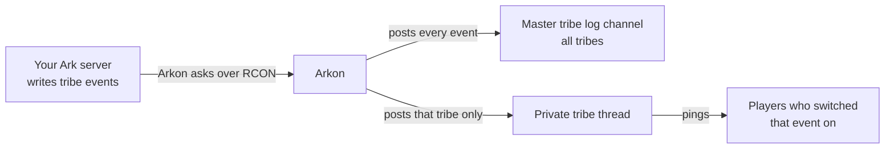

# Tribe Logs in Discord and Private Tribe Threads

Arkon copies every tribe event from your Ark server (kills, deaths, tames, destroyed structures and more) into a Discord channel. Players can also claim their tribe and get a private thread that only their tribe can see, with pings for the events they care about.

**You need:**

- A server connected to Arkon with RCON working (RCON is the remote-control connection Arkon uses to talk to your game server). See [RCON setup](/guides/rcon-setup) and [Getting started](/guides/getting-started).
- Admin access to Arkon. The `+tribeset` commands and `+cleantribelogs` need the Discord Manage Server permission or the Arkon admin role. Viewing another person's tribe and the thread commands need the Discord Administrator permission or the Arkon admin role. Set roles in [Getting started](/guides/getting-started).
- Players who have linked their character with `+register`. See [Player registration](/guides/player-registration).

> Tribe logs and private threads work with RCON alone. They do not need ArkView (the extra map and save-file tool, see [ArkView](/guides/arkview)). The log text comes from the RCON `GetChat` command, and tribe membership comes from the RCON `ListPlayers` command. Nothing in the log, claim, `+tribe` menu or thread code requires ArkView.
{.is-info}

> One small extra: if Arkon cannot match a name in a tribe log to a known player, and you have ArkView connected on that server, Arkon tries an ArkView player lookup as a last resort. It only helps Arkon recognize the player. Without ArkView the logs, pings and threads still work.
{.is-info}

## How it works

Arkon asks each server for new chat lines every few seconds. Tribe lines are picked out and posted in order. If RCON was down for a while, the missed lines arrive all at once when it comes back.

There are two places logs can land:

- The **master tribe log channel** shows every tribe on a cluster (a cluster is a group of linked servers). Admins and staff read this one.
- A **private tribe thread** shows one tribe only. Players get it by pressing Claim in the `+tribe` menu.

## Set it up

You do this once. Steps 1 and 2 are for the master log. Steps 3 to 5 turn on private threads.

1. **Make a text channel for the master log.** Where: Discord. Example: `#tribe-logs`. Make sure Arkon can see it and send messages and embeds there.
2. **Point a cluster at it.** Where: any channel Arkon can see. Run this once for each cluster:

   `+tribeset logchannel "My Cluster" #tribe-logs`

   If the cluster name has spaces, put it in quotes. You will see: `Tribe log for this cluster has been set!`

   > Use a channel that is only for tribe logs. Do not reuse your chat, join, leave or admin log channels.
   {.is-warning}

3. **Make a channel for the private threads.** Where: Discord. Example: `#tribe-threads`. Give Arkon the **Create Private Threads** and **Manage Threads** permissions in it.
4. **Tell Arkon about that channel.** Where: any channel Arkon can see.

   `+tribeset claimchannel #tribe-threads`

   You will see: `Private tribelog threads will be created in the #tribe-threads channel`. If you see `I lack the discord permissions to create private tribelog threads!`, fix the permissions from step 3.
5. **Choose who can claim.** Where: any channel Arkon can see.

   `+tribeset claimrole @Player`

   You will see: `Users with this role can now claim their tribes`. Players need any one of the listed roles.

   > `+tribe` will not open until BOTH the claim channel and at least one claim role are set.
   {.is-danger}

6. **Check it worked.** Run `+tribeset view`. You should see the channel and role you just set.

After the next tribe event in game, an embed appears in `#tribe-logs`. The title is the server, cluster and tribe name, the body is the event text, and the footer shows the in-game time and the tribe ID. A private thread gets a lighter version of the same embed.

## What players do

1. Link your character with `+register` ([Player registration](/guides/player-registration)).
2. Be seen online in game at least once, so Arkon knows your tribe.
3. Run `+tribe` (also works as `/tribe`). A menu opens with one page per tribe per map. Use the arrows to find the right tribe.
4. Press **Claim** while the right tribe page is showing.
5. Arkon creates a private thread named like `Dino Ranchers (The Island My Cluster)`, adds you, pins a welcome message and announces it in the claim channel.

To get pinged for events, press **Notifications**, then press the events you want. Green is on, grey is off. Everything starts off. Press the red back button when done. You need a claim role to use Notifications. Arkon only pings you if your Discord is linked to your character, you hold a claim role, and you switched that event on. Your choices are saved per player. The explanation text on the screen does not list Tame Kill, but the button works.

The events you can switch on are: PvP Kill, Tame Kill, PvP Death, PvE Death, PvP Dino Death, PvE Dino Death, Tamed, Cryopod, Starved (the button is spelled "Sarved"), Claimed, Unclaimed, Uploaded, Downloaded, Destroyed, Demolished, Added, Removed, Admin, Merge, Alarm and Sensor.

Other tribemates press **Join** on the same tribe page to add themselves to the existing thread. Join does not ask the owner and does not check claim roles. You can press the red close button on the menu to delete it.

> The Claim button acts on the tribe page you are looking at. Flip to the right map first.
{.is-info}

## Commands

Prefix is `+`. Commands marked hybrid also work as slash commands.

### Player commands

| Command | Who | What it does |
|---|---|---|
| `+tribe [user]` (hybrid, alias `+mytribe`) | Everyone. Only admins can give a `user`. | Opens the tribe menu. Closes by itself after 120 seconds. |

Example: `+tribe` or, as an admin, `+tribe @SurvivorSam`. When an admin views someone else, the Notifications, Claim and Join buttons are hidden. Non-admins who name another user get `Only admins can view other users' tribes!`.

### Admin commands

These need the Discord Manage Server permission or the Arkon admin role. They are prefix only. Arkon itself needs Embed Links and Attach Files where you run them. `logchannel`, `claimchannel` and `resetclaims` also need Arkon to have Create Private Threads, Manage Threads and Manage Permissions.

| Command | What it does | Example |
|---|---|---|
| `+tribeset` | Shows help for the group. | `+tribeset` |
| `+tribeset view` | Shows saved tribes, claimed tribes, claim roles, thread channel and master log channels. | `+tribeset view` |
| `+tribeset logchannel <cluster> <channel>` | Sets the master tribe log channel for one cluster. | `+tribeset logchannel "My Cluster" #tribe-logs` |
| `+tribeset claimchannel <channel>` | Sets where private threads are created. Old threads do not move. | `+tribeset claimchannel #tribe-threads` |
| `+tribeset claimrole <role>` | Adds a role that may claim. Run again to remove it. | `+tribeset claimrole @Player` |
| `+tribeset unclaim <member>` | Frees every tribe that member owns. The thread stays and the next person to press Claim is added to it. The old owner stays in the thread until removed. | `+tribeset unclaim @RexRider` |
| `+tribeset resetclaims true` | Deletes every thread in the claim channel and clears every claim. | `+tribeset resetclaims true` |
| `+cleantribelogs` | Deletes active threads in the claim channel that are not tied to any tribe. | `+cleantribelogs` |

Notes:

- The cluster name is matched without regard to capital letters.
- To remove a master log channel, use the cluster edit menu in [Server settings](/guides/server-settings) and clear the channel.
- `resetclaims` needs `true`. Any other answer prints `Not wiping tribelog threads and resetting tribes.`
- `cleantribelogs` ignores archived threads. It prints `Deleted N threads`, or `No threads to delete!`.

> `resetclaims` and `cleantribelogs` delete threads for good. The messages cannot be recovered. `resetclaims` also deletes threads that were never tied to a tribe.
{.is-danger}

### Thread commands

Run these **inside** the tribe thread. The tribe owner or any admin (Administrator permission or Arkon admin role) can use them, except `threadmembers`, which anyone in the thread can use. All are hybrid.

| Command | What it does | Example |
|---|---|---|
| `+threadadd @user` (aliases `addmember`, `tribeaddmate`) | Adds a Discord member to the thread. Bots cannot be added. It does not check that the person is in the tribe. | `+threadadd @RexRider` |
| `+threadkick @user` (aliases `kicktribemate`, `kickmate`) | Removes a member. Cannot remove yourself, the server owner or admins. | `+threadkick @RexRider` |
| `+threadpurge true` (aliases `kickall`, `threadclear`) | Removes everyone except you, Arkon, the server owner and admins. Add people back with `+threadadd`. | `+threadpurge true` |
| `+threadmembers` (aliases `threadwho`, `threadlist`) | Lists the members and marks the owner. | `+threadmembers` |
| `+threadtransfer @user` (aliases `tribetransfer`, `threadowner`) | Gives ownership to someone else. They must be a registered member of this tribe, hold a claim role, and already be in the thread. The old owner stays in the thread. | `+threadtransfer @RexRider` |

## What happens by itself

- A renamed tribe renames its thread.
- If the owner leaves your Discord, or loses all claim roles, their tribe is unclaimed and its thread is deleted.
- If tribes merge, the old tribe's thread is archived and locked.
- Threads archive after 7 days of quiet. Arkon wakes them when it posts, if it has Manage Threads.
- If a thread breaks (deleted, or Arkon lost permissions), Arkon posts a **Tribe Thread Issue** embed in the claim channel and forgets the thread. The owner presses **Claim** again to get a new one.
- A tribe only shows in `+tribe` after Arkon has seen you online in it, because tribe membership comes from the player list.
- Private tribe logs are available on both Free and Premium. See [Premium](/guides/premium).

## Common problems

| Problem | Why it happens | Fix |
|---|---|---|
| `Private tribelogs have not been configured yet!` | The claim channel or claim role is missing. | Run steps 4 and 5 above. |
| `You have not registered yet, you can do so with the +register command` | Your Discord is not linked to a character. | Run `+register`. |
| `You are not in any tribes yet!` | Arkon has not seen you online in a tribe yet. | Join the server, wait a minute, try again. |
| `You must have one of the following roles to claim private tribelogs!` | You lack a claim role. | Ask an admin for the role, or add it with `+tribeset claimrole`. |
| `I need the Manage Threads permission in the claim channel!` or `I need the Create Private Threads permission in the claim channel!` | Arkon lacks permissions in that channel. | Give Arkon both permissions there. |
| `This tribe has already been claimed by ...` | Someone else owns it. | Ask them to `+threadtransfer`, or an admin can `+tribeset unclaim` them. |
| `This command must be run inside a tribelog thread!` | You ran a thread command in the wrong place. | Open the thread and run it there. |
| `Only the tribe owner can use this command!` | You are not the thread owner. | Ask the owner or an admin. |
| `This channel is already set as the tribe log for another cluster!` | One channel can only serve one cluster. | Pick a different channel. |
| `I could not find a cluster with that name!` | Wrong name, or spaces without quotes. | Check names in [Server settings](/guides/server-settings) and use quotes. |
| `+threadpurge` does nothing | It needs `true`. | Run `+threadpurge true`. |
| `Database connection is not active, try again later` | The bot's database is down for a moment. | Wait and try again. |
| Nothing posts in the master channel | RCON may be down, or the channel is shared with another log. | Check [RCON setup](/guides/rcon-setup) and give the log its own channel. |

## Related pages

- [Getting started](/guides/getting-started)
- [RCON setup](/guides/rcon-setup)
- [Server settings](/guides/server-settings)
- [Player registration](/guides/player-registration)
- [Player guide](/guides/player-getting-started)
- [Chat and logs](/guides/chat-and-logs)
- [Premium](/guides/premium)
- [ArkView](/guides/arkview)
