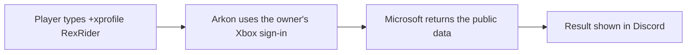

# Xbox Lookup

Xbox Lookup lets your players look up Xbox information from Discord. Type a command and a Gamertag (an Xbox player name). Arkon shows the profile, friends, games, screenshots or clips. It can also post an alert when Microsoft's Xbox services go down.

> This page is about looking up public Xbox data. It is not the same as the host Gamertag features (friend adds, invites, Xbox messages). Those are on [Xbox and Microsoft Store Features](/guides/xsapi).
{.is-info}

**You need:**

- Arkon in your server.
- Nothing else for the two outage commands (`+xstatus` and `+xstatuschannel`).
- For every other command, Arkon's owner must have connected Arkon to Xbox first. You cannot do this from your server. See the next section.

## Who sets up Xbox access

Most lookups ask Microsoft for the data. Arkon can only do that if the bot owner has signed Arkon in to Microsoft once, with their own Microsoft app keys. The keys and the sign-in belong to the whole bot. They are not per server.

The Xbox access commands are owner-only. A server admin cannot run them and cannot add their own keys.

What this means for you:

- If the owner has set it up, the commands just work.
- If not, the commands reply with a message and do nothing else. See [Common problems](#common-problems).
- You cannot fix this yourself. Ask the bot's owner.

| Needs Xbox access | Works without it |
|---|---|
| `+setgt`, `+xuid`, `+gamertag`, `+xprofile`, `+xgames`, `+xfriends`, `+xscreenshots`, `+xclips`, `+xmostplayed`, `+gameswithgold` | `+xstatus`, `+xstatuschannel` |


## How it works



Only data the Xbox player has made public can be seen. If a player set their Xbox privacy to private, Arkon shows an error instead.

## Setup for players

### Step 1: Save your Gamertag (optional)

Where: any channel where Arkon can read and reply.

Type:

```
+setgt YourGamertag
```

You will see: a checkmark reaction on your message. After this, you can type `+xprofile` and the other commands with no name and Arkon uses yours.

If the Gamertag is wrong, Arkon replies "Invalid Gamertag. Try again."

> Your saved Gamertag belongs to you and works in every server where Arkon is. It does not link to your Ark character. For that, use `+register` ([Player registration](/guides/player-registration)).
{.is-info}

### Step 2: Look someone up

Type `+xprofile` and a Gamertag. You can also give a number called an XUID (the permanent Xbox ID behind a Gamertag).

```
+xprofile RexRider
```

You will see: a "Gathering data..." message, then the profile card. It shows the Gamertag, whether the player is online and the profile details.

### Step 3: Check it worked

Type `+xuid RexRider`. Arkon replies with a number. Type `+gamertag` followed by that number and you should get `RexRider` back.

## Outage alerts

Microsoft Xbox services sometimes go down. Arkon checks every 5 minutes. If the status changes, it posts the new status in every server that has a status channel.

### Step 1: Pick the channel

Where: any channel. You need the Manage Messages permission.

Type:

```
+xstatuschannel #xbox-status
```

You will see: "Status channel set to #xbox-status".

### Step 2: Check it worked

Type `+xstatus` in any channel. You will see either "All Microsoft services are up and running!" or a list of what is affected.

To stop the alerts, type `+xstatuschannel` with no channel. Arkon replies "Status channel reset".

> Arkon needs permission to send messages and embeds in that channel. If it cannot, the alert is skipped without any warning.
{.is-warning}

> This is not the Ark server status message. For that, see [Live server status channel](/guides/status-channel).
{.is-info}

## Menus and searching

`+xgames`, `+xfriends`, `+xscreenshots`, `+xclips`, `+xmostplayed` and `+gameswithgold` show pages with buttons. Use the arrow buttons to flip pages and the X to close. Only the person who typed the command can press the buttons.

- `+xgames`: Arkon asks "What game would you like to search for?". Type part of a game name. If several match, type the number of the one you want. Reply `cancel` to stop. You have 60 seconds for each answer.
- `+xfriends`: a magnifying glass button lets you search the friends list by typing part of a Gamertag. Picking one opens that person's profile.

## Commands

| Command | Who | What it does | Example |
|---|---|---|---|
| `+setgt <gamertag>` | Everyone | Saves your Gamertag so you can leave it out later | `+setgt RexRider` |
| `+xuid [gamertag]` | Everyone | Shows the XUID for a Gamertag | `+xuid RexRider` |
| `+gamertag <xuid>` | Everyone | Shows the Gamertag for an XUID | `+gamertag 2535400000000000` |
| `+xprofile [gamertag or xuid]` | Everyone | Shows an Xbox profile card | `+xprofile RexRider` |
| `+xgames [gamertag]` | Everyone | Shows achievements and stats for a game you pick | `+xgames RexRider` |
| `+xfriends [gamertag]` | Everyone | Shows a friends list, with search | `+xfriends RexRider` |
| `+xscreenshots [gamertag]` | Everyone | Shows saved screenshots | `+xscreenshots RexRider` |
| `+xclips [gamertag]` | Everyone | Shows saved game clips | `+xclips RexRider` |
| `+xmostplayed [gamertag]` | Everyone | Shows most played games, by minutes played | `+xmostplayed RexRider` |
| `+gameswithgold` | Everyone | Shows this month's free Xbox games | `+gameswithgold` |
| `+xstatus` | Everyone | Shows whether Microsoft services are up | `+xstatus` |
| `+xstatuschannel [channel]` | Manage Messages permission | Sets the outage alert channel. No channel clears it | `+xstatuschannel #xbox-status` |

These commands have no slash version. Type them with the `+` prefix. Where the table says `[gamertag]`, you can leave it out if you used `+setgt`.

The commands that show pages need the Embed Links permission for Arkon in that channel.

## Defaults

| Setting | Default | Command |
|---|---|---|
| Saved Gamertag | None | `+setgt` |
| Outage alert channel | Not set (no alerts) | `+xstatuschannel` |
| Outage check | Every 5 minutes | Cannot be changed |

## Common problems

| Problem | Why it happens | Fix |
|---|---|---|
| "Client ID and Secret have not been set yet!" followed by "Bot owner needs to run" the owner-only setup command | The bot owner never added the Microsoft keys | Ask the bot's owner. A server cannot fix this |
| "Tokens have not been authorized by bot owner yet!" | Keys are set but the owner has not signed in | Ask the bot's owner |
| "Tokens have failed to refresh." with "Bot owner will need to re-authorize their tokens" | The owner's sign-in expired or Microsoft is having trouble | Ask the bot's owner. Try again later |
| "You haven't set your Gamertag yet! To set a Gamertag type `+setgt`" | You gave no name and have none saved | Type a Gamertag after the command, or use `+setgt` |
| "Invalid Gamertag. Try again." | The name does not exist | Check the spelling |
| "Invalid XUID. Try again." | The number is wrong | Check the number |
| "Connection timed out. Try again." | Microsoft did not answer in time | Try again |
| "This persons friends list is private!" | Their Xbox privacy hides friends | They must change their Xbox privacy settings |
| "Forbidden: Cannot get screenshots for user, they may have their settings on private" | Their Xbox privacy hides screenshots | They must change their Xbox privacy settings |
| "Your privacy settings might be blocking your game clips." | Same, for clips | Same |
| "Your privacy settings are blocking your gameplay history." | Same, for games and most played | Same |
| "No screenshots found" or "No game clips found" | The player has none saved | Nothing to fix |
| "Couldn't find ... in your game history." | No game name matched what you typed | Type less of the name |

## Related pages

- [Xbox and Microsoft Store Features](/guides/xsapi)
- [Player registration](/guides/player-registration)
- [Live server status channel](/guides/status-channel)
- [Player getting started](/guides/player-getting-started)
- [FAQ](/guides/faq)
