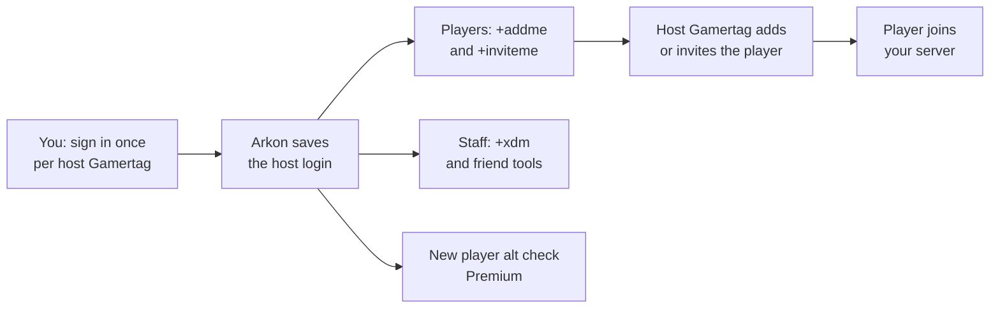

# Xbox and Microsoft Store Features 🔸

Arkon can sign in as the Xbox account that hosts your server (the "host Gamertag") and use it to add friends, send game invites and send Xbox messages for you. It can also warn you when a brand new player looks like a fake alt account.

> 🔸 These features are only for self-hosted **Ark: Survival Evolved (ASE)** servers on the Microsoft Store version that players join through a host Gamertag. Ark: Survival Ascended (ASA) and Steam players never use them.
{.is-info}

**You need:**

- A server already connected to Arkon: [Getting Started](/guides/getting-started) and [Server Settings](/guides/server-settings).
- Admin rights in Discord (Administrator or Manage Server). "Admin" and "Mod" are Arkon roles, set up in [Getting Started](/guides/getting-started).
- The email and password of each host Gamertag account.
- Players who have linked their Xbox account with `+register`: [Player Registration](/guides/player-registration).
- [Premium](/guides/premium) for auto-friend and alt detection only. Everything else is free.

## The big picture

## Step 1: Sign in each host Gamertag

You do this once per server. It lets Arkon act as that host account. Arkon stores a login token, not the password.

1. In a Discord channel the bot can see, type `+xsapi authenticate` and send it. (Short form: `+xsapi auth`.) Example: `+xsapi authenticate`
2. A menu called **Select a Server** appears. Pick the server whose host Gamertag you are about to sign in.

3. A gold message appears with two buttons. Click **Sign In**. A Microsoft page opens in your browser.

4. Sign in with the **host Gamertag's** email and password, for example `survivorsamhost@outlook.com`. Use the account that matches the server you picked.

> Arkon does not check that the account matches the server you picked. Whatever account you sign in as becomes that server's host Gamertag.
{.is-warning}

5. After you sign in you land on a blank page or a "localhost" error. This is normal and expected.
6. Click the address bar of your browser and copy **everything** in it.
7. Go back to Discord and click **Enter Code**. A popup opens.

8. Paste what you copied into the box and submit.
9. **Check it worked:** the message changes to `Tokens for `SurvivorSamHost` have been authorized for `The Island My Cluster``. Repeat for every host Gamertag.

> Only the person who ran the command can use the buttons. You have 2 minutes to pick a server and 10 minutes to paste the code. Codes only work once, so if it fails, start again with `+xsapi authenticate`.
{.is-info}

### Optional: allow game invites

Only needed if players should use `+inviteme`. Do this after Step 1 for each host.

1. Type `+xsapi inviteauth`.
2. Pick the server from the menu (only servers already signed in are listed).
3. Click **Sign In** and sign in as the **same** host Gamertag. Use Chrome or Edge. Firefox may show only a `login.live.com ... res=success` page and fail.
4. Copy the full `ms-xal-000000004c12ae6f://auth/...` address, or copy the whole "Failed to launch ..." message the browser shows.
5. Click **Enter Code**, paste it and submit.
6. **Check it worked:** Arkon says `Invite tokens authorized for **SurvivorSamHost** (XUID: ...)` and then `SurvivorSamHost can now send game invites for The Island My Cluster`.

If you sign in as a different account, Arkon says "You signed in as **{gamertag}**, which is not this server's host gamertag. Nothing was saved."

## What players can do

### Add yourself as a friend: `+addme`

**Who:** Everyone (registered Xbox players). **Syntax:** `+addme`

1. The player types `+addme` in any channel the bot can see.
2. They pick a server from the menu.
3. The host Gamertag of that server sends them a friend add.

**Check it worked:** a green **Success!** message says "You have been added as a friend by ..." and the host Gamertag appears on the player's Xbox friends list or requests.

If the player has not registered, Arkon says "You need to register first, type `+register` to register". Steam and ASA accounts are refused. Xbox decides whether the player must accept the request on their Xbox. If Xbox refuses, Arkon shows Xbox's reason.

### Get a game invite: `+inviteme`

**Who:** Everyone (registered Xbox players). One use per 60 seconds. **Syntax:** `+inviteme`

The host Gamertag sends an invite straight to the player's Xbox. They accept the notification to join. Only servers with the optional invite sign-in done are listed. If the server is not joinable, Arkon says it "isn't joinable right now". If nothing arrives, the player's Xbox privacy settings may block invites from people they have not added: add the host as a friend and try again.

## What staff can do

| Command | Who | What it does | Example |
|---|---|---|---|
| `+addplayer <player>` | Admin (Manage Server) | Makes a host add a player as a friend. | `+addplayer SurvivorSam` |
| `+removeplayer <xuid>` | Admin (Manage Server) | Removes one player from one host's friends. Needs the 16 digit Xbox ID. Repeat per host. | `+removeplayer 2535400000000000` |
| `+xdm <player> <message>` | Mod | Sends an Xbox message from the host of the player's last server. Max 500 characters. One use per 10 seconds. Also works as /xdm. | `+xdm RexRider Join the event tonight` |
| `+susrating <player>` | Mod (Manage Messages) | Shows how suspicious a Gamertag or Xbox ID looks. | `+susrating NewPlayer123` |

`+xdm` first asks you to confirm.

Click **Yes** to send, **No** to cancel. Only you can click, and you have 60 seconds. On **Yes** the prompt turns green and says which Gamertag sent the message to which player. The player needs a recorded last server (Arkon records it when it sees them online) and that server must be signed in. The 10 second wait applies to your whole Discord server, not just you.

If you have set a mod log channel (Red's built-in moderation log), Arkon posts an **Xbox DM Sent** entry there with the moderator, player, server and message.

The `+playerstats` screen has an **Xbox DM** button for mods. It only shows when the player has a 16 digit Xbox ID and a recorded last server. It opens a popup for your message, then logs the message in your event log and mod log. If you warn a player with no Discord account (see [Moderation](/guides/moderation)), Arkon sends the warning as an Xbox message instead.

## Host Gamertag tools (Admin)

All `+xsapi` commands need Admin. Type `+xsapi` alone to list them. For commands that take `<cluster> <server>`, give one cluster name and one map name; `all` is not allowed.

| Command | What it does | Example |
|---|---|---|
| `+xsapi view` | Shows your Xbox settings: auto-friend on or off and unfriend days, plus alt detection on or off, minimum score, auto-ban, alert channel and whitelisted clusters. | `+xsapi view` |
| `+xsapi viewhosts` | Lists each host and its friend count, grouped by cluster. Xbox allows 1000 friends per account, so use this to see which host is nearly full. Shows `No Auth!` if a host is not signed in. | `+xsapi viewhosts` |
| `+xsapi friendrequests <cluster> <server>` | Sends a file of requests the host received but has not accepted. | `+xsapi friendrequests "My Cluster" "The Island"` |
| `+xsapi friendinvites <cluster> <server>` | Sends a file of requests the host sent that are still waiting. | `+xsapi friendinvites "My Cluster" "The Island"` |
| `+xsapi cleanfriends <cluster> <server> [days]` | Removes friends who were not seen on this server within `days` days (default 30, minimum 1). | `+xsapi cleanfriends "My Cluster" "The Island" 14` |
| `+xsapi dumpfriends <xuid>` | Shows which of a player's Xbox friends are in your player database, with banned ones marked. Fails if their friends list is private. | `+xsapi dumpfriends 2535400000000000` |
| `+xsapi gettokens <cluster> <server>` | Posts that host's login tokens as a file. | `+xsapi gettokens "My Cluster" "The Island"` |

> `+xsapi cleanfriends` runs at once with no confirmation. It removes everyone not seen on **this** server, even if they play another map in your cluster, and even friends who are not in your player database. Arkon then shows the list of who it removed. Think before you press enter.
{.is-danger}

> `+xsapi gettokens` posts login tokens in the channel. Run it only in a private admin channel and delete the file afterwards.
{.is-danger}

## Auto-friend (Premium)

Premium only. Off by default.

| Setting | What it does | Default | Command |
|---|---|---|---|
| Auto-friend | Turns the system on or off. | Off | `+xsapi autofriend toggle` |
| Unfriend days | A number of days that is saved and shown in `+xsapi view`. Arkon does not use it to unfriend anyone by itself, so use `+xsapi cleanfriends` to trim old friends. | 30 | `+xsapi autofriend unfriendtime <days>` |

Example: `+xsapi autofriend unfriendtime 45`. Short form of the group is `+xsapi smartmanage`.

When auto-friend is on, every host Gamertag unfriends a registered Xbox player who leaves your Discord. Arkon posts a purple message in your event log (set with `+arkset eventlog`) saying who left and listing each host with a check mark if it unfriended them or a cross if it failed. For adding players, use `+addme`. To trim old friends yourself, use `+xsapi cleanfriends`. Arkon also has a web tool for friend handling at https://autofriend.arkonbot.com.

## Alt detection (Premium)

Alt detection checks each brand new Xbox player and gives a score from 0 to 100. Higher means more suspicious. At or above your limit (the "threshold"), Arkon posts an alert.

Each point is added like this (the follower, following and gamerscore values shrink as the number grows, and are approximate):

| Sign | Points |
|---|---|
| Gamerscore 0 | about 40 (about 28 at 100, 6 at 500, 1 at 1000, 0 above) |
| 0 followers | 15 |
| Following 0 people | 15 |
| Private friends list | 11 |
| Silver account | 8 |
| No tenure level | 5 |
| No bio | 3 |
| No display name | 3 |

### Set it up

1. Pick a channel for alerts: `+xsapi altdetection channel #alt-alerts`. If you skip it, alerts go to your event log.
2. Choose your limit: `+xsapi altdetection threshold 50` (default 50, minimum 1, scores never go above 100).
3. Turn it on: `+xsapi altdetection toggle`.
4. Optional, to ban automatically: `+xsapi altdetection autoban`.
5. Optional, to protect a cluster from bans: `+xsapi altdetection whitelist My Cluster` (run again to remove it).
6. **Check it worked:** run `+xsapi view` and confirm Alt Detection shows Enabled.

Auto-ban only hits Silver accounts. Gold accounts are alerted but never banned. Whitelisted clusters get alerts but no bans. The ban reason is "Alt Detection Auto-Ban". The alert is titled **Suspicous Account Detected** (the spelling is the bot's own). It shows the Gamertag, Xbox ID, gamerscore, account type, followers, following, the score and the reasons, and whether the player was auto-banned. If a ban fails, the alert says to ban the player yourself. Arkon checks players when it first sees them on a server, and only when the host for that server is signed in. The short form of the group is `+xsapi alt`.

## Commands

| Command | Who | Premium |
|---|---|---|
| `+xsapi`, `view`, `authenticate`, `inviteauth`, `viewhosts`, `gettokens`, `friendrequests`, `friendinvites`, `cleanfriends`, `dumpfriends` | Admin | No |
| `+xsapi autofriend`, `toggle`, `unfriendtime` | Admin | Yes |
| `+xsapi altdetection`, `toggle`, `autoban`, `channel`, `threshold`, `whitelist` | Admin | Yes |
| `+addplayer`, `+removeplayer` | Admin (Manage Server) | No |
| `+xdm`, `+susrating` | Mod | No |
| `+addme`, `+inviteme` | Everyone | No |

## Checklist

Premium servers see an **Xbox / Crossplay** section in `+checklist` with rows for Auto-Friend, Alt Detection and Alt Log Channel. Each row shows what is on and the command to fix what is off. Free servers see these rows with a lock. See [Getting Started](/guides/getting-started).

## Common problems

| Problem | Why it happens | Fix |
|---|---|---|
| `Server has not been authorized by the xbox API!` or `This server hasn't been authenticated with Microsoft XSAPI!` | The host was never signed in. | Run `+xsapi authenticate` for it. |
| `Authorization failed. The code may have expired or already been used. Please try again.` | The pasted code is old or was used. | Start again and paste right away. |
| `Authorization timeout.` | You waited over 10 minutes. | Run the command again. |
| `Failed to refresh tokens for ...` | The host sign-in expired or was revoked. | Sign in again with `+xsapi authenticate`. |
| `Client ID and Secret are not set by the bot owner!` or `Bot owner has not set any master tokens!` | The bot owner setup is missing. | Only the bot owner can fix it. Ask them. |
| `This feature requires your server owner to have an Arkon Premium subscription!` | The command is Premium. | See [Premium](/guides/premium). |
| `Xbox IDs are 16 digits long!` | The ID you typed is the wrong length. | Use the 16 digit Xbox ID. |
| "This player's ID apears to be for steam or ASA..." | The player is not on Xbox. | These tools are ASE Xbox and Microsoft Store only. |
| `Failed to initialize database. Bot developer has been notified.` | Arkon's database is down. | Wait a few minutes and try again. |
| `There are no servers to select!` | No server has the sign-in the command needs. | Run `+xsapi authenticate` (or `+xsapi inviteauth` for invites) first. |
| `This isn't your menu!` | Someone else clicked your buttons. | Run the command yourself. |
| `No rating found for that player!` | Score is 0 or not found. | Nothing to fix. |

## Related pages

- [Getting Started](/guides/getting-started)
- [Server Settings](/guides/server-settings)
- [Player Registration](/guides/player-registration)
- [Moderation](/guides/moderation)
- [Premium](/guides/premium)
- [FAQ](/guides/faq)
