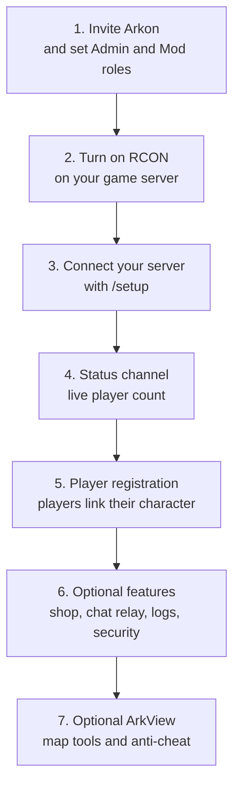

# Arkon: The All-in-One Ark Discord Bot

Arkon is a Discord bot that connects to your Ark: Survival Evolved (ASE) and Ark: Survival Ascended (ASA) game servers. From Discord you can run server commands, show live player counts, relay chat, run an in-game shop and keep cheaters out, with a free tier and a Premium tier.

> Arkon works with both ASE and ASA. However, **ASE on Nitrado is NOT supported**.
{.is-warning}

## Quick links

- [Invite Arkon](https://discord.com/api/oauth2/authorize?client_id=857070505294430218&permissions=433188236503&scope=applications.commands%20bot) - add the bot to your Discord server 🦖
- [Discord Support Server](https://discord.gg/RaR3wR4MgY) - get help or request features
- [Arkon Premium](https://upgrade.chat/arkon) - unlock Premium features (see [Free vs Premium](/guides/premium))

---

## Pick your path

Choose the row that sounds like you. Each link is the first page to open.

| I am a... | What I want | Start here |
|-----------|-------------|------------|
| **Server owner** | Add Arkon and connect my Ark server | [Getting Started](/guides/getting-started) |
| **Moderator** | Ban people, watch for cheaters, run commands | [Moderation](/guides/moderation) |
| **Player** | Link my character, earn and spend currency | [Player Guide](/guides/player-getting-started) |

Stuck on a word like "RCON" or "cluster"? Open the [Glossary](/guides/glossary). Something broken? Open the [FAQ and Troubleshooting](/guides/faq).

---

## Setup roadmap

Do the steps in this order. Everything after step 3 is optional, so add only what you want.

1. [Getting Started](/guides/getting-started): invite the bot and set your Admin and Mod roles.
2. [Turn On RCON](/guides/rcon-setup): RCON is the remote-control connection Arkon uses to talk to your server. Find your RCON IP, port and password.
3. [Getting Started](/guides/getting-started): connect your first server.
4. [Status Channel](/guides/status-channel): show your servers live in Discord.
5. [Player Registration](/guides/player-registration): let players link their Discord account to their character.
6. Pick any feature from the map below.
7. [ArkView](/guides/arkview): the free plugin that unlocks the map and anti-cheat tools.

---

## Feature map

**Legend:** 🔹 = needs [ArkView](/guides/arkview) | 🔸 = Xbox / Microsoft Store ASE only

### Set up your servers

| Guide | What it does |
|-------|--------------|
| [Getting Started](/guides/getting-started) | Invite Arkon, set Admin and Mod roles, connect your first server and run the `+checklist`. Stuck on RCON details? Type `+rconhelp` for host-by-host help. |
| [Turn On RCON](/guides/rcon-setup) | Find the RCON address, port and password for your host, and fix connection errors with the built-in troubleshooting guide. |
| [Server Settings](/guides/server-settings) | Use the server menu, set up clusters and change general settings, set the alert channel and enable the in-game rename command. |
| [Status Channel](/guides/status-channel) | A live server status message and player count graphs. |
| [Playtime Roles and Welcome Messages](/guides/playtime-and-roles) | Track playtime, give roles for hours played and greet new players and share your Discord invite in game. |

### Players, shop and rewards

| Guide | What it does |
|-------|--------------|
| [Player Registration](/guides/player-registration) | Players link Discord to their in-game character with `+register`. |
| [In-Game Commands](/guides/in-game-commands) | Kits, payday rewards, the imstuck care package, player votes (day, night, dino wipe, cleanup), rename and mytames, typed in game chat. |
| [Rshop](/guides/rshop) | An automated shop where players spend currency on in-game items. |
| [Lootboxes](/guides/lootboxes) | Players pay to roll a random item that is sent into the game. |
| [Stats and Leaderboards](/guides/stats-and-leaderboards) | Player stat cards and leaderboards. |

### Chat, logs and tribes

| Guide | What it does |
|-------|--------------|
| [Chat and Logs](/guides/chat-and-logs) | Game chat in Discord, kill feed, join logs, time zone setting and who-was-online lookups. |
| [Tribe Logs](/guides/tribe-logs) | Tribe logs in Discord and private tribe log threads 🔹. |

### Staff tools

| Guide | What it does |
|-------|--------------|
| [Moderation](/guides/moderation) | Bans, temp bans, tribe warnings and notes, ban sync and the watchlist. |
| [Server Control](/guides/server-control) | Run RCON commands, schedule them, restart with countdowns, send items in bulk and see what schedules post. |
| [Security](/guides/security) | RDP dupe protection, imposter protection and a character name blacklist and a list of forbidden admin commands. |

### Map tools and anti-cheat 🔹

| Guide | What it does |
|-------|--------------|
| [ArkView Setup](/guides/arkview) | Install the free plugin that lets Arkon read your save. |
| [ArkView on Nitrado](/guides/arkview-nitrado) | Advanced setup for Nitrado ASA servers. |
| [Map Tools](/guides/map-tools) 🔹 | Hunt wild dinos, find lost tames and structures, and draw heatmaps. |
| [Anti-Cheat](/guides/anti-cheat) 🔹 | Catch tame dupes, mass breeding, foreign tames, uncryo abuse, inactive tribes and tame limit warnings. |

### Xbox and Premium

| Guide | What it does |
|-------|--------------|
| [Xbox and Microsoft Store Features](/guides/xsapi) 🔸 | Host Gamertag friends, auto-friend, alt account detection and Xbox messages (including the Xbox DM button on player stats). |
| [Free vs Premium](/guides/premium) | What every server gets free, what Premium adds, and the messages Arkon posts when limits are hit. |

### Minigames and economy

| Guide | What it does |
|-------|--------------|
| [Minigames](/guides/games) | Every game Arkon can run in your Discord and how they pay out. |
| [Server Economy](/guides/economy) | Your server's own currency: balances, payday, command costs, inactivity decay and the swear jar. |
| [Casino](/guides/game-casino) | Nine betting games with memberships, bet limits and payouts. |
| [Dino Collector](/guides/game-dinocollector) | Catch, collect, trade and sell ARK-style dinos. |
| [Fishing](/guides/game-fishing) | Catch fish, sell the catch and upgrade gear. |
| [Bird Hunting](/guides/game-hunting) | Shoot birds when they fly into a channel. |
| [Miner](/guides/game-miner) | Mine rocks together and upgrade your pickaxe. |
| [Pupper](/guides/game-pupper) | A dog that wanders into chat and hands out credits. |
| [Trivia](/guides/game-trivia) | Quiz games with dozens of built-in lists. |

### Community tools

| Guide | What it does |
|-------|--------------|
| [LevelUp](/guides/levelup) | XP and levels for chatting and voice, role rewards, profiles and leaderboards. |
| [Tickets](/guides/tickets) | Support tickets members open with a button. |
| [Idea Board](/guides/ideaboard) | A suggestion box with voting and optional anonymity. |
| [Crafter](/guides/crafter) | Look up what any ARK item costs to craft. |
| [Xbox Lookup](/guides/xbox-lookup) | Look up Xbox profiles, friends, games and screenshots. |
| [Bot Profile](/guides/bot-profile) | Give Arkon its own avatar, banner and bio in your server. |
| [More Discord Tools](/guides/extras) | Translation, contests, an AI chatbot, custom commands and Discord moderation basics. |

### Reference

| Page | What it is |
|------|------------|
| [Quick Reference](/guides/quick-reference) | One-page cheat sheet of every command by role. |
| [FAQ and Troubleshooting](/guides/faq) | Common questions and fixes. |
| [Glossary](/guides/glossary) | Plain meanings of Ark and Arkon words. |
| [Ark RCON Commands](/guides/ark-rcon-commands) | List of Ark console commands you can run from Discord. |
| [All Commands](/commands/all-commands) | Every Arkon command. |
| [Admin Commands](/commands/admin-commands) | Commands for Admins. |
| [Mod Commands](/commands/mod-commands) | Commands for Mods. |
| [Player Commands](/commands/player-commands) | Commands anyone can use. |

---

## Legal

- [Terms of Service](/legal/tos)
- [Privacy Policy](/legal/privacypolicy)
